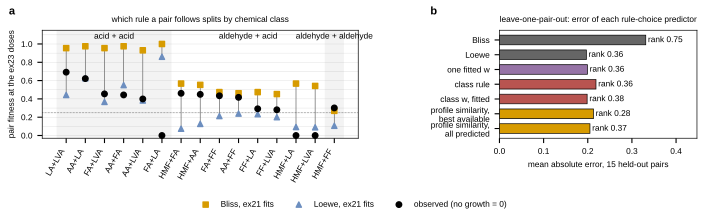

## 2026.10.10 - Which rule draws a pair's boundary, and whether anything predicts the choice

`experiments/040-inhibitor-synergy-wetlab/scripts/rule_choice.py`, reading
`results/mixture_combinations.csv`, `results/profile_similarity.csv`,
`results/isobole_boundary.csv` and `results/single_agent_fits.csv`. Served growth call
throughout. Bliss multiplies surviving fractions (independent hits); Loewe adds doses as
fractions of each compound's own dose for the same effect (a shared capacity). The
boundary of a pair is set by its two single-agent curves plus that one choice.

**Which rule is closer, pair by pair** (`results/rule_choice_pairs.csv`, absolute error
against the observed pair fitness with no growth as 0):

| class | pairs | closer to Loewe | closer to Bliss |
|---|---|---|---|
| acid + acid | 6 | 6 (AA+FA, AA+LA, AA+LVA, FA+LVA, LA+LVA, FA+LA) | 0 |
| aldehyde + acid | 8 | 4 (HMF+LA, HMF+LVA, FF+LA, FF+LVA) | 4 (HMF+AA, HMF+FA, FF+AA, FF+FA) |
| aldehyde + aldehyde | 1 | 0 | 1 (HMF+FF) |

The acid pairs all follow Loewe (Bliss predicts 0.93 to 1.00 where 0.40 to 0.69 was
observed). The aldehyde + acid pairs split by the acid, not by the class: with acetic or
formic acid the aldehyde pairs follow Bliss, with lactic or levulinic acid they follow
Loewe, and 5-HMF with lactic or levulinic acid grew in no well, which Loewe calls (0.09,
below tau 0.248) and Bliss does not (0.54 to 0.57). The three isobole grids agree with
the fixed-dose pairs they share (`results/rule_choice_grids.csv`): acetic acid with
furfural or 5-HMF follows Bliss (Jaccard of the alive region 0.73 and 0.70 against 0.29
for Loewe), acetic with formic acid follows Loewe (0.88 against 0.44).

**Leave-one-pair-out over the 15 pairs** (`results/rule_choice_lopo.csv`; the pair's
prediction is w Loewe + (1 - w) Bliss with w from the predictor fitted on the other 14):

| predictor | mean absolute error | growth accuracy | Spearman, 12 grown |
|---|---|---|---|
| Bliss (w = 0) | 0.331 | 0.800 | 0.748 |
| Loewe (w = 1) | **0.197** | 0.467 | 0.357 |
| one fitted w | 0.199 | 0.667 | 0.357 |
| class rule (same class 1, across 0) | 0.219 | 0.733 | 0.364 |
| class w, fitted | 0.199 | 0.600 | 0.385 |
| profile similarity, best available, centered Spearman | 0.213 | 0.733 | 0.280 |
| profile similarity, all predicted, centered Spearman | 0.205 | 0.667 | 0.371 |
| profile similarity, all predicted, top-100 Jaccard | 0.196 | 0.533 | 0.371 |

Nothing beats pure Loewe on error, and nothing beats pure Bliss on the growth call or on
ranking the grown pairs; the fitted predictors land between the two rules (mean w 0.78 to
0.82). The class rule is worse than Loewe because four aldehyde + acid pairs follow Loewe.
Profile similarity does not select the rule on these 15 pairs. Small sample: 15 pairs,
3 grown pairs fewer than that for the ranking, and six of fifteen pairs have at least one
compound with no measured profile.

**The class hierarchy on all 63 combinations** (`results/rule_choice_higher_orders.csv`,
Loewe within each class group and Bliss across groups, no parameter): growth AUROC 0.887
and accuracy 0.810 against Loewe's 0.958 and 0.825, worst-scenario Spearman 0.678 against
0.772; its one advantage is the smallest fitness error over the 21 grown combinations
(RMSE 0.148 against Loewe 0.208 and Bliss 0.259). It does not replace Loewe for the
growth boundary.

Left: observed pair fitness (black) against Bliss (orange squares) and Loewe (blue
triangles) from the ex21 fits, grouped by chemical class; the dotted line is tau. Right:
leave-one-pair-out mean absolute error of each rule-choice predictor, with its Spearman
over the 12 grown pairs beside the bar. The growth-call accuracy in the table above is a
majority-class readout here: 12 of 15 pairs grew, Bliss predicts growth for every pair
and scores 0.800 by missing only the three that died, Loewe calls eight grown pairs dead
and scores 0.467. Bliss's error is a level bias (too high for every acid pair) that
leaves the order of the grown pairs intact, which is why it ranks best while erring most.
