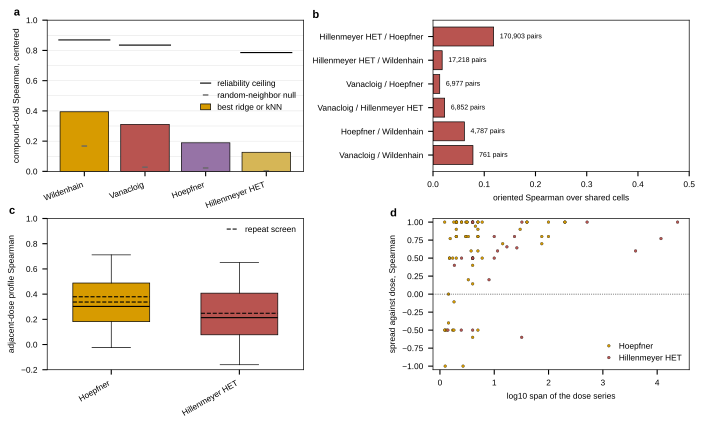

## 2026.10.11 - The comparison basis across four sources, and the dose axis

Script: `experiments/040-inhibitor-synergy-wetlab/scripts/source_axes.py`. It reads
experiment 031's per-dataset baselines and experiment 033's pooled axes by absolute path
(neither branch is landed; every path read is recorded in `results/source_axes_sources.csv`)
and measures the dose structure itself from build 002 of the pooled cell table.

### Why a per-source axis is needed at all

A joint model over four sources cannot be scored by one number, because the four do not
measure one quantity. The sources differ in ploidy (haploid against diploid), in the
perturbation (deletion, heterozygous copy number at functional dose 0.5, conditional
alleles), in the background (the Vanacloig host carries `PDR1`, `PDR3` and `SNQ2`
deletions beside the queried one; the others are BY4741 or BY4743), in the medium (YPD,
SC, SD, anaerobic synthetic hydrolysate), in the label (log2 ratio, MADL sensitivity
score, z-score) and in the assay (pooled barcode against liquid OD).

The consequence is measurable. Over the shared (gene, compound) cells of each pair of
sources, the oriented Spearman is:

| pair | shared pairs | oriented Spearman |
|---|---|---|
| Hillenmeyer HET / Hoepfner | 170,903 | 0.118 |
| Vanacloig / Wildenhain | 761 | 0.078 |
| Hoepfner / Wildenhain | 4,787 | 0.061 |
| Vanacloig / Hillenmeyer HET | 6,852 | 0.023 |
| Hillenmeyer HET / Wildenhain | 17,218 | 0.018 |
| Vanacloig / Hoepfner | 6,977 | 0.013 |

The best agreement is 0.118 on the one pair with six figures of shared cells. A model that
treats the four labels as one quantity is asserting these are high, and they are not.

### The axis: the compound-cold score as a fraction of the source's own ceiling

| source | scheme | best simple model | Spearman | ceiling | fraction |
|---|---|---|---|---|---|
| Wildenhain | 10-fold, compound grouped | kNN5 on ECFP4 counts | 0.394 | 0.869 | 0.453 |
| Vanacloig | leave one compound out | ridge on FCFP4 counts | 0.311 | 0.835 | 0.373 |
| Hoepfner | 10-fold, compound grouped | ridge on FCFP4 counts | 0.189 | none served | |
| Hillenmeyer HET | 10-fold, compound grouped | kNN1 on MACCS | 0.126 | 0.786 | 0.161 |

Every number is on the centered target, which removes the gene main effect; the raw target
is dominated by it and a model can score well there carrying no compound-specific
information. The random-neighbor null is 0.168 for Wildenhain and under 0.03 for the other
three, so Wildenhain's lead is partly its 242-gene panel, where a random training compound
is already informative.

**Two reasons not to read the four as a ranking.** The schemes differ: Vanacloig is
exhaustive leave-one-compound-out over 41 compounds, the others are 10-fold over hundreds
or thousands, and the table records which. And Hoepfner serves no uncertainty on any
record, so it has no ceiling and its 0.189 is reported alone. That is an honest gap, not an
estimate.

### Dose is a gain on a conserved profile, which is what a FiLM scale can express

Measured here over the 84 compounds served at three or more molar doses with a complete
gene-by-dose matrix (61 in Hoepfner, 23 in Hillenmeyer HET), median over compounds:

| source, arm | compounds | adjacent-dose profile Spearman | extreme-dose | spread against dose | per-gene response against dose |
|---|---|---|---|---|---|
| Hoepfner, deletion | 32 | 0.316 | 0.216 | 0.9 | 0.0 |
| Hoepfner, heterozygous | 29 | 0.261 | 0.143 | 0.7 | 0.0 |
| Hillenmeyer HET | 23 | 0.214 | 0.205 | 0.6 | 0.0 |

The reference for the first column is the repeat measurement, not zero: the same source's
profile correlation between two SCREENS at one dose is 0.379 and 0.337 for Hoepfner and
0.248 for Hillenmeyer HET (033 `within_cell_reliability.csv`). So the profile at an
adjacent dose is about as similar to a profile as a repeat of the same measurement is, and
it falls to roughly half that at the extremes of the series.

The spread grows with dose in 81 percent of the 84 compounds. The median per-gene Spearman
against dose is 0.0, which is expected and is not a null result: a profile has genes that
get sicker and genes that get more resistant as dose rises, so the median over genes of a
signed dose slope is near zero while the spread still grows.

**Reading.** In public data, raising the dose scales a largely conserved profile rather
than reordering it. A multiplicative scale on a compound token, which is what the dose FiLM
is, is the right shape for that. Hypothesis (untested): the dose FiLM hurt the wet-lab
readouts of round 1 not because the parameterization is wrong but because it was fitted
where it had almost nothing to fit, since no auxiliary dose series was ever held out and
scored. Round 3's `aux_holdout: dose` arms test it directly by holding out one served dose
of every multi-dose compound.

**a**, The best simple compound-cold baseline per source on the centered target, over
eleven molecule encoders and three model families, with that source's reliability ceiling
as the rule above the bar and the random-neighbor null as the short dash inside it.
Hoepfner has no rule because it serves no uncertainty on any record. The schemes differ by
source and are named in `results/source_basis.csv`. **b**, Oriented Spearman between each
pair of sources over the (gene, compound) cells they share, with the shared-cell count
beside each bar; the axis runs to 0.5 to make the scale of the disagreement visible.
**c**, Distribution over compounds of the profile correlation between adjacent doses of
one compound, against the dashed line of that source's correlation between two screens of
the same condition. Hoepfner carries two dashed lines because its two arms are measured
separately. **d**, Per compound, the Spearman of the per-gene spread against dose, against
the log10 span of the compound's dose series; 81 percent lie above zero.
