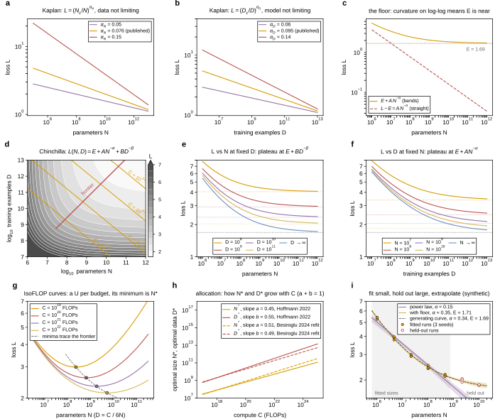
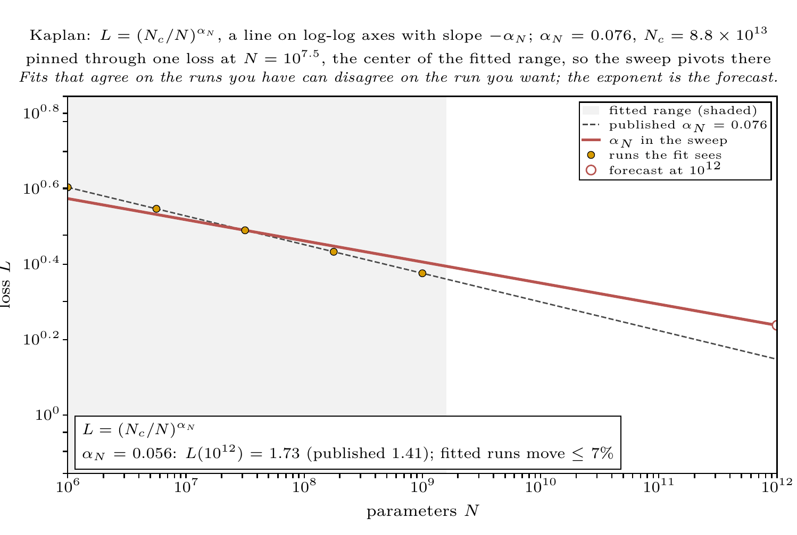
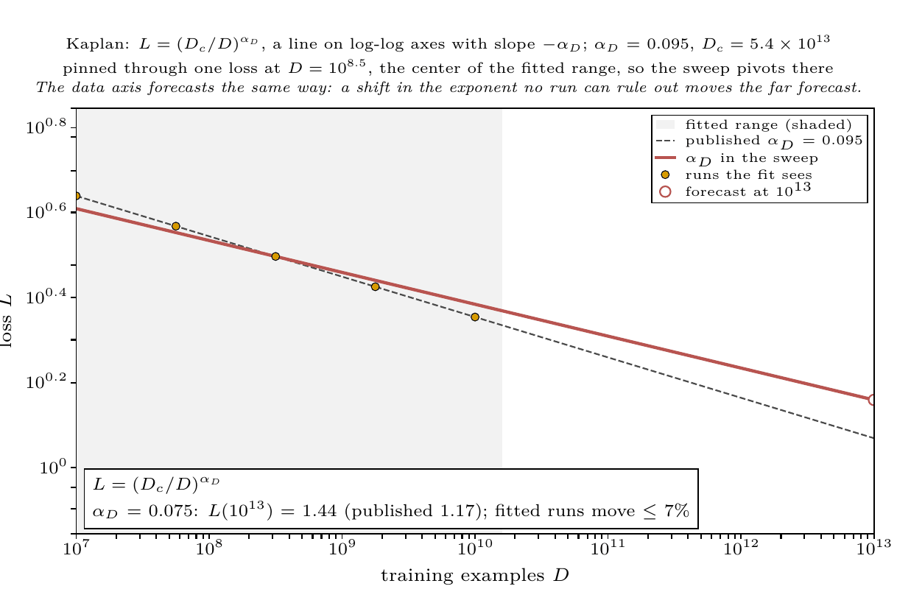
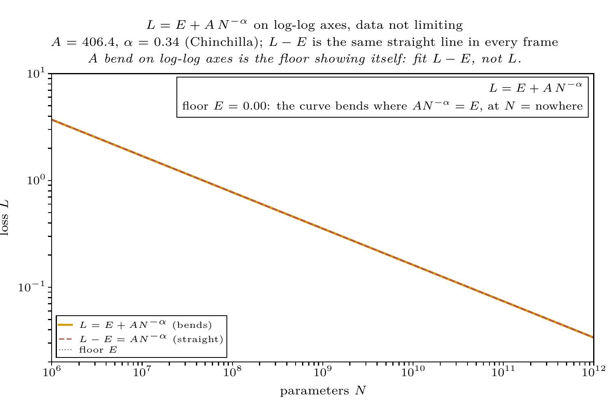
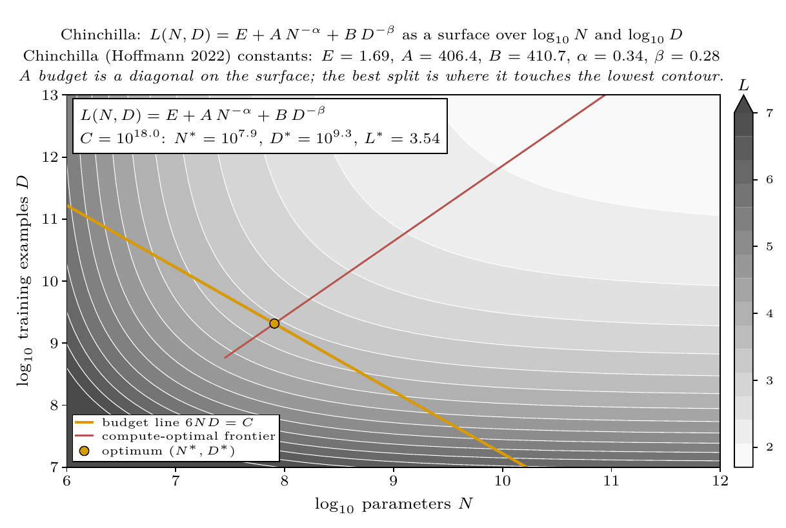
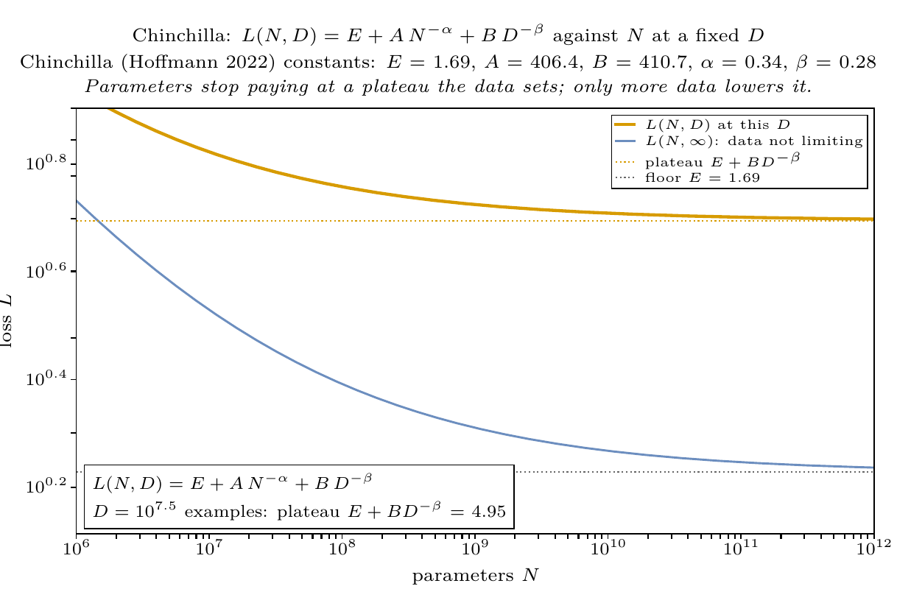
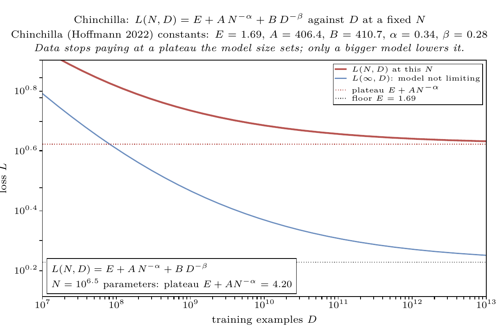
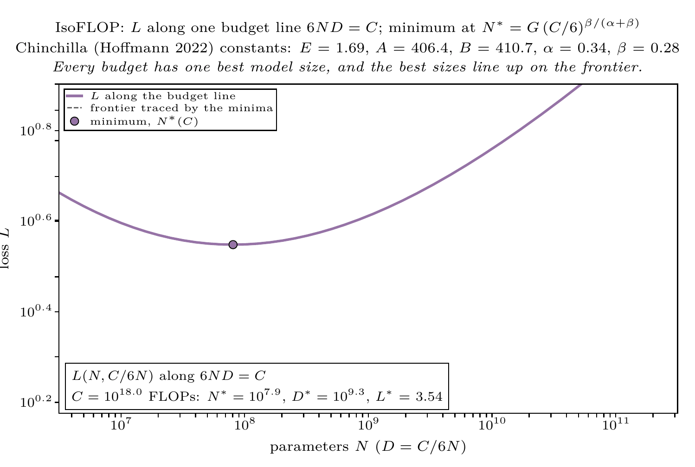
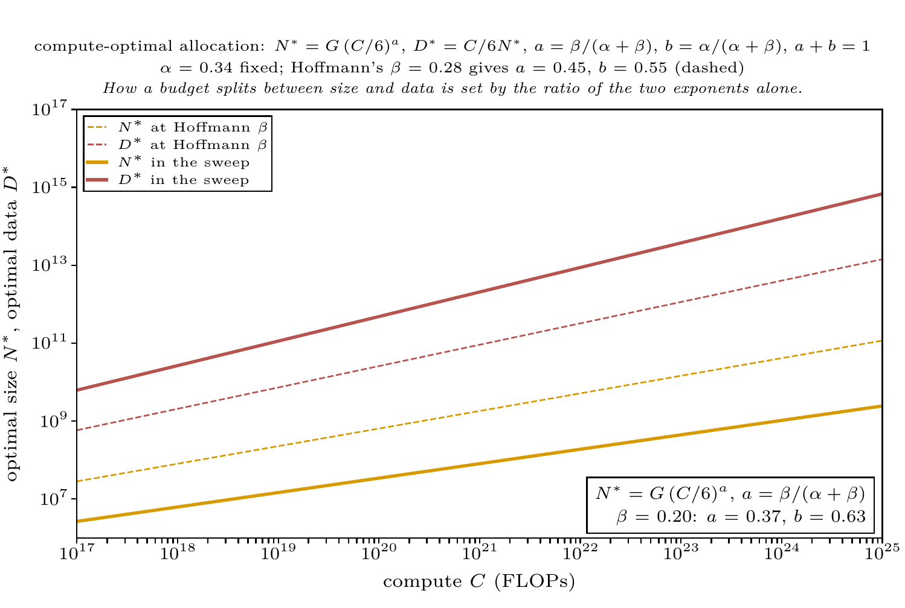
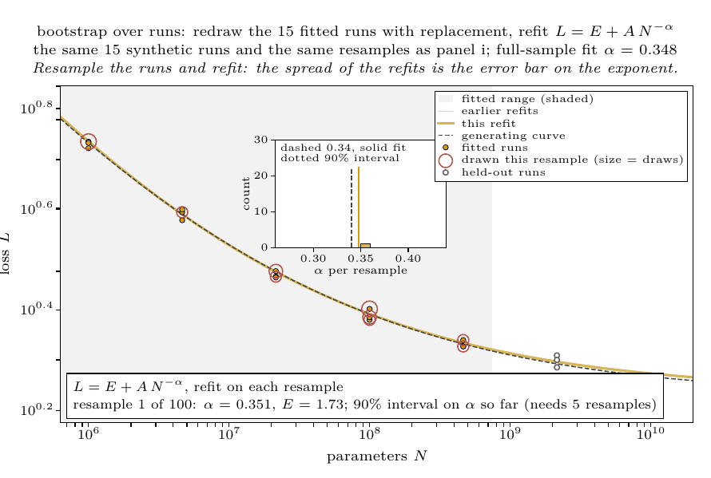

## 2026.10.09 - The two scaling-law forms, drawn to be read

Script: `experiments/041-scaling-laws/scripts/scaling_law_forms.py`. Nothing here is measured on a torchcell model; the panels draw the Kaplan 2020 (arXiv:2001.08361) and Hoffmann 2022 (arXiv:2203.15556) forms at their published constants, plus the Besiroglu 2024 refit (arXiv:2404.10102). Panel i is a synthetic fitting exercise on runs drawn from the Hoffmann form. The typeset explainer is `notes-tex/modeling/scaling-laws/` ([[scaling-laws]]), which reads this figure through `make plots` and the constants table the script writes to `tables/t1-constants.tex`.

Run from the repo root (the GIFs take a few minutes; `--no-gifs` skips them):

```bash
python experiments/041-scaling-laws/scripts/scaling_law_forms.py
```

### The equations, in brief

A scaling law is a fitted relation between a model's held-out loss $L$ and what a training run spends: the number of trainable parameters $N$, the number of training examples $D$ (tokens for a language model, records here), and the training compute $C$ in floating-point operations. Over the range a model family was trained on, the loss falls as a power of each quantity, so a line fit on log-log axes to the runs you can afford predicts the loss of a run you cannot. Two published forms carry the field, and the difference between them is a floor. The three papers behind every number below are in the mirror: @kaplanScalingLawsNeural2020, @hoffmannTrainingComputeOptimalLarge2022 and @besirogluChinchillaScalingReplication2024.

**Kaplan 2020: one axis at a time.** Kaplan et al. varied one quantity while the others were made large enough not to limit, and found a pure power law on each axis:

$$
L(N) = \left(\frac{N_c}{N}\right)^{\alpha_N}, \qquad L(D) = \left(\frac{D_c}{D}\right)^{\alpha_D}, \qquad \alpha_N \approx 0.076,\ \alpha_D \approx 0.095 .
$$

On log-log axes each is a straight line and the exponent is its slope: a decade more parameters lowers the loss by a factor $10^{-\alpha_N}$. $N_c$ and $D_c$ are fitted scale constants in units of parameters and tokens ($8.8 \times 10^{13}$ and $5.4 \times 10^{13}$ for their text corpus); they fix where the line sits and have no meaning of their own. Two conventions travel with the form. $N$ counts non-embedding parameters, because the embedding matrix scales with the vocabulary rather than with the capacity the loss responds to, and including it bends the curve at small $N$. And training compute for a transformer is

$$
C \approx 6\,N\,D \quad \text{FLOPs},
$$

about two operations per parameter per token for the forward pass and four for the backward pass. Kaplan also gave a joint form, $L(N, D) = \big[(N_c/N)^{\alpha_N/\alpha_D} + D_c/D\big]^{\alpha_D}$, which the Chinchilla form below superseded.

**Chinchilla 2022: a joint form with a floor.** Hoffmann et al. fit both axes at once and let the loss bottom out:

$$
L(N, D) = E + \frac{A}{N^{\alpha}} + \frac{B}{D^{\beta}} .
$$

In their words, the first term "captures the loss for an ideal generative process on the data distribution", the second "the fact that a perfectly trained transformer with $N$ parameters underperforms the ideal generative process", and the third "the fact that the transformer is not trained to convergence" on finite data. So $E$ is the irreducible loss, the floor reached with infinite parameters and infinite data; $A$ and $B$ are the sizes of the finite-model and finite-data penalties; and $\alpha$, $\beta$ are how fast each penalty shrinks. Their Approach 3 fit on more than 400 training runs gives $E = 1.69$, $A = 406.4$, $B = 410.7$, $\alpha = 0.34$, $\beta = 0.28$. The fit itself is nonlinear least squares in log space: minimize $\sum_i \mathrm{Huber}_\delta\big(\log \hat L(N_i, D_i) - \log L_i\big)$ with L-BFGS from a grid of starting points, because the objective has several local minima, and with a Huber residual ($\delta = 10^{-3}$) so a few bad runs do not steer the exponents. With a floor present a pure power law is wrong at the large end: on log-log axes $L$ bends toward $E$ while $L - E$ stays straight, which is the diagnostic of panel c.

**Compute-optimal allocation.** Minimizing $L(N, D)$ under the budget $C = 6ND$ gives the size and data a fixed budget should buy. Writing $D = C/6N$ and setting the derivative in $N$ to zero,

$$
N^*(C) = G\left(\frac{C}{6}\right)^{a}, \qquad D^*(C) = \frac{1}{G}\left(\frac{C}{6}\right)^{b}, \qquad G = \left(\frac{\alpha A}{\beta B}\right)^{\frac{1}{\alpha + \beta}}, \qquad a = \frac{\beta}{\alpha + \beta},\ \ b = \frac{\alpha}{\alpha + \beta},
$$

so $N^* \propto C^{a}$ and $D^* \propto C^{b}$ with $a + b = 1$. The split of a budget between size and data is set by the ratio of the two exponents and nothing else. Hoffmann et al. reached the same answer three ways, by the envelope of training curves ($a = 0.50$), by the minima of IsoFLOP curves ($a = 0.49$) and by this closed form ($a = 0.46$): parameters and data should grow in about equal proportion. Kaplan's earlier recommendation to grow the model much faster than the data came from learning-rate schedules not matched to each run's length. Two pictures follow from the form. An **IsoFLOP curve** is the loss along one budget line $6ND = C$, drawn against $N$; it is a U, and its minimum is $N^*(C)$. The **compute-optimal frontier** is the set of those minima in the $(N, D)$ plane, a straight line on log-log axes with slope $b/a$.

**The same runs, a different fit.** Besiroglu et al. reconstructed Hoffmann's data from the published figure and refit the same form, obtaining $E = 1.82$, $A = 482$, $B = 2085$, $\alpha = 0.348$, $\beta = 0.366$ and therefore $a = 0.51$. The lead authors of the original later confirmed the cause: their optimizer averaged the Huber losses rather than summing them, which stopped the fit early, and the same early stopping during bootstrapping produced the implausibly narrow confidence intervals they reported. The lesson the GIFs keep returning to is that an exponent is a fitted quantity with an interval, and that interval, not the point estimate, is what an extrapolation inherits.

**Symbols at a glance.** $L$ held-out loss; $N$ parameters (non-embedding); $D$ training examples consumed; $C$ compute in FLOPs, $\approx 6ND$ for a transformer; $N_c, D_c, \alpha_N, \alpha_D$ Kaplan's scale constants and exponents; $E, A, B, \alpha, \beta$ the Chinchilla floor, coefficients and exponents; $N^*, D^*$ the compute-optimal size and data for a budget; $a, b$ their growth exponents in $C$, $a + b = 1$; $G$ the prefactor of the optimum.

### Figure 1 (3 x 3)



- **a, b** Kaplan single-axis laws, one exponent published and two others; on log-log axes the exponent is the slope.
- **c** The floor: `E + A N^-alpha` bends toward `E` while `L - E` stays straight. Curvature at the large end is the sign that `E` is near.
- **d** The Chinchilla surface `L(N, D)` with iso-compute diagonals `6ND = C` and the compute-optimal frontier.
- **e, f** Cuts at fixed `D` and fixed `N`: each plateaus at the term the fixed axis leaves behind.
- **g** IsoFLOP curves, a U per budget; the minima trace the frontier.
- **h** `N*` and `D*` against `C` under two fits of the same runs (`a = 0.45` vs `0.51`).
- **i** Fit on fifteen small synthetic runs, hold out the two largest, extrapolate with bootstrap bands: the pure power law (`alpha = 0.15`) misses the held-out runs, the floored fit (`alpha = 0.35`, `E = 1.71` against a generating 0.34, 1.69) lands on them. Numbers in `experiments/041-scaling-laws/results/scaling_law_forms_summary.json`.

### GIFs, one per panel

Nine GIFs, one for each panel of the figure above and named by its letter. Each is one sweep of one quantity with everything else pinned, and each uses exactly the constants, forms and, where there are runs, the runs and random draws of its panel, so a frame of the GIF can be laid over the panel:

| panel | GIF | the panel shows | the GIF sweeps | shared between them |
|---|---|---|---|---|
| a | `a_exponent_sweep` | $L(N)$ at $\alpha_N$ = 0.05, 0.076, 0.15 | $\alpha_N$ over 0.056 to 0.096, pinned at $N = 10^{7.5}$ | Kaplan form, $N_c = 8.8 \times 10^{13}$ |
| b | `b_data_exponent_sweep` | $L(D)$ at $\alpha_D$ = 0.06, 0.095, 0.14 | $\alpha_D$ over 0.075 to 0.115, pinned at $D = 10^{8.5}$ | Kaplan form, $D_c = 5.4 \times 10^{13}$ |
| c | `c_floor_sweep` | $E + AN^{-\alpha}$ at $E$ = 1.69 beside $L - E$ | $E$ from 0 to 2.5 | $A$ = 406.4, $\alpha$ = 0.34 |
| d | `d_surface_sweep` | the surface with four budget lines and the frontier | one budget line, $C$ from $10^{18}$ to $10^{24}$ | the Chinchilla constants, the same contour levels |
| e | `e_data_sweep` | cuts at $D$ = $10^8$ to $10^{11}$ | $D$ from $10^{7.5}$ to $10^{12.5}$ | the Chinchilla constants |
| f | `f_params_sweep` | cuts at $N$ = $10^7$ to $10^{10}$ | $N$ from $10^{6.5}$ to $10^{11.5}$ | the Chinchilla constants |
| g | `g_compute_sweep` | IsoFLOP curves at $C$ = $10^{19}$ to $10^{22}$ | $C$ from $10^{18}$ to $10^{23}$ | the Chinchilla constants, $D = C/6N$ |
| h | `h_allocation_sweep` | $N^*$, $D^*$ under the Hoffmann and Besiroglu fits | $\beta$ from 0.2 to 0.4 at $\alpha$ = 0.34 | the Hoffmann allocation is the dashed reference |
| i | `i_bootstrap` | fits with a 5 to 95% band from 300 resamples | resamples 1 to 100, one per frame | the same 15 runs, the same seed, the same draw order |

The centered title is static across frames: what is drawn and what is held fixed, the constants and their source, and in italics the one-sentence takeaway of the sweep. The equation and the swept value sit inside the plot in a framed box, in a corner that stays clear for every frame of that sweep and opposite the legend; the box is pinned by its outer corner and the numbers are fixed width, so nothing slides when a value changes. Legends name every line, dotted ones included, and hold still from frame to frame. Both axes are logarithmic and both are ticked as powers of ten (10^0.2, 10^0.4, ... on the loss axis, which spans under a decade).

The frames are typeset by real LaTeX (Latin Modern, `amsmath`) rather than matplotlib's mathtext, on a Nature "wide" panel canvas (118.9 mm) with 7 pt text at 320 dpi, about 1500 pixels across, and 80 ms per frame. 190 dpi left the glyphs visibly rough and 260 was still judged soft; if a viewer cannot decode 1500 pixel frames at 80 ms the sweep plays slowly, and `GIF_DPI` in the script is the one knob to lower. A title that would overrun the canvas shrinks toward 5.5 pt until it fits, measured from the DVI. Frames are quantized to the GIF palette without dithering so glyph edges stay smooth. matplotlib's Agg backend cannot rasterize `usetex` text without `dvipng`, which GilaHyper lacks, so each frame is written through the PDF backend (which reads the DVI itself) and rasterized with `pdftoppm`. The system TeX Live also omits `type1cm.sty`, which matplotlib's `usetex` preamble loads; it is installed in the user tree at `~/texmf/tex/latex/type1cm/type1cm.sty` (built from the CTAN `type1cm.ins` on 2026.10.09). The static 3x3 figure stays in Arial mathtext per the repo figure standard.

**a, exponent sweep.** Takeaway: fits that agree on the runs you have can disagree on the run you want; the exponent is the forecast. Kaplan's $L = (N_c/N)^{\alpha_N}$ with $\alpha_N$ moving by plus or minus 0.02 about the published 0.076. Every curve is pinned through the same loss at $N = 10^{7.5}$, the center of the fitted range, which is why the sweep pivots there: the five runs the fit sees stay within a few percent of every curve, which 2% replicate noise cannot rule out, while the forecast at $N = 10^{12}$ moves by about a quarter each way.



**b, data-exponent sweep.** Takeaway: the data axis forecasts the same way; a shift in `alpha_D` no run can rule out moves the far forecast by a quarter. The twin of a on the data axis, $L = (D_c/D)^{\alpha_D}$ pinned at $D = 10^{8.5}$ with $\alpha_D$ moving by plus or minus 0.02 about the published 0.095 and the forecast read at $D = 10^{13}$.



**c, floor sweep.** Takeaway: a bend on log-log axes is the floor showing itself, so fit `L - E`, not `L`. $E$ rises from 0 to 2.5 under a fixed $A N^{-\alpha}$ in $L = E + A N^{-\alpha}$: the curve bends where $A N^{-\alpha} = E$, and $L - E$ is the same straight line in every frame.



**d, surface sweep.** Takeaway: a budget is a diagonal on the surface, and the best split is where it touches the lowest contour. The surface $L(N, D) = E + A N^{-\alpha} + B D^{-\beta}$ with one budget line $6ND = C$ sliding across it; the optimum $(N^*, D^*)$ is where the line touches its lowest contour, and the optima lie on the frontier.



**e, data sweep.** Takeaway: parameters stop paying at a plateau the data sets, and only more data lowers it. $L(N, D)$ against $N$ while $D$ rises from $10^{7.5}$ to $10^{12.5}$: the plateau $E + B D^{-\beta}$ drops toward $E$, and the $N$-curve runs into it later and later.



**f, parameter sweep.** Takeaway: data stops paying at a plateau the model size sets, and only a bigger model lowers it. $L(N, D)$ against $D$ while $N$ rises: the mirror image of e, plateau $E + A N^{-\alpha}$.



**g, compute sweep.** Takeaway: every budget has one best model size, and the best sizes line up on the frontier. The IsoFLOP curve $L(N, C/6N)$ while $C$ rises from $10^{18}$ to $10^{23}$; the minimum $N^* = G (C/6)^{a}$ moves about 0.45 decades per decade of $C$.



**h, allocation sweep.** Takeaway: how a budget splits between size and data is set by the ratio of the two exponents and nothing else. $\beta$ moves from 0.2 to 0.4 with $\alpha$ fixed at 0.34: $a = \beta/(\alpha+\beta)$ and $b = \alpha/(\alpha+\beta)$ move with it, and the $N^*$ and $D^*$ lines tilt against the Hoffmann allocation (dashed).



**i, bootstrap.** Takeaway: resample the runs and refit, and the spread of the refits is the error bar on the exponent. One resample per frame, 100 in all. The fifteen runs the fit sees (five sizes, three seeds) are fixed data; a resample is fifteen draws from them with replacement, so some runs are drawn two or three times and others not at all (ring size = times drawn). $L = E + A N^{-\alpha}$ is refit on each resample, and the refits pile up into the 5 to 95% band that panel i shows at once. The draws are panel i's own, same seed and same order, so frame $k$ is the $k$-th of the 300 resamples behind that band. The refits differ by only a few percent in loss, which a log axis hides, so an inset histogram of the resampled $\alpha$ carries the motion: it fills in, and the 90% interval in the box settles, as the resamples accumulate.



### What counts as more data

The rule that settles every case: $D$ is the number of distinct supervised targets the loss averages over. "More data" means more distinct measured targets, never more views of the same measurement. The unit is chosen once and held fixed across a sweep, because a curve whose $x$-axis changes meaning between runs is not a curve.

The simple case first. A language model's loss is per token, so $D$ is tokens. A model trained on one label per record (the trigenic build: one interaction score per genotype) has a per-record loss, so $D$ is records, and the 376,732 records are the data. Everything else is a variation on which quantity the loss averages over.

**Multi-label records.** A genotype measured on several phenotypes, say fitness, an interaction score and morphology, is one record with up to $K$ labels, and in a real build most records have only some of them observed. Count what the optimizer actually consumes: the number of observed (record, label) pairs. A record with three of ten labels observed contributes three. This matches a per-label loss (mean over observed labels) exactly, and it is the honest count under a per-record summed loss too, since a record with more labels observed carries more supervision. Two consequences. First, "more data" can mean new strains, new environments, or new phenotypes measured on strains already present; all three add observed pairs, and the curve does not care which. Second, labels have different noise floors, so each label has its own $E$; fit the scaling curve per label when the labels matter separately, and read the pooled curve as a weighted mix.

**Multi-input records.** Several inputs per record, for example a sequence embedding, an expression profile and graph features for the same genotype, are not more data. They are the dimension of a record: they change what a record is, the input width of the model (part of $N$) and the compute per record, and $D$ is unchanged. Adding a modality is a sweep over architecture or features, and it belongs on a different axis of the ablation from the $D$-sweep. The exception is when the new input is also a target: an expression profile used as a supervised output is labels, and counts as above.

**Tokens inside a record.** A gene-token model that reads a genotype as a set of six thousand tokens does not consume $D \times 6000$ tokens in the Kaplan sense. The loss is one number per record (or per observed label), so the tokens are dimension, not data. They do scale the compute per record, which is why $C$ is measured with a profiler here rather than taken as $6ND$.

**Several datasets pooled.** When records come from different screens or papers, $D$ is still the sum of observed (record, label) pairs, but the $D$-sweep has to subsample within each dataset in proportion, or the curve measures a change in composition rather than in size. Subsample by the unit that leaks, a gene or a query pair, within each dataset.

**Repetition is not data.** Epochs are a fixed training hyperparameter, not a multiplier on $D$; repeated records are worth less than fresh ones, and beyond about four epochs the return on repetition falls off quickly (Muennighoff 2023, arXiv:2305.16264). Augmented copies, resampled perturbation sets and re-weighted records are the same thing: more passes over the measurements already in hand, not more measurements.

Full argument, with the leakage measurement on the trigenic build, in section 3 of the notes-tex document.

### How to run the sweeps: showing that more data and more compute pay

Nothing below has been run. It is the recipe, written against the trigenic build of experiment 025 (376,732 records, 420 recurring query pairs, a query-pair-disjoint split already on disk), so that each sweep can be launched without a design discussion. Three sweeps, in the order that matters for a data-limited project, then one fit.

**0. Fix what is measured, once.** The quantity on the $y$-axis of every curve is the validation loss per record on one fixed evaluation set, in the units the model trains on (mean squared error on the interaction score). Not a correlation: a correlation jumps and plateaus, and a power law fit to it is a fit to the plateau's edge. The evaluation set is the disjoint-split test set, never resampled, and every subset below is a subset of the disjoint-split training set only. Record for every run: run id, $N$ (non-embedding parameters, the gene embedding table counted separately), $D$ (distinct training records), epochs, measured FLOPs, seed, the per-epoch validation loss, and the test loss of the validation-selected checkpoint.

**1. Data sweep, $L(D)$: the one to run first.** One model at the current configuration's size. Nested training subsets at fractions $1/64, 1/32, 1/16, 1/8, 1/4, 1/2, 1$, drawn by query pair from one seed so that a smaller subset removes whole screens and the subsets nest. Every run trains to convergence with early stopping on validation and the same epoch budget; three seeds at the three smallest fractions, where they are cheap, give the noise floor. Plot the test loss of the selected checkpoint against $D$ on log-log axes.

What it answers: whether the loss is still falling with $D$ at the full set. If it is, a new screen is worth more than a larger model, and the slope says by how much: a fitted $\beta$ turns "we need more data" into "a doubling of distinct records buys $2^{-\beta}$ of the reducible loss".

**2. Parameter sweep, $L(N)$.** Five sizes of the same architecture, width and depth scaled together in the current configuration's ratio, spaced evenly in $\log N$ over about two decades (for example $10^{5.5}$ to $10^{7.5}$ non-embedding parameters). Every run on the full disjoint training set, so that data is as fixed as it can be made. The learning rate is tuned per size on the smallest two and transferred, or set under $\mu$P once the parametrization is checked against the model code; a schedule not matched to run length is what misled Kaplan's allocation. Two seeds at the smallest two sizes.

What it answers: whether a bigger model still pays at the current data size, and where the plateau $E + B D^{-\beta}$ sits.

**3. Compute sweep, the IsoFLOP curves.** First measure the cost per record at each size with a profiler (`torch.utils.flop_counter.FlopCounterMode` on one training step), because $6ND$ is a transformer-over-tokens rule and the cost of a gene-token model depends on how many tokens a record carries and on the graph penalty. Call it $c_N$ FLOPs per record. Then pick three budgets $C$ spanning two decades, and at each budget train four or five sizes $N$ with the number of records seen set by the budget, $\text{records seen} = C / c_N$, realized as epochs over a subset at the fixed epoch count of sweep 1. Each budget gives a U in $N$; its minimum is $N^*(C)$, and a line through the minima on log-log axes is the frontier with slope $a$.

What it answers: how a fixed budget should be split between model size and data, which only matters once sweeps 1 and 2 have shown that the budget buys anything.

**4. The floor from the replicates, before any fit.** Under a squared loss the best possible predictor has expected error equal to the replicate variance of the measurement, so the released replicate standard deviations of the test records bound $E$ from below in the loss's own units; the replicate structure of the Kuzmin and Costanzo screens is recorded in [[torchcell.datasets.scerevisiae.costanzo2016.noise-computation]]. Compute this number first and set it beside every fitted $E$.

**5. Fit, hold out, bootstrap.** Fit the pure power law and the floored form with `fit_power_law` and `fit_floored` from this script (nonlinear least squares in log space, 27 starts; switch the residual to Huber with $\delta = 10^{-3}$ for real runs, as Hoffmann et al. do). Fit on all but the largest size of each sweep and check that the fit predicts the held-out run; that is the test, and panel i is what passing and failing look like. Bootstrap over runs for a 90% interval on every exponent, with `bootstrap_fits`. Report the interval, never the point.

**6. The figure the sweeps produce.** Three panels, $L$ against $D$, $L$ against $N$, and the IsoFLOP U's with their frontier, each with the fitted exponent and its interval, the held-out run marked, and $E$ drawn against the replicate floor. The one-sentence result the section is for: at the current data size, a doubling of distinct records lowers the reducible loss by $2^{-\beta}$ and a doubling of parameters by $2^{-\alpha}$, with intervals, so the next unit of effort goes where the larger of the two says.

**Run bookkeeping.** One W&B group per sweep, one run per (size, fraction, seed), the sweep grid in a single config file under `experiments/041-scaling-laws/conf/`, and a results CSV with the columns of step 0 that the fitting script reads, so the figure is regenerated from the CSV and never hand-assembled.
