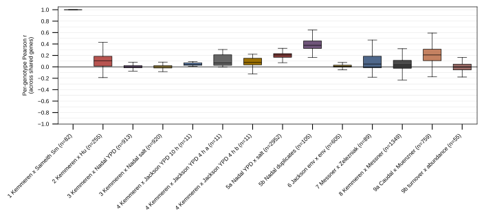
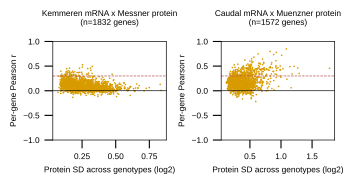
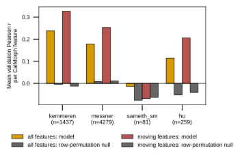
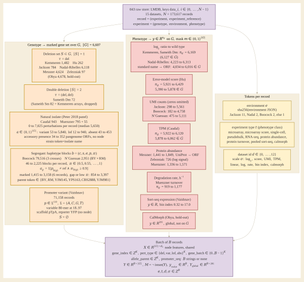
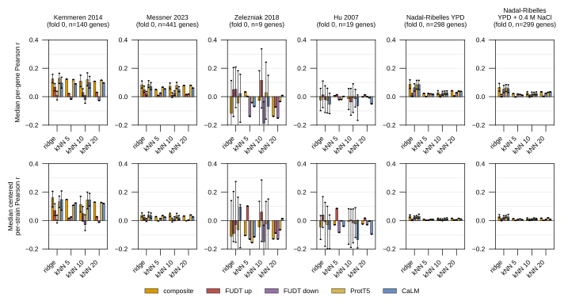
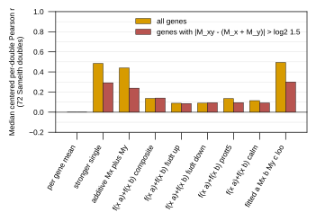
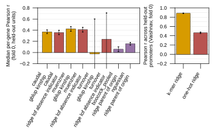
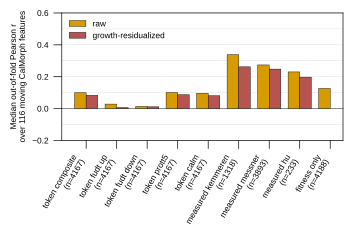

## 2026.10.19 - Design of stage 1: the raw store

Experiment 043 builds one store over every served KG 4.0 (release
`2026.10.17-4295f7ca`) dataset whose readout is a cell-state vector of expression,
protein abundance or turnover, or CalMorph morphology. Stage 1 is the query and the raw
store; nothing is trained.

### The 15 datasets

| dataset | phenotype class (recorded closure) | graph_level | gene clause | served experiments |
|---|---|---|---|---|
| MicroarrayKemmeren2014Dataset | MicroarrayExpressionPhenotype | node | all | 1,484 |
| SmMicroarraySameith2015Dataset | MicroarrayExpressionPhenotype | node | all | 82 |
| DmMicroarraySameith2015Dataset | MicroarrayExpressionPhenotype | node | all | 72 |
| MicroarrayScoreHu2007Dataset | MicroarrayExpressionScorePhenotype | node | all | 263 |
| TfDeletionPseudobulkJackson2020Dataset | SingleCellExpressionPhenotype | node | all | 784 |
| NadalRibellesPerturbSeq2025Dataset | PseudobulkExpressionPhenotype | node | all | 6,188 |
| ProteomeMessner2023Dataset | ProteinAbundancePhenotype | node | all | 4,699 |
| ProteomeZelezniak2018Dataset | ProteinAbundancePhenotype | node | all | 97 |
| ScmdOhya2005Dataset | CalMorphPhenotype | global | all | 4,718 |
| CaudalPanTranscriptome2024Dataset | RNASeqExpressionPhenotype | node | any | 943 |
| ProteomeMuenzner2024Dataset | ProteinAbundancePhenotype | node | any | 795 |
| ProteinTurnoverMuenzner2024Dataset | ProteinTurnoverPhenotype | node | any | 55 |
| Boocock2025Dataset | SingleCellExpressionPhenotype | node | none | 79,516 |
| Nguessan2025Dataset | SingleCellExpressionPhenotype | node | none | 2,951 |
| PooledPromoterExpressionVaishnav2022Dataset | PooledSortSeqExpressionPhenotype | node | none | 71,158 |

Served experiments are `n_experiments` in `database/releases/2026.10.17-4295f7ca.json`;
total 173,805. Gene clauses: `all` = every perturbation names a gene in `$gene_set` and
there is at least one; `any` = at least one does (the isolates carry accessory-ORF
absences and thousands of `sequence_variant` perturbations outside S288C); `none` = no
gene clause and an unlabeled genotype (`SegregantGenotype` for Boocock and Nguessan,
reached through `GenotypeMemberOf` because `segregant genotype` is_a `genotype` in
`biocypher/config/torchcell_schema_config.yaml`; a promoter-library reporter with no gene
for Vaishnav). Query and generator:
[[experiments.043-expression-proteome-morphology.scripts.generate_043_cql]]; registered as
the supported query `expression_proteome_morphology_043`.

### Five exclusions

- **Puddu 2019** (`genome_architecture_puddu2019`): a realized-genotype table, not a
  cell-state readout.
- **Ohnuki 2018**: shares 0 to 5 genes with any expression or proteome set.
- **Ohnuki 2022**: shares the target gene with other sets, not the strain.
- **Hackett 2020**: its induction perturbation would be read as a deletion by the
  `Perturbation` graph processor.
- **Messner 2021** (`proteome_messner2021`): no genotype perturbation.

### The raw-store rule

Owner's decision for the first query: keep the data. No converter, no deduplicator, no
genotype aggregation; one sample per served `(Experiment, ExperimentReference)` pair.
Reasons, from the reviewer's measurement and consistent with the source on main (v1.8.4):

- `MeanExperimentDeduplicator.duplicate_key` hashes `experiment_type` plus the sorted
  `systematic_gene_name` list only (`torchcell/data/mean_experiment_deduplicate.py`), so
  it ignores the environment and would average the same deletion across media (Jackson
  2020 measures 12 genotypes over 11 environment refs).
- `create_deduplicate_entry` raises `ValueError: Unsupported experiment type` for any type
  outside `_VECTOR_EXPERIMENT_TYPES` (`microarray_expression`, `rnaseq_expression`,
  `calmorph`, `metabolite`, `protein_abundance`, `visual_score`), which includes
  `pseudobulk_expression`, `pseudobulk_umi_count`, `microarray_expression_score` and
  `protein_turnover`.

How the rule is implemented (a deviation from `aggregator=None`, which does not run on
main): [[experiments.043-expression-proteome-morphology.scripts.build_043_store]].

### Shared label names

Three label names span more than one dataset, so a per-label readout sees several
sources under one name (dev census, 2026.10.19): `expression_log2_ratio` (Kemmeren,
Sameith Sm and Dm, Nadal-Ribelles), `umi_count` (Jackson, Boocock, Nguessan), and
`protein_abundance` (Messner 2023, Zelezniak, Muenzner proteome). The per-dataset label of every record is in
[[experiments.043-expression-proteome-morphology.scripts.store_census]].

### Scripts

- [[experiments.043-expression-proteome-morphology.scripts.generate_043_cql]]
- [[experiments.043-expression-proteome-morphology.scripts.build_043_store]]
- [[experiments.043-expression-proteome-morphology.scripts.gh_build_043_store]]
- [[experiments.043-expression-proteome-morphology.scripts.store_census]]

## 2026.10.19 - Stage 1 status

- Query generated, registered and validated (`validate` and `check` pass on
  `2026.10.17-4295f7ca`).
- Build job 5851 FAILED in the raw stage on the segregant genotypes (no `perturbations`
  list); nothing written. Details and traceback in
  [[experiments.043-expression-proteome-morphology.scripts.build_043_store]].
- Dev-tree census done (173,805 records); raw census waits on a successful build.

## 2026.10.19 - Stage 2: segregant fix, isolate clause, rebuild

- **torchcell fix (same PR):** a genotype with no `perturbations` list (a
  `SegregantGenotype`, by design) now counts as zero perturbed genes in
  `Neo4jQueryRaw.extract_systematic_gene_names`, `RawStageGrouping.prepare`, and the
  `Perturbation` and `DCellGraphProcessor` processors. The record is kept with empty
  `perturbation_indices` and `pert_mask` all False. Tests:
  `tests/torchcell/data/test_segregant_genotype_without_perturbations.py` (4 tests, 3 fail
  without the fix).
- **Isolate clause:** `(SIZE(perts) = 0 OR ANY(p IN perts WHERE p.systematic_gene_name IN
  $gene_set))`, so the Muenzner 2024 proteome strain with no perturbation is kept.
- **Known torchcell bug, not fixed here:** on main, `Neo4jCellDataset` with
  `aggregator=None` (and no deduplicator) copies the raw LMDB into `processed/`
  unchanged, keys `data_<i>` with one JSON object per value, while every reader expects
  keys `<i>` with a JSON list. Measured offline on a one-record LMDB: `get(0)` reads
  `None` and `compute_phenotype_info` raises `TypeError: string indices must be integers`.
  The resulting processed store cannot be opened by any reader. The 043 build works
  around it with the in-script `RecordAggregator` (one record per group).
- **Not fixed, same shape as the segregant bug:** the lazy index passes
  `compute_perturbation_count_index`, `compute_is_any_perturbed_gene_index` and
  `compute_is_any_deletion_gene_index` in `torchcell/data/neo4j_cell.py` still read
  `["genotype"]["perturbations"]` and catch exceptions per entry. Hypothesis
  (untested): they would skip segregant entries rather than raise. The 043 build does
  not run them: the folded raw-stage path writes those index files from the summaries.

## 2026.10.19 - Stage 3: two processor and index fixes; open items for the owner

Fixed in torchcell (same PR), with no re-query and no rebuild:

- **Shared label read once.** `MicroarrayExpressionPhenotype` and
  `PseudobulkExpressionPhenotype` both carry `expression_log2_ratio`. All six processors in
  `torchcell/data/graph_processor.py` that build `phenotype_types` and `stat_types` from
  `phenotype_info` now keep each name once, in order. Before the fix, the Kemmeren sample
  carried 12,338 values for 6,169 genes.
- **Segregants in the index passes.** `compute_perturbation_count_index`,
  `compute_is_any_perturbed_gene_index` and `compute_is_any_deletion_gene_index` read the
  perturbation list with `.get(...) or []`; a segregant counts 0 and names no gene. The
  index files were recomputed from the existing processed store
  ([[experiments.043-expression-proteome-morphology.scripts.reindex_043_store]]).

Build job 5856 requested 256 GB and `sstat` read a MaxRSS of 267 GB during the
aggregation and processed copies; the job was not killed.

### Open items for the owner

1. **188 records are dropped by the deletion blocks' `ALL` clause.** By dataset:
   Kemmeren 2, Hu 1, Nadal-Ribelles 70, Messner 75, Ohya 40. Each has a released gene name
   outside the 6,607-gene `SCerevisiaeGenome.gene_set`. Keeping them means the deletion
   blocks adopt the isolates' `SIZE = 0 OR ANY` shape, plus a re-query (about 6 h, from
   the 5 h 48 min raw stage of job 5855).
2. **Isolates enter the `Perturbation` processor with every `sequence_variant` gene marked
   perturbed.** The Caudal sample has 5,575 of 6,607 nodes in `pert_mask`. A rule over
   perturbation types is needed before any isolate training.
3. **`aggregator=None` on main writes an unreadable processed store.** The store keeps
   keys `data_<i>` with one object per value; `get(0)` reads `None` and
   `compute_phenotype_info` raises `TypeError`. The 043 build works around it with
   `RecordAggregator`; the bug is to be fixed separately.

## 2026.10.19 - Correlations between datasets of the same readout type

Script: [[experiments.043-expression-proteome-morphology.scripts.cross_dataset_correlation]]
(slurm job 5890 for extraction plus analysis, job 5892 for the final analysis and figures,
both from the raw LMDB and its cache; no re-query). Records are keyed by
(dataset, sorted perturbed systematic genes, environment hash). Isolates are keyed by
strain name, and Caudal and Muenzner name the same isolates.

### What each dataset reports, and what is compared

| dataset | label | released quantity | scale | used here |
|---|---|---|---|---|
| Kemmeren 2014 | expression_log2_ratio | two-channel array, deletion over wild type | log2 | as released |
| Sameith 2015 Sm | expression_log2_ratio | two-channel array, deletion over wild type | log2 | as released |
| Hu 2007 | expression_score | error-model X score vs BY4741 | signed score | as released |
| Nadal-Ribelles 2025 | expression_log2_ratio | pseudobulk log2 fold change vs wild type | log2 | as released; standard names mapped to ORFs |
| Jackson 2020 | umi_count | pseudobulk UMI counts (zeros omitted) | linear counts | log2((CPM+1)/(CPM_HO+1)) vs the HO deletion in the same environment; genes with at least 10 UMIs summed |
| Messner 2023 | protein_abundance | SWATH MaxLFQ batch-corrected | linear | log2(strain / record reference) |
| Zelezniak 2018 | protein_abundance | SWATH label-free log signal (SVA) | log | strain minus record reference |
| Muenzner 2024 proteome | protein_abundance | SWATH MaxLFQ precursor quantity | linear | log2, centered per protein over isolates |
| Muenzner 2024 turnover | degradation_rate | dynamic SILAC, per hour | linear | log2, centered per protein over isolates |
| Caudal 2024 | expression_tpm | RNA-seq TPM | linear | log2(TPM+1), centered per gene over isolates |
| Ohya 2005 | calmorph | CalMorph feature values | per feature | z per feature over shared genotypes, clipped at 8 |

Every pair compares log against log. Pearson and Spearman do not depend on the base of
the logarithm, so Zelezniak's unspecified log base does not change its pair.

### Headline: medians with IQR in brackets

| pair | n shared genotypes | n shared genes | per-genotype Pearson r, median [IQR] (n) | per-genotype Spearman rho, median [IQR] | per-gene Pearson r, median [IQR] (n genes) | fraction of genes with per-gene r > 0.3 |
|---|---|---|---|---|---|---|
| 1 Kemmeren x Sameith Sm | 82 | 6,169 | 1.000 [1.000, 1.000] (82) | 1.000 | 1.000 (6,169) | 1.000 |
| 2 Kemmeren x Hu | 255 | 5,803 | 0.107 [0.013, 0.184] (255) | 0.082 [0.000, 0.151] | 0.097 [0.023, 0.197] (5,803) | 0.102 |
| 3 Kemmeren x Nadal, YPD | 913 | 5,926 | 0.002 [-0.017, 0.022] (913) | 0.007 [-0.011, 0.027] | 0.017 [-0.010, 0.046] (5,891) | 0.007 |
| 3 Kemmeren x Nadal, YPD + 0.4 M NaCl 15 min | 920 | 5,926 | -0.001 [-0.021, 0.022] (920) | 0.005 [-0.014, 0.028] | 0.015 [-0.011, 0.043] (5,896) | 0.006 |
| 4 Kemmeren x Jackson YPD 10 h | 11 | 5,340 | 0.043 [0.026, 0.070] (11) | 0.047 [0.018, 0.058] | 0.035 [-0.217, 0.296] (5,340) | 0.247 |
| 4 Kemmeren x Jackson YPD 4 h (a) | 11 | 5,353 | 0.066 [0.027, 0.210] (11) | 0.030 [-0.006, 0.142] | 0.118 [-0.135, 0.381] (5,353) | 0.321 |
| 4 Kemmeren x Jackson YPD 4 h (b) | 11 | 5,601 | 0.076 [0.036, 0.149] (11) | 0.045 [0.026, 0.084] | 0.052 [-0.201, 0.304] (5,601) | 0.253 |
| 5a Nadal YPD x Nadal NaCl | 2,952 | 6,385 | 0.208 [0.168, 0.231] (2,952) | 0.043 [0.028, 0.059] | 0.183 [0.108, 0.223] (6,134) | 0.050 |
| 5b Nadal within-condition duplicates | 105 | 6,385 | 0.376 [0.323, 0.452] (105) | 0.178 [0.142, 0.240] | 0.062 [-0.020, 0.166] (5,897) | 0.089 |
| 6 Jackson, environment x environment per genotype | 605 genotype-environment pairs (11 genotypes, 11 environments) | per pair | 0.010 [-0.005, 0.029] (605) | 0.009 [-0.004, 0.030] | n/a | n/a |
| 7 Messner x Zelezniak | 89 | 715 | 0.049 [-0.016, 0.185] (89) | 0.050 [-0.030, 0.187] | 0.085 [-0.001, 0.176] (715) | 0.067 |
| 8 Kemmeren mRNA x Messner protein | 1,349 | 1,832 | 0.031 [-0.025, 0.112] (1,349) | 0.034 [-0.027, 0.113] | 0.094 [0.043, 0.157] (1,832) | 0.033 |
| 9a Caudal mRNA x Muenzner protein (isolates) | 759 | 1,572 | 0.208 [0.109, 0.307] (759) | 0.176 [0.085, 0.267] | 0.160 [0.084, 0.256] (1,572) | 0.183 |
| 9b Muenzner turnover x abundance (isolates) | 55 | 1,269 | -0.006 [-0.053, 0.047] (55) | -0.003 [-0.036, 0.049] | -0.007 [-0.126, 0.106] (1,120) | 0.066 |

Morphology link: ridge to CalMorph, 5-fold out-of-fold, statistic = Pearson r per
feature across held-out genotypes, then the mean and median over features. The earlier
number is the 019 `morphology_input_screen.json` (median over the 116 moving features).

| input matrix | n genotypes shared with Ohya | mean r over all 281 features | median r over all 281 | null mean r (all) | median r over the 116 moving features | earlier 019 median r over the 116 |
|---|---|---|---|---|---|---|
| Kemmeren 2014 | 1,437 | 0.238 | 0.238 | -0.005 | 0.348 | 0.345 (n=1,438) |
| Messner 2023 | 4,279 | 0.179 | 0.172 | 0.008 | 0.278 | 0.282 (n=4,314) |
| Hu 2007 | 259 | 0.114 | 0.105 | -0.052 | 0.235 | not run |
| Sameith 2015 Sm | 81 | -0.014 | -0.027 | -0.077 | -0.085 | not run |

The 116 moving-feature list is not on main. It was read from the retrospective
worktree's `results/calmorph_moving_features.json` (sha256 recorded in the json), so the
all-feature columns are the main-branch result.

Figures:







### Readings (measured unless labeled)

- **Pair 1 is not a reproducibility ceiling.** All 82 Sameith 2015 single-mutant
  profiles are value-for-value identical to Kemmeren 2014's for the same deletions. This
  also holds on the dev LMDBs: 82 of 82 vectors match exactly. Hypothesis (untested):
  Sameith 2015 re-released the Kemmeren 2014 profiles of those strains; the Sameith SI
  should say. Until then the store holds 82 duplicated profiles under two dataset names,
  and Sameith Sm adds nothing to the morphology ridge (81 genotypes, mean r -0.014 against
  a null of -0.077).
- **Array expression agrees weakly with other platforms.**
  - Kemmeren against Hu 2007 (array, X score, different growth) gives a median
    per-genotype r of 0.107 over 255 TF deletions.
  - Against Jackson 2020 single-cell pseudobulk in YPD it gives 0.043 to 0.076 over 11
    TF deletions.
  - Against Nadal-Ribelles it gives 0.002 and -0.001 over about 915 deletions per
    condition.
- **Per-gene fractions for Jackson are at chance.** The Jackson per-gene fractions above
  0.3 (0.25 to 0.32) rest on 11 genotypes. The null spread of r at n = 11 is wide (about
  0.3), so these fractions are not distinguishable from chance. That is an expectation
  from sampling theory; this run computed no permutation null.
- **Nadal-Ribelles has a low internal ceiling.**
  - Duplicate records of the same genotype and condition agree at a median Pearson of
    0.376 (Spearman 0.178, n = 105 cells).
  - The same genotype across YPD and NaCl agrees at Pearson 0.208 (Spearman 0.043,
    n = 2,952).
  - Pearson is well above Spearman, so the agreement sits in a few large values. The
    log2 fold changes reach plus or minus 28. Hypothesis (untested): these come from genes
    with near-zero counts on one side.
  - With within-dataset duplicates at 0.38, an agreement of about 0 with Kemmeren is
    within what the Nadal measurement can resolve, not evidence against a shared signal.
- **Jackson TF-deletion profiles do not repeat across environments.**
  - The median r of the HO-ratio profiles across 55 environment pairs per genotype is
    0.010 (605 pairs).
  - The matrix itself is sound: the log2 CPM level profiles of two genotypes in one
    environment correlate at 0.959.
  - The r rises with the UMI floor: 0.052 at 200 UMIs and 0.097 at 1,000 (a diagnostic run
    on the cache, not in the json).
  - Hypothesis (untested): count noise in pseudobulk of about 6 records per cell
    dominates the ratio.
- **Protein against protein (Messner x Zelezniak), same lab:** 0.049 median per-genotype
  r over 89 kinase deletions and 715 proteins.
- **mRNA against protein.**
  - Deletion strains (Kemmeren x Messner) correlate at 0.031 per genotype (1,349
    deletions) and 0.094 per gene (1,832 genes).
  - Natural isolates (Caudal x Muenzner) correlate at 0.208 per isolate (759) and 0.160
    per gene (1,572).
  - The isolates vary far more across strains, as the protein SD axis of the scatter
    figure shows. Hypothesis (untested): that larger range is why mRNA and protein agree
    more there.
  - Turnover against abundance is about 0 (55 isolates).
  - The 3,317 expression-by-protein genotypes of the co-location census include
    Nadal-Ribelles; Kemmeren alone shares 1,349 with Messner.
- **Morphology.** Kemmeren carries the most CalMorph signal per genotype: mean r 0.238 over
  all 281 features, against Messner 0.179, Hu 0.114 and Sameith Sm -0.014. On the
  116 moving features, Kemmeren (0.348) and Messner (0.278) reproduce the 019 screen
  (0.345 and 0.282) on the raw store.
- **Boocock against N'Guessan: no comparison is possible.**
  - Shared segregant ids: 0 of 79,516 and 2,951.
  - Shared crosses: none. Boocock has crosses `3004`, `A` and `B` (BY with RM, CBS2888,
    YJM145, YJM981 and YPS163); N'Guessan has `BBQTL_BYxRM` (BY4741 x RM11-1a).
  - Both name RM as a parent, but under different strain names and as different
    segregant panels.

## 2026.10.19 - Within-dataset ceilings and the datasets primer

Script: [[experiments.043-expression-proteome-morphology.scripts.within_dataset_ceilings]]
(jobs 5893, 5895, 5896, 5898). Headlines, measured:

- **Kemmeren 2014 own cultures** (114 mutants with two cultures: 72 responsive, 42
  non-responsive): per-strain r median 0.730 (null 0.284), per-gene r median 0.612,
  ceiling 0.729 test-retest, 0.653 decomposition. Replaces the void 019 ceiling (0.775),
  which paired Kemmeren with Sameith Sm, now shown to be the same arrays.
- **Jackson 2020 construction pairs** within a condition, deletion effect vs summed HO,
  floor 100 UMIs per condition: same genotype 0.129 vs 0.095 different genotype
  (1,778 / 21,300 pairs); 0.244 vs 0.103 at floor 1,000 (660 genes). Median depth
  43,851 UMIs and 23 cells per construction.
- **Hu 2007**: no replicate released (weighted duplicate averaging before GEO); the bound
  is Kemmeren x Hu 0.107.
- **Segregants**: no segregant in two panels (best concordance 0.672 / 0.657, none at
  0.95); nearest-genotype deviation r 0.113 vs 0.070 random (p 1e-8).

Typeset for the group as `notes-tex/multimodal/043-datasets-primer/` (10 pages; tables
by [[experiments.043-expression-proteome-morphology.scripts.primer_043_tables]]),
published to Zotero `torchcell/notes-tex/multimodal/043-datasets-primer` as
`043-datasets-primer_2026-10-19-17-04-51_c41df5c6.pdf`. Its batch proposal is a
proposal, not a decision.

## 2026.10.19 - Input design: sequence, genotype and the perturbed cell graph

Design agent for the input side (one of three parallel design agents). Deliverables:

- `notes-tex/multimodal/043-datasets-primer/sections/input-design.tex` (section, `todo`;
  not yet `\input` by `043-datasets-primer.tex`, the integrator adds the line).
- [[experiments.043-expression-proteome-morphology.mermaid.input-side]], rendered to
  `notes/assets/pdf-output/experiments.043-expression-proteome-morphology.mermaid.input-side.pdf`.
- Prototype [[torchcell.models.genotype_tokens_043]] with
  `tests/torchcell/models/test_genotype_tokens_043.py` (4 passed; ruff and mypy clean on
  the module).

### What enters the model today (measured on the retrospective branch)

- The 019 expression model's gene token is a learned `nn.Embedding(6607, d)`
  (`conf/train_cgt_multitask.yaml`: `node_embeddings: []`, `learnable_embedding.enabled:
  true`); no sequence encoder is in the loop, though ProtT5, nucleotide-transformer
  windows (5,979 bp; 1,003 bp five-prime; 300 bp three-prime), FUDT, CALM, codon
  frequency and one-hot are all served per gene by `NodeEmbeddingBuilder` on main.
- The perturbation token is `p_t = h_{g(t)}`, the deleted gene's encoder state. The
  Methods' type embedding `t_tau` and magnitude term are not implemented
  (perturbation-operator document, symbols table). A variant and a deletion of the same
  gene are therefore the same input today.
- The `Perturbation` processor marks every perturbation type: Caudal 5,575 of 6,607
  nodes; a segregant is all false (the reference strain).

### The abstraction

- **Gene token** `X_i = W_f f_theta(s_i(gamma))`, reference sequence for unmarked genes,
  shared across strains, encoder run once per batch (the cost the 019 configuration was
  tuned around). A deleted gene's row stays and is marked; it is neither removed (token
  edit, one encoder pass per strain) nor zeroed (LayerNorm of a zero row is one constant
  vector, so every deleted gene would be the same token).
- **Change types** `C = {reference, deletion, variant, loss_of_function, absent, present,
  promoter}`, precedence absent > deletion > loss_of_function > variant > present >
  promoter when a gene carries several marks. Mask `m_i = 1[c_i != reference]`. Per-record
  counts from the census: deletions 1 (Sameith Dm 2); Caudal 5,047 variant, 383 LoF, 135
  absent, 84 present (off graph), 0.12 HO deletion; Vaishnav 1 promoter.
- **Variant token now** `X_i + T_var` (reference feature plus a learned change-type
  vector); **later** `W_f f_theta(variant allele) + T_var`, computable because every
  `SequenceVariantPerturbation` carries a sha256-pinned `sequence_ref`.
- **Segregants, definite assumption**: a gene is `variant` with allele parent = the
  non-reference parent when one block of that parent with posterior >= 0.9 contains the
  whole gene; straddling or gap genes stay reference. Loaders write `chrI..chrXVI`; the
  genome keys chromosomes as ints, so the gene table maps once.
- **Promoter variant**: `u_rep = W_g g_phi(p) + T_prom + X_YFP`, an extra off-graph token;
  Vaishnav trains `g_phi`. Hypothesis (untested): `g_phi` on native upstream windows
  transfers.
- **Position** `pi_i = (chromosome, midpoint / chromosome length)`, optional flag
  (`use_position`), added to the reference token. For: segregant marks are linkage
  blocks. Against: for deletions it is a fixed per-gene attribute an identity table
  already encodes.
- **Strain tokens** (parent, medium, dataset) as extra keys of the operator; the isolate
  clade is not on the graph (`NaturalIsolateDescriptor` has no clade field).
- **Operator**: unchanged form; token becomes `p_t = h_{g(t)} + T_c + A_a`. At `T = A = 0`
  it is the current operator. `M` goes from 1 to about 518 (LoF + absent) or 5,565 (every
  type) per isolate; attention scores per head per strain go from 6,607 to about
  3.3e7 (6,607 x 5,047); operator A averages (magnitude fixed in `M`), B would sum.
- **Shapes**: `X [|G|, d]`, `c [B, |G|]`, `m [B, |G|]`, `X_strain [B, |G|, d]`,
  `E [(|G|+1), d]` once per batch, `H [B, |G|, d]`, `h_pert [B, d]`,
  `z_S [B, d]`.

### The one change to make first for variants

Implement the change-type term in the perturbation token (`p_t = h_{g(t)} + T_c`, the
Methods' `t_tau`), and carry the change type on the self flag
(`delta_{i,t} e_{self,c}`). Without it the operator cannot tell "gene deleted" from "gene
carries the RM allele", and the self entry is told every mark silences its gene (Kemmeren
mean -2.42 for the deleted transcript).

### Owner decisions

1. Base token: learned identity table (today) or frozen sequence encoder (ProtT5, NT,
   FUDT; all per-gene rows on main; none used by 019; nothing measured on expression).
2. Absence and deletion: one change type or two (same physical state, different
   provenance; two lets the similarity of `T_del` and `T_abs` be measured).
3. Isolate mask: every type (`M` about 5,565) or LoF + absent (`M` about 518); cost
   scales with `M_max` of the batch.
4. Segregant gene membership: whole-gene containment (prototype) or midpoint.
5. Position: on for every class or on only when segregants enter.
6. Strain tokens: extra operator keys or added to the CLS row (keys make `M = 2` for a
   deletion plus one token, which un-degenerates the softmax and confounds comparisons).
7. Normalization at large `M`: softmax average or sigmoid sum (sigmoid gate run once,
   0.200 vs 0.210, one seed, at `M = 1`; nothing at `M >= 10`).
8. Accessory ORFs and the reporter: encode as extra tokens or report and skip (prototype
   reports and skips).

## 2026.10.19 - Output-side design: readouts, heads, tokens, losses, evaluation protocol

Design section for the group: `notes-tex/multimodal/043-datasets-primer/sections/output-design.tex`
(not yet `\input` into `043-datasets-primer.tex`; the integrator adds it). Diagram:
[[experiments.043-expression-proteome-morphology.mermaid.output-side]]. Prototype of the
heads and the loss: `torchcell/models/readout_heads_043.py` (`ExperimentTypeEmbedding`
flat or DAG-path, `PerGeneReadout` shared head over the gene's own state $H_g$ with a
per-dataset affine $a_k f([H_g ; t]) + b_k$, `GlobalScalarReadout` over $[h ; z_S ; t]$,
`MaskedTypedLoss` MSE or 19-quantile pinball on the measured entries), tested by
`tests/torchcell/models/test_readout_heads_043.py` (14 passed; ruff and mypy clean on the
module).

### Evaluation protocol

| split | held out | n | metric | bar |
|---|---|---|---|---|
| A, Kemmeren by gene | 10% of Kemmeren deletion genes; every deletion record naming one, in every deletion dataset (Kemmeren, Hu, Jackson, Nadal, Messner, Zelezniak, Ohya); isolates and segregants not held out | 148 strains, 6,169 genes | per-gene Pearson across held-out strains (mean, median over genes); per-strain Pearson across genes (median) | ceiling 0.729 test-retest, 0.653 decomposition (job 5893); reference 019 by-strain 0.180 +/- 0.006 |
| B, Sameith doubles | all 72 double deletions; the 82 constituent singles stay in training as Kemmeren records (Sameith Sm excluded outright: the same arrays) | 72 strains, 6,169 genes | per-strain Pearson vs measured; paired difference vs the additive null $M_x + M_y$ (the paper's expected value, paper.md line 39) and vs the stronger single; the same restricted to genes with $\|M_{xy} - (M_x + M_y)\| > \log_2 1.5$ | additive null (no model); ceiling 0.729 (same arrays, no double replicate released) |
| C, Muenzner isolates | a fifth of the proteome isolates, the same strains out of Caudal (759 shared) and turnover | 159 isolates, 1,540 proteins | per-protein Pearson across held-out isolates; per-isolate Pearson across proteins | no Muenzner ceiling measured; reference Caudal x Muenzner 0.208 per isolate, 0.160 per gene (job 5892); reference 019 Messner 0.085 +/- 0.008 |
| morphology probe | Ohya 2005, never trained; 5-fold over genotypes | 4,678 genotypes, 116 moving features | ridge from frozen $h$, $z_S$, mean $H$, their concatenation; out-of-fold Pearson per feature, median over the 116 | 019 trained head 0.149 +/- 0.022; sequence ridge 0.08 to 0.14; Kemmeren ridge 0.348 (1,437) and Messner 0.278 (4,279), transductive; ceiling 0.847 (116) or 0.611 (281) |

Arms: 2 x 2 of {with, without natural-genome datasets} x {with, without Vaishnav}, plus
the split-head control, the no-token ablation (the 035 `cgt_genes` analog) and the
deletion-only reference (primer batch 1). Three initializations and two split seeds per
arm. Epoch budget and window declared with the launch (019: 500 epochs, window 400 to
499); a cell is read by its escape fraction first and its window mean second; no maximum
over epochs is reported; test indices pinned to a file before training.

### Owner decisions (option, option, facts; proposal in bold)

1. Heads: **joined by readout type with per-dataset affines (six heads, 15 affines)** vs
   one head per dataset. Same-type agreement 0.002 to 0.107 (expression), 0.049
   (protein); an affine cannot change a correlation; no joint training across types has
   been scored. Split is the control arm.
2. Experiment-type token: **flat class id** vs ontology path. The served ontology is flat
   (34 leaves directly under `phenotype` in `biocypher/config/torchcell_schema_config.yaml`;
   only the two microarray classes share a parent in the pydantic schema), so a path needs
   a modeling-side grouping or the unification.
3. Token entry: **head only** (base) vs CLS row vs attended token (arm). 035 on 123
   compound-evaluations: -0.007, -0.025, +0.008 against ridge, all CIs through zero.
4. Loss: **MSE** (base) vs 19-quantile pinball (arm). 019 morphology on $z_S$: MSE 12 of
   12 escapes, pinball 8 of 10 and late; measured on morphology only.
5. Dataset weighting: **equal per dataset, agreement-weighted for Nadal and Jackson** vs
   by ceiling vs by record count (arm). Boocock 79,516 + Vaishnav 71,158 = 87% of the
   173,617 records.
6. Nadal-Ribelles sentinels: **$|\log_2 FC| > 20$ set to missing** (20.2% of cells, 028)
   vs keep.
7. Jackson target: **deletion effect vs the HO control of the same environment** vs
   absolute $\log_2(CPM+1)$ with the environment token. Construction pairs 0.129 vs 0.095
   on the effect; one genotype across environments 0.010.
8. Split A leakage: **gene held out of every deletion dataset** vs expression datasets
   only.
9. Split C: a fifth of the isolates, contingent on the input side admitting isolates.
10. Budget and window: declare at launch; 019's 500 / 400 to 499 is the precedent.

Hypothesis (untested), stated as such in the section: the affine absorbs the scale and
the dataset token the mean profile, leaving the shared head the per-gene response.

## 2026.10.19 - Data tensors and the dataset module

Scripts: [[experiments.043-expression-proteome-morphology.scripts.data_shapes_043]] (full
pass over the 173,617 raw records, slurm job 5902, 14 min 29 s; the sample mode on the
login node gives the same mins and medians for the deletion sets) and
[[experiments.043-expression-proteome-morphology.scripts.dataset_043]] (the torch
`Dataset` the owner steps through; run output recorded in its note). The diagram is
[[experiments.043-expression-proteome-morphology.mermaid.data-flow]].



### Shape table (full pass, n = records)

Label keys are the released keys; "on index" is the count on the 6,607-gene
`gene_set.json` after the two read-time maps (Messner UniProt -> ORF, Nadal-Ribelles
standard name -> ORF). Marked genes are per the dataset module's definite rules
(`isolate_marking = all_gene_level`, segregant posterior >= 0.9) and are measured on the
three records per dataset of the debugger run, not the full pass.

| dataset | records (n) | genotype class | marked genes per record (rule) | phenotype class | label key: released scale | label keys per record min / median / max | label keys on index per record, median (min to max) | environments (sha of environment JSON) |
|---|---|---|---|---|---|---|---|---|
| Kemmeren 2014 | 1,482 | Genotype | 1 (deletion) | MicroarrayExpressionPhenotype | expression_log2_ratio: log2 ratio to wild type | 6,169 / 6,169 / 6,169 | 6,127 (6,127 to 6,127) | 1 |
| Sameith 2015 Sm (dropped: the Kemmeren arrays) | 82 | Genotype | 1 (deletion) | MicroarrayExpressionPhenotype | expression_log2_ratio: log2 ratio | 6,169 / 6,169 / 6,169 | 6,127 | 1 |
| Sameith 2015 Dm | 72 | Genotype | 2 (deletion, deletion) | MicroarrayExpressionPhenotype | expression_log2_ratio: log2 ratio | 6,169 / 6,169 / 6,169 | 6,127 | 1 |
| Hu 2007 | 262 | Genotype | 1 (deletion) | MicroarrayExpressionScorePhenotype | expression_score: error-model X score, -8.35 to 8.05 | 5,921 / 6,381 / 6,429 | 5,832 (5,390 to 5,878) | 1 |
| Jackson 2020 | 784 | Genotype | 1 (deletion) | SingleCellExpressionPhenotype | umi_count: pseudobulk UMI counts, zeros omitted | 298 / 4,028 / 5,561 | 4,009 (298 to 5,501) | 11 |
| Nadal-Ribelles 2025 | 6,118 | Genotype | 1 (deletion) | PseudobulkExpressionPhenotype | expression_log2_ratio: pseudobulk log2 fc, -33.0 to 32.9 | 4,223 / 5,866 / 6,313 | 5,665 (4,034 to 6,016) | 2 |
| Caudal 2024 | 943 | Genotype + natural_isolate | 4,952 to 5,995 (variant, lof, absent; 499 under lof_absent_deletion) | RNASeqExpressionPhenotype | expression_tpm: TPM, 0 to 88,829 | 5,922 / 6,050 / 6,120 | 6,006 (5,878 to 6,062) | 1 |
| Muenzner 2024 proteome | 795 | Genotype + natural_isolate (794), Genotype with 0 perturbations (1) | 4,921 to 5,894 (variant, lof, absent) | ProteinAbundancePhenotype | protein_abundance: MaxLFQ linear, 0.09 to 181,277 | 1,336 / 1,540 / 1,571 | 1,540 (1,336 to 1,571) | 1 |
| Muenzner 2024 turnover | 55 | Genotype + natural_isolate | 5,901 to 6,012 (variant, lof, absent) | ProteinTurnoverPhenotype | degradation_rate: per hour, 0.017 to 2.44 | 919 / 1,055 / 1,177 | 1,055 (919 to 1,177) | 1 |
| Boocock 2025 | 79,516 | SegregantGenotype (3 crosses) | 1,415 to 2,320 non-reference alleles at posterior >= 0.9; 2,201 to 2,693 genes in block gaps | SingleCellExpressionPhenotype | umi_count: per-cell UMI counts, 1 to 2,301 | 182 / 962 / 4,758 | 962 (182 to 4,758) | 2 |
| N'Guessan 2025 | 2,951 | SegregantGenotype (BY4741 x RM11-1a) | 2,743 to 3,158 non-reference alleles; 697 to 1,002 in gaps | SingleCellExpressionPhenotype | umi_count: UMI counts, 1 to 12,339 | 475 / 2,592 / 5,111 | 2,591 (475 to 5,109) | 1 |
| Vaishnav 2022 | 71,158 | Genotype (variable_promoter_reporter) | 0; promoter 110 nt, variable 80-mer at 18..97, scaffold pTpA | PooledSortSeqExpressionPhenotype | expression_level: sort-seq bin index, 0.32 to 17.0 (scalar) | 1 / 1 / 1 | scalar | 1 |
| Messner 2023 | 4,624 | Genotype | 1 (deletion) | ProteinAbundancePhenotype | protein_abundance: MaxLFQ linear, 0.03 to 393,221 | 1,441 / 1,819 / 1,849 | 1,819 (1,441 to 1,849) | 1 |
| Zelezniak 2018 | 97 | Genotype | 1 (deletion) | ProteinAbundancePhenotype | protein_abundance: log signal (SVA), 1.62 to 11.19 | 726 / 726 / 726 | 726 | 1 |
| Ohya 2005 (hold-out) | 4,678 | Genotype | 1 (deletion) | CalMorphPhenotype | calmorph: 281 features, global | 281 / 281 / 281 | 0 (features, not genes) | 1 |

Total 173,617 records; the 13 training datasets hold 168,857, Ohya 4,678, Sameith Sm 82.

### What the dataset module returns

Per sample: `gene_index` (LongTensor of marked genes on the 6,607 index), `pert_type`
(one of deletion / variant / lof / absent per marked gene), `allele_parent` (parent token
per marked gene, -1 outside the segregant panels), `promoter_seq` and `scaffold`
(Vaishnav), `env_id`, `dataset_id`, `exp_type_id` (the nine phenotype classes), `y_scale`
(nine released scales), `y` (6,607 floats, NaN where unmeasured), `y_scalar` (Vaishnav),
`y_global` (Ohya's 281), `y_ref` on request. `collate_043` concatenates the marked genes
with a `gene_batch` vector and stacks `y` into `[B, 6607]` with `y_mask`. A mixed batch of
one record per dataset (15 rows) carries 21,728 marked genes, 21,713 of them from the five
isolate and segregant rows.

### Three shapes that matter for the design

1. **The isolate and segregant rows are dense.** A Caudal isolate marks 4,952 to 5,995 of
   6,607 genes (variants dominate); a segregant marks 1,415 to 3,158. A deletion row
   marks 1. The perturbation operator sees three orders of magnitude of marked-set size
   across datasets.
2. **The definite segregant rule leaves large gaps.** On the six debugger records 697 to
   2,693 genes fall between blocks (unassigned) and 157 to 704 sit under a block below
   posterior 0.9. Hypothesis (untested): Boocock's LD-pruned marker set leaves longer
   unassigned runs than N'Guessan's 41,594-SNP panel. Interpolating the parent across a
   gap, or the probabilistic marking, is the next step on this axis.
3. **Two label-key maps are read-time, not load-time.** Nadal-Ribelles keys are standard
   names (1,441 of 6,796 match the index by raw name, 6,325 after the map) and Messner
   keys are UniProt accessions (0 of 1,850 by raw name, 1,850 after); Hu carries 547 to
   551 platform spot names per record with no gene. Keys with no index position are
   counted per sample and dropped from `y`, never guessed.

Also measured: slurm job 5902 ran at MaxRSS 157 GB on a 16 GB request because the mmap'd
LMDB pages count as resident; the job was not killed.

## 2026.10.19 - Design pass: integration into the primer

The owner set the plan on 2026-10-19 and it replaces the primer's two-batch proposal:
every gene-level readout trains together (all datasets except Sameith Sm, which is
Kemmeren's arrays; Vaishnav stays in as the promoter signal), expression and proteome
readouts come off the perturbed graph (CLS, $z_S$, each gene's own node state), Ohya 2005
is evaluation only through a probe of the frozen latent, split A holds out Kemmeren
singles by gene, split B all 72 Sameith doubles against the additive null, and split C a
fifth of the Muenzner proteome isolates.

- New modules, with tests (18 passed): `torchcell/models/genotype_tokens_043.py`,
  `torchcell/models/readout_heads_043.py`; dataset module
  [[experiments.043-expression-proteome-morphology.scripts.dataset_043]] and shape pass
  [[experiments.043-expression-proteome-morphology.scripts.data_shapes_043]].
- Diagrams: [[experiments.043-expression-proteome-morphology.mermaid.data-flow]],
  [[experiments.043-expression-proteome-morphology.mermaid.input-side]],
  [[experiments.043-expression-proteome-morphology.mermaid.output-side]]; the primer's
  Makefile copies their PDFs into `figures/` scaled to 180 mm (`make diagrams`).
- Primer `notes-tex/multimodal/043-datasets-primer/` (28 pages): Sec. 5 is the plan
  (Table 11) and ends with the owner-decision checklist (Table 12, `tab:decisions`, 20
  rows: I1 to I8 input, O1 to O10 output, P1 Boocock de novo cells, P2 split A against
  split B); Sec. 6 "Data as tensors" (Fig. 5, Table 13); Secs. 7 and 8 the input and output
  designs (Figs. 6 and 7 on rotated pages). Tables by
  [[experiments.043-expression-proteome-morphology.scripts.primer_043_tables]].
- Published to Zotero `torchcell/notes-tex/multimodal/043-datasets-primer` as
  `043-datasets-primer_2026-10-19-18-13-41_09fcb3bc.pdf`.
- The output-side diagram prints at about 4.5 pt on its rotated page, below Nature's 5 pt
  floor; a redraw with fewer boxes per row would fix it if the figure moves beyond the
  primer.

## 2026.10.20 - Review pass: representation, objective, splits

Two reviews (representation; objective, splits and evaluation) were reconciled by the
driver and folded into the primer `notes-tex/multimodal/043-datasets-primer/`. These are
design decisions; the code (`genotype_tokens_043.py`, `readout_heads_043.py`,
`dataset_043.py`) follows in the next stage, and no training ran.

Representation (Sec. 7 of the primer):

- I1 composite frozen sequence token: FUDT upstream 1,003 bp and downstream 300 bp (768
  each), ProtT5-XL (1,024), CaLM (768), per-block LayerNorm and projection, summed, plus
  position. The identity table survives only as a transductive-ceiling ablation.
  Alternatives: nucleotide-transformer windows for FUDT (one yeast arm), ESM2 for ProtT5.
- I3 main: each isolate is its own reference context (979 by strain name, encoded once and
  cached; the operator carries only engineered edits). Interim arm: LoF plus absence on
  S288C ($M \approx 518$) with allele tokens on variant rows.
- I4: the five non-BY segregant parents carry Peter ids (RM `AAA`, YJM145 `AAS`, YPS163
  `ACD`, CBS2888 `ABL`, YJM981 `ADI`) that are all members of the gene-keyed allele tarball
  ([[experiments.043-expression-proteome-morphology.scripts.count_distinct_alleles]]), so
  marked genes carry the parent's real allele token.
- I5 position on for every class (chromosome embedding scaled by copy number, Fourier
  features of the relative midpoint, pangenome copy number); reference coordinates.
- I6: dataset identity only as the per-dataset bias at the head, never in the trunk.
- Vaishnav stays in the plan; the construct window goes through the same FUDT upstream
  encoder; linear evaluations (k-mer, one-hot) first; joint entry gated on Addgene 127546
  being fetched into the constructs tier.
- E1 isolate embedding plan: dedup by sequence hash; 775,856 distinct proteins and
  1,198,539 distinct CDS over 1,011 isolates (measured); about 2.7 h of ProtT5 on two
  cards (hypothesis, throughput assumed).

Objective and evaluation (Secs. 5 and 8):

- O1 one head per readout level, conditioned by the type token; per-dataset
  standardization and bias; six heads by type is the control arm.
- O2 ontology path token with a modeling-side grouping; flat id the ablation.
- O3 main: tokens read at the head (the 030 per-entry token form); arm 1: type and
  environment attended after the operator (035 form); ablation: no token.
- O4 HL-Gauss bins (K 32 over [-4, 4] z, sigma 0.75 bins) main; pinball arm; one MSE cell.
  No binned head has run here; every gain is a hypothesis.
- S1 global fold file `conf/splits/global_split_v1.json` (`GlobalSplit043`, not yet
  written); S2 rule: gain >= 0.02, 5 of 6 seeds, strain-resampled interval clear of zero;
  S3 CPU linear ladder before any GPU run; S4 centered per-strain Pearson with the 0.284
  floor; S5 joint minus alone; S6 raw and growth-residualized morphology probe; S7
  Spearman beside Pearson.
- New subsection "What the three case studies teach" (031, 035/038, 010/030) and the
  unified protocol; new Table 14 (data per model part, `t14-data-per-part.tex`).

Table 12 (decisions) now has 29 rows. Owner questions: (1) isolate as reference context vs the interim arm; (2) fetch Addgene
127546; (3) ProtT5 or ESM2 for the first isolate pass; (4) confirm parent allele tokens
for segregants; (5) headline joint arm with or without Hu, Jackson and Nadal-Ribelles; (6)
a clade-disjoint isolate split beside the random one; (7) the centered per-strain
statistic as the quoted form.

Diagrams redrawn: [[experiments.043-expression-proteome-morphology.mermaid.input-side]]
(four encoders, reference contexts, tokens at the head) and
[[experiments.043-expression-proteome-morphology.mermaid.output-side]] (heads per level,
bins; three boxes per row). Printed sizes, read from the PDF text matrices at the placed
width: output side 6.94 pt body, 4.92 pt sub- and superscripts (0.91 of the text width);
input side 5.11 pt body, 3.63 pt scripts (rotated page, height-limited). The 2026-10-19
"4.5 pt" was the unscaled rendering; the placed output figure then printed at 5.12 pt
body, 3.64 pt scripts.

Isolate count: the census counts 979 isolates by strain name (943 + 795 - 759); the shape
pass counts 794 distinct isolate descriptors in Muenzner's 795 records, 978 in all.

Primer: 34 pages, `make check` 0 errors 0 warnings; published to Zotero
`torchcell/notes-tex/multimodal/043-datasets-primer` as
`043-datasets-primer_2026-10-20-00-33-36_5a419cba.pdf` (built at commit 81400eea9).

## 2026.10.21 - Global split and linear evaluations

Owner direction 2026-10-21: run every linear evaluation first; the headline arms drop Hu 2007,
Jackson 2020 and Nadal-Ribelles 2025, so those are reported separately and the joint reference
set below is Kemmeren 2014, Messner 2023 and Zelezniak 2018; dataset weighting (none, then
uniform) is a later training question and does not enter here; the Nadal sentinel rule
(`|log2 FC| > 20` set missing) is applied.

**Fold file.** `conf/splits/global_split_v1.json` (`GlobalSplit043`, seed 0, store index sha256
`4bd3e6d4...`), written by [[make_global_split_043|experiments.043-expression-proteome-morphology.scripts.make_global_split_043]],
job 6046 (4 min). Fold-0 test units realized against the primer's expected shares: Kemmeren 140
(about 140), Messner 441 genes (about 448), Nadal-Ribelles 302 genes (about 306), Hu 19 (about 26),
Zelezniak 9 (about 10), isolates 196 with 160 Muenzner and 11 turnover (about 196, 159, 11),
Boocock 15,904 records (about 15,903), N'Guessan 590 (about 590), promoters 14,232 (about 14,232).
Jackson 2020 has no gene in fold 0 or 1 (6 of its 12 genes pinned as Sameith singles or HO, the
other 6 dealt into folds 2 to 9), so Jackson is not scored by the ladder, and under v1 cannot be
scored on split A by any arm.

**Ladder.** [[linear_evals_043|experiments.043-expression-proteome-morphology.scripts.linear_evals_043]];
extraction job 6051 (3 min 50 s), Kemmeren 6059 (5 min 45 s), Sameith doubles 6060 (32 s),
Zelezniak 6061 (20 s), Hu 6062 (50 s), Nadal-Ribelles 6063 (21 min), Messner 6064 (7 min 54 s),
isolates 6065 (1 min 32 s), segregants 6066 (1 min 1 s), Vaishnav 6067 (3 min 11 s), morphology
6068 (1 min 57 s), report 6109. All folds fitted; fold 0 reported with the 95% paired bootstrap
over held-out strains (1,000 resamples, seed 0). N0 (the training-mean profile) scores 0 by
construction on the per-gene and centered per-strain statistics, so the interval of a model's
median is its interval against N0.

Split A, fold 0, frozen token of the deleted gene (ridge with inner-fold penalty; kNN k = 10):

| dataset | test genes | ridge composite, median per-gene Pearson r [95% CI] | best single-block ridge, median per-gene Pearson r | kNN 10 composite, median per-gene Pearson r | ridge composite, median centered per-strain Pearson r [95% CI] | N0, median raw per-strain Pearson r | ridge composite, median per-gene Spearman rho |
|---|---|---|---|---|---|---|---|
| Kemmeren 2014 | 140 | 0.125 [0.097, 0.157] | ProtT5 0.129 | 0.110 | 0.161 [0.095, 0.206] | 0.514 | 0.117 |
| Messner 2023 | 441 | 0.083 [0.060, 0.111] | ProtT5 0.086 | 0.073 | 0.037 [0.025, 0.054] | 0.044 | 0.062 |
| Zelezniak 2018 | 9 | -0.117 [-0.360, 0.114] | FUDT down 0.052 | -0.027 | -0.110 [-0.414, 0.140] | 0.754 | -0.117 |
| Hu 2007 (reported separately) | 19 | -0.023 [-0.098, 0.058] | FUDT up 0.013 | -0.014 | -0.044 [-0.133, 0.035] | 0.460 | -0.019 |
| Nadal-Ribelles YPD (separately) | 298 | 0.088 [0.059, 0.119] | CaLM 0.085 | 0.028 | 0.031 [0.021, 0.040] | 0.500 | 0.057 |
| Nadal-Ribelles YPD + 0.4 M NaCl (separately) | 299 | 0.065 [0.038, 0.093] | ProtT5 0.062 | 0.025 | 0.029 [0.019, 0.042] | 0.529 | 0.045 |

Fold means over the ten folds (median per-gene Pearson r, ridge composite): Kemmeren 0.120,
Messner 0.077, Zelezniak 0.032, Hu 0.035, Nadal YPD 0.072, NaCl 0.058. Composite against ProtT5
alone is inside zero on every dataset (Kemmeren difference interval [-0.026, 0.018] on the
per-gene median); composite beats FUDT upstream and FUDT downstream alone on Kemmeren and Messner
with intervals clear of zero. The Kemmeren different-mutant raw floor is 0.284 (job 5893); the N0
raw per-strain value here, 0.514, is higher because the training mean averages 1,342 profiles.
Against the reference points: the token ridge on Kemmeren (0.125 per gene, 0.161 centered per
strain) sits below the 019 by-strain window mean 0.180 and far below the 0.729 ceiling (different
splits and statistics, references, not paired bars).

Split B, the 72 Sameith doubles (median centered per-double Pearson r; all 6,127 genes / genes
with `|M_xy - (M_x + M_y)| > log2 1.5`, median 100 per double): per-gene mean 0 / 0 by
construction; stronger single 0.484 / 0.292; `M_x + M_y` 0.440 / 0.239; fitted
`a M_strong + b M_weak + c`, leave one out, 0.494 / 0.300 (a 0.638, b 0.312, c 0.005); inductive
`f(x_a) + f(x_b)` from the single-fit ridge, composite 0.136 / 0.140, ProtT5 0.135 / 0.095. The
fitted rung beats the additive null on all genes (difference of medians 0.055, interval
[0.004, 0.101]) and is inside zero against the stronger single (single minus fitted -0.010,
[-0.050, 0.033]). Calibration slope of measured on predicted (centered, all entries): additive 0.44,
fitted 0.97.

Split C, isolates, fold 0 (median per-gene Pearson r [95% CI]; centered per-isolate Pearson r):
Caudal 188 isolates GBLUP 0.369 [0.340, 0.404], 0.443; LoF + absence ridge 0.357, 0.446. Muenzner
protein 160 isolates GBLUP 0.423 [0.381, 0.463], 0.497; indicator ridge 0.408, 0.478. Turnover,
the fold average over five folds (11 isolates per fold): GBLUP 0.137, indicator ridge 0.154
(fold 0 alone: -0.025 and 0.236 with intervals spanning -0.5 to 0.7). Kinship is identity by state
over gene-level calls (variant, loss of function, absence); the records carry no variant
positions. The random isolate fold leaves relatives in training, so these are the easy-split bars.

Split D, segregants, fold 0 (parent-of-origin marker ridge; median per-gene Pearson r [95% CI];
centered per-segregant): Boocock pooled, 79 segregants, 0.058 [0.018, 0.100], 0.026; N'Guessan,
590, 0.155 [0.133, 0.177], 0.056. Boocock's 79,123 de novo cells were not read in this pass.

Split E, Vaishnav, fold 0 (71,054 promoters with a level; 104 records carry none): k-mer (k 1 to
6) ridge Pearson r 0.884 [0.880, 0.888], Spearman 0.893; one-hot 80-mer ridge 0.464
[0.450, 0.477]. Within the 65,727-record unnamed library the k-mer ridge reads 0.893, so the
library indicator does not carry it. Sequence similarity between folds was not checked.

Morphology probe (Ohya 2005, 116 moving features, 5-fold out-of-fold ridge, median Pearson r over
features; raw on the 4,167 genotypes with a Costanzo 2016 fitness / growth-residualized):
token composite 0.100 / 0.083 (0.121 raw on all 4,678; 0.137 on the 459 genotypes whose gene is in
fold 0); ProtT5 0.101 / 0.087; CaLM 0.096 / 0.080; FUDT up 0.028 / 0.006; FUDT down 0.014 / 0.011;
measured Kemmeren 0.331 / 0.267 (1,317; 0.348 on all 1,437, reproducing job 5892); Messner
0.270 / 0.243 (3,875; 0.278 on all); Hu 0.224 / 0.198 (232; 0.231 on all 259, against 0.235 in
job 5892); fitness alone 0.132. The composite token sits below the Kemmeren ridge raw (difference
-0.231, [-0.286, -0.174]) and residualized (-0.203, [-0.262, -0.135]) on their shared genotypes,
and below fitness alone. Fitness source: the `smf_costanzo2016` dev store, the gene's mean over
its single-deletion records, the source the 019 morphology screen used.

Not run: Jackson 2020 (no held-out gene under v1); Boocock de novo cells; the isolate
change-type-weighted token sum and the `[x_a + x_b ; x_a * x_b]` doubles input (no double trains);
the frozen promoter-window ridge (needs the Addgene 127546 window).

Figures:








## 2026.10.21 - Input representation complete

Owner direction 2026-10-21: "first thing is to get everything needed for representation of all inputs" before any training. Every record of the raw store now resolves to the token inputs the model consumes, as keys, through `Raw043Dataset.__getitem__` with `Dataset043Config.representation = RepresentationConfig(route="A" | "B")`. Library [[torchcell.data.representation_043]]; store binding [[experiments.043-expression-proteome-morphology.scripts.representation_043]]; segregants [[experiments.043-expression-proteome-morphology.scripts.resolve_segregant_alleles_043]]; reporter and promoter windows [[experiments.043-expression-proteome-morphology.scripts.embed_vaishnav_reporter_043]]; verification [[experiments.043-expression-proteome-morphology.scripts.verify_representation_043]].

A sample's representation holds, per gene of the 6,607 index, the four composite key ids (FUDT upstream, FUDT downstream, ProtT5, CaLM; -1 = typed gap), the change type under the precedence rule, the allele parent, the operator mask, the position features (chromosome index, relative midpoint, chromosome copy number, gene copy number) and the extra off-graph tokens (accessory ORFs, the Vaishnav reporter). Vectors are read lazily from `alleles/<encoder>.h5`; a key with no vector raises, and a gap is never filled.

Store-wide verification, slurm job 6120 (commit `b87697a81`, 3 min 37 s, 32 workers), `results/verify_representation_043.json`. All 173,617 records resolve. Complete = no gene slot and no extra token carries a gap. Gap columns are the median genes per record with that gap in at least one encoder; marks, operator and extra tokens are median (min-max) per record; isolates under route A:

| Dataset | Class | Records | Complete | No allele | Locus gap | Short flank | Splice | Absent (A) | Seg. unassigned | Acc. w/o row | Reporter w/o window | Marks | Operator | Extra tokens |
|---|---|---:|---:|---:|---:|---:|---:|---:|---:|---:|---:|---|---|---|
| Boocock2025 | segregant | 79,516 | 0 | 274 | 66 | 39 | 1 | 0 | 2494 | 0 | 0 | 3351 (662-6001) | 3351 (662-6001) | 0 (0-0) |
| CaudalPanTranscriptome2024 | isolate | 943 | 0 | 571 | 199 | 87 | 2 | 123 | 0 | 0 | 0 | 5162 (148-5993) | 0 (0-1) | 78 (34-352) |
| DmMicroarraySameith2015 | deletion | 72 | 72 | 0 | 0 | 0 | 0 | 0 | 0 | 0 | 0 | 2 (2-2) | 2 (2-2) | 0 (0-0) |
| MicroarrayKemmeren2014 | deletion | 1,482 | 1,482 | 0 | 0 | 0 | 0 | 0 | 0 | 0 | 0 | 1 (1-1) | 1 (1-1) | 0 (0-0) |
| MicroarrayScoreHu2007 | deletion | 262 | 262 | 0 | 0 | 0 | 0 | 0 | 0 | 0 | 0 | 1 (1-1) | 1 (1-1) | 0 (0-0) |
| NadalRibellesPerturbSeq2025 | deletion | 6,118 | 6,118 | 0 | 0 | 0 | 0 | 0 | 0 | 0 | 0 | 1 (1-1) | 1 (1-1) | 0 (0-0) |
| Nguessan2025 | segregant | 2,951 | 0 | 230 | 45 | 31 | 1 | 0 | 585 | 0 | 0 | 2910 (1095-4416) | 2910 (1095-4416) | 0 (0-0) |
| PooledPromoterExpressionVaishnav2022 | promoter | 71,158 | 71,158 | 0 | 0 | 0 | 0 | 0 | 0 | 0 | 0 | 0 (0-0) | 0 (0-0) | 1 (1-1) |
| ProteinTurnoverMuenzner2024 | isolate | 55 | 0 | 571 | 207 | 85 | 2 | 126 | 0 | 0 | 0 | 5198 (4551-5747) | 0 (0-1) | 78 (49-334) |
| ProteomeMessner2023 | deletion | 4,624 | 4,624 | 0 | 0 | 0 | 0 | 0 | 0 | 0 | 0 | 1 (1-1) | 1 (1-1) | 0 (0-0) |
| ProteomeMuenzner2024 | isolate | 794 | 0 | 571 | 197 | 86 | 2 | 122 | 0 | 0 | 0 | 5127 (148-5990) | 0 (0-1) | 78 (34-352) |
| ProteomeMuenzner2024 | reference | 1 | 1 | 0 | 0 | 0 | 0 | 0 | 0 | 0 | 0 | 0 (0-0) | 0 (0-0) | 0 (0-0) |
| ProteomeZelezniak2018 | deletion | 97 | 97 | 0 | 0 | 0 | 0 | 0 | 0 | 0 | 0 | 1 (1-1) | 1 (1-1) | 0 (0-0) |
| ScmdOhya2005 | deletion | 4,678 | 4,678 | 0 | 0 | 0 | 0 | 0 | 0 | 0 | 0 | 1 (1-1) | 1 (1-1) | 0 (0-0) |
| SmMicroarraySameith2015 | deletion | 82 | 82 | 0 | 0 | 0 | 0 | 0 | 0 | 0 | 0 | 1 (1-1) | 1 (1-1) | 0 (0-0) |
| TfDeletionPseudobulkJackson2020 | deletion | 784 | 784 | 0 | 0 | 0 | 0 | 0 | 0 | 0 | 0 | 1 (1-1) | 1 (1-1) | 0 (0-0) |

Readings:

- **89,358 of 173,617 records are complete**: every deletion, reference and promoter record. No isolate or segregant record is complete, and that is the typed gaps doing their job, not a resolution failure:
  - 596 genes of the 6,607 have no allele in the 2018 release (the mitochondrial genes and SGD annotations the tarball does not carry). They show as 571 no-allele genes per isolate because the record's absence calls take precedence on the rest.
  - The assembly alignment leaves locus gaps (median 197 to 207 genes per isolate record) and short flanks (85 to 87).
  - 2,074 rows in the whole index carry a splice gap.
  - Segregants carry their unassigned genes: median 2,494 per Boocock cell and 585 per N'Guessan record.
- **Route A against route B, per isolate record.** The edit list is the route-B genes whose change type is variant or loss of function: median 5,038 for Caudal, 5,000.5 for Muenzner protein and 5,068 for Muenzner turnover. Genes whose inputs differ between the two routes: median 1,417, 1,459.5 and 1,405. Those are promoter-only differences (window keys), absences (a gap in A, the S288C row in B) and the genes outside the release. Genes whose route-A keys differ from S288C: median 5,686, 5,673 and 5,672. The route-A operator mask holds 0 or 1 genes (the HO deletion); route B holds median 5,162 (Caudal).
- **Position.** The chromosome copy number differs from 1 in 200 Caudal, 168 Muenzner protein and 45 Muenzner turnover records (aneuploid isolates). One Caudal isolate, AEC, has no reported basal ploidy, so 6,579 genes carry `PLOIDY_UNREPORTED`. Gene copy number is unreleased for about 945 genes per isolate record: the 596 genes outside the release plus the reference genes the pangenome matrix does not list.
- **Marks outside the index**: 7,323 (Caudal), 6,182 (Muenzner protein) and 415 (Muenzner turnover), median 7 per record. These are retired R64-1-1 names with no row in the R64-4-1 index (YER109C, YOR031W, YFL056C, YFL057C, YIR043C, YIL171W, ...). They are counted, never dropped from the record.
- **Segregants**: under the confident-run rule the Boocock cells carry median 3,351 marks (662 to 6,001) and N'Guessan 2,910. The cross-check against `segregant_alleles.parquet` (job 6118) shows 0 missing records and 0 mismatches in assigned, marked or unassigned counts over all 82,467 records.
- **Vectors.** None are read here. Job 6106 (isolate four-encoder pass) measures FUDT upstream at 74.6 windows per second, against an assumed 150 to 300. Job 6115 (Vaishnav windows and reporter) waits on 6106 with `afterany`.

Not done in this pass: no vector-level check (it needs 6106 and 6115 to finish); route A runs the encoder over each isolate's own token matrix, and the model code that caches one encoder pass per context does not exist yet; the segregant chromosome copy number of 1 is an assumption (the segregant genotype carries no aneuploidy descriptor).

## 2026.10.21 - Training stack and the first smoke cell

Owner direction 2026-10-21: "use the 2 GilaHyper GPUs to experiment over the query and find a decent setup we can move to the supercomputers for design grids"; Kemmeren alone is a control arm, the joint arm is the headline. Built on the input representation of the previous section:

- loss and standardization [[torchcell.losses.hl_gauss]];
- model [[torchcell.models.cell_model_043]];
- trainer, prepared store and Hydra arms [[experiments.043-expression-proteome-morphology.scripts.train_043]];
- prepare job [[experiments.043-expression-proteome-morphology.scripts.gh_train_043_prepare]] (job 6123, 3 min 8 s);
- smoke cell [[experiments.043-expression-proteome-morphology.scripts.gh_train_043_smoke]] (job 6124).

Tests: 13 for the loss, 13 for the model, 10 for the trainer end to end on synthetic h5 tables and a synthetic fold file (two optimizer steps of each loss arm on CPU, plus the record weighting and the missing-vector failure). One real-data forward and backward on CPU, with random stand-in vectors at the real widths and a batch of one N'Guessan, one Caudal, one Kemmeren and one Vaishnav record, ran without error (1.85 M trainable parameters; 40.8 s on 16 CPU threads); no real vector has been read yet because the tables are still being filled.

**Arms.** Every arm reads the same prepared store and fold file (`global_split_v1`, fold 0 test never loaded, fold 1 validation). Loss: `hlgauss` (K 32 over $[-4, 4]$ z, sigma 0.75 bin widths), `pinball` (19 quantiles), `mse`. Weighting: `equal`, `records`.

| arm | training datasets | training records | split B doubles | loss, weighting | status |
|---|---|---:|---:|---|---|
| `joint_9_hlgauss_equal` | Kemmeren, Messner, Zelezniak, Caudal, Muenzner protein, Muenzner turnover, Boocock pooled, N'Guessan, Vaishnav | 50,767 | 72 | HL-Gauss, equal | smoke, job 6124, pending on 6122 |
| `joint_9_balanced_hlgauss_equal` | as joint_9, dataset-balanced sampler | 50,767 | 72 | HL-Gauss, equal | smoke, job 6125, pending on 6122 |
| `alone_kemmeren_hlgauss_equal` | Kemmeren | 1,202 | 72 | HL-Gauss, equal | prepared, not submitted |
| `joint_9_pinball_equal` | as joint_9 | 50,767 | 72 | pinball, equal | prepared, not submitted |
| `joint_9_mse_equal` | as joint_9 | 50,767 | 72 | MSE, equal | prepared, not submitted |
| `alone_<dataset>` (8 more) | one each | per dataset | 0 | any | configs written |

Bars to beat (split A fold 0, previous section, ridge on the frozen composite token of the deleted gene): Kemmeren median per-gene Pearson r 0.125 and centered per-strain 0.161; Messner 0.083 and 0.037. Isolates: Caudal GBLUP 0.369, Muenzner protein 0.423. Segregants: N'Guessan marker ridge 0.155, Boocock pooled 0.058. Vaishnav k-mer ridge 0.884. Doubles: the measured additive null 0.440 (centered per double, all genes). These are the linear ladder's numbers on the same fold file; the model's `val/` numbers are on fold 1, so a comparison needs the fold-0 read, which the trainer never does (the test read is once, at the end of a campaign).

**Registered window**, declared before the launch in `conf/train_043_default.yaml`: the read-out is the mean over the last 20% of the run's epochs (`start_frac` 0.8, `end_frac` 1.0). For the smoke the epoch count is fixed after the first epoch by the time budget, so the window is set at that moment and printed in the `[budget]` line, before any later validation is read. Validation never selects an epoch.

**Smoke.** `gh_train_043_smoke.slurm`: `joint_9`, HL-Gauss, equal, seed 0, batch 8, one card, `--time 8:00:00`, epochs `min(50, fit)`. Submitted 2026-10-21 23:00 CDT as job 6124, `--dependency=afterany:6122`. Not started at the time of writing; the epoch time is not measured. The mark cap of 1,024 per record is a smoke-only truncation (the design has none).

W&B project:

https://wandb.ai/zhao-group/torchcell_043-expression-proteome-morphology

Decisions taken here that the design left open (each is a choice, untested):

- Segregant genes the definite rule leaves unassigned are not marks; they read the S288C state in the trunk. The alternative is an `unknown` mark.
- Batches are uniform over training records by default (`data.sampler: records`), so Vaishnav fills 84% of training records (42,694 of 50,767) and a batch of 8 carries about 1.3 gene-level records; equal weighting gives each dataset present in the batch the same loss weight. The dataset-balanced sampler (`data.sampler: balanced`: each batch slot draws a dataset uniformly, then a record within it, same batches per epoch) is the other extreme the owner asked for, and runs as the second smoke, job 6125. Sampler (batch side) and weighting (loss side) compose.
- The null key of the operator is always present (019's null sink, value zero, learned key).
- Muenzner's FY4 reference record trains as an S288C-context record with no marks.
- Trunk: width 144, 9 heads, 4 layers, graph mask on layer 1 with one relation per head (019 used width 90 and 6 layers); head dimension 16 keeps the fused attention kernels.
- The type token is the modeling-side path (expression, protein, promoter groups); the environment and dataset tokens are flat (dims 16 and 8; type 16).
- Counts never detected in a training row of Boocock or N'Guessan are not targets.

Not done: no GPU run has started (chained behind the embedding jobs); epochs per hour unmeasured; the Ohya morphology probe is not wired into the trainer; route B, the attended-token head (form c), the flat-type ablation and the six-heads-by-type control are not implemented; Boocock de novo cells are excluded (P1 open); Hu, Jackson and Nadal-Ribelles have no specs in the trainer.

## 2026.10.22 - Isolate embeddings: ambiguity codes are a typed gap

Job 6106 finished FUDT upstream for every isolate window (1,131,360 rows, 76.0 per s) and then
died in CaLM on `KeyError: 'UAM'`, a codon carrying the IUPAC code M of a heterozygous site;
resumes 6121 and 6122 died the same way, and the smokes 6124 and 6125 failed at startup on the
missing downstream vectors (357,802 of 364,360).

Rule: an input with a character outside its encoder's alphabet is the typed gap
`ambiguous_sequence` (`GapKind.AMBIGUOUS_SEQUENCE = 11` in `torchcell/data/representation_043.py`,
its own learned gap row in `cell_model_043.py`), never resolved and never embedded. The
trainer's key check is unchanged and still fails on a missing vector; the gapped slots carry no
key. Measured (job 6126): untokenizable isolate-gene rows FUDT upstream 138,408 (2.4%), FUDT
downstream 71,495 (1.2%), CaLM 1,281,220 (20.8%), ProtT5 992,159 (16.1%). FUDT and ProtT5 map
such characters to an unknown token without failing, so 111,641 upstream windows had already
been embedded through `[UNK]`; they are relabelled and unreferenced. Every ProtT5 input, S288C
included, ends in `*`, read as `<unk>`: the trained convention, kept.

New jobs: A 6127 (downstream, CaLM) with resume 6131; B 6138 (ProtT5; 6128 stopped on a padded
batch, fixed) with resume 6139; isolate verify 6135; representation rebuild 6129, 6130, 6133 and
trainer prepare 6134; smokes 6136 and 6137 (balanced), after both resumes and the prepare.
Details and the per-code counts: [[experiments.043-expression-proteome-morphology.scripts.compute_isolate_composite]].

## 2026.10.22 - Suggested datasets to add next

Owner's question: what to add to the 043 query beyond the 15 datasets, with the GFP and
position-effect studies in mind. Ranked by fit to the 043 questions (gene-level cell-state
readouts, the position term, the promoter encoder). Schedule rows refer to the
database-expansion-100 and -200 candidate tables; "in mirror" means the paper is OCR'd under
`$DATA_ROOT/torchcell-library/`.

| rank | dataset | records (approx.) | readout | genotype class | why for 043 | state |
|---|---|---|---|---|---|---|
| 1 | Wu 2017, genome-wide position effects (Biotechnol Biofuels) | 1,044 loci | RFP fluorescence, pURA3 (a pTEF1 subset) | YKO deletion + reporter cassette at the deleted locus | the direct test of the position term: one reporter, one promoter, 1,044 chromosomal positions; the first integrated-cassette genotype | in mirror (`wuGenomewideLandscapePosition2017`, no SI captured); no candidate verdict yet |
| 2 | Rafi 2024, Random Promoter DREAM Challenge (Nat Biotechnol) | about 6.7 million random 80 bp promoters plus designed test sets (from memory, unverified) | YFP sort-seq, the de Boer assay | S288C + reporter locus | the promoter-encoder training signal at scale; same reporter path and plasmid window as Vaishnav if the library build matches 127546 (to verify) | not in Zotero, not in the mirror, on no schedule; owner names it 2026-10-22 |
| 3 | de Boer 2020, 100 M random promoters (Nat Biotechnol) | > 1e8 | YFP sort-seq | S288C + reporter locus | the parent set of Vaishnav and Rafi; Addgene cites it as the primary paper of plasmid 127546 | schedule row 55, in mirror |
| 4 | Renganaath 2020, natural promoter-variant MPRA (eLife) | 5,832 variants in 2,503 promoters | allele-specific promoter activity | S288C + reporter locus | bridges designed 80-mers to the natural promoter variation the isolates carry | row 103 |
| 5 | Keren 2013, promoter activity across conditions (MSB) | about 900 native promoter reporters x 10 conditions | time-resolved fluorescence | S288C + reporter locus | promoter x environment | row 83 |
| 6 | Newman 2006 and Breker 2013, GFP fusion library | about 2,500 proteins (abundance and noise, rich and minimal medium); 4,159 strains under stress | protein level per gene of the tagged reference cell | S288C + tag | reference-cell protein level and noise per gene, which supervises the gene token itself | rows 15/17 and 101/114 |
| 7 | Chong 2015 (CYCLoPs) and Huh 2003, localization | about 4,100 tagged ORFs | localization class per gene | S288C + tag | a classification readout per gene, suited to the binned head; a new phenotype leaf | rows 67/79 and 119 |
| 8 | Sharon 2012, Cuperus 2017 | 2,000 designed promoters; 500 k random 5' UTRs | fluorescence; translation output | S288C + reporter locus | regulatory DNA beyond the promoter | rows 123/136 and 77 |

Not candidates: Albert 2014 X-pQTL (no strain-by-protein matrix), Zhang 2020 promoter
combinations (blocked on provision, #990), Hale 2024 (landed; fitness readout on segregants, not
gene-level). Adding any of these to Zotero or the mirror is a separate instruction; this list is
the suggestion only.

## 2026.10.22 - Overnight test queue

Owner grant: two GilaHyper cards for about 10 hours from 21:29 (window end 07:29, passed to
the jobs as `DEADLINE=1792758540`). Two chains, each one card, `afterany` on the previous
job, all seed 0 on the prep store of job 6134 and the registered window (fractions 0.8 to
1.0 of the run's epochs). Lines in `scripts/gh_train_043_smoke.slurm`.

| chain | job | run | --time | trainer budget | expected (from measured epoch times) |
|---|---|---|---|---|---|
| 1 | 6136 | joint_9_hlgauss_equal_s0 (records sampler) | 8:00 | 7.6 h | running; 222 s per epoch (training + evaluation), ends about 23:05 |
| 1 | 6150 | joint_9_pinball_equal_s0, afterany 6136 | 4:40 | min(4.3 h, hours to 07:29) | about 3.1 h if pinball's epoch matches 6136 (unmeasured) |
| 1 | 6152 | alone_kemmeren_hlgauss_equal_s0, `budget.max_steps=317300`, eval every 42 epochs, afterany 6150 | 4:50 | min(4.5 h, hours to 07:29) | 2,102 epochs of 151 steps; about 3.1 h if 0.035 s per step holds (unmeasured for this arm); raises at epoch 1 if the budget cannot fit all steps |
| 2 | 6137 | joint_9_balanced_hlgauss_equal_s0 | 8:00 | 7.6 h | running; first epoch 8.6 min (0.074 s per step), ends about 04:35 |
| 2 | 6151 | joint_9_hlgauss_records_s0, afterany 6137 | 4:40 | min(4.3 h, hours to 07:29) | about 2.9 h of budget, so about 40 epochs (SHORT of 50); its window rescales to its own epochs |
| 2 | dropped | joint_9_mse_equal_s0 | | | does not fit: chain 2 reaches it only after 07:29 |

Step matching: 6136 runs 6,346 steps per epoch at batch 8, so 50 epochs are 317,300
optimizer steps; Kemmeren alone has 1,202 training records (151 steps per epoch), so the
alone run takes 2,102 epochs, the last cut so the total is exactly 317,300
(`budget.max_steps`, commit 694b80513, synthetic tests pass). Transfer = joint minus alone at
matched steps.

Finding while wiring this: window checkpoints are saved at `epoch in window` with `window`
the tuple `(first, last)`, so only the window's first and last epochs are checkpointed, not
every epoch inside it. Unchanged here; flagged for the owner.

### First validation reads (epoch 1; validation fold, fold 0 is test)

Statistic per dataset: median over genes of the per-gene Pearson (`pearson_per_gene_median`);
doubles: median over the 72 Sameith doubles of the per-double centered Pearson; Vaishnav:
Pearson over sequences. Bars: the fold-0 ladder of `results/linear_evals_043.json` as the
coordinator lists them. Epoch 26 of 6136 is a PARTIAL run (26 of 50 epochs), not a result.

| dataset | ladder bar | 6136 epoch 1 | 6136 epoch 26 (partial) | 6137 epoch 1 |
|---|---|---|---|---|
| Kemmeren | 0.125 (frozen-token ridge) | -0.004 | 0.089 | 0.040 |
| Sameith doubles | 0.494 (fitted rung) | -0.067 | 0.146 | -0.051 |
| Messner | 0.083 | -0.015 | 0.055 | 0.011 |
| Zelezniak | inside zero | -0.007 | 0.145 (9 validation records) | 0.102 |
| Boocock | 0.058 (marker ridge) | 0.010 | 0.026 | 0.011 |
| N'Guessan | 0.155 (marker ridge) | 0.001 | 0.020 | -0.003 |
| Caudal | 0.369 (GBLUP) | -0.002 | 0.147 | 0.057 |
| Muenzner | 0.423 (GBLUP) | -0.018 | 0.185 | 0.043 |
| Turnover | none listed | -0.058 | -0.114 (11 validation records) | 0.185 |
| Vaishnav | 0.884 (6-mer ridge, fold mean) | 0.776 | 0.911 | 0.566 |

Nadal and Hu are not in joint_9, so their bars have no run to compare. At epoch 26 of 50,
6136 is below every expression and protein bar except Zelezniak's (whose bar is zero and
whose validation set is 9 records) and above the Vaishnav k-mer ridge; nothing is concluded
before its registered window (epochs 41 to 50).

## 2026.10.23 - Overnight results, seed 0

Single seed, validation fold, registered window (0.8 to 1.0 of each run's epochs: epochs 41
to 50 of the 50-epoch joint runs; for the step-matched alone run its evaluations inside
epochs 1,682 to 2,102, 11 of them). Statistic: the window mean of the median per-gene
Pearson (doubles: the median per-double centered Pearson over the 72 Sameith doubles;
Vaishnav: Pearson over sequences). Computed from the unsampled W&B history by
`scripts/wandb_view_043.py --window-means` into
`results/overnight_2026_10_22_window_means.json`. These are BELOW the decision rule (a gain
of at least 0.02 in 5 of 6 paired seeds): one seed decides nothing.

| readout | alone_kemmeren | joint, records sampler (6136) | joint, balanced (6137) | joint, pinball (6150) | bar |
|---|---|---|---|---|---|
| Kemmeren per-gene | 0.110 | 0.078 | 0.119 | 0.090 | 0.125 (frozen-token ridge) |
| doubles centered per double | 0.335 | 0.208 | 0.218 | 0.230 | additive measured 0.440; fitted 0.494 |
| Muenzner per-gene | | 0.202 | 0.278 | 0.210 | 0.423 (GBLUP) |
| Caudal per-gene | | 0.155 | 0.175 | 0.160 | 0.369 (GBLUP) |
| Messner per-gene | | 0.059 | 0.064 | 0.065 | 0.083 |
| Vaishnav Pearson | | 0.921 | 0.866 | 0.914 | 0.884 (6-mer ridge) |

Transfer on Kemmeren at matched optimizer steps, joint minus alone: -0.032 (records
sampler), +0.009 (balanced), -0.020 (pinball). Single seed; none clears the rule.

Corrections to the figures relayed earlier (same statistic, recomputed here from the
unsampled history): Kemmeren records-sampler joint 0.078 (not 0.081) and pinball joint
0.090 (not 0.087); doubles pinball 0.230 (0.2295; not 0.232); transfer -0.032 (not -0.029),
+0.009 (not +0.008), -0.020 (not -0.023). The other cells agree within 0.001 of rounding.

joint_9_hlgauss_records (6151, run 2391fl7t) is PARTIAL: 26 of 39 epochs when read, its
window (epochs 32 to 39) not reached; no number is reported for it.

None of the overnight runs logs a validation loss: `train_043.py` logged only `train/loss`
until commit e6ad22d0c, which adds `val/loss` and `val/<dataset>/loss` (the training
objective over the validation pass, same weighting). The owner's train-and-validation-loss
rule is met from the next run on; 6151 was not restarted for it.

Views (rerun `scripts/wandb_view_043.py` after every sync):
[[experiments.043-expression-proteome-morphology.scripts.wandb_view_043]].

## 2026.10.23 - Two-stage smokes on GilaHyper

Owner direction 2026-10-23: stage 1 pretrains one model over every dataset of the query with
no target dataset; stage 2 fine-tunes the stage-1 checkpoint on Kemmeren and is read on the
Sameith doubles against the from-scratch alone run. Grant: at most two of our cards. Plan
document: `notes-tex/multimodal/043-training-plan/`.

### Code changes (commits a054414d7, fadb13813, a814b4e76)

- `model.operator_residual: plain | rezero`, default `plain` (post-norm, as the trunk); ReZero
  only as a control, its W&B group suffixed `_rezero`. `operator/relative_norm` (attention
  branch as added over the context norm, mean over records and tokens of the validation pass),
  `operator/ffn_relative_norm`, `operator/update_relative_norm` logged each evaluation.
- Arm `all` = joint_9 + Hu 2007 (X score, as released) + Jackson 2020 (log2 CPM ratio to the
  record's served reference of the same environment; zero counts on both sides missing) +
  Nadal-Ribelles 2025 (as released, |v| >= 20 set missing). Prepared store `prep_v2` (job
  6171, 197 s); joint_9's ten datasets have the same record counts as `prep_v1`. Sameith 2015 Sm
  is in the raw store but the fold file excludes it (Kemmeren's arrays, 82 of 82 identical), so
  it is not in `all`. Ohya 2005 stays the eval-time probe: no record-level multi-output head
  exists (the record head emits one scalar per record), and the probe is not wired into the
  trainer yet.
- `init_from: <checkpoint>` loads model weights only (fresh optimizer), dataset-indexed rows
  by name, refuses a model/loss/standardization mismatch; group
  `finetune_<dataset>_from_<stage-1 group>`.
- `data.mark_cap` default null (every mark); the setup line prints the maximum and what a cap
  drops. Checkpoints now go to `checkpoints/<run_name>/<SLURM_JOB_ID>/` (the overnight ones
  sit directly in `<run_name>/` and are untouched).

### ReZero stayed nearly shut overnight (window checkpoints)

One operator layer, so one `beta_attn` and one `beta_ffn` per run (there is no per-layer
pair). Read from the checkpoints under
`$DATA_ROOT/experiments/043-expression-proteome-morphology/checkpoints/<run_name>/`:

| run | job | epoch 41 (or 1,682) attn / ffn | epoch 50 (or 2,102) attn / ffn |
|---|---|---|---|
| joint_9_hlgauss_equal_s0 (g5wda4mp) | 6136 | -0.051 / -0.050 | -0.060 / -0.054 |
| joint_9_balanced_hlgauss_equal_s0 (cqdm487x) | 6137 | -0.068 / -0.264 | -0.062 / -0.227 |
| joint_9_pinball_equal_s0 (5f3ijxa1) | 6150 | -0.055 / +0.034 | -0.049 / +0.028 |
| alone_kemmeren_hlgauss_equal_s0 (kmlepsr2) | 6152 | +0.271 / -0.207 | +0.245 / -0.192 |

The three joint runs kept the attention gate at |beta| 0.05 to 0.07 after 317,300 steps; the
alone run opened it to about 0.25. A beta is a scale, not a contribution: the branch size
relative to the context was not logged then. The smokes below log it. Same-run comparison at 4
epochs, arm `all`: `operator/relative_norm` 0.413 under plain (job 6172) against 0.144 under
ReZero (job 6173), epoch 4.

### Records per dataset, arm `all` (train / val / traineval; job 6172 setup line)

kemmeren 1202/140/256; messner 3712/455/256; zelezniak 79/9/79; caudal 566/189/256; muenzner
476/159/256; turnover 33/11/33; boocock 235/79/235; nguessan 1770/591/256; vaishnav
42694/2000/256 (validation capped at 2,000 of 14,232); hu 224/19/224; jackson 784/0/256; nadal
4913/603/256, 5,926,828 sentinel cells (|v| >= 20) masked over its train and validation
records; Sameith Dm split B 72. Total 56,688 training records, 7,086 steps per epoch at batch 8.
Jackson has no validation record under `global_split_v1` (its 12 TF genes and HO are training
units), so it is read on traineval only. Marks: maximum 4,416 (N'Guessan); the smoke cap of
1,024 truncates 2,675 of 73,247 records (Boocock 314, N'Guessan 2,361) and drops 5,012,316
marks.

### Gate (S1, run f3zk2sb3, after epoch 2)

```
epoch                                 rows      2  ok
train/loss                            rows      2  ok
val/loss                              rows      2  ok
train/lr                              rows    303  ok
train/grad_norm                       rows    303  ok
val/kemmeren/loss                     rows      2  ok
val/kemmeren/pearson_per_gene_median  rows      2  ok

OK zhao-group/torchcell_043-expression-proteome-morphology/f3zk2sb3: every required key is logged on >= 2 rows
```

### Queue (two of our cards at most; 025 held the other two)

| job | run | dependency | --time | trainer budget | measured |
|---|---|---|---|---|---|
| 6171 | prepare prep_v2 (CPU) | none | 2:00 | | 197 s |
| 6172 | S1 all_hlgauss_equal_s0, plain, records sampler | none | 1:00 | 4 epochs (0.9 h cap) | 0.035 s/step; 259 to 263 s per epoch; 18.7 min wall |
| 6173 | S2 all_hlgauss_equal_rezero_s0 | submitted after the gate | 1:00 | 4 epochs | 0.037 s/step; 253 to 257 s per epoch |
| 6174 | S3 finetune_kemmeren_from_all_hlgauss_equal_s0 | afterok:6172 | 0:30 | 302 steps (2 Kemmeren epochs) | 0.029 s/step |
| 6175 | S4 alone_kemmeren_hlgauss_equal_s0 | afterany:6174 | 1:00 | max_steps 28,646, eval every 10 epochs | 190 epochs, about 15 min wall |

Matched budget for S4: stage 1 4 x 7,086 = 28,344 steps plus 302 fine-tune steps = 28,646
steps, which is 189 Kemmeren epochs of 151 steps plus 107. S3: lr 3e-4, the same as the stage-1
lr (3e-4), warmup 30 steps (the default 500 would never reach 3e-4 in 302 steps). Launcher lines
in `scripts/gh_train_043_smoke.slurm`.

### Reads (validation fold; single seed; smokes, not results)

Statistics as in the overnight section: Kemmeren median per-gene Pearson; doubles median over
the 72 Sameith doubles of the centered per-double Pearson (additive measured line 0.440);
Vaishnav Pearson over sequences; losses are the HL-Gauss objective.

| run | job | epoch | Kemmeren | doubles | Vaishnav | val/loss | train/loss |
|---|---|---|---|---|---|---|---|
| S1 plain | 6172 | 4 of 4 | 0.033 | -0.019 | 0.836 | 2.547 | 2.368 |
| S2 ReZero | 6173 | 4 of 4 | 0.028 | -0.018 | 0.835 | 2.543 | 2.371 |
| S3 fine-tune | 6174 | 2 of 2 | 0.077 | 0.101 | | 2.313 | 2.280 |
| S4 alone, matched | 6175 | 190 of 190 | 0.130 | 0.231 | | 2.564 | 1.888 |

S1's other datasets at epoch 4: Nadal 0.164, Hu 0.013, Jackson (traineval) 0.304, Messner
0.041, Caudal 0.043, Muenzner 0.022 (per-gene median Pearson).

At matched optimizer steps the from-scratch alone run is above the pretrain-then-fine-tune
run on both Kemmeren (0.130 against 0.077) and the doubles (0.231 against 0.101), one seed. The
two arms do not see the target equally: Kemmeren training records seen are 4 x 1,202 + 2 x
1,202 = 7,212 for S3 against 189 x 1,202 + 107 x 8 = 228,034 for S4, since Kemmeren is 2.1% of
`all`'s training records under the records sampler. S4's validation loss (2.564) is above
S3's (2.313) while its Pearson is higher, and its train loss (1.888) is far below its validation
loss. A four-epoch stage 1 is far short of the plan's stage 1, so none of this decides the
two-stage question; it shows the pipeline runs end to end.

W&B views, round `two_stage_2026_10_23` (loss panel first):

https://wandb.ai/zhao-group/torchcell_043-expression-proteome-morphology?nw=9kmfp3eqe72

Runs:

https://wandb.ai/zhao-group/torchcell_043-expression-proteome-morphology/runs/f3zk2sb3

https://wandb.ai/zhao-group/torchcell_043-expression-proteome-morphology/runs/pc0zsb60

https://wandb.ai/zhao-group/torchcell_043-expression-proteome-morphology/runs/l2fwphu9

https://wandb.ai/zhao-group/torchcell_043-expression-proteome-morphology/runs/9rqoslxw

### Raw store short 145 served records (issue #1154, PR #1155)

Loaders that store a deleted gene under its released SYMBOL write
`ReleasedIdentifierPerturbation` (`perturbation_type` `released_identifier`), and the query's
`ALL(... systematic_gene_name IN $gene_set)` clause rejects them: Messner 4,699 served against
4,624 returned (75 missing), Nadal-Ribelles 6,188 against 6,118 (70 missing), Zelezniak 97
against 97. The Kemmeren 2, Hu 1 and Ohya 40 shortfalls are ordinary ORFs outside the gene set
(`results/build_043_store_census.json`, job 5856). Fix at the NEXT store build:
`generate_043_cql.py` admits the leaf for the Messner, Nadal and Zelezniak blocks with the
clause now in `torchcell/knowledge_graphs/queries/expression_proteome_morphology.cql`
(`p.perturbation_type = 'released_identifier' OR p.systematic_gene_name IN $gene_set`, plus
`SIZE(...) > 0`); the strict clause stays for Kemmeren, Sameith, Hu, Jackson and Ohya. Not
re-queried mid-campaign; `dataset_043.py` maps a perturbed standard name to its ORF on read.

Open decision 13: whether to rebuild the raw store with the admitted leaf before the stage-1
campaign (145 records more, Messner and Nadal-Ribelles) or carry the current store to the end
of the campaign and admit them at the next build.

### First smokes on the ALCF machines (arm `all`, 4 epochs, seed 0, prep_v2 of job 6171)

| machine | run | mark cap | s/step (30-step probe) | epoch seconds | state |
|---|---|---|---|---|---|
| GilaHyper RTX 6000 Ada (S1) | f3zk2sb3, job 6172 | 1024 | 0.035 | 259 to 263 | finished, 4 of 4 |
| Polaris A100 | yd1vcute | none (4,416 max) | 0.059 | 372 to 379 | finished, 4 of 4 |
| Aurora Max 1550 tile | 4xvlubph, PBS 8957239 | 1024 | 0.236 | none completed | died in epoch 1 on an XPU page fault |

Polaris epoch 4 (yd1vcute): Kemmeren per-gene 0.036, doubles -0.018, Vaishnav 0.837, val/loss
2.537, train/loss 2.368; GilaHyper S1 at epoch 4 reads 0.033, -0.019, 0.836, 2.547, 2.368. The
two differ in the mark cap (Polaris ran every mark), so the rate ratio (0.059 against 0.035
s/step) is not like for like.

Aurora: PBS 8957169 failed at import (`torch_scatter` reached through `torchcell.models`;
fixed in 9a166da10). PBS 8957194 ran uncapped and aborted on `Segmentation fault from GPU ...
NotPresent ... banned` (intel-compute-runtime `drm_neo.cpp` line 288) right after the setup
lines. PBS 8957239, capped at 1,024 (ac9fde590), got through the 30-step probe at 0.236 s/step
(6.7x GilaHyper's 0.035) and then aborted with the same page fault, so the cap is not the
cause; the cause is not found. No Aurora evaluation exists, so no gate was run on it. The
Aurora tree was synced from the working tree while the store-v2 agent's edits were
uncommitted, so its `torchcell/data/representation_043.py` carried the off-index token edit
(committed afterwards in 9d4f31cdc); `train_043.py` on Aurora did not carry the v2 switch.
Hypothesis (untested): the fault is in an XPU kernel path of the bf16 autocast or the masked
SDPA over the 6,608-token context; a run with `device=xpu` and autocast off, or a smaller
batch, would separate the two.

The standardization sha256 differs between GilaHyper (5ba3e409...) and Aurora (042e5966...) on
the same prep_v2 store; the cause (floating-point summation order across numpy builds is the
first candidate) is not checked.

### ReZero removed; every mark by default (owner, 2026-10-23)

- ReZero removed from 043 entirely on the owner's instruction after the beta readout (joint
  attention gates at |0.05 to 0.07| after 317,300 steps against 0.25 alone; relative_norm 0.413
  plain against 0.144 ReZero at epoch 4, jobs 6172 and 6173). The operator is the post-norm
  residual only; `model.operator_residual` and `OPERATOR_RESIDUAL` are gone; S1's checkpoint
  still loads for fine-tuning, S2's is refused (commit ef30c01ff). S2 (pc0zsb60) stays in W&B as
  the only ReZero record, tagged `rezero_removed`.
- Training plan (`notes-tex/multimodal/043-training-plan/`): the plain-against-ReZero arm is
  out of the abstract, Sec. 2 (the residual subsection now states the plain residual and the
  readout above), the logging contract and the grid. Delta loses D3 and D4 (block 58.2 to 34.2
  card-h estimated, 88:00 to 52:00 requested); Polaris loses C1 (72 runs, 588.6 card-h, P1
  147.2 node-h, block 148.3); Aurora A1 and A3 run R only on the same node-hours (one node is
  the minimum); decision 14 is closed. Rebuilt, `make check` clean, published to Zotero as
  version 3 (`043-training-plan_2026-10-23-11-41-58_1325d89f.pdf`; version 2, uploaded a minute
  earlier, still read 160 Polaris node-hours in the abstract).
- Every mark by default (owner: "bump the limit"): `data.mark_cap` null, the maximum read from
  the store at setup (4,416, N'Guessan), no record truncated; both launchers default to null
  (they passed 1024); `time/peak_gpu_gb` logged per epoch (commit a45a4dd80). Memory, job 6207:
  the eight records with the most marks (all N'Guessan, 4,128 to 4,416) as one batch of 8, arm
  `all`, bf16, forward, backward and AdamW: peak 6.29 GB of 47.7 GB (frozen tables 3.39 GB
  included), 0.062 s per step after the first. The plan's reference R still reads "cap 1,024"
  and its C9 "mark cap 4,096" contrast is moot under an uncapped default; both await the
  owner.

## 2026.10.23 - Store v2: every served record admitted

Owner, 2026-10-23: "we haven't even started training yet so let's do it". Open decision 13 is
closed: the raw store is rebuilt before the stage-1 campaign, and the new query admits EVERY
served record. The genome never gates a record; a gene with no index position is a typed gap
at read time, not a query filter.

### The query change

`scripts/generate_043_cql.py` writes `queries/expression_proteome_morphology_043.cql` and its
byte-identical copy in `torchcell/knowledge_graphs/queries/` (sha256 `b8ba1de8...c57c791e`).
No block reads `$gene_set` any more:

- deletion and allele panels (Kemmeren, Sameith Sm and Dm, Hu, Jackson, Nadal-Ribelles,
  Messner, Zelezniak, Ohya): `AND SIZE([(g)<-[:PerturbationMemberOf]-(pert) | pert]) > 0` only;
  the `ALL(p IN ... WHERE p.systematic_gene_name IN $gene_set)` test is gone.
- natural isolates (Caudal, Muenzner protein and turnover): no genotype clause beyond the
  `Genotype` label (the old clause was `SIZE = 0 OR ANY(... IN $gene_set)`).
- segregants and Vaishnav: unchanged (no clause).

This goes further than PR #1155 (which admits only `released_identifier` in the Messner block
and keeps the gene-set test elsewhere): the 43 Kemmeren, Hu and Ohya records with ORFs outside
the gene set return too. Offline check:
`python -m torchcell.knowledge_graphs.supported_queries validate expression_proteome_morphology_043 --release 2026.10.17-4295f7ca`
reports "validated on 2026.10.17-4295f7ca, dataset_composite 1bbf284e...7c15997, since_kg_version 4.0".

The census settles the premise of issue #1154 for 043: the served graph holds NO
`released_identifier` perturbation in any of the 15 datasets, and every record the v1 query
dropped is a placed deletion (`kanmx_deletion`, Nadal-Ribelles `marker_deletion`) of an ORF
outside the 6,607-gene index (e.g. `YLL016W`, `YNCB0010W`, `YER109C`, `YBL039W-A`, `YAR037W`,
`YML010C-B`, `YDL038C`). The gene-set test, not the leaf, removed them.

### Store generations side by side

`scripts/store_version_043.py` is the one switch. v1 stays exactly as it was; v2 writes only
new names.

| artifact | v1 (runs to 2026-10-23) | v2 |
|---|---|---|
| raw store | `raw_043` (job 5856) | `raw_043_v2` |
| census | `results/build_043_store_census.json` | `results/build_043_store_census_v2.json` |
| representation | `representation_043` | `representation_043_v2` |
| verify | `results/verify_representation_043.json` | `results/verify_representation_043_v2.json` |
| split | `conf/splits/global_split_v1.json` | `conf/splits/global_split_v2.json` |
| linear evals | `results/linear_evals_043.json` | `results/linear_evals_043_v2.json` |
| prepared store | `prep_v2_routeA` | `prep_v3_routeA` |
| ALCF lists | `scripts/alcf/*_043.txt` | `scripts/alcf/*_043_v2.txt` |

Scripts read `STORE_043_VERSION` (unset = v1, so every committed v1 result regenerates
unchanged); the trainer reads `data.store_version` in `conf/train_043_default.yaml`, default
`v2` from now on; `data.store_version=v1` reproduces the 2026-10-22 and 2026-10-23 runs
(smokes 6172-6175 ran on v1).

The v2 training round trains uncapped (every mark of every record; `data.mark_cap` is a
smoke-only override since a45a4dd80) and without ReZero (removed from the operator in
ef30c01ff; the post-norm residual is the only path).

### Read side

- `dataset_043.py`: a `released_identifier` perturbation with `released_kind` deletion or
  truncation is a DELETION mark; its released symbol finds the ORF through the standard-name
  map (`ENA1` -> `YDR040C`). Any other released kind raises.
- `torchcell/data/representation_043.py`: `change_type_of_perturbation` maps the released kind;
  `RepresentationResolver.deletion(marks, outside, off_index)` turns every engineered deletion
  with no index position into an `off_index_gene` extra token, change type deletion, every key
  `-1`, gap `NO_S288C_KEY` in all four blocks. The record is kept and stays a `deletion`
  record (not a reference strain) even when its only deletion is off the index.
  `n_marked_outside_index` still counts them.
- `train_043.py` prepare: an off-index token takes the position row of an ORF with no
  reference coordinate (`Replicon.ACCESSORY_ORF`), the reporter keeps its own row; no new
  embedding row, so stage-1 checkpoints still load.
- Tests: `tests/torchcell/trainers/test_043_store_v2_read_side.py` (released symbol resolves;
  off-index ORF and an unmapped released symbol become the gap token; a lone off-index
  deletion keeps its record; the two store generations name disjoint paths) and two tests in
  `tests/torchcell/data/test_representation_043.py`.

### Partitioned candidate (job 6208): not used, hung on a dead worker

Owner, 2026-10-23: "if we speed it up we must be confident that we are getting equivalent
query." A partitioned raw stage (`build_043_raw_partitioned.py`, `fetch_workers` 8, prefix
length 2, 64 GB) ran beside the single-session reference 6187 on
`queries/expression_proteome_morphology_043_partitioned.cql` (the v2 query with
`{partition}` once per block; `generate_043_cql.py` asserts that removing the markers gives the
v2 query byte for byte), to be proven record-identical by `compare_raw_stores_043.py` (order-free
multiset of per-record canonical-JSON sha256s, the gene set and an index-free reference index)
before anything downstream read it. It did not finish, so no comparison ran and v2 reads the
single-session store `raw_043_v2`:

- At 12:51:03 the job's memory cgroup killed ONE fetch worker (pid 3909297, anon RSS 9.1 GB;
  kernel log). Nine processes at about 9 GB each is about 80 GB, over the 64 GB requested.
- The main process and the other 8 workers then waited in `futex_wait` with no Bolt socket open;
  the log and `data.mdb` stop at 12:52:48. The pool hung on the dead worker for 2 h 18 min
  until the job was cancelled at 15:10:46. slurm reports OUT_OF_MEMORY because the cgroup flag
  is read at teardown, not because the kill happened then.
- Throughput while it ran: 91,970 records committed between 12:01 and 12:51, about 30 records/s,
  against the reference's about 4.7 records/s over the same blocks (Kemmeren through most of
  Boocock), about 6x. A 1.7x figure reported earlier divided by a wall time that included the
  deadlock and is withdrawn.
- The dead store was moved to
  `/scratch/projects/torchcell-scratch/deprecated/2026.10.23/raw_043_v2_partitioned.oom_6208`.
- Fix list before the partitioned path is tooling: a worker death must fail the job rather than
  hang the pool; memory sized from the measured 9 GB per worker; prefix length 3 (16x smaller
  Boocock partitions).

### Chain (GilaHyper, slurm, afterany)

Every job exports `STORE_043_VERSION=v2`; each stage waits (afterany) on the one before. No job
requests a GPU.

| job | stage | --time |
|---|---|---|
| 6187 | raw build into `raw_043_v2`, census v2, raw dataset index (256 GB) | 12 h |
| 6189 | `representation_043_v2` | 1 h |
| 6190 | segregant alleles | 1 h |
| 6191 | verify | 1 h |
| 6192 | `global_split_v2` | 1 h |
| 6193 | linear evals, extract | 1 h |
| 6194-6203 | ladder parts: Kemmeren, Hu, Nadal-Ribelles, Messner, Zelezniak, doubles, isolates, segregants, Vaishnav, morphology | 30 min, Nadal-Ribelles 1 h |
| 6204 | linear evals, report | 30 min |
| 6205 | `prep_v3` (one prepare covers arms `all` and `joint_9`) | 1 h |

6187 started 11:14 CDT; its raw stage closed at about 17:34 (6 h 08 min of record fetch,
"Total records processed: 173805" in `043-build-store-v2_6187.out`), single session at about
4.7 records/s over the run.

### Results

Census v2 (raw stage of 6187; read-only pass over `raw_043_v2/raw/lmdb` after it closed,
checked against `results/build_043_store_census_v2.json` when the job writes it). Every served
record is returned: 173,805 served, 173,805 returned.

| block | served | returned | v1 returned | records with an ORF outside the index | released identifier |
|---|---|---|---|---|---|
| Kemmeren 2014 | 1,484 | 1,484 | 1,482 | 2 | 0 |
| Sameith 2015 Sm | 82 | 82 | 82 | 0 | 0 |
| Sameith 2015 Dm | 72 | 72 | 72 | 0 | 0 |
| Hu 2007 | 263 | 263 | 262 | 1 | 0 |
| Jackson 2020 | 784 | 784 | 784 | 0 | 0 |
| Nadal-Ribelles 2025 | 6,188 | 6,188 | 6,118 | 70 | 0 |
| Messner 2023 | 4,699 | 4,699 | 4,624 | 75 | 0 |
| Zelezniak 2018 | 97 | 97 | 97 | 0 | 0 |
| Ohya 2005 | 4,718 | 4,718 | 4,678 | 40 | 0 |
| Caudal 2024 | 943 | 943 | 943 | 0 | 0 |
| Muenzner 2024 protein | 795 | 795 | 795 | 0 | 0 |
| Muenzner 2024 turnover | 55 | 55 | 55 | 0 | 0 |
| Boocock 2025 | 79,516 | 79,516 | 79,516 | 0 | 0 |
| N'Guessan 2025 | 2,951 | 2,951 | 2,951 | 0 | 0 |
| Vaishnav 2022 | 71,158 | 71,158 | 71,158 | 0 | 0 |

v1 counts: `results/build_043_store_census.json` (job 5856). The 188 records with an ORF outside
the index are exactly the v1 shortfall.

Gap counts of the 188 newly admitted records: pending the verify job 6191 (`results/verify_representation_043_v2.json`, `off_index_gene_tokens`). Expected from the code, not yet measured: one `off_index_gene` token (gap `NO_S288C_KEY`) per record.

Split change against v1: pending 6192 (`results/global_split_v2_summary.json`, `against_global_split_v1`).

Linear-evaluation bars v1 against v2: pending 6204 (`results/linear_evals_043_v2.json`).

### Split inheritance, prep_v3 and the trainer default (2026-10-23 evening)

- The first `global_split_v2` (job 6192) was a full redraw under the same seed: the 79 new
  genes change how much of the one `default_rng(0)` stream the gene deal consumes, so every
  later draw shifted (4,421 of 4,908 genes, 787 of 979 isolates, 63,992 of 82,467 segregants,
  58,273 of 71,158 promoter 80-mers changed fold). Kept as `conf/splits/global_split_v2_redraw.json`,
  not used.
- Owner, 2026-10-23: a new split version INHERITS its predecessor and draws only new keys; this is
  the rule for every later version. `make_global_split_043.py --inherit-from global_split_v1`
  (job 6291) writes `conf/splits/global_split_v2.json` (`mode: inherit`,
  `inherits_from: global_split_v1`): every v1 gene, isolate, segregant and promoter keeps its fold
  (`inherited_keys_unchanged` true for all four; `tests/torchcell/trainers/test_043_split_inheritance.py`),
  and the 79 new genes (the off-index ORFs of the 188 admitted records) are dealt 8 per fold,
  7 in fold 9. The 83 pinned genes and Jackson's 12 genes are v1 keys, so unchanged; Jackson
  still has no fold-0 or fold-1 gene. Records train / val / test that differ from v1
  (`results/global_split_v2_summary.json`): Kemmeren 1,202 / 141 / 141 (v1 140 / 140), Hu
  225 / 19 / 19 (v1 224), Nadal-Ribelles 4,969 / 611 / 608 (v1 4,913 / 603 / 602), Messner
  3,772 / 463 / 464 (v1 3,712 / 455 / 457), Ohya probe 4,718 (v1 4,678).
- `prep_v3_routeA` (job 6304, 1 min 10 s; `meta.json` split `global_split_v2`, commit f65676e6c):
  the training and validation counts that change from prep_v2 are Kemmeren val 141 (140), Messner
  3,772 / 463 (3,712 / 455), Hu train 225 (224), Nadal-Ribelles 4,969 / 611 (4,913 / 603).
- Trainer default flipped to `data.store_version: v2`. Every run before it read the v1 store:
  the GilaHyper smokes S1-S4 (jobs 6172-6175) and the Polaris and Aurora smokes ran on prep_v2
  over `raw_043` with `global_split_v1`. The v2 round trains uncapped and without ReZero.

### Linear evaluations on store v2 (report job 6320)

`results/linear_evals_043_v2.json` (extract 6292, parts 6293-6302 and doubles rerun 6319, report
6320; the first doubles run 6298 stopped with `KeyError: 'YLL016W'`, a Kemmeren gene with no
index position entering the token ridge; `run_doubles` now leaves such genes out of the fit and
lists them as `kemmeren_genes_outside_index`, the two of store v2). Under the inheriting split
every bar that reads frozen tokens is UNCHANGED from v1 to the last digit, because the newly
admitted units have no token (they are counted as `n_units_outside_index`: Messner 73,
Nadal-Ribelles 36 and 34, Kemmeren 2, Hu 1) and every other unit keeps its v1 fold. Parts
deletion (Kemmeren, Hu, Nadal-Ribelles, Messner, Zelezniak), doubles, isolates (GBLUP),
segregants and Vaishnav are identical to `results/linear_evals_043.json` apart from those
counts. Fold-0 median per-gene Pearson of `ridge_composite`, v1 = v2: Kemmeren 0.125, Messner
0.083, Nadal-Ribelles 0.088 (env 0) and 0.065 (env 1), Hu -0.023, Zelezniak -0.117; doubles
median centered per-unit Pearson: stronger single 0.484, fitted aMx + bMy + c 0.494, inductive
additive ridge on the composite 0.136. The training bars do not move.

Only the morphology probe changes, because it reads MEASURED profiles: Ohya genotypes 4,678 ->
4,718 and the Kemmeren, Hu and Messner input panels gain the admitted genotypes (Messner raw_all
4,279 -> 4,314). Its medians move by under 0.02 (Kemmeren raw_all 0.348 -> 0.352, Messner raw_all
0.278 -> 0.282); the Hu fold-0 subgroup moves most (raw_all 0.178 -> -0.001, a subgroup of a
few dozen genotypes).




## 2026.10.23 - Ontology conditioning arm (Polaris)

The owner asked for an arm that uses the experiment ontology directly: the model never sees which dataset a record came from, and its conditioning is the record's annotation to the schema DAG, the way experiment 030 conditions its readouts.

### What was copied from 030

`torchcell/data/experiment_ontology.py` and its test come from the 030 worktree (commits 8ef094ac7 and 65b365a4c): `OntologyNode`, `ExperimentOntologyVocabulary`, `build_experiment_ontology_vocabulary`, `OntologyDagEncoder`, `describe_annotation`, `CONVERTED_FROM`. `dataset_name` is excluded by construction. Three changes were needed on the 043 records, all generic:

- `AnnotationRecipe`: a record's annotation without a vocabulary, so DataLoader workers annotate and the vocabulary is the union of what they return.
- A walk of every closed field (Enum, Literal or bool, read from the schema's own typing) of the phenotype, the genotype (class, segregant cross parents, natural isolate zygosity and ploidy; never its genes), the reference genome (ploidy, assembly, background) and the environment fields 030 did not visit (durations, culture format, pre-culture, perturbation compound and dose). Free strings and lists are not visited. Nested models are named by path, so a pre-culture medium never lands on the experiment's Media node.
- The `ref:` namespace mirrors the whole Phenotype and ExperimentReference subtrees; the 030 version raised on `MicroarrayExpressionPhenotype`, whose parent is not `Phenotype`.

030's `scan_store_records` was left out: it reads `torchcell.data.pool_store`, which is absent from this tree.

### Vocabulary and collisions (job 6323)

`ontology_annotation_043.py` annotated all 173,805 records of the 15 v2 datasets: 426 nodes, depth 7, 43 distinct annotations. Of 105 dataset pairs, 4 share a profile:

| pair | shared |
|---|---|
| Kemmeren 2014, Sameith 2015 Dm | identical profile sets |
| Kemmeren 2014, Sameith 2015 Sm | identical profile sets |
| Sameith 2015 Dm, Sameith 2015 Sm | identical profile sets |
| Messner 2023, Muenzner 2024 proteome | 1 of 795 Muenzner records (the one with no natural isolate) equals Messner's single profile |

The three microarray collisions were expected. The Muenzner record differs from Messner only by its medium name (6.8 versus 6.7 g/L YNB), and component concentrations are not nodes. The encoder check passed: identical annotations give identical tokens, and the smallest token distance between distinct annotations at initialization was 2.3e-5. Results: `results/ontology_annotation_043_v2.json`.

### prep_v4 (job 6324)

prep_v4 is prep_v3 plus `rec_onto` and `onto_profiles` (38 profiles among the prepared records), with the vocabulary sha256-pinned in `meta.json`. Every prep_v3 array is byte-identical; train 56,805, val 16,504. The prep_v4 train tier was sent to Polaris and Aurora with `PREP_043_VERSION=prep_v4 transfer_043.sh train`, and sha256 was verified on both. Code was synced from a clean `git archive` export of 25ce71d69, because another agent had uncommitted edits in the shared worktree.

### Leak channels removed

Under `model.conditioning.source=ontology`, the dataset embedding, the environment embedding (23 environments across 15 datasets act as a fingerprint), the experiment-type path token and both per-dataset bias tables are gone. One `OntologyDagEncoder` token of width 40 takes their place, so the head input stays 184. The bias tables become `nn.Linear(40, P)` maps of that token, with default init. `forward` never reads `dataset_ids`, `env_ids` or `exp_type_ids`: a test feeds ids far outside every table and gets bit-identical outputs. Loss masks and metrics still use the dataset id as bookkeeping. `arm.exclude_from_training` removes a dataset from every training batch while it is still evaluated.

### Smokes

- GilaHyper CPU, job 6326: arm all, batch 8, 6 steps for each of ontology, name and leave-Hu-out. All three trained and evaluated (val/loss 3.5208, 3.4629, 3.5182; smoke numbers, not results). The setup line confirms the composite gene token: FUDT upstream 768-d, FUDT downstream 768-d, ProtT5-XL 1024-d, CaLM 768-d.
- Polaris debug, PBS 7780477, one node of 4 A100 40 GB:

| card | arm | s/step (30-step probe) | epoch 1 with evaluation | peak GPU memory |
|---|---|---|---|---|
| 0 | ontology, batch 8 | 0.058 | 438 s | 6.67 GB (epoch 1), 6.93 GB (epoch 2) |
| 1 | ontology, batch 8, two processes on one card | 0.115 and 0.109 | not reached in the smoke window | 15.2 GB for the pair (nvidia-smi) |
| 2 | name, batch 8 | 0.050 | 380 s | 6.67 GB |
| 3 | ontology, batch 32 | 0.174 | 318 s (1,776 steps) | 10.90 GB |

Packing two processes on one card gave the same aggregate rate as one process (17.9 against 17.2 steps per second), with the card at 98 to 99 percent utilization. The grid therefore runs one process per card; memory alone would allow five. At batch 32, one card processes 184 records per second, against 138 at batch 8.

The standardization sha256 on Polaris (138a3ab2...) differs from GilaHyper's (6523e7d0...) for the same prepared store. Hypothesis (untested): floating-point summation differs between the two numpy builds.

Gate: `check_wandb_run_keys.py` on run vg9v0g0b passed. epoch, train/loss, val/loss, val/kemmeren/loss, val/kemmeren/pearson_per_gene_median, val/kemmeren/spearman_median, val/hu/loss and time/peak_gpu_gb are each logged on 2 rows.

### Grid (round ontology_2026_10_23)

There are 20 cells in `alcf/ontology_grid_043.tsv`, one per A100 on 5 Polaris nodes. All use prep_v4, equal weighting, every mark and 80 epochs (registered window epochs 71 to 80), and every stage 1 chains to its Kemmeren fine-tune (20 epochs, lr 3e-4, warmup 30, batch 8, as GilaHyper 6311):

- conditioning {ontology, name} x loss {hlgauss, pinball, mse} x seed {0, 1}, batch 8 (12 cells);
- leave-out: lodo_hu and lodo_zelezniak, ontology, HL-Gauss, seed 0;
- alone_kemmeren ontology HL-Gauss seeds 0 and 1, step-matched to 6316 (571,100 steps, validation every 20 epochs), no fine-tune;
- batch-size axis: ontology HL-Gauss seed 0 at batch 16 (lr 4.243e-4) and batch 32 (lr 6.0e-4), lr = 3e-4 x sqrt(batch / 8), 80 epochs;
- seed 2 of ontology and name HL-Gauss.

Every stage carries `resume_id` (`o1023_<cell>`, plus `_ft` for the fine-tune), which is both its W&B run id and its checkpoint directory. Each node job is rerunnable (`-r y`), so a preempted job resumes every stage from its last.pt.

Queue choice: on Polaris, `qstat -Qf` gave preemptable max 10 nodes and 72 h, at most 10 running and 20 queued jobs per project, with 17 running and 124 queued. Capacity allows 4 nodes, 168 h and one running job per project, with 18 running and 26 queued. The measured 438 s per epoch makes a stage 1 about 9.7 h (80 epochs) and the fine-tune well under 1 h, which fits the 72 h preemptable limit with a wide margin. The grid went to preemptable as 5 one-node jobs with 24 h walltime: PBS 7780544 to 7780548 (NODE 0 to 4). They were queued at submission with no start estimate ("Insufficient amount of resource: queue_tags"). No result exists yet.

### Standardization hash, GilaHyper against Polaris (not a gate)

The two smoke runs fitted the standardization over the same sha256-verified prep_v4 training rows. Their `standardization.json` files hash to 6523e7d0... on GilaHyper (job 6326) and 138a3ab2... on Polaris (PBS 7780477). Every dataset's `mu` and `sd` differs only at float64 rounding level:

- The first differing entry, in key order, is `boocock/mu`: -5.04e-18 against -7.75e-18, a mean that is zero by construction (per-gene centering).
- The largest absolute difference is `jackson/sd`: 2.3980681938646193 against 2.3980681938646202, 9e-16.
- Every non-zero statistic agrees to about 1e-15 relative.

The hashes differ only because the canonical JSON prints the last digit. Hypothesis (untested): the two numpy builds sum in a different order. The z-scored targets differ at the 1e-15 level, which cannot move any reported metric.

### Queue state, 2026-10-24 04:00 UTC (23:00 CDT)

- preemptable: its default chunk asks for `queue_tags=preemptable`. 56 nodes carry that tag (shared with `demand`), and all 56 were job-exclusive. A NeoUS-BandwidthAI preemptable job runs on the same pool, so the tag is a node pool, not a project ACL. FIFO, with 129 queued, 17 running and 50 held.
- capacity: open to every project (no ACL), 1 to 4 nodes, at most 1 running and 2 queued jobs per project. GenesisHackathonOct26 already holds both: mwest's 3-node job has run since 00:30 UTC (24 h walltime) and aattia's 1-node job is queued. Our 4-node submission was refused at qsub ("would exceed queue capacity's per-project limit"). `polaris_train_043_ontology_capacity.pbs` is ready (the 16 priority cells under the same run ids, live-run guard in `run_cell_043.sh`).
- demand: limited to named groups (APS, IRI, OpenCosmo and others; we are in `users` and `GenesisHackathonOct26` only), 1 h maximum. Not a route.
- prod backlog: small 69 queued, medium 48, large 14, plus 29 in the prod routing queue.

## 2026.10.24 - GilaHyper sweep: layer pattern, loss family, preprocessing, dims

Owner instruction (2026-10-23, verbatim): "ok you can keep running experiments on ghyper wrt to this dataset - we don't want to make dramatic changes away from the virt cell like architecture. but how it's optimized, how data is preprocessed, mse mle, versus more binned quantile etc., how many layers of M vs S [S, M, M, S, S] etc. dim of L dim of H. keep composite no matter what."

### Reading of the axes against the code

- `model.mask_layers` is 0-based (`CellTrunk043.forward`, `torchcell/models/cell_model_043.py`: `mask = self.head_mask if i in self.masked`). The default `[1]` therefore makes the trunk **[S, M, S, S]**, not [M, S, S, S]. SMSS is the baseline label everywhere below.
- Heads: `num_heads = 9`, one per graph channel (`head_graphs` 0..8: physical, regulatory, TFLink, six STRING 12.0 channels); `conf/train_043_default.yaml` `model.num_heads: 9`, `train_043.py` `ModelConfig.num_heads`, `CellModel043Config.num_heads` default 9. At hidden 144 the head dim is 16, so the model is 9 heads x 16 dims. Keeping 9 heads, hidden 288 gives head dim 32; a width not divisible by 9 is refused at config validation.
- "dim of L" = `model.hidden_dim` (token width, 144). "dim of H" = the trunk FFN (`model.trunk_ffn_mult`, 4 = 576; hard-coded 4x before commit c02fa631e), the operator FFN (`model.operator_ffn_mult`, 4 = 576) and `model.head_hidden` (128).

### Knob table

| knob (config key) | values (meaning) | default = every earlier run | commit | synthetic test |
|---|---|---|---|---|
| `model.layer_pattern` | list of S (dense) / M (multigraph-masked), sets `num_layers` and `mask_layers` | null (SMSS) | 50fe3e3fb | `test_layer_pattern_sets_layers_and_widths_refuse_loudly`, `test_sweep_arm_yamls_validate` |
| `model.hidden_dim` (L) | 144, 288 (head dim 16, 32) | 144 | existing | `test_two_training_steps_per_sweep_knob[dims]` |
| `model.trunk_ffn_mult` (H, trunk) | 2, 4 (FFN width / hidden) | 4 | c02fa631e, 50fe3e3fb | `test_trunk_ffn_mult_sets_the_trunk_ffn_width_only`, `[pattern_ffn2]` |
| `model.head_hidden` (H, heads) | 128, 256 | 128 | existing | `[dims]` |
| `loss.kind` | hlgauss, pinball, mse, mle (Gaussian NLL, log-variance clamped to [-7, 7]), binned_quantile (HL-Gauss over K = 32 equal-mass bins of the TRAINING targets per group) | hlgauss | 708122c1a | `tests/torchcell/losses/test_readout_family_043.py`, `[mle]`, `[binned_quantile]` |
| point prediction (scoring) | expectation (hlgauss, binned_quantile), mean (mse, mle), median quantile (pinball) | expectation | 708122c1a | same |
| `data.target_transform` | zscore, quantile_normal (rank to N(0,1) per group, train only), none (released scale after the per-gene center) | zscore | 289b9355d, 50fe3e3fb | `tests/torchcell/data/test_target_transform_043.py`, `[quantile_normal]`, `[none]` |
| `data.target_stats_by` | dataset, profile (experiment-ontology phenotype profile, prep_v4) | dataset | 289b9355d, 50fe3e3fb | `test_profile_grouping_shares_statistics_and_weighting` |
| `weighting.by` | dataset, profile | dataset | 50fe3e3fb | same |
| `optim.lr` | 3e-4 (x0.5, x2 in wave 3) | 3e-4 | existing | - |
| `optim.warmup_steps` | linear warmup steps | 500 (fine-tunes 30) | existing | - |
| `optim.weight_decay` | AdamW decay | 1e-8 | existing | - |
| `optim.schedule` / `min_lr_frac` | constant, cosine to `min_lr_frac * lr` at the last step | constant / 0.0 | 50fe3e3fb | `test_cosine_schedule_and_resume_reads_missing_sweep_keys_as_defaults`, `[cos]` |
| `optim.clip_grad_norm` | gradient norm clip | 10.0 | existing | - |
| `data.batch_size` | records per batch | 16 in the yaml; 8 in every launcher | existing | - |

The new preprocessing is a monotone second stage on the legacy z, fitted on training rows and inverted before scoring. Every `val/*` Pearson key is therefore computed against the same legacy-z targets for every loss and preprocessing family, and `val/loss` / `train/loss` are each family's own objective. Losses of different families are not on one scale: compare families on the Pearson keys, and loss curves only within a family. The defaults are bit-identical to HEAD 5f29aff8d: `test_default_config_is_bit_identical_to_head` pins the parameter count and an exact fixed-seed forward sum for hlgauss, pinball and mse. Earlier W&B group names are unchanged, because the sweep suffix is opt-in (`wandb.label_knobs`).

`data.target_transform=none` leaves each dataset on its released scale after the per-gene center (the `u` of `torchcell.data.target_transform_043`). That is incompatible across datasets in one model: Vaishnav's sort-seq expression and the log2 ratio datasets (Kemmeren, Sameith, Hu) live on different ranges; Nadal's pseudobulk log2 fold change runs to the |v| < 20 sentinel; the CPM-based datasets (Boocock, N'Guessan) are log2 CPM after a per-gene center; Turnover is a rate. The HL-Gauss bins over [-4, 4] would clip most of a released-scale target, so `none` is only paired with mse or mle.

### Phenotype profiles on prep_v4 (the `by: profile` groups)

Profile key = the sorted annotated vocabulary nodes whose ancestors include `Phenotype` (`torchcell.data.target_transform_043.profile_keys`); the prep_v4 vocabulary has no phenotype unit nodes, so units do not enter the key. Record counts are from `prep_v4_routeA/store.npz`:

| profile key (phenotype-lane nodes) | datasets sharing it (records) |
|---|---|
| MicroarrayExpressionPhenotype, TwoChannelMicroarrayExpressionPhenotype | kemmeren 1343, sameith_dm 72 |
| ProteinAbundancePhenotype | messner 4235, zelezniak 88, muenzner 635 |
| RNASeqExpressionPhenotype | caudal 755 |
| ProteinTurnoverPhenotype | turnover 44 |
| SingleCellExpressionPhenotype, ...measurement_type:scrnaseq_umi_count | boocock 314, nguessan 2361, jackson 784 |
| PooledSortSeqExpressionPhenotype, ...readout:sort_seq_fluorescence | vaishnav 56926 |
| MicroarrayExpressionScorePhenotype, TwoChannelMicroarrayExpressionPhenotype | hu 244 |
| PseudobulkExpressionPhenotype | nadal 5580 |

### Dataset-name branches in train_043.py and their general replacement

Line numbers at commit 56385d5b2. "Now" = implemented as a config-level additive option (legacy default unchanged); "next" = the next refactor.

| line(s) | branch keyed by a dataset name | general replacement (keyed by the record / ontology) | status |
|---|---|---|---|
| 131-132, 1035-1039 | `BOOCOCK_POOLED_MEDIA` string filter on the raw record (Boocock pooled SM cells only) | an environment-attribute filter read from the record's `Environment.media` (an arm-level predicate over ontology value nodes) | next |
| 1044-1048 | Vaishnav role key = the promoter variable region | the split key comes from the perturbation type (a promoter-sequence perturbation keys by its variable region), not the dataset | next |
| 1197-1199 | `genes2` filled for kemmeren / sameith_dm only | fill the deleted-gene pair for every record whose perturbations are gene deletions | next |
| 287-295, 1546, 1725-1740, 2568-2593 | Sameith Dm read as split B through Kemmeren's tokens and standardization; doubles evaluated against Kemmeren stats and training mean | same-technology-leaf sharing: records with one phenotype profile share one normalization (`data.target_stats_by=profile` does this for the statistics); the doubles read takes the profile's statistics | statistics now; doubles read next |
| 394 | arm validator: doubles require kemmeren in the arm | require the profile of the doubles in the arm | next |
| 174-297 `SPECS` | per-dataset transform, `center_per_gene`, level (gene / record), `exp_class`, `metric_type` | transform and level from the phenotype leaf (technology); centering from the genotype class (panel of isolates or segregants); metric grouping from the profile | next |
| 284, 1101 | Nadal `sentinel_abs=20` masking | a measured-column mask carried by the record (typed absence for a sentinel value) | next |
| 1567 | `log2_cpm_plus_one` never-detected genes set missing, by the dataset's transform | measured-column mask from the record | next |
| 313, `conf/arm/all.yaml` | Ohya 2005 probe-only (absent from SPECS); Jackson train-only (no validation records under the fold file) | Ohya: no record-level multi-output head, a model capability, not a name; Jackson: a property of the split, nothing to change in code | none needed |
| 2334-2350 (`combine_loss`), weighting `equal` | the loss balances datasets | `weighting.by=profile` pools datasets sharing a profile first | now |
| 1853 (`balanced_batches`) | the balanced sampler draws a dataset uniformly | draw a profile uniformly | next |
| 2482 (`eval_positions`), `val_max_records_per_dataset` | evaluation caps per dataset | caps per profile | next (logged keys per dataset stay, the gate needs `val/kemmeren/loss`) |
| 2062 `DATASET_INDEXED`, name conditioning | dataset token and per-dataset bias tables | ontology conditioning (`model.conditioning.source=ontology`, commit b3ca02bf5) has no dataset id in forward | landed (ontology agent) |

### CPU smoke evidence (real store, three optimizer steps per case)

`gh_train_043_sweep_smoke_cpu.slurm` at commit 56385d5b2: arm all, prep_v3 (prep_v4 for profile), name conditioning, batch 4, every mark, `attention_query_chunk` 1024, W&B offline, a tiny validation pass (8 records per dataset). These prove the forward, the loss, the evaluation keys and the checkpoint path. The metric values after three steps are not results. Jobs 6327-6329 failed at Hydra composition (`attention_query_chunk` needs `+`) and were resubmitted as 6330-6332, all COMPLETED, exit 0.

| case (job) | `[setup] trunk` line, abridged | epoch seconds (CPU) | train/loss (own objective) | val/loss (own objective) |
|---|---|---|---|---|
| ftlegacy (6330) | SMSS, 9 heads x 16, hlgauss, legacy z; fine-tune alone_kemmeren from a copy of overnight job 6308's last.pt, lr 3e-4, warmup 30 | 152 | 2.2056 | 2.2614 |
| smmss (6330) | SMMSS via `+model=pattern_smmss` | 229 | 3.5004 | 3.4346 |
| ssss (6330) | SSSS, no head mask built | 161 | 3.4849 | 3.4675 |
| mle (6330) | loss mle | 162 | 1.4700 | 1.4568 |
| mmmm (6331) | MMMM | 245 | 3.4853 | 3.4717 |
| msmsms (6331) | MSMSMS | 307 | 3.4330 | 3.4626 |
| dims (6331) | hidden 288 (9 heads x 32), trunk FFN 576 (2x), operator FFN 1152, head_hidden 256 | 230 | 3.4676 | 3.4268 |
| binq (6331) | loss binned_quantile | 139 | 3.4764 | 3.4861 |
| qn (6332) | quantile_normal by dataset (12 groups) | 184 | 3.4921 | 3.4615 |
| none (6332) | none, mse (released scale: loss not comparable) | 186 | 88.0692 | 9.7247 |
| profile (6332) | zscore and weighting by ontology phenotype profile, prep_v4 | 203 | 3.4852 | 3.4692 |
| cos (6332) | cosine schedule | 138 | 3.4559 | 3.4267 |
| chain-stage1 / chain-ft (6332) | binned_quantile + quantile_normal, then its Kemmeren fine-tune (target map and bins checked equal to stage 1) | 131 / 129 | 3.4764 / 3.4843 | 3.4867 / 3.4740 |

The ftlegacy case is the pending overnight fine-tune 6311 (stage 1 6308) run on the new trainer, so the overnight chain still loads under it. Composite gene token in every case, from the setup line of 6331: "composite gene token: encoders fudt_species_upstream 768-d x 929348 rows, fudt_species_downstream 768-d x 326255 rows, prot_t5_xl_uniref50 1024-d x 329430 rows, calm 768-d x 514189 rows".

### Wave plan and submitted jobs (round ghyper_sweep_2026_10_24)

`gh_train_043_sweep_v2.slurm` at commit 73aaf11a7: store v2 on prep_v4, conditioning by ontology (commit b3ca02bf5; no dataset id enters forward), equal weighting, batch 8, every mark, 80 fixed epochs, window 0.875 (epochs 71-80, the overnight round's), seed 0, STOP_HOURS 11.5. Each stage 1 is chained (afterany) to its Kemmeren fine-tune: 20 epochs, lr 3e-4, warmup 30, window 0.8, gated on the stage-1 W&B history holding `val/kemmeren/loss` (`scripts/check_wandb_run_keys.py --min-rows 2`). GPU smoke 6335 (cases smmss mmmm ssss msmsms mle binq qn dims, ontology, prep_v4) depends afterany:6311:6312:6317:6318:6322; every wave-1 stage 1 depends afterok on it. Four slots, at most four 043 GPU jobs at once. The in-sweep baseline is the default trunk SMSS: the ontology round's o1023_all_onto_hlgauss_equal_s0 (Polaris, same recipe), and on GilaHyper the name-conditioned overnight all_hlgauss_equal_s0 (job 6308).

| slot | wave 1 (stage 1 / ft job), run id | wave 2 | wave 3 |
|---|---|---|---|
| A | SMMSS 6336 / 6337, gs1024_w1_smmss | mle 6338 / 6339, gs1024_w2_mle | trunk FFN 2x 6340 / 6341, gs1024_w3_ffn2 |
| B | MMMM 6342 / 6343, gs1024_w1_mmmm | binned_quantile 6344 / 6345, gs1024_w2_binq | head_hidden 256 6346 / 6347, gs1024_w3_hh256 |
| C | SSSS (no graph, control) 6348 / 6349, gs1024_w1_ssss | quantile_normal 6350 / 6351, gs1024_w2_qn | lr 1.5e-4 6352 / 6353, gs1024_w3_lrhalf |
| D | MSMSMS 6354 / 6355, gs1024_w1_msmsms | hidden 288 6356 / 6357, gs1024_w2_h288 | lr 6e-4 6358 / 6359, gs1024_w3_lrx2 |

Fine-tune run ids append `_ft`. Projected start (an estimate, not measured): the round ends near 07:30 CDT 2026-10-24, the GPU smoke takes about 30 min, so wave 1 starts near 08:00. The overnight stage 1 epoch is 286-338 s with evaluation (job 6308, epochs 33-35), so 80 epochs take about 6.5-7.5 h. That puts wave 2 near 15:30 and wave 3 near 23:00. Hypothesis (untested): MMMM, MSMSMS and hidden 288 run slower per epoch than SMSS; a run that hits STOP_HOURS 11.5 exits 124 and is PARTIAL.

### Baseline added and one-factor check (2026-10-24, before the round ended)

Slot A now opens with the in-sweep baseline: `gs1024_w1_smss` (ontology, prep_v4, the default trunk SMSS, every other knob at the recipe value), stage 1 job 6362 (afterok:6335), and its fine-tune `gs1024_w1_smss_ft`, job 6363 (afterany:6362). SMMSS 6336 was re-pointed to afterany:6363, and the rest of slot A follows unchanged. The baseline runs on GilaHyper with the same code as the cells it anchors; the Polaris run o1023_all_onto_hlgauss_equal_s0 is no longer the anchor.

Every cell is one factor at a time against the recipe: hlgauss, weighting equal by dataset, target_stats_by dataset, target_transform zscore, schedule constant, lr 3e-4, warmup 500, trunk SMSS, hidden 144, trunk FFN 4x, head_hidden 128. Each cell passes only its own knob, and the profile options appear in no cell. Recipe values that differ from the yaml:

- prep_v4 and ontology conditioning: owner-directed.
- Batch 8: the yaml says 16, but every launcher since 2026-10-22 uses 8.
- Registered window 0.875: the overnight round's last 10 of 80 epochs. This is a read-out choice and does not change training.

The lr cells' fine-tunes keep lr 3e-4.

Loss-curve reports, one runset per panel grid (`experiments/043-expression-proteome-morphology/scripts/wandb_report_043.py --round ghyper_sweep_2026_10_24` and `--round aurora_2026_10_24`): sweep report with layer pattern (losses, metrics), one grid per objective-changing cell, dims and optimization against SMSS, and fine-tunes; Aurora report with onto vs name anchors, capacity axis, pinball, mse and alone Kemmeren. Run ids not yet in W&B are skipped and printed, so rerun the script as cells start; in-flight runs are partial.

https://wandb.ai/zhao-group/torchcell_043-expression-proteome-morphology/reports/043-GilaHyper-sweep-2026-10-24:-loss-curves--VmlldzoxODE3NTk3MQ==

https://wandb.ai/zhao-group/torchcell_043-expression-proteome-morphology/reports/043-Aurora-capacity-grid-2026-10-24:-loss-curves--VmlldzoxODE3NTk3Mw==

## 2026.10.24 - Aurora: XPU fixes and capacity grid

### The page fault is the materialized attention, not a bad index

- SDPA kernel survey on one Max 1550 tile (torch 2.11.0+xpu, PBS 8959138): for a masked training call at the trunk shape `[2, 9, 6609, 16]`, MATH and EFFICIENT_ATTENTION run, FLASH_ATTENTION and OVERRIDEABLE have no kernel, CUDNN none. EFFICIENT used the same memory as MATH, so on XPU it forms the score matrix too.
- Shape sweep (PBS 8959152, forward plus backward, bf16 autocast, default kernel choice): every masked or dropout call forms `[B, 9, Lq, Lk]`. Only the unmasked, dropout-0 call fuses.

| case (B x heads x Lq x Lk) | mask | dropout | peak extra GB (`torch.xpu.max_memory_allocated`) | s per fwd+bwd |
|---|---|---|---|---|
| 1 x 9 x 6609 x 6609 (trunk, 1 context) | head | 0.1 | 5.14 | 2.66 (first call) |
| 4 x 9 x 6609 x 6609 | head | 0.1 | 20.53 | 0.87 |
| 8 x 9 x 6609 x 6609 | head | 0.1 | 41.05 | 0.90 |
| 8 x 9 x 6609 x 6609 | none | 0.1 | 41.06 | 0.74 |
| 8 x 9 x 6609 x 6609 | none | 0.0 | 0.98 | 0.62 |
| 8 x 9 x 6609 x 4417 (operator, every mark) | key | 0.1 | 27.47 | 0.85 |

None of these isolated calls faulted, including the ones over 2^31 scores. The trainer at batch 8 holds several such matrices for backward at once (four trunk layers, the operator, several distinct contexts per batch), more than a 64 GB tile, and the failure surfaces as `Segmentation fault from GPU ... NotPresent ... banned` (reproduced: PBS 8959230 tile 0, run ifoo5r54; PBS 8959340, 8 layers at micro-batch 2, run 6u2nvxuh). Hypothesis (untested): the Level Zero runtime reports this out-of-memory condition as a page fault instead of a torch OutOfMemoryError.

- Peak device memory is now logged on XPU (`time/peak_gpu_gb` through `torch.get_device_module`, fd3ef1bb6).

### Query-chunked SDPA: exact in isolation, non-finite in the trainer (open)

`query_chunked_sdpa` (`torchcell/models/equivariant_cell_graph_transformer.py`, 5f29aff8d) splits the queries into blocks under activation checkpointing, opt-in through the top-level trainer field `attention_query_chunk` (default None = the one call, CUDA unchanged). CPU tests: identical values and gradients to the one call for no mask, per-query and per-key masks, dropout draws replayed in backward, and the 043 model's outputs and gradients unchanged. On XPU at the trunk shape it matches the one call to bf16 rounding at dropout 0 and 0.1 (PBS 8959263 and 8959297). Inside the trainer every chunked run stopped on `non-finite gradient norm` within 2 to 68 steps (PBS 8959230: chunks 512, 1024, 2048 at batch 8, 16, 32; PBS 8959263: batch 2, chunk 1024, step 2; PBS 8959297: batch 2, chunk 1024, dropout 0, step 11), while the unchunked trainer at batch 2 trains (PBS 8959263, 150 steps). Cause not found; debugging stopped on the coordinator's decision. Not used by the grid.

### Standardization sha mismatch: float rounding

Aurora (`standardization.json` of 4xvlubph) and GilaHyper (job 6172) on the same prep_v2 store differ only in the last one or two ULPs of `mu` and `sd` for 11 of 12 datasets (for example kemmeren sd 0.19771548645028988 against 0.1977154864502899); every per-gene center is identical. numpy 2.5.4 with AVX512 on the Aurora Xeon Gold 5320 against numpy 2.2.6 with AVX2 on the GilaHyper Threadripper 5995WX; the pairwise summation order differs. Harmless when stage 1 and its fine-tune run on the same machine (the `init_from` check compares the two exactly); a cross-machine `init_from` would be refused. No code change.

### Gradient accumulation

`optim.accumulate_steps` (fc4ef5bd7; default 1 is the old loop): micro-batches of `data.batch_size` per optimizer step; steps, warmup, the lr schedule and `max_steps(_per_epoch)` count optimizer steps (80 epochs at effective batch 8 stay 7,101 x 80 updates). Semantic difference: the `equal` weighting averages per dataset inside each micro-batch, so with several datasets accumulation is not exactly one step at the effective batch. Test (`test_accumulate_steps_matches_one_batch_on_one_dataset`, one record-level dataset, mse, dropout 0): micro 1 x 2 equals batch 2 after two optimizer steps, every parameter within 3.4e-5 except the key-projection biases (their exact gradient is zero, so AdamW turns float noise into lr-sized moves, 1.0e-4 at lr 1e-3); batch 1 without accumulation lands more than 5e-4 away. `data.label_batch_size` labels the effective batch (80fed4eaf).

### Smoke and memory per tile (PBS 8959340, prep_v4, arm all, hlgauss, equal, unchunked, 7 runs on tiles 0-6 of one node)

| run | W&B | micro-batch x accumulate | s per micro-step (30-step probe) | `time/peak_gpu_gb` (`torch.xpu.max_memory_allocated`, train + eval) | headroom of 64 GB |
|---|---|---|---|---|---|
| gate, ontology, 2 epochs x 60 optimizer steps | f0u767u7 | 2 x 4 | 0.219 | 35.90 | 44 % |
| anchor, name conditioning | gp3gkepq | 2 x 4 | 0.207 | 35.90 | 44 % |
| hidden 288 | 4lzt1hqy | 2 x 4 | 0.229 | 36.35 | 43 % |
| hidden 288 | t56c198k | 1 x 8 | 0.226 | 21.24 | 67 % |
| 8 layers | 6u2nvxuh | 2 x 4 | page fault | none | none |
| 8 layers | q2tr5ve7 | 1 x 8 | 0.347 | 35.29 | 45 % |
| trunk FFN mult 2 | 0j3zdun6 | 2 x 4 | 0.199 | 35.84 | 44 % |

Earlier, one run alone on a node at batch 2 (PBS 8959263, h9jb4y8h): 0.194 s per step, 35.89 GB. Gate: `check_wandb_run_keys.py .../f0u767u7 --require val/kemmeren/loss --min-rows 2` passed (epoch, train/loss, val/loss, train/lr, train/grad_norm, val/kemmeren/loss on 2 rows each); val/loss 3.315 then 2.953 at the two evaluations. Setup line from the gate log: `[setup] composite gene token: encoders fudt_species_upstream 768-d x 929348 rows, fudt_species_downstream 768-d x 326255 rows, prot_t5_xl_uniref50 1024-d x 329430 rows, calm 768-d x 514189 rows; conditioning ontology (426 ontology nodes, 38 profiles in the arm)`.

Batch 16 and 32 were not measured as micro-batches: the grid reaches them by accumulation at micro-batch 2, whose memory does not depend on the effective batch.

### Grid, round aurora_2026_10_24

Queue capacity (`qstat -Qf`: 1-16 nodes, 168 h, 2 running and 5 queued per user), walltime 168 h, `-r y`, checkpoint every epoch, resume ids `a1024_<cell>` and `a1024_<cell>_ft`. Two single-node jobs, six cells each on tiles 0, 2, 4, 6, 8, 10 (one tile per card): 12 GPUs of the 18-GPU (3-node) ceiling. Cells and placement: `experiments/043-expression-proteome-morphology/scripts/alcf/aurora_grid_043.tsv`; launcher `aurora_train_043_grid.pbs` -> `aurora_run_cell_043.sh` (stage 1, then the Kemmeren fine-tune, 20 epochs, lr 3e-4, warmup 30, effective batch 8).

| PBS | node slot | cells |
|---|---|---|
| 8959369 | 0 | all_onto s0, all_name s0, bs16 s0, bs32 s0, h288 s0, ffn2 s0 |
| 8959370 | 1 | all_onto s1, bs16 s1, bs32 s1, h288 s1, all_onto s2, all_name s2 |

Dropped: 8 layers (page fault at micro-batch 2; at micro-batch 1 it fits, 35.29 GB, but 0.347 s per micro-step projects to about 438 h for 80 epochs, past the 168 h limit).

Projection from the measured rates (not a result): 28,403 micro-steps per epoch at 0.207 to 0.229 s plus about 100 s of evaluation is 1.66 to 1.84 h per epoch, 133 to 147 h for 80 epochs, plus about 1 h of fine-tune; inside 168 h, with the h288 cells closest to the limit. About 13x slower per record than the Polaris A100 (0.059 s per batch-8 step there), because masked SDPA on XPU takes the math path.

Morning item, hypothesis (unimplemented): the masked trunk layers could run as edge-list attention with a scatter softmax, O(E) instead of the 6609 x 6609 score matrix, which would let Aurora train at batch 8 without accumulation.

### Grid resubmitted with every tile filled (PBS 8959387 and 8959388)

PBS 8959369 and 8959370 were deleted while still queued and resubmitted with all 12 tiles of each node in use, 24 cells on the same 2 nodes (12 GPUs). The paired-tile rates of PBS 8959340 already include sharing a card (tiles 0-5 ran in pairs: 0.207 to 0.229 s per micro-step; tile 6 without a partner: 0.199), so the projection above stands. Added to the 12 cells: all_onto pinball s0 and mse s0 (the Polaris loss axis), all_name s1 and s3, all_onto s3, ffn2 s1, bs16 s2, bs32 s2, h288 s2, lodo_hu and lodo_zelezniak (ontology, s0), and alone_kemmeren (ontology, s0, 571,100 optimizer steps, validation every 20 epochs, no fine-tune). Placement in `aurora_grid_043.tsv`.

| PBS | node slot | tiles 0-11 |
|---|---|---|
| 8959387 | 0 | all_onto s0, pinball s0, all_name s0, mse s0, bs16 s0, all_name s1, bs32 s0, ffn2 s1, h288 s0, lodo_hu s0, ffn2 s0, lodo_zelezniak s0 |
| 8959388 | 1 | all_onto s1, bs16 s2, bs16 s1, bs32 s2, bs32 s1, h288 s2, h288 s1, alone_kemmeren s0, all_onto s2, all_onto s3, all_name s2, all_name s3 |

### Long cells resubmitted, MMMM fine-tune guarded (2026-10-24 02:50)

From the two live wave-1 runs: SSSS 0.039 s/step (334-341 s per epoch with evaluation, job 6348) and MMMM 0.066 s/step (511-514 s per epoch, about 11.4 h for 80 epochs, job 6342), so each M layer adds about 0.007 s/step. Projected (an estimate): SMMSS about 10.4 h, MSMSMS about 12.3 h; hidden 288 is unmeasured and assumed over 10 h. The pending jobs for those three cells were cancelled and resubmitted with STOP_HOURS 14 and `--time=15:00:00`, keeping the same run ids and dependencies:

| cell, run id | old job | new job | dependency | fine-tune re-pointed |
|---|---|---|---|---|
| SMMSS, gs1024_w1_smmss | 6336 | 6369 | afterany:6363 | 6337 -> afterany:6369 |
| MSMSMS, gs1024_w1_msmsms | 6354 | 6370 | after:6362 (starts once the baseline has started) | 6355 -> afterany:6370 |
| hidden 288, gs1024_w2_h288 | 6356 | 6371 | afterany:6355 | 6357 -> afterany:6371 |

MMMM 6342 still runs under STOP_HOURS 11.5, and its fine-tune 6343 is held (`scontrol hold`). This also holds slot B's wave 2, because binq 6344 depends on 6343. When 6342 ends: on COMPLETED with an `[epoch 80/80]` line, 6343 is released. Otherwise a resume job on the same run id (gs1024_w1_mmmm, resume_id = the checkpoint directory and the W&B id; same config) finishes the remaining epochs, and 6343 is released with afterok on that resume job. The registered window then covers epochs 71-80 complete.

## 2026.10.24 - Aurora: GPU page faults, memory probe, micro-batch 1 resubmission

Follows "2026.10.24 - Aurora: XPU fixes and capacity grid" above.

### Faults in the micro-batch-2 grid (PBS 8959387, node x4412c7s5b0n0; PBS 8959388, node x4708c7s4b0n0)

Every 80-epoch cell at micro-batch 2 except one died in epoch 1 on the same signature: `Segmentation fault from GPU at 0x...000, ctx_id: 1 (CCS) type: 0 (NotPresent), level: 1 (PDE), access: 1 (Write), banned: 1, aborting`, then `Abort was called at 288 line in file .../intel-compute-runtime-25.18.33578.77/shared/source/os_interface/linux/drm_neo.cpp`. The first fault came at 06:13 UTC (lodo_zelezniak, node 0 tile 11), and 20 of the 22 non-lodo 80-epoch cells had faulted by 08:02 UTC. The last W&B steps put the faults at 900 to 6,900 optimizer steps, which is 13,000 to 27,600 micro-steps. all_name s3 finished epoch 1 (val/loss 2.6206) and was still running at 08:30 UTC. alone_kemmeren (Kemmeren only, one context, `time/peak_gpu_gb` flat at 16.53 over 58 epochs) never faulted. PBS 8959387 ended by itself at 07:34 UTC (exit 134) once its 12 cells had died. Every dead run carries `ops/status = faulted`, `ops/fault_utc` and `ops/fault_last_step` in its W&B summary. The lodo runs carry `ops/status = moved_to_polaris`.

Two separate findings:

1. No out-of-range index on the lodo path. The bounds audit covered every epoch-1 micro-batch of lodo_hu (28,290) and lodo_zelezniak (28,363) against the tables of the arm's model: the key-row tables, record_context, mark gene and parent, dataset, environment and experiment-type ids, and the target rows. It found 0 out of range. CPU forward and backward of micro 11,780-12,010 (hu) and 9,580-9,810 (zelezniak) gave 0 non-finite values and no exception. Sources: GilaHyper slurm 6367 and 6368, `aurora_lodo_replay_043.py`. The batch census (`aurora_batch_census_043.py`) found no heavy micro-batch at the fault (at most 2 contexts and 331 marks), while heavier ones earlier in the epoch went through.
2. A tile that faulted fails every later launch. After the faults, every relaunch on tiles 9 and 11 of x4412c7s5b0n0 died at its first training step with a host SIGSEGV (exit 139): 14 attempts, including a non-lodo config (`aurora_tile_test_043.sh`). A plain 4096 x 4096 matmul still ran on both tiles. Hypothesis (untested): the tile stays degraded until the node is reset.

Kept for an ALCF ticket: `/flare/GenesisHackathonOct26/mjvolk3/torchcell/core.x4412c7s5b0n0.585635` (11.55 GB, tile 11) and `core.x4412c7s5b0n0.585639` (11.68 GB, tile 9). The 16 other core files (154 GB) were moved to `/flare/GenesisHackathonOct26/mjvolk3/torchcell/cores_2026-10-24/`. The runner now sets `ulimit -c 0`.

### Memory probe (PBS 8959729, debug, 53 min, arm all, ontology, W&B tag aurora_memprobe)

| arm (seeds 0 / 1) | `memory_reserved` GB at 5 min | `memory_reserved` GB at 53 min | reserved slope GB/h, 5-53 min | `max_memory_reserved` GB | micro-steps reached | GPU faults |
|---|---|---|---|---|---|---|
| baseline, micro 2 x 4 | 49.66 / 54.91 | 54.50 / 58.06 | 6.0 / 3.9, all in the first 15 min | 54.50 / 58.06 | 13,200 / 13,000 | 0 / 0 |
| `PYTORCH_XPU_ALLOC_CONF=expandable_segments:True` | 49.66 / 54.91 | 54.50 / 58.06 | identical to baseline | 54.50 / 58.06 | 13,100 / 13,200 | 0 / 0 |
| `torch.xpu.empty_cache()` every 50 optimizer steps | 49.66 / 54.91 | 5.36 / 5.41 after a release | sawtooth | 62.59 / 65.89 | 11,400 / 11,200 | 0 / 0 |
| micro 1 x 8 | 22.93 / 23.10 | 23.80 / 23.11 | 1.1 / 0.0 | 23.80 / 23.11 | 14,200 / 14,300 | 0 / 0 |

`memory_allocated` between steps is 3.83 GB in every arm. The device holds 68.7 GB. Reserved memory does not keep growing; the expandable setting has no effect on XPU; the cache release raises the peaks. The probe stopped before the production fault window, so it does not establish the mechanism. Hypothesis (untested): a rare heavy micro-batch pushes reserved memory past the device while it already sits at 54-58 GB. Micro-batch 1 leaves about 45 GB.

### Resubmission at micro-batch 1

Runner changes: `budget.checkpoint_every_steps` (9be61c73b; a mid-epoch `last.pt`, and the resume skips micro-batches already trained; tested against an uninterrupted run), `last.pt` every 1,000 optimizer steps, a failed attempt marks its tile bad and retries on a free healthy tile (3f9893e5e), and fresh run ids `a1024b_<cell>`. Grid b (`aurora_grid_043_b.tsv`, PBS 8959835, queued 08:2x UTC): all_onto s0/s1, all_name s0, bs16 s0/s1, bs32 s0/s1, h288 s0/s1, ffn2 s0, pinball s0, mse s0. Grid c (`aurora_grid_043_c.tsv`) is to replace PBS 8959388 once grid b runs. It holds the 7 remaining faulted cells, all_name s3 at micro 1 (its micro-2 run marked superseded), and alone_kemmeren resumed under its own id.

Cost (measured 0.204 s per micro-step at micro 1, PBS 8959729): about 3.3 h per epoch, about 260 h for 80 epochs, past the 168 h walltime, so every cell needs one continuation job. This is roughly 25x slower per record than Polaris on this model, because masked attention has no fused XPU kernel.

## 2026.10.24 - Loss-curve report for the overnight round

The saved view "total loss only" for `overnight_2026_10_23` was hard to read: one panel carried all 10 runs (20 lines), HL-Gauss (about 2 to 3) and pinball (about 0.2) shared a y axis, and alone_kemmeren (3,783 epochs) squashed the 80-epoch and 20-epoch runs into the left edge. A saved view has one runset, so the fix is a W&B Report with one runset per panel grid, filtered by run id. Five grids, 16 panels, no smoothing, every panel 12 x 8:

1. Stage 1 HL-Gauss (gdqlsjpb, oc881bqm): train/loss and val/loss by epoch and by optimizer step.
2. Stage 1 pinball (05d5anh5): the same two panels, on its own y axis.
3. Alone Kemmeren (18s6j2p2, bc1awz4y) against stage 1 HL-Gauss at matched optimizer steps: loss, `val/kemmeren/pearson_per_gene_median`, `val/doubles/pearson_per_strain_centered_median`.
4. Kemmeren fine-tunes (jxlvzmmb, zbsnrjqn, fth871fz): loss, Kemmeren median and doubles median by epoch.
5. Stage 1 validation by epoch (gdqlsjpb, oc881bqm, 05d5anh5, 86cc6tgp; joint_9 is partial at 15 epochs): Kemmeren, doubles, Muenzner, Caudal, Messner per-gene medians and Vaishnav Pearson.

The script verifies after saving that every plotted key is logged by every run of its grid (all 25 grid-key pairs held), and a second run updated the same report (URL unchanged). The report id is recorded in `results/wandb_view_ids.json` under `overnight_2026_10_23_report`.

https://wandb.ai/zhao-group/torchcell_043-expression-proteome-morphology/reports/043-overnight-round-2026-10-23:-loss-curves--VmlldzoxODE3NTA1MA==

Script: `experiments/043-expression-proteome-morphology/scripts/wandb_report_043.py`

### bal_p1 stopped at epoch 12 by the pre-registered rule (2026-10-25 03:20)

Rule, set before the run reached it: stop `gs1024_w4_bal_p1` (balanced sampler, balance_power 1) at epoch 25 unless `val/kemmeren/loss` or `val/messner/loss` rises more than 0.02 above its running minimum on two consecutive epochs, in which case stop at once. The rule fired at epoch 12 and job 6392 was cancelled at 03:20:38 (2:02:49); its fine-tune 6393 was cancelled unrun. Per-epoch values (HL-Gauss CE, validation fold, seed 0, W&B history):

| epoch | val/loss (equal-weight composite) | train/loss | val/kemmeren/loss | val/messner/loss | val/turnover/loss | val/zelezniak/loss |
|---|---|---|---|---|---|---|
| 1 | 2.6361 | 2.5533 | 2.3791 | 2.5189 | 3.9054 | 2.4845 |
| 6 | 2.8563 | 2.2364 | 2.3118 | 2.5086 | 5.9745 | 3.2051 |
| 9 | 2.8763 | 2.1914 | 2.3469 | 2.5138 | 6.1788 | 3.3031 |
| 10 | 2.8453 | 2.1863 | 2.3247 | 2.5131 | 5.8739 | 3.3535 |
| 11 | 2.8765 | 2.1779 | 2.3523 | 2.5109 | 5.9574 | 3.4442 |
| 12 | 2.8744 | 2.1694 | 2.3389 | 2.5175 | 6.0419 | 3.4645 |

Read: the composite rise is carried by turnover (33 training records, about 143 draws per record per epoch) and zelezniak (79, about 60), whose validation loss climbs while their training loss falls. Kemmeren rose 0.040 and 0.027 above its epoch-6 minimum on epochs 11 and 12, which is near its own epoch-to-epoch variation (+0.022 on epoch 9), so the Kemmeren harm is weak evidence on one seed. Messner stayed flat. The capped variant `gs1024_w4_bal_p1_cap8` (job 6406) and power 0.5 (job 6394) are queued.

### Four failed cells and their signatures (2026-10-25)

All seed 0, ontology conditioning, prep_v4, HL-Gauss, constant lr 3e-4 after warmup, from the W&B history (grad norms are logged every 50th step; `train/grad_norm_max50` exists only for runs started after commit 4ff106bcc). Two different signatures, not one:

| cell (job) | failure onset | gene head (val/doubles/pearson_per_strain_centered_median) | record head (val/vaishnav/pearson) | train/grad_norm | operator/relative_norm (attention branch / input) |
|---|---|---|---|---|---|
| MMMM (6342) | epoch 71.5 | healthy, 0.17-0.22 through epoch 79, 0.097 at 80 | 0.92-0.93, 0.887 at 80 | > 1e3 from step 507,700, max 2.2e14 | 1.0-1.4, no excursion |
| MSMSMS (6370) | epoch 72.4 | healthy, 0.14-0.23 through epoch 79, 0.048 at 80 | sign flips from epoch 76 (-0.50, 0.67, -0.73, 0.49, -0.62) | > 1e3 from step 514,100, max 6.0e16 | 1.1-1.8, no excursion |
| hidden 288 (6371) | epoch 60 | locked at exactly -0.0883 from epoch 60 | intact, 0.92-0.93 | no logged value above 50 (max 48.9 at epoch 51.9) | 2.52 (ep 59) -> 2.86 (ep 60) -> 4.51 (ep 61); FFN branch 4.36 -> 1.0 |
| batch 32 (6398) | epoch 2 | locked at exactly -0.0883 from epoch 2 | nan at epochs 42-43 | max50 first > 100 at epoch 8.7, > 1e3 at 22.7 | 0.336 (ep 1) -> 0.533 (ep 2) -> 1.09 (ep 3) -> 14.8 (ep 4) -> 1164 (ep 43); SMSS baseline 0.34-0.36 at epochs 1-5 |

- **Gradient explosion** (MMMM, MSMSMS, the multi-M trunks): late, the gene head stays healthy, the record head breaks (MSMSMS), the operator norm stays ordinary.
- **Constant gene-head attractor at -0.0883** (hidden 288, batch 32): the gene-level readouts go constant while the record head survives (h288), and the operator's attention branch grows. In batch 32 it is already off-baseline at the epoch of the lock (0.533 vs SMSS 0.361 at epoch 2; FFN branch 1.66 vs 0.83), about six epochs before the first gradient window above 100. At epoch resolution the operator growth coincides with the lock and precedes the gradient spikes; it is not shown to precede the lock itself.
- Hypothesis (untested): -0.0883 is the per-strain centered Pearson that a strain-independent gene-level prediction (every strain given the same profile) scores against the Sameith doubles, so any collapse of the gene head to a constant lands on it.
- Hypothesis (coordinator's, untested): the mark-operator branch exploding drives the attractor. Consistent with batch 32 and hidden 288, not with MMMM or MSMSMS (which never reached it).

### bal_p05 stopped at epoch 20; per-gene heads overfit after a similar number of passes (2026-10-25)

`gs1024_w4_bal_p05` (balance_power 0.5; about 18.5 draws per turnover record and 12 per zelezniak record per epoch) was stopped at epoch 20 (job 6394 cancelled 08:28:47; fine-tune 6395 cancelled unrun). The bal_p1 rule, applied to its full per-epoch history, fires on Messner at epoch 13 (running minimum 2.5038 at epoch 2) and on Kemmeren at epoch 17 (minimum 2.3127 at epoch 4); by epoch 20 both sit 0.035-0.045 above their minima. Over epochs 1 -> 20, val/turnover/loss rose 3.27 -> 4.44 and val/zelezniak/loss 2.48 (epoch 5) -> 2.74 while their training losses fell, and val/vaishnav/loss fell 2.57 -> 1.99. The capped variant `gs1024_w4_bal_p1_cap8` (job 6406) continues under a new-rise watcher (minima from epoch 14, stop on a > 0.02 rise on two consecutive epochs, hard stop at epoch 30).

Observation (measured, one seed per sampler): the per-gene heads reach their validation minimum after a similar number of passes over their own records, whatever the sampler. Epoch of the minimum, with passes per record per epoch from each run's draw table:

| head | sampler (run) | epoch of val minimum | val/&lt;dataset&gt;/loss minimum (HL-Gauss CE) | passes per record per epoch | passes at the minimum |
|---|---|---|---|---|---|
| Kemmeren | records (gs1024_w1_smss) | 14 | 2.3191 | 1.0 | 14 |
| Kemmeren | records (gdqlsjpb, overnight) | 24 | 2.3193 | 1.0 | 24 |
| Kemmeren | balanced p=0.5 (gs1024_w4_bal_p05) | 4 | 2.3127 | 3.07 | about 12 |
| Kemmeren | balanced p=1 (gs1024_w4_bal_p1) | 6 | 2.3118 | 3.94 | about 24 |
| Messner | records (gs1024_w1_smss) | 3 | 2.4975 | 1.0 | 3 |
| Messner | records (gdqlsjpb) | 3 | 2.4984 | 1.0 | 3 |
| Messner | balanced p=0.5 | 2 | 2.5038 | 1.73 | about 3.5 |
| Messner | balanced p=1 | 3 | 2.5018 | 1.26 | about 3.8 |

The Kemmeren minimum under the records sampler is at epoch 14 (SMSS) and 24 (overnight), not 33. Under balanced sampling the minimum moves earlier in epochs in proportion to the revisit rate, so in passes it lands in the same range (Kemmeren 12-24, Messner 3-4); the minimum values themselves agree within 0.01.

### Closed: balanced sampling as implemented does not lower the validation floor (2026-10-25)

Three balanced-sampler cells on the SMSS recipe (seed 0 each, ontology, prep_v4, HL-Gauss) were stopped by the pre-registered rule before their scoring window; every one memorizes the two smallest datasets and the per-gene heads reach their validation minima early, then rise.

| cell (job) | sampler | stopped at epoch | val/turnover/loss, epoch 1 -> stop | val/zelezniak/loss, low -> stop | per-gene val minimum (epoch) | rule trigger |
|---|---|---|---|---|---|---|
| gs1024_w4_bal_p1 (6392) | balance_power 1 | 12 | 3.905 -> 6.042 | 2.485 -> 3.465 | Kemmeren 2.3118 (6), Messner 2.5018 (3) | Kemmeren +0.040, +0.027 at epochs 11-12 |
| gs1024_w4_bal_p05 (6394) | balance_power 0.5 | 20 | 3.27 -> 4.44 | 2.48 (5) -> 2.74 | Kemmeren 2.3127 (4), Messner 2.5038 (2) | Messner from epoch 13, Kemmeren from epoch 17 |
| gs1024_w4_bal_p1_cap8 (6406) | balance_power 1, at most 8 visits per record per epoch | 22 | 3.293 -> 3.738 | 2.442 (2) -> 2.652 | Kemmeren 2.3180 (5), Messner 2.5039 (3) | new rise after epoch 14: Messner +0.029, +0.027 at epochs 21-22 |

Read (one seed each): turnover (33 training records) and zelezniak (79) are memorized under every balanced setting, the cap slowing it without stopping it, and the per-gene heads reach their minima within epochs 2-6 and then rise. None of the three reaches a per-gene validation loss below the records-sampler cells (Kemmeren 2.3191 at epoch 14 under `gs1024_w1_smss`), so balanced sampling as implemented does not lower the validation floor. The batch-size axis is followed up instead: `gs1024_w4_bs16` (batch 16) is the one cell beyond the seed spread on Kemmeren at both stages (stage 1 +0.051, fine-tune +0.044 against SMSS), and seeds 1 and 2 (`gs1024_w4_bs16_s1`, `_s2`; jobs 6408/6409, 6410/6411) are queued after the regularization cells.

### Recipe v2 and ontology injection (2026-10-25)

Owner (verbatim): "you only get 3 gpus... we are using the other for environment type experiments"; "we wanted to add injection of ontology per dataset... similar to how we are doing in 030... if that is not being done on ghyper we should try on one of next 3 gpus"; "throughput on these experiments needs to be improved". The three-card cap is permanent: the slot manager keeps three 043 jobs busy and placeholder job 6401 holds the owner's card.

**Recipe v2**, for every cell started from now on: data.batch_size 16, budget.max_epochs 50, registered window 0.8 (epochs 41-50), best.pt kept (val/loss_best logged). Reasons: batch 16 is 24% faster per epoch than batch 8 (time/epoch_seconds mean 278.1 vs 365.5 s over 80 epochs, `gs1024_w4_bs16` vs `gs1024_w1_smss`; measured) with a higher Kemmeren window mean (stage 1 0.1222 vs 0.0717, one seed); the coordinator's read is that the runs' validation minima fall before epoch 45. The baseline is `gs1024_w4_bs16` read over epochs 41-50: at constant lr its first 50 epochs are the same computation as a 50-epoch run. Cells already running finish under their own recipe; the mmmm_cos resume (job 6400) keeps its recipe; the cells queued but not started were resubmitted as `gs1024_r2_*` (tdrop01, ffn2, hh256, lrx2, SMMSS seed 1), and the bs16 seeds 1 and 2 keep their ids at 50 epochs. Note: `gs1024_r2_smmss_s1` is no longer a same-recipe replicate of `gs1024_w1_smmss` (batch 8, 80 epochs).

**Ontology injection** (`model.conditioning.inject`, commits 87d0335b2 and 0e035f9de). Before: the OntologyDagEncoder token entered only the heads (it replaces the name token t and drives the bias maps). 030 did the same: its per-entry dataset token, ontology-sourced included, entered at the readout only (readout or affine mode), never the trunk. New values, the head conditioning kept in all of them:

- `head` (default): the existing model; same parameters and bit-identical outputs (test).
- `operator`: s = Linear(LayerNorm(t_onto)) (token_dim -> hidden_dim, default PyTorch init, no zero init, no gate) is added to every gene token and the CLS of the record's trunk state after the context is expanded to records, before the mark keys and the mark operator.
- `trunk_and_operator`: s is also added to the trunk input (gene tokens and the CLS), so the trunk runs once per record instead of once per distinct context; s is added again before the operator. Its step time is measured on the GPU smoke (job 6413) before `gs1024_w5_onto_inject_tr` runs.

Cells (recipe v2, ontology, prep_v4, HL-Gauss, seed 0, each with its Kemmeren fine-tune): `gs1024_w5_onto_inject_op` (jobs 6414/6415), `gs1024_w5_onto_inject_tr` (6416/6417), first in the queue after the GPU smoke and its W&B gate.

### Ontology injection at the operator, first read (2026-10-25, one seed)

`gs1024_w5_onto_inject_op` (jobs 6432/6433 after the zsh PIPESTATUS resubmission; recipe v2, 50 epochs) against the recipe v2 baseline `gs1024_w4_bs16` read over the same epochs 41-50 (unsampled W&B history, `wandb_view_043.py --window-means` and a direct history read; stage-1 seed floor from `gs1024_w1_smss` s0 vs s1: Kemmeren 0.038, doubles 0.006; fine-tune floor 0.013 and 0.011).

| cell | stage | window epochs | val/kemmeren/pearson_per_gene_median | val/doubles/pearson_per_strain_centered_median | val/loss | val/messner/pearson_per_gene_median | val/caudal/pearson_per_gene_median | val/muenzner/pearson_per_gene_median | val/vaishnav/pearson |
|---|---|---|---|---|---|---|---|---|---|
| gs1024_w4_bs16 (baseline) | 1 | 41-50 | 0.0935 | 0.2131 | 2.5042 | 0.0460 | 0.1626 | 0.1977 | 0.9188 |
| gs1024_w5_onto_inject_op | 1 | 41-50 | 0.0876 | **0.2469** | 2.4980 | 0.0659 | 0.1588 | 0.2099 | 0.9194 |
| gs1024_w4_bs16_ft (from the epoch-80 checkpoint) | fine-tune | 16-20 | 0.1427 | 0.2423 | 2.3669 | | | | |
| gs1024_w5_onto_inject_op_ft (from the epoch-50 checkpoint) | fine-tune | 16-20 | 0.1112 | 0.2347 | 2.3821 | | | | |

Read: the operator injection moves the Sameith doubles window mean by +0.034 (about 6x the one measured doubles seed gap) and leaves Kemmeren within the seed floor at stage 1; the fine-tune Kemmeren is 0.032 lower, but the two fine-tunes start from checkpoints of different length (80 against 50 stage-1 epochs), so that comparison is not matched. val/loss is within 0.006 of the baseline. One seed; the seed-1 replicate `gs1024_w5_onto_inject_op_s1` is queued first in the slot-manager order. The trunk variant (`inject_tr`, 3.4x the step time) stays unrun.
