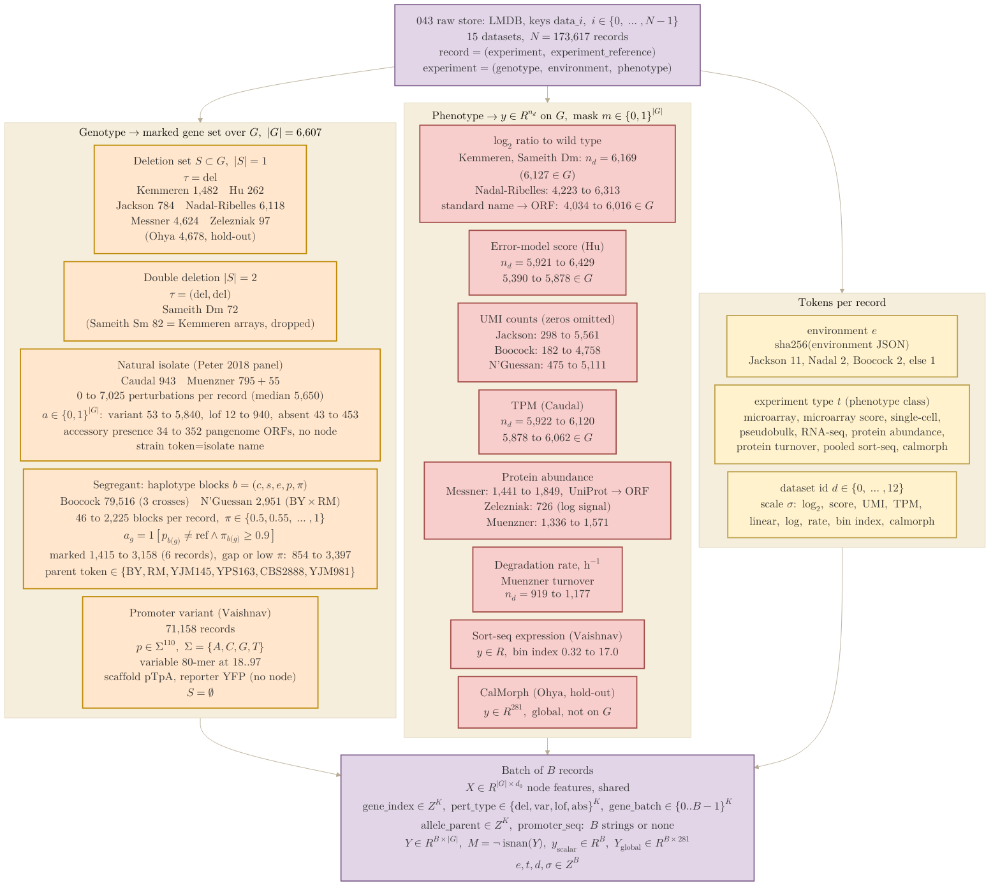

## 2026.10.19 - From the raw store to the batch the model consumes

Top to bottom: the 043 raw store, the four genotype classes and how each becomes a marked
gene set over the shared index of $|G| = 6{,}607$ genes, the per-dataset label tensors
scattered onto that index with a measured-gene mask, the four tokens, and the batch. Every
number is from [[experiments.043-expression-proteome-morphology.scripts.data_shapes_043]]
(the full pass over 173,617 records, slurm job 5902; per-record ranges are min to max, the
segregant marking counts are from the three-records-per-dataset debugger run of
[[experiments.043-expression-proteome-morphology.scripts.dataset_043]]). The marking rules
are the definite ones of the dataset module: a deletion marks its gene; an isolate marks
every gene with a sequence variant, a predicted loss of function or a natural absence; a
segregant marks a gene when its covering block calls the non-reference parent with posterior
at least 0.9. Colors follow the worked example in
[[torchcell.models.equivariant_cell_graph_transformer.mermaid.type-i-ii]]: purple = the
store and the batch, orange = genotype to marked genes, red = labels, yellow = tokens.



Render (PDF, outlined SVG and PNG land in `notes/assets/pdf-output/` under this note's name):

```bash
bash notes/assets/publish/scripts/mermaid_pdf.sh notes/experiments.043-expression-proteome-morphology.mermaid.data-flow.md "#F5EEDD"
```


