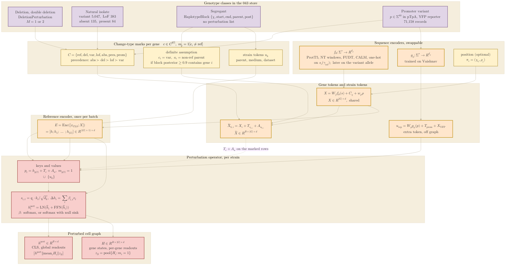

## 2026.10.19 - The input side of the 043 model, top to bottom

Companion to the `input-design.tex` section of `notes-tex/multimodal/043-datasets-primer/`
and to the prototype [[torchcell.models.genotype_tokens_043]]. Genotype classes become
change-type marks; the sequence encoder gives every reference gene one token; marks and
strain tokens feed the perturbation operator; the readouts come off the perturbed CLS and
gene states. Counts per record are the store census
(`experiments/043-expression-proteome-morphology/results/store_census.json`, Caudal means
for the isolate row). Palette as in
[[torchcell.models.equivariant_cell_graph_transformer.mermaid.type-i-ii]]: purple = input
and genotype, orange = encoders and tokens, red = operator and perturbed graph, yellow =
marks and strain-level tokens.



Regenerate the figure asset (name matches this note):

```bash
bash notes/assets/publish/scripts/mermaid_pdf.sh notes/experiments.043-expression-proteome-morphology.mermaid.input-side.md
# -> notes/assets/pdf-output/experiments.043-expression-proteome-morphology.mermaid.input-side.pdf
```
