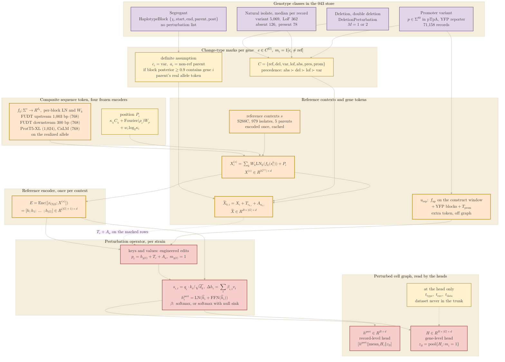

## 2026.10.19 - The input side of the 043 model, top to bottom

Companion to the `input-design.tex` section of `notes-tex/multimodal/043-datasets-primer/`
and to the prototype [[torchcell.models.genotype_tokens_043]]. Genotype classes become
change-type marks; the sequence encoder gives every reference gene one token; marks and
strain tokens feed the perturbation operator; the readouts come off the perturbed CLS and
gene states. Counts per record are the store census
(`experiments/043-expression-proteome-morphology/results/store_census.json`, Caudal means
for the isolate row). Palette as in
[[torchcell.models.equivariant_cell_graph_transformer.mermaid.type-i-ii]]: purple = input
and genotype, orange = encoders and tokens, red = operator and perturbed graph, yellow =
marks and strain-level tokens.



Regenerate the figure asset (name matches this note):

```bash
bash notes/assets/publish/scripts/mermaid_pdf.sh notes/experiments.043-expression-proteome-morphology.mermaid.input-side.md
# -> notes/assets/pdf-output/experiments.043-expression-proteome-morphology.mermaid.input-side.pdf
```

## 2026.10.20 - Review pass: composite token, reference contexts, head-only context tokens

The diagram above was redrawn for the 2026-10-20 review pass
([[experiments.043-expression-proteome-morphology]], "Review pass"). The sequence-encoder
box now lists the four frozen encoders of the composite token (FUDT upstream and
downstream, ProtT5-XL, CaLM; one-hot is gone and survives only as an ablation arm); a
reference-context box feeds the gene tokens (S288C, 979 isolates, five non-BY parents,
each encoded once and cached); the reporter's promoter block is the FUDT upstream encoder
on the construct window, so the separate promoter encoder is gone; the strain-token box is
gone, the allele parent rides on the segregant rule, and the type, environment and dataset
tokens enter at the heads only. Isolate counts are medians per Caudal record from
`results/data_shapes_043.json`.
