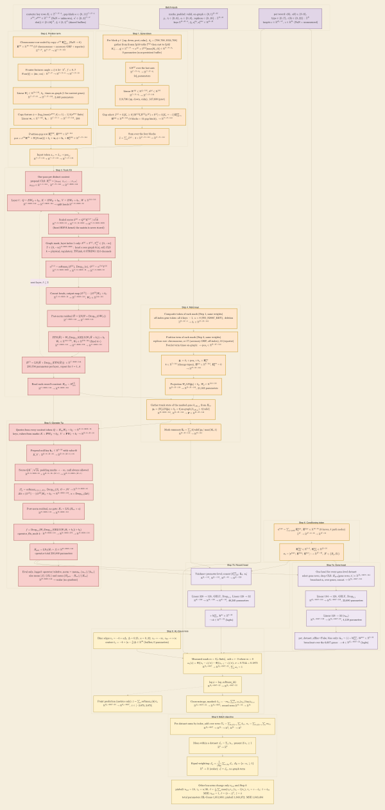

## 2026.10.23 - Every operation of the 043 forward pass and loss, with tensor shapes

One level below [[experiments.043-expression-proteome-morphology.mermaid.training-design]]:
each box is one mathematical operation of `CellModel043.forward` and the HL-Gauss objective,
with the input and output tensor shapes and the trainable parameters it holds. Symbols follow
the notation table of `notes-tex/multimodal/043-training-design/` (Sec. 1), which reuses the
Nature Biotechnology manuscript's symbols. Shapes are for the default config
(`conf/train_043_default.yaml`, arm `joint_9`, loss `hlgauss`, weighting `equal`) on store
`prep_v3_routeA`. Colors: purple = data entering, orange = input tokens, red = trunk and
operator, light purple = heads, yellow = objective.

Batch symbols used in every shape:

| Symbol | Meaning | Value |
|---|---|---|
| $B$ | records per batch | 16 (`data.batch_size`) |
| $B_g,\ B_r$ | gene-level and record-level rows of the batch, $B_g + B_r = B$ | per batch |
| $C$ | distinct reference contexts in the batch, $1 \le C \le B$ | per batch |
| $d,\ h,\ d_k$ | width, heads, head width | 144, 9, 16 |
| $M$ | padded marks per record, $\max_b M_b$ over the batch | 1 to 4,416 (`mark_cap: null`) |
| $N$ | genes of the S288C index; $N + 1$ with the CLS | 6,607; 6,608 |
| $n_{\mathrm{bin}}$ | HL-Gauss bins, the head output width | 32 |
| $\lvert\mathcal{S}\rvert$ | datasets of the arm | 9 |

```mermaid
%%{init: {'forceLegacyMathML': true, 'themeCSS': 'print-color-adjust: exact; -webkit-print-color-adjust: exact;', 'theme':'base','themeVariables':{'background':'#F5EEDD','clusterBkg':'#F5EEDD','clusterBorder':'#E0D6BE','lineColor':'#B7AC93','fontFamily':'Arial'}, 'flowchart': {'nodeSpacing': 14, 'rankSpacing': 22, 'subGraphTitleMargin': {'top': 6, 'bottom': 10}}}}%%
graph TD
  subgraph In["Batch inputs"]
    direction LR
    InCtx["$$\begin{gathered}\text{contexts: key rows } K_c \in \mathbb{Z}^{C \times N \times 4},\ \text{gap kinds } \kappa \in \{0..11\}^{C \times N \times 4}\\\ \nu^{\mathrm{chr}}, \nu^{\mathrm{gene}} \in \mathbb{R}^{C \times N}\ (\mathrm{NaN} = \text{unknown}),\ \kappa' \in \{0..3\}^{C \times N}\\\ \mathrm{chr}(i) \in \{0..16\}^{N},\ \xi_i \in [0,1]^{N}\ \text{(shared buffers)}\end{gathered}$$"]
    InMark["$$\begin{gathered}\text{marks, padded: valid, on-graph} \in \{0,1\}^{B \times M}\\\ j_t,\ \tau_t \in \{0..6\},\ o_t \in \{0..8\},\ \text{replicon} \in \{0..18\}:\ \mathbb{Z}^{B \times M}\\\ \text{keys } \mathbb{Z}^{B \times M \times 4},\ \xi_t, \nu^{\mathrm{chr}}_t, \nu^{\mathrm{gene}}_t \in \mathbb{R}^{B \times M}\end{gathered}$$"]
    InIds["$$\begin{gathered}\text{per record: } c(b),\ s(b) \in \{0..8\},\\\ \text{type} \in \{0..7\},\ \varepsilon(b) \in \{0..22\}:\ \mathbb{Z}^{B}\\\ \text{targets } z \in \mathbb{R}^{B_g \times N},\ z \in \mathbb{R}^{B_r}\ (\mathrm{NaN} = \text{unmeasured})\end{gathered}$$"]
  end

  subgraph Tok["Step 1. Gene token"]
    direction TB
    A1["$$\begin{gathered}\text{Per block } q \in \{\mathrm{up}, \mathrm{down}, \mathrm{prot}, \mathrm{calm}\},\ d_q = (768, 768, 1024, 768)\\\ \text{gather from frozen fp16 table } T^{(q)}\ \text{then cast to fp32}\\\ K_c[\ldots, q] \in \mathbb{Z}^{C \times N} \to x^{(q)} = T^{(q)}[\max(K_c, 0)] \in \mathbb{R}^{C \times N \times d_q}\\\ \text{0 parameters (non-persistent buffer)}\end{gathered}$$"]
    A2["$$\begin{gathered}\mathrm{LN}^{(q)} \text{ over the last axis}\\\ \mathbb{R}^{C \times N \times d_q} \to \mathbb{R}^{C \times N \times d_q}\\\ 2 d_q \text{ parameters}\end{gathered}$$"]
    A3["$$\begin{gathered}\text{Linear } W^{(q)} \in \mathbb{R}^{d_q \times 144},\ b^{(q)} \in \mathbb{R}^{144}\\\ \mathbb{R}^{C \times N \times d_q} \to \mathbb{R}^{C \times N \times 144}\\\ 110{,}736 \text{ (up, down, calm)},\ 147{,}600 \text{ (prot)}\end{gathered}$$"]
    A4["$$\begin{gathered}\text{Gap select: } \tilde x^{(q)} = \mathbf{1}[K_c \ge 0]\,(W^{(q)}\mathrm{LN}^{(q)}(x^{(q)}) + b^{(q)}) + \mathbf{1}[K_c = -1]\,\mathbf{E}^{\mathrm{gap}}_{12q + \kappa}\\\ \mathbf{E}^{\mathrm{gap}} \in \mathbb{R}^{48 \times 144}\ (4 \text{ blocks} \times 12 \text{ gap kinds}),\ \to \mathbb{R}^{C \times N \times 144}\end{gathered}$$"]
    A5["$$\begin{gathered}\text{Sum over the four blocks}\\\ \tilde x = \textstyle\sum_{q} \tilde x^{(q)}:\ 4 \times \mathbb{R}^{C \times N \times 144} \to \mathbb{R}^{C \times N \times 144}\end{gathered}$$"]
  end

  subgraph Pos["Step 2. Position term"]
    direction TB
    B1["$$\begin{gathered}\text{Chromosome row scaled by copy: } \nu^{\mathrm{chr}}\,\mathbf{E}^{\mathrm{chr}}_{\mathrm{chr}(i)}\ (\mathrm{NaN} \to 0)\\\ \mathbf{E}^{\mathrm{chr}} \in \mathbb{R}^{19 \times 144}\ (17 \text{ chromosomes} + \text{accessory ORF} + \text{reporter})\\\ \mathbb{Z}^{C \times N},\ \mathbb{R}^{C \times N} \to \mathbb{R}^{C \times N \times 144}\end{gathered}$$"]
    B2["$$\begin{gathered}\text{Fourier features: angle} = \xi \otimes 2\pi \cdot 2^{f},\ f = 0..7\\\ \mathrm{Four}(\xi) = [\sin;\ \cos]:\ \mathbb{R}^{C \times N} \to \mathbb{R}^{C \times N \times 8} \to \mathbb{R}^{C \times N \times 16}\end{gathered}$$"]
    B3["$$\begin{gathered}\text{Linear } W_\xi \in \mathbb{R}^{16 \times 144},\ b_\xi,\ \text{times on-graph (1 for context genes)}\\\ \mathbb{R}^{C \times N \times 16} \to \mathbb{R}^{C \times N \times 144},\ 2{,}448 \text{ parameters}\end{gathered}$$"]
    B4["$$\begin{gathered}\text{Copy feature } \phi = (\log_2(\max(\nu^{\mathrm{gene}}, 0) + 1) - 1)\,\mathbf{1}[\nu^{\mathrm{gene}} \text{ finite}]\\\ \text{Linear } \mathbf{w}_\nu \in \mathbb{R}^{1 \times 144},\ \mathbf{b}_\nu:\ \mathbb{R}^{C \times N \times 1} \to \mathbb{R}^{C \times N \times 144},\ 288\end{gathered}$$"]
    B5["$$\begin{gathered}\text{Position-gap row } \mathbf{E}^{\mathrm{pgap}}_{\kappa'},\ \mathbf{E}^{\mathrm{pgap}} \in \mathbb{R}^{4 \times 144}\\\ \mathrm{pos} = \nu^{\mathrm{chr}}\mathbf{E}^{\mathrm{chr}} + W_\xi\mathrm{Four}(\xi) + b_\xi + \mathbf{w}_\nu\phi + \mathbf{b}_\nu + \mathbf{E}^{\mathrm{pgap}}_{\kappa'} \in \mathbb{R}^{C \times N \times 144}\end{gathered}$$"]
    B6["$$\begin{gathered}\text{Input token } x_{c,i} = \tilde x_{c,i} + \mathrm{pos}_{c,i}\\\ \mathbb{R}^{C \times N \times 144} + \mathbb{R}^{C \times N \times 144} \to \mathbb{R}^{C \times N \times 144}\end{gathered}$$"]
  end

  subgraph Trunk["Step 3. Trunk Fθ"]
    direction TB
    C0["$$\begin{gathered}\text{One pass per distinct context}\\\ \text{prepend CLS: } H^{(0)}_c = [x_{\mathrm{CLS}};\ x_{c,1}; \ldots; x_{c,N}]\\\ x_{\mathrm{CLS}} \in \mathbb{R}^{1 \times 1 \times 144}:\ \mathbb{R}^{C \times N \times 144} \to \mathbb{R}^{C \times 6608 \times 144}\end{gathered}$$"]
    C1["$$\begin{gathered}\text{Layer } \ell:\ Q = HW_Q + b_Q,\ K = HW_K + b_K,\ V = HW_V + b_V,\ W \in \mathbb{R}^{144 \times 144}\\\ \mathbb{R}^{C \times 6608 \times 144} \to \mathbb{R}^{C \times 6608 \times 144} \to \text{split heads } \mathbb{R}^{C \times 9 \times 6608 \times 16}\end{gathered}$$"]
    C2["$$\begin{gathered}\text{Scaled scores } S^{(a)} = Q^{(a)}K^{(a)\top}/\sqrt{16}\\\ \mathbb{R}^{C \times 9 \times 6608 \times 16} \times \mathbb{R}^{C \times 9 \times 16 \times 6608} \to \mathbb{R}^{C \times 9 \times 6608 \times 6608}\\\ \text{(fused SDPA kernel; the matrix is never stored)}\end{gathered}$$"]
    C3["$$\begin{gathered}\text{Graph mask, layer index 1 only: } S^{(a)} + \Gamma^{(a)},\ \Gamma^{(a)}_{ij} \in \{0, -\infty\}\\\ \Gamma \in \{0,-\infty\}^{9 \times 6608 \times 6608}:\ \text{head } a \text{ sees graph } k(a) \text{, self, CLS}\\\ k = \text{physical, regulatory, TFLink, 6 STRING 12.0 channels}\end{gathered}$$"]
    C4["$$\begin{gathered}\alpha^{(\ell,a)} = \mathrm{softmax}_j(S^{(a)}),\ \mathrm{Drop}_{0.1}(\alpha),\ O^{(a)} = \alpha^{(\ell,a)} V^{(a)}\\\ \mathbb{R}^{C \times 9 \times 6608 \times 6608} \times \mathbb{R}^{C \times 9 \times 6608 \times 16} \to \mathbb{R}^{C \times 9 \times 6608 \times 16}\end{gathered}$$"]
    C5["$$\begin{gathered}\text{Concat heads, output map } [O^{(1)} \Vert \cdots \Vert O^{(9)}]W_O + b_O\\\ \mathbb{R}^{C \times 9 \times 6608 \times 16} \to \mathbb{R}^{C \times 6608 \times 144},\ W_O \in \mathbb{R}^{144 \times 144}\end{gathered}$$"]
    C6["$$\begin{gathered}\text{Post-norm residual } \hat H = \mathrm{LN}(H + \mathrm{Drop}_{0.1}(OW_O))\\\ \mathbb{R}^{C \times 6608 \times 144} \to \mathbb{R}^{C \times 6608 \times 144}\end{gathered}$$"]
    C7["$$\begin{gathered}\mathrm{FFN}(\hat H) = W_2\,\mathrm{Drop}_{0.1}(\mathrm{GELU}(W_1\hat H + b_1)) + b_2\\\ W_1 \in \mathbb{R}^{144 \times 576},\ W_2 \in \mathbb{R}^{576 \times 144}\ (\text{fixed } 4\times)\\\ \mathbb{R}^{C \times 6608 \times 144} \to \mathbb{R}^{C \times 6608 \times 576} \to \mathbb{R}^{C \times 6608 \times 144}\end{gathered}$$"]
    C8["$$\begin{gathered}H^{(\ell)} = \mathrm{LN}(\hat H + \mathrm{Drop}_{0.1}(\mathrm{FFN}(\hat H)))\ \in \mathbb{R}^{C \times 6608 \times 144}\\\ 250{,}704 \text{ parameters per layer},\ \text{repeat for } \ell = 1..4\end{gathered}$$"]
    C9["$$\begin{gathered}\text{Read each record's context: } H_{\mathrm{rec}} = H^{(4)}_{c(b)}\\\ \mathbb{R}^{C \times 6608 \times 144} \to \mathbb{R}^{B \times 6608 \times 144}\end{gathered}$$"]
  end

  subgraph Mark["Step 4. Mark keys"]
    direction TB
    D1["$$\begin{gathered}\text{Composite token of each mark (Step 1, same weights)}\\\ \text{off-index gene token: all 4 keys } -1,\ \kappa = 8\ (\text{NO\_S288C\_KEY}),\ \text{deletion}\\\ \mathbb{Z}^{B \times M \times 4} \to \tilde x_t \in \mathbb{R}^{B \times M \times 144}\end{gathered}$$"]
    D2["$$\begin{gathered}\text{Position term of each mark (Step 2, same weights)}\\\ \text{replicon row: chromosome, or 17 (accessory ORF, off-index), 18 (reporter)}\\\ \text{Fourier term times on-graph: } \to \mathrm{pos}_t \in \mathbb{R}^{B \times M \times 144}\end{gathered}$$"]
    D3["$$\begin{gathered}\tilde{\mathbf{p}}_t = \tilde x_t + \mathrm{pos}_t + \mathbf{t}_{\tau_t} + \mathbf{E}^{\mathrm{par}}_{o_t}\\\ \mathbf{t} \in \mathbb{R}^{7 \times 144}\ (\text{change types}),\ \mathbf{E}^{\mathrm{par}} \in \mathbb{R}^{9 \times 144},\ \mathbf{E}^{\mathrm{par}}_0 = 0\\\ \to \mathbb{R}^{B \times M \times 144}\end{gathered}$$"]
    D4["$$\begin{gathered}\text{Projection } W_p\,\mathrm{LN}(\tilde{\mathbf{p}}_t) + b_p,\ W_p \in \mathbb{R}^{144 \times 144}\\\ \mathbb{R}^{B \times M \times 144} \to \mathbb{R}^{B \times M \times 144},\ 21{,}168 \text{ parameters}\end{gathered}$$"]
    D5["$$\begin{gathered}\text{Gather trunk state of the marked gene } h_{c(b),\,j_t}\text{ from } H_{\mathrm{rec}}\\\ \mathbf{p}_t = (W_p\mathrm{LN}(\tilde{\mathbf{p}}_t) + b_p + \mathbf{1}[\text{on-graph}]\,h_{c(b),j_t})\cdot\mathbf{1}[\text{valid}]\\\ \mathbb{R}^{B \times 6608 \times 144},\ \mathbb{R}^{B \times M \times 144} \to \mathbf{P} \in \mathbb{R}^{B \times M \times 144}\end{gathered}$$"]
    D6["$$\begin{gathered}\text{Mark summary } \bar{\mathbf{k}}_b = \textstyle\sum_t \mathbf{1}[\text{valid}]\,\mathbf{p}_t / \max(M_b, 1)\\\ \mathbb{R}^{B \times M \times 144} \to \mathbb{R}^{B \times 144}\end{gathered}$$"]
  end

  subgraph Op["Step 5. Operator Tψ"]
    direction TB
    E1["$$\begin{gathered}\text{Queries from every context token: } Q = H_{\mathrm{rec}}W_Q + b_Q \to \mathbb{R}^{B \times 9 \times 6608 \times 16}\\\ \text{keys, values from marks: } K = \mathbf{P}W_K + b_K,\ V = \mathbf{P}W_V + b_V \to \mathbb{R}^{B \times 9 \times M \times 16}\end{gathered}$$"]
    E2["$$\begin{gathered}\text{Prepend null key } \mathbf{k}_\varnothing \in \mathbb{R}^{9 \times 16} \text{ with value } \mathbf{0}\\\ K, V:\ \mathbb{R}^{B \times 9 \times M \times 16} \to \mathbb{R}^{B \times 9 \times (M+1) \times 16}\end{gathered}$$"]
    E3["$$\begin{gathered}\text{Scores } QK^\top/\sqrt{16},\ \text{padding marks} \to -\infty,\ \text{null always allowed}\\\ \mathbb{R}^{B \times 9 \times 6608 \times 16} \times \mathbb{R}^{B \times 9 \times 16 \times (M+1)} \to \mathbb{R}^{B \times 9 \times 6608 \times (M+1)}\end{gathered}$$"]
    E4["$$\begin{gathered}\beta^{a}_{i,t} = \mathrm{softmax}_{t \in \{\varnothing, 1..M\}},\ \mathrm{Drop}_{0.1}(\beta),\ O = \beta V \to \mathbb{R}^{B \times 9 \times 6608 \times 16}\\\ \Delta h = [O^{(1)} \Vert \cdots \Vert O^{(9)}]W_O + b_O \to \mathbb{R}^{B \times 6608 \times 144},\ a = \mathrm{Drop}_{0.1}(\Delta h)\end{gathered}$$"]
    E5["$$\begin{gathered}\text{Post-norm residual, no gate: } H_1 = \mathrm{LN}_1(H_{\mathrm{rec}} + a)\\\ \mathbb{R}^{B \times 6608 \times 144} \to \mathbb{R}^{B \times 6608 \times 144}\end{gathered}$$"]
    E6["$$\begin{gathered}f = \mathrm{Drop}_{0.1}(W_2\,\mathrm{Drop}_{0.1}(\mathrm{GELU}(W_1H_1 + b_1)) + b_2)\\\ \text{operator\_ffn\_mult } 4:\ \mathbb{R}^{B \times 6608 \times 144} \to \mathbb{R}^{B \times 6608 \times 576} \to \mathbb{R}^{B \times 6608 \times 144}\end{gathered}$$"]
    E7["$$\begin{gathered}H_{\mathrm{pert}} = \mathrm{LN}_2(H_1 + f) \in \mathbb{R}^{B \times 6608 \times 144}\\\ \text{operator total } 250{,}848 \text{ parameters}\end{gathered}$$"]
    E8["$$\begin{gathered}\text{Eval only, logged: operator/relative\_norm} = \mathrm{mean}_{b,i}\ \lVert a_{b,i}\rVert / \lVert h_{b,i}\rVert\\\ \text{also } \mathrm{mean}\,\lVert f\rVert/\lVert H_1\rVert \text{ and } \mathrm{mean}\,\lVert H_{\mathrm{pert}} - H_{\mathrm{rec}}\rVert / \lVert H_{\mathrm{rec}}\rVert\\\ \mathbb{R}^{B \times 6608 \times 144} \to \text{scalar (no gradient)}\end{gathered}$$"]
  end

  subgraph Cond["Step 6. Conditioning token"]
    direction TB
    F1["$$\begin{gathered}\mathbf{c}^{\mathrm{type}} = \textstyle\sum_{\chi \in \mathrm{path}} \mathbf{E}^{\mathrm{type}}_\chi,\ \mathbf{E}^{\mathrm{type}} \in \mathbb{R}^{12 \times 16}\ (\text{8 leaves, 4 path nodes})\\\ \mathbb{Z}^{B'} \to \mathbb{R}^{B' \times 3 \times 16} \to \mathbb{R}^{B' \times 16}\end{gathered}$$"]
    F2["$$\begin{gathered}\mathbf{E}^{\mathrm{data}}_{s(b)} \in \mathbb{R}^{9 \times 8},\ \mathbf{E}^{\mathrm{env}}_{\varepsilon(b)} \in \mathbb{R}^{23 \times 16}\\\ \mathbf{c}_b = [\mathbf{c}^{\mathrm{type}};\ \mathbf{E}^{\mathrm{data}};\ \mathbf{E}^{\mathrm{env}}]:\ \to \mathbb{R}^{B' \times 40},\ B' \in \{B_g, B_r\}\end{gathered}$$"]
  end

  subgraph GH["Step 7a. Gene head"]
    direction TB
    G1["$$\begin{gathered}\text{One head for every gene-level dataset}\\\ \text{select gene rows, drop CLS: } H_{\mathrm{pert}}[\text{gene rows}, 1{:}] \in \mathbb{R}^{B_g \times 6607 \times 144}\\\ \text{broadcast } \mathbf{c}_b \text{ over genes, concat} \to \mathbb{R}^{B_g \times 6607 \times 184}\end{gathered}$$"]
    G2["$$\begin{gathered}\text{Linear } 184 \to 128,\ \mathrm{GELU},\ \mathrm{Drop}_{0.1}\\\ \mathbb{R}^{B_g \times 6607 \times 184} \to \mathbb{R}^{B_g \times 6607 \times 128},\ 23{,}680 \text{ parameters}\end{gathered}$$"]
    G3["$$\begin{gathered}\text{Linear } 128 \to 32\ (n_{\mathrm{bin}})\\\ \mathbb{R}^{B_g \times 6607 \times 128} \to \mathbb{R}^{B_g \times 6607 \times 32},\ 4{,}128 \text{ parameters}\end{gathered}$$"]
    G4["$$\begin{gathered}\text{per\_dataset\_affine=False, bias only: } \hat{\mathbf{o}}_{b,i} = (\cdot) + \mathbf{b}^{\mathrm{gene}}_{s(b)},\ \mathbf{b}^{\mathrm{gene}} \in \mathbb{R}^{9 \times 32}\\\ \text{broadcast over the 6,607 genes: } \to \hat{\mathbf{o}} \in \mathbb{R}^{B_g \times 6607 \times 32}\ (\text{logits})\end{gathered}$$"]
  end

  subgraph RH["Step 7b. Record head"]
    direction TB
    R1["$$\begin{gathered}\text{Vaishnav promoter level; concat } [h^{\mathrm{pert}}_{b,\mathrm{CLS}};\ \bar{\mathbf{k}}_b;\ \mathbf{c}_b]\\\ \mathbb{R}^{B_r \times 144},\ \mathbb{R}^{B_r \times 144},\ \mathbb{R}^{B_r \times 40} \to \mathbb{R}^{B_r \times 328}\end{gathered}$$"]
    R2["$$\begin{gathered}\text{Linear } 328 \to 128,\ \mathrm{GELU},\ \mathrm{Drop}_{0.1},\ \text{Linear } 128 \to 32\\\ \mathbb{R}^{B_r \times 328} \to \mathbb{R}^{B_r \times 128} \to \mathbb{R}^{B_r \times 32},\ 46{,}240 \text{ parameters}\end{gathered}$$"]
    R3["$$\begin{gathered}+\ \mathbf{b}^{\mathrm{rec}}_{s(b)},\ \mathbf{b}^{\mathrm{rec}} \in \mathbb{R}^{9 \times 32}\\\ \to \hat{\mathbf{o}} \in \mathbb{R}^{B_r \times 32}\ (\text{logits})\end{gathered}$$"]
  end

  subgraph HL["Step 8. HL-Gauss loss"]
    direction TB
    H1["$$\begin{gathered}\text{Bins: edges } \upsilon_u = -4 + u\Delta,\ \Delta = 0.25,\ u = 0..32;\ \upsilon_0 \to -\infty,\ \upsilon_{32} \to +\infty\\\ \text{centers } \bar\upsilon_u = -4 + (u - \tfrac12)\Delta \in \mathbb{R}^{32}\ (\text{buffers, 0 parameters})\end{gathered}$$"]
    H2["$$\begin{gathered}\text{Measured mask } m = \mathbf{1}[z \text{ finite}],\ \text{safe } z \leftarrow 0 \text{ where } m = 0\\\ \omega_u(z) = \Phi((\upsilon_u - z)/\sigma) - \Phi((\upsilon_{u-1} - z)/\sigma),\ \sigma = 0.75\Delta = 0.1875\\\ \mathbb{R}^{B_g \times 6607} \to \mathbb{R}^{B_g \times 6607 \times 32},\ \textstyle\sum_u \omega_u = 1\end{gathered}$$"]
    H3["$$\begin{gathered}\log\hat\omega = \mathrm{log\_softmax}_u(\hat{\mathbf{o}})\\\ \mathbb{R}^{B_g \times 6607 \times 32} \to \mathbb{R}^{B_g \times 6607 \times 32}\end{gathered}$$"]
    H4["$$\begin{gathered}\text{Cross-entropy, masked: } \ell_{b,i} = -m_{b,i}\textstyle\sum_{u=1}^{32} \omega_u(z_{b,i}) \log\hat\omega_{b,i,u}\\\ \mathbb{R}^{B_g \times 6607 \times 32} \to \mathbb{R}^{B_g \times 6607};\ \text{record rows } \mathbb{R}^{B_r \times 32} \to \mathbb{R}^{B_r}\end{gathered}$$"]
    H5["$$\begin{gathered}\text{Point prediction (metrics only): } \hat z = \textstyle\sum_u \mathrm{softmax}_u(\hat{\mathbf{o}})\,\bar\upsilon_u\\\ \mathbb{R}^{B_g \times 6607 \times 32} \to \mathbb{R}^{B_g \times 6607},\ \hat z \in [-3.875, 3.875]\end{gathered}$$"]
  end

  subgraph Obj["Step 9. Batch objective"]
    direction TB
    J1["$$\begin{gathered}\text{Per-dataset sums by index\_add over rows: } \Sigma_s = \textstyle\sum_{b: s(b) = s} \sum_i \ell_{b,i},\ n_s = \sum_{b: s(b) = s} \sum_i m_{b,i}\\\ \mathbb{R}^{B_g \times 6607} \to \mathbb{R}^{B_g} \to \mathbb{R}^{9};\ \mathbb{R}^{B_r} \to \mathbb{R}^{9}\end{gathered}$$"]
    J2["$$\begin{gathered}\text{Mean within a dataset: } \mathcal{L}_s = \Sigma_s / n_s,\ \text{present if } n_s \ge 1\\\ \mathbb{R}^{9} \to \mathbb{R}^{9}\end{gathered}$$"]
    J3["$$\begin{gathered}\text{Equal weighting: } \mathcal{L}_y = \frac{1}{\lvert\mathcal{S}_{\mathcal{B}}\rvert}\textstyle\sum_{s \in \mathcal{S}_{\mathcal{B}}} \mathcal{L}_s,\ \mathcal{S}_{\mathcal{B}} = \{s : n_s \ge 1\}\\\ \mathbb{R}^{9} \to \mathbb{R}\ (\text{scalar});\ \mathcal{L} = \mathcal{L}_y,\ \text{no graph term}\end{gathered}$$"]
  end

  Alt["$$\begin{gathered}\text{Other loss arms change only } n_{\mathrm{out}} \text{ and Step 8}\\\ \text{pinball: } n_{\mathrm{out}} = 19,\ \gamma_u = u/20,\ \ell = \tfrac{1}{19}\textstyle\sum_u \max(\gamma_u r_u, (\gamma_u - 1) r_u),\ r_u = z - \hat o_u;\ \hat z = \hat o_{10}\\\ \text{MSE: } n_{\mathrm{out}} = 1,\ \ell = (\hat o - z)^2,\ \hat z = \hat o\\\ \text{total parameters: HL-Gauss } 1{,}851{,}960;\ \text{pinball } 1{,}848{,}372;\ \text{MSE } 1{,}843{,}404\end{gathered}$$"]

  InCtx --> A1
  InCtx --> B1
  A1 --> A2 --> A3 --> A4 --> A5
  B1 --> B2 --> B3 --> B4 --> B5
  A5 --> B6
  B5 --> B6
  B6 --> C0
  C0 --> C1 --> C2 --> C3 --> C4 --> C5 --> C6 --> C7 --> C8
  C8 -. "$$\text{next layer, } \ell \le 3$$" .-> C1
  C8 --> C9
  InMark --> D1
  D1 --> D2 --> D3 --> D4 --> D5
  C9 --> D5
  D5 --> D6
  C9 --> E1
  D5 --> E1
  E1 --> E2 --> E3 --> E4 --> E5 --> E6 --> E7
  E7 -.-> E8
  InIds --> F1
  F1 --> F2
  E7 --> G1
  F2 --> G1
  G1 --> G2 --> G3 --> G4
  E7 --> R1
  D6 --> R1
  F2 --> R1
  R1 --> R2 --> R3
  G4 --> H2
  R3 --> H2
  InIds --> H2
  H1 --> H2 --> H3 --> H4
  H3 -.-> H5
  H4 --> J1 --> J2 --> J3
  J3 ~~~ Alt

  classDef data fill:#E1D5E7,stroke:#846592,stroke-width:2px
  classDef inp fill:#FFE6CC,stroke:#BD8800,stroke-width:2px
  classDef model fill:#F8CECC,stroke:#A24A46,stroke-width:2px
  classDef head fill:#EFE7F3,stroke:#846592,stroke-width:2px
  classDef obj fill:#FFF2CC,stroke:#BCA04C,stroke-width:2px
  class InCtx,InMark,InIds data
  class A1,A2,A3,A4,A5,B1,B2,B3,B4,B5,B6,D1,D2,D3,D4,D5,D6,F1,F2 inp
  class C0,C1,C2,C3,C4,C5,C6,C7,C8,C9,E1,E2,E3,E4,E5,E6,E7,E8 model
  class G1,G2,G3,G4,R1,R2,R3 head
  class H1,H2,H3,H4,H5,J1,J2,J3,Alt obj
```

Render (PDF, outlined SVG and PNG land in `notes/assets/pdf-output/` under this note's name):

```bash
bash notes/assets/publish/scripts/mermaid_pdf.sh notes/experiments.043-expression-proteome-morphology.mermaid.model-math.md "#F5EEDD"
```

Two `init` keys are load-bearing for the render. `forceLegacyMathML: true` makes KaTeX emit
HTML with its own fonts instead of MathML; under MathML, Chromium ignores `mathvariant`, so
`\mathbb{R}`, `\mathbf{E}` and `\mathcal{L}` all print as plain italic letters. The `themeCSS`
`print-color-adjust: exact` keeps the beige background in the printed PDF, which Chromium
otherwise drops under the legacy output. Subgraph titles are plain text: KaTeX titles were
clipped or hidden under the legacy output.



### Where each number comes from

Paths are relative to the repo root; `E` = `experiments/043-expression-proteome-morphology`.
Counts that depend on the store are written by `E/scripts/model_math_043_counts.py` to
`E/results/model_math_043_counts.json` (store `prep_v3_routeA`, job 6304).

| Number in the diagram | Value | Source (file:line) |
|---|---|---|
| $d$, $h$, $L$, dropout | 144, 9, 4, 0.1 | `E/conf/train_043_default.yaml:57-60` |
| $d_k = d/h$ | 16 | `torchcell/models/equivariant_cell_graph_transformer.py:47`; `torchcell/models/cell_model_043.py:499` |
| masked layer index | 1 (second layer) | `E/conf/train_043_default.yaml:61`; `cell_model_043.py:476` |
| head graphs $k(0..8)$ | physical ... STRING database | `E/conf/train_043_default.yaml:62-71`; mask built `cell_model_043.py:413-442` |
| Fourier frequencies | 8 (16 features) | `E/conf/train_043_default.yaml:72`; `cell_model_043.py:382-386` |
| operator FFN | $4\times$ (576) | `E/conf/train_043_default.yaml:73`; `cell_model_043.py:505-510` |
| trunk FFN | $4\times$ (576), hard-coded | `equivariant_cell_graph_transformer.py:63-68` |
| token widths type, env, dataset | 16, 16, 8 (sum 40) | `E/conf/train_043_default.yaml:74-76`; `cell_model_043.py:246-249` |
| head hidden | 128 | `E/conf/train_043_default.yaml:77`; `torchcell/models/readout_heads_043.py:160-168, 235-240` |
| $B$ | 16 | `E/conf/train_043_default.yaml:43` |
| $M \le 4{,}416$ | N'Guessan maximum | `E/conf/train_043_default.yaml:51` (`mark_cap: null`); `E/results/model_math_043_counts.json` (`marks_max_joint_9`) |
| $d_q$ | 768, 768, 1024, 768 | `cell_model_043.py:118` |
| gap kinds, $\mathbf{E}^{\mathrm{gap}}$ rows | 12, $4 \times 12 = 48$ | `torchcell/data/representation_043.py:96-113`; `cell_model_043.py:344` |
| $\mathbf{E}^{\mathrm{chr}}$ rows | 17 chromosomes + 2 replicons = 19 | `cell_model_043.py:119, 124-131, 381` |
| $\mathbf{E}^{\mathrm{pgap}}$ rows | 4 | `representation_043.py:131-137`; `cell_model_043.py:388` |
| change types $\mathbf{t}$ | 7 | `torchcell/models/genotype_tokens_043.py:46-59`; `cell_model_043.py:595` |
| allele parents $\mathbf{E}^{\mathrm{par}}$ | 9 (row 0 = none, zero) | `E/scripts/train_043.py:1762`; `cell_model_043.py:596`; `model_math_043_counts.json` (`n_parents`) |
| off-index gene token | keys $-1$, $\kappa = 8$, replicon 17, deletion | `representation_043.py:634-660`; `E/scripts/train_043.py:922-930` |
| $N$, $N+1$ | 6,607, 6,608 | `train_043_prep/prep_v3_routeA/meta.json` (`genes`); CLS `cell_model_043.py:472` |
| $\lvert\mathcal{S}\rvert$, $\mathbf{E}^{\mathrm{data}}$ rows | 9 (`joint_9`) | `E/conf/arm/joint_9.yaml:2`; `E/scripts/train_043.py:277-287, 1765` |
| $\mathbf{E}^{\mathrm{env}}$ rows | 23 | `meta.json` (`env_keys`); `E/scripts/train_043.py:1766` |
| $\mathbf{E}^{\mathrm{type}}$ rows, path depth | 12 nodes, 3 | `E/scripts/train_043.py:293-326`; `readout_heads_043.py:95-114` |
| gene head in, record head in | 184, 328 | `readout_heads_043.py:158, 231-233` |
| per-dataset term | bias only, `per_dataset_affine=False` | `cell_model_043.py:618, 631-632, 703-713` |
| $n_{\mathrm{bin}}$, range, $\sigma$ | 32, $[-4, 4]$, $0.75\Delta$ | `E/conf/loss/hlgauss.yaml:5-8`; `torchcell/losses/hl_gauss.py:59-81` |
| open edge bins, target, CE, expectation | | `hl_gauss.py:94-97, 104-121, 136-139, 149-152` |
| pinball $n_q$, levels, point | 19, $u/20$, $\hat o_{10}$ | `E/conf/loss/pinball.yaml:4`; `cell_model_043.py:732-736, 761` |
| per-dataset mean, equal weighting | | `E/scripts/train_043.py:1820-1845, 1848-1865`; `E/conf/weighting/equal.yaml:3` |
| relative norm | eval-only, `operator/relative_norm` | `cell_model_043.py:517-554`; `E/scripts/train_043.py:2036, 2333` |

Measured index columns per gene-level dataset in `prep_v3_routeA` (every gene-level record
emits all 6,607 genes; the rest are NaN targets and drop out through $m$):

| Dataset | Level | Records, n | Index columns measured in any record, n | Index columns measured, median record, n | Marks per record, max |
|---|---|---|---|---|---|
| Kemmeren | gene | 1,343 | 6,127 | 6,127 | 1 |
| Messner | gene | 4,235 | 1,850 | 1,819 | 1 |
| Zelezniak | gene | 88 | 726 | 726 | 1 |
| Caudal | gene | 755 | 6,084 | 6,006 | 352 |
| Muenzner | gene | 635 | 1,576 | 1,541 | 352 |
| Muenzner turnover | gene | 44 | 1,808 | 1,071 | 334 |
| Boocock | gene | 314 | 6,607 | 6,607 | 3,844 |
| N'Guessan | gene | 2,361 | 6,607 | 6,607 | 4,416 |
| Vaishnav | record | 56,926 | (one scalar) | (one scalar) | 1 |

Boocock and N'Guessan count a released zero as measured; genes never detected in a training
row are set missing later, at standardization (`E/scripts/train_043.py:1230-1232`).

### Parameter count per block

From `E/results/model_math_043_counts.json`, model built as `build_model` builds it
(`E/scripts/train_043.py:1748-1796`); the frozen tables and the graph mask are buffers and hold
no parameters.

| Block | Parameters, HL-Gauss arm (n) | Parameters, pinball arm (n) | Parameters, MSE arm (n) |
|---|---|---|---|
| Composite token (4 LN + 4 Linear + $\mathbf{E}^{\mathrm{gap}}$) | 493,376 | 493,376 | 493,376 |
| Position term | 6,048 | 6,048 | 6,048 |
| Trunk (CLS + 4 layers of 250,704) | 1,002,960 | 1,002,960 | 1,002,960 |
| Change-type embedding | 1,008 | 1,008 | 1,008 |
| Allele-parent embedding | 1,296 | 1,296 | 1,296 |
| Mark projection (LN + Linear) | 21,168 | 21,168 | 21,168 |
| Operator (Q K V O, null key, FFN, 2 LN) | 250,848 | 250,848 | 250,848 |
| Experiment-type token | 192 | 192 | 192 |
| Dataset token | 72 | 72 | 72 |
| Environment token | 368 | 368 | 368 |
| Gene head | 27,808 | 26,131 | 23,809 |
| Record head | 46,240 | 44,563 | 42,241 |
| Gene bias $\mathbf{b}^{\mathrm{gene}}$ | 288 | 171 | 9 |
| Record bias $\mathbf{b}^{\mathrm{rec}}$ | 288 | 171 | 9 |
| **Total** | **1,851,960** | **1,848,372** | **1,843,404** |

### Discrepancies between the code and the design documents

Each item is a place where `notes-tex/multimodal/043-training-design/` or
[[experiments.043-expression-proteome-morphology.mermaid.training-design]] describes the model
differently from the code this diagram reads.

1. **Discrepancy: ReZero.** `sections/3-model.tex` Step 11 (Eq. `eq:rezero`), the notation row
   for $\zeta_{\mathrm{attn}}, \zeta_{\mathrm{ffn}}$ and the row for $\mathcal{T}_\psi$, and the
   training-design mermaid (operator box) describe zero-initialized ReZero gates, so that the
   operator is the identity at step 0. The code has no gate since `ef30c01ff`: the operator is
   post-norm, $H_1 = \mathrm{LN}(H + a)$, $H_{\mathrm{pert}} = \mathrm{LN}(H_1 + f)$, and is not
   the identity at initialization.
2. **Discrepancy: environment count.** `sections/3-model.tex` Step 13 says nine environments
   (true of `prep_v1`); `prep_v2` and `prep_v3` carry 23, so $\mathbf{E}^{\mathrm{env}} \in
   \mathbb{R}^{23 \times 16}$. The total moves by 224 parameters; both round to the 1.85 M the
   notation table quotes from job 6136.
3. **Discrepancy: mark cap.** `sections/3-model.tex` Step 8 describes the 1,024-mark cap of
   the overnight runs; the config is now `mark_cap: null`, every mark, maximum 4,416
   (N'Guessan). The design text also gives N'Guessan's median as 2,910 (job 6120); `prep_v3`
   gives 2,909.
4. **Discrepancy: batch size.** The design document and the training-design mermaid use
   $B = 8$ (the overnight override); the config default is 16, used here.
5. **Discrepancy with the request for this diagram: no per-dataset output heads.** There is
   one gene head shared by every gene-level dataset, emitting all 6,607 genes for every
   record; a dataset's narrower panel (Kemmeren 6,127 measured index columns in `prep_v3`, not
   6,123; Messner 1,850; Zelezniak 726) enters only through the NaN mask $m$. Ohya 2005
   morphology (501 features) is in no trainer arm (`E/scripts/train_043.py:288-291`, "Ohya
   2005 is the morphology probe (no record-level multi-output head)"). The design document
   describes this correctly.
6. **Discrepancy with the request: the off-index gene token is a mark, not a context token.**
   The context stays $N = 6{,}607$ (+ CLS); an off-index deleted gene enters only as an
   off-graph key of the operator.
7. **Coupling the documents do not state:** the trunk FFN width is hard-coded at $4d$
   (`equivariant_cell_graph_transformer.py:64`); `operator_ffn_mult` sets the operator's FFN
   only. They agree at the default of 4.
8. **Stale store counts in the training-design mermaid:** it quotes `prep_v1` and global split
   v1 (50,767 training records); the trainer default is now store v2 (`prep_v3`,
   `global_split_v2`).
