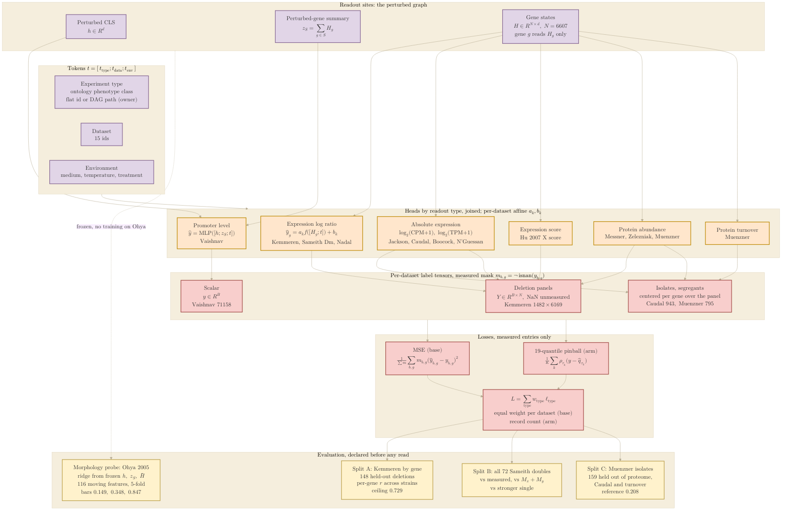

## 2026.10.19 - The output side of the 043 model

How a readout leaves the perturbed graph, by readout type, with the experiment-type,
dataset and environment tokens; the per-dataset label tensors and their masks; the losses;
and the three evaluation splits plus the morphology probe. Prose and the facts behind every
choice: `notes-tex/multimodal/043-datasets-primer/sections/output-design.tex`
([[experiments.043-expression-proteome-morphology]]). Prototype of the heads and the loss:
`torchcell/models/readout_heads_043.py`.

Palette and rules as in
[[torchcell.models.equivariant_cell_graph_transformer.mermaid.type-i-ii]]: one KaTeX block
per label, `\\\` row breaks, four primary colors. Purple: the perturbed graph and the
tokens (inputs to the heads). Orange: the heads. Red: label tensors and losses. Yellow:
the evaluation.



Render:

```bash
bash notes/assets/publish/scripts/mermaid_pdf.sh notes/experiments.043-expression-proteome-morphology.mermaid.output-side.md
# -> notes/assets/pdf-output/experiments.043-expression-proteome-morphology.mermaid.output-side.pdf
```

Numbers in the boxes: Kemmeren 1,482 genotypes and 6,169 genes, Caudal 943, Muenzner 795,
Vaishnav 71,158 (store table, [[experiments.043-expression-proteome-morphology]]); the
Kemmeren ceiling 0.729 (within-dataset ceilings, job 5893); the Caudal x Muenzner
per-isolate reference 0.208 (cross-dataset correlation, job 5892); the probe bars 0.149
(019 genotype-only morphology, M_zs with MSE, 12 runs), 0.348 (Kemmeren ridge, 1,437
genotypes) and 0.847 (019 ceiling on the 116 moving features).
