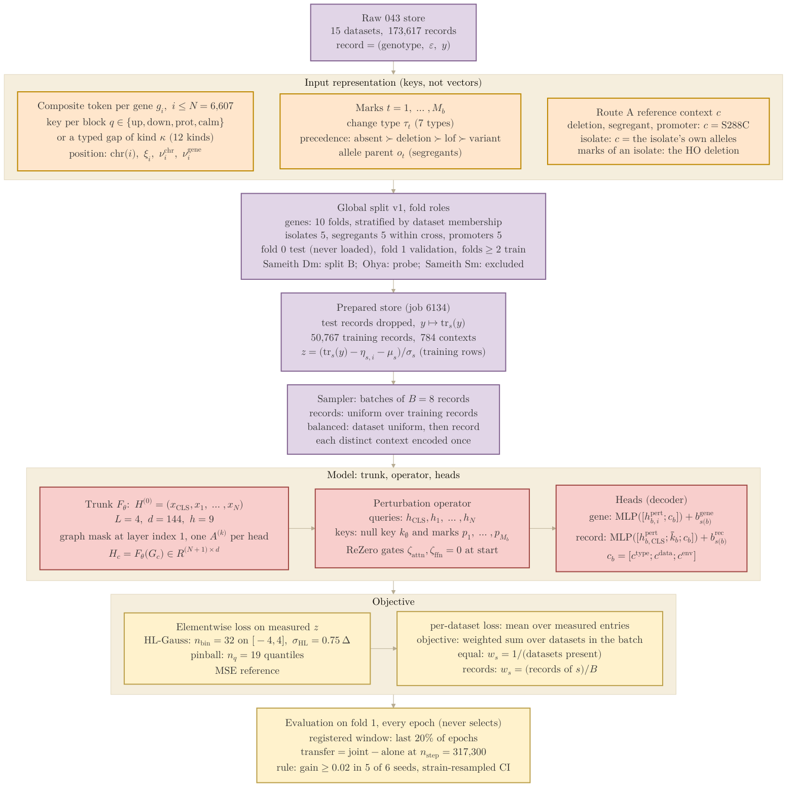

## 2026.10.23 - Data and model flow of the 043 training setup

Figure 1 of [[notes-tex/multimodal/043-training-design|dendron://torchcell/experiments.043-expression-proteome-morphology]]
(`notes-tex/multimodal/043-training-design/`). Top to bottom: the raw store, the input
representation, the fold roles, the prepared store, the sampler and batch, the model, the
heads, the losses, and the registered-window evaluation. Symbols follow the notation table of
that document, which reuses the Nature Biotechnology manuscript's symbols. Sources: record
counts from `results/verify_representation_043.json` (job 6120) and the primer; fold counts
from `results/global_split_v1_summary.json` (job 6046); prepared-store counts (50,767
training records, 784 reference contexts = S288C plus the 783 non-test isolates) from
`train_043_prep/prep_v1_routeA/meta.json` (job 6134); model and loss settings from
`conf/train_043_default.yaml`, `conf/loss/*.yaml` and `torchcell/models/cell_model_043.py`.
Colors follow [[torchcell.models.equivariant_cell_graph_transformer.mermaid.type-i-ii]]:
purple = data, orange = input side, red = model, yellow = objective and evaluation.



Render (PDF, outlined SVG and PNG land in `notes/assets/pdf-output/` under this note's name):

```bash
bash notes/assets/publish/scripts/mermaid_pdf.sh notes/experiments.043-expression-proteome-morphology.mermaid.training-design.md "#F5EEDD"
```
