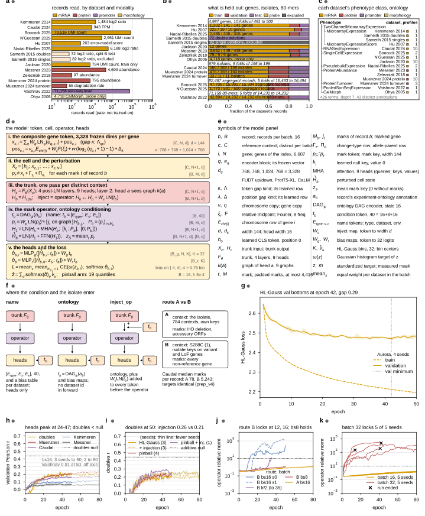
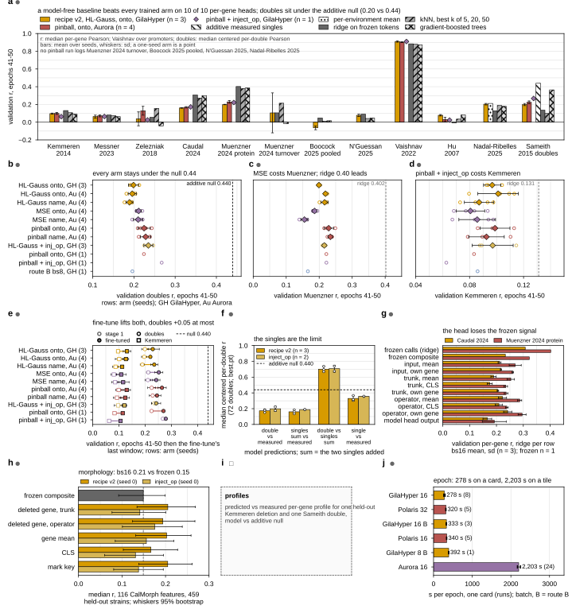

## 2026.10.27 - Two figure sheets: setup and pretraining, preliminary evaluations

Owner, 2026-10-27: "we need to construct some figure for it. I think 2 total. 1 is setup and pretraining. 2. is our preliminary evaluations", with "more synthesis on these multi panel plots" in the style of the 040 thesis sheet (`fig-pretrain.pdf` of the environment case study: lettered panels, drawn data and model panels, curves, bars, a status mark per panel, a long-first caption), placeholders allowed.

Generating script: `experiments/043-expression-proteome-morphology/scripts/figure_043_sheets.py`, which composes panels from four modules in the same directory: `figure_043_data_panels.py` (records, split, ontology, ceilings), `figure_043_model_panel.py` (the model in math, its symbol table, the conditioning routes; every equation audited against `torchcell/models/cell_model_043.py`, line map in the module's `CODE_LINES`), `figure_043_curve_panels.py` (W&B histories cached to `results/figure_043_curves.csv`, 46 runs, `--fetch` refreshes) and `figure_043_eval_panels.py` (baselines, ladders, fine-tune, diagnostics, morphology). The shared layout, palette aliases and the status marks live in `figure_043_common.py`. Status marks after each panel letter: filled circle = drawn from a result on file, half circle = partial, open circle = idea only, square = placeholder with the intent written inside.

```bash
PYTHONPATH=$PWD ~/miniconda3/envs/torchcell/bin/python experiments/043-expression-proteome-morphology/scripts/figure_043_sheets.py
```

### Sheet 1: setup and pretraining (179 x 222 mm)



**Figure 1. Fifteen datasets of four modalities enter one model as per-record cells; the heads peak by epoch 24-47 under HL-Gauss, and route B and batch 32 both lock the operator.** (a) Records read per dataset on a log axis, colored by modality (mRNA, protein, promoter, morphology), pale where the dataset is not trained on (Sameith singles excluded, Sameith doubles the split-B test, Ohya a probe only); from `build_043_store_census_v2.json`. (b) What is held out: the fraction of each dataset's records in train, validation and test, grouped by the unit that is split (4,987 genes in 10 folds, 979 isolates in 5, 82,467 segregant records in 5, 71,158 promoter 80-mers in 5), unit counts inside the bars; from `global_split_v2_summary.json`. (c) Each dataset's phenotype class in the experiment ontology the model conditions on (426 terms, depth 7, 43 distinct annotations), with the number of profiles per dataset; from `ontology_annotation_043_v2.json`. (d) The model in math: the composite gene token (3,328 frozen dims: FUDT upstream and downstream, ProtT5-XL, CaLM), the cell and its marks, the trunk (4 post-LN layers, 9 heads, one masked by the graphs), the mark operator with the ontology condition token (the marks are the keys and values, the cell the queries), and the heads with the HL-Gauss loss (32 bins on [-4, 4], sigma 0.75 bins); tensor sizes at the right of each line; counts from `model_math_043_counts.json` and the configs. (e) The symbol table of (d). (f) Where the condition and the isolate enter: name conditioning (heads only), ontology conditioning (DAG encoder, heads only), ontology injected into the operator (`inject_op`), and route A against route B (the isolate as its own context with few marks, or S288C as the context with every non-reference gene as a mark: 78 against 5,243 median marks per Caudal record). (g) Train (dashed) and validation (solid) HL-Gauss loss by epoch, Aurora ontology arm, mean of 4 seeds with the min-max band: validation bottoms at epoch 42 (2.471) with a train-validation gap of 0.29; pinball and MSE (not shown) are still falling at epoch 50. (h) Validation r per head by epoch for recipe v2 (`gs1024_w4_bs16`, 3 seeds to epoch 50, 2 to 80): Kemmeren peaks at epoch 24 (0.105), Caudal 37 (0.167), doubles 38 (0.227), Messner 38 (0.074), Muenzner 47 (0.211); doubles stays under the additive-measured-singles null 0.440 (dotted); Vaishnav 0.91 is off the axis. (i) Doubles r by epoch for the arms that moved it: at epoch 50 operator injection 0.26 (3 seeds), pinball 0.22 (4), the combination 0.25 (1 seed, raw max 0.295 at epoch 44, an upward-biased order statistic), recipe v2 0.21. (j) Route B: the operator's relative norm on a log axis passes 10 at epoch 12 (seed 0, reaching 292) and 16 (seed 1, 1,716), the half-lr run at its last epoch 35; route B at batch 8 peaks at 1.2 and route A at 1.1. (k) Batch 32 on Polaris: all 5 seeds lock (norms 2,349 to 32,500, doubles stuck at exactly -0.0883), 3 die with a non-finite gradient norm at epochs 14, 41 and 42 (crosses); batch 16 stays at or below 1.81 at every seed. Panels g-k from `results/figure_043_curves.csv`.

### Sheet 2: preliminary evaluations (179 x 196 mm)



**Figure 2. A model-free baseline leads the trained model on every per-gene head and the doubles head sits under the additive null; pinball and operator injection move doubles by 0.03 to 0.07 and fine-tuning by at most 0.05, none of it past the null.** (a) Validation r (epochs 41-50) per dataset for the trained arms (recipe v2 HL-Gauss, 3 seeds; Aurora ontology pinball, 4 seeds; pinball + operator injection, 1 seed) beside the model-free baselines fitted on the same training records and scored on the same validation records (ridge on the frozen composite tokens, the best of kNN k = 5, 20, 50, gradient-boosted trees, the additive measured singles for doubles, the per-environment mean for Nadal-Ribelles): ridge leads on Kemmeren (0.131 against 0.097), Caudal (0.307 against 0.160) and Muenzner (0.402 against 0.199); the model leads only on Vaishnav (0.910 against 0.884); doubles 0.199 to 0.267 against the null 0.440; from `baselines_043.json` and the window-means files. (b-d) The lever ladders on doubles, Muenzner and Kemmeren r (epochs 41-50), one row per arm with the seeds as open circles and the mean as a diamond, GH = GilaHyper, Au = Aurora, seeds in parentheses: every pinball seed on doubles (0.209-0.243) is above every HL-Gauss seed (0.177-0.204); MSE costs Muenzner (0.155-0.186 against 0.216-0.234); pinball + injection costs Kemmeren (0.063, n = 1). (e) The Kemmeren fine-tune: stage-1 r (open) to fine-tuned r (filled) per arm, doubles as circles and Kemmeren as squares; the lift is +0.007 to +0.046 on doubles and +0.024 to +0.043 on Kemmeren, the best fine-tuned doubles 0.278 (pinball + injection, 1 seed). (f) Doubles composition at each run's best checkpoint (72 doubles): the model double tracks the sum of the model's own singles (r 0.70) while the model single tracks the measured single at 0.33, so the singles are the limit; from `diagnostics_043.json`. (g) Where the isolate signal is lost: validation per-gene r of a ridge fitted on each representation, from the frozen per-gene calls (Caudal 0.307, Muenzner 0.402) through the input tokens, the trunk and the operator (0.19-0.30) to the model's own head output (0.166, 0.192). (h) The morphology probe: median r over 116 CalMorph features on 459 held-out Ohya strains, ridge on the frozen composite (0.149) against the trained representations (0.13-0.21, 95 percent bootstrap whiskers, one checkpoint each); from `morphology_probe_043.json`. (i) Placeholder: predicted against measured per-gene profiles for one held-out Kemmeren deletion and one Sameith double, model against the additive null. (j) Seconds per epoch from the W&B timestamps (median over runs, whiskers the range): 278 s on a GilaHyper card at batch 16, 320-340 s on a Polaris A100, 2,203 s on an Aurora tile.

### Caveats carried on the sheets

- The 71-80 windows of the resumed operator-injection runs are empty in `ghyper_sweep_2026_10_24_window_means.json` (W&B `scan_history` truncation), so every cross-arm comparison on sheet 2 uses the 41-50 window; the curve cache (`history`, not `scan_history`) holds those runs to epoch 80.
- Panel 1d was audited against the code; `notes-tex/multimodal/043-training-design/sections/3-model.tex` still describes a ReZero gate (the code has none), no ontology conditioning, 9 environments (the code has 23), batch 8 and a 1,024 mark cap; the document needs the update, not the figure.
- The kNN bar in 2a is the best k on the validation fold, which favors that baseline; the best.pt checkpoints in 2f range over epochs 24-75.
- Sheet 1 is 222 mm tall, above the 170 mm Nature cap; it is a thesis-style sheet like the 040 reference, and the owner picks what to cut. Panel 1f is tight at its row height; the route A and B boxes read but have no air.
