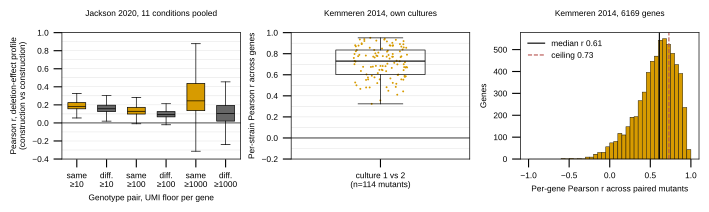
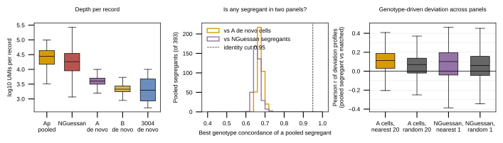

## 2026.10.19 - Within-dataset reproducibility of the 043 expression datasets

Stages (each merges into `results/within_dataset_ceilings.json`; per-dataset CSVs in
`results/within_dataset_ceilings/`), launched by
[[experiments.043-expression-proteome-morphology.scripts.gh_within_dataset_ceilings]]:
`jackson` (job 5895), `kemmeren` and `hu` (job 5893), `segregants` (job 5896), `figures`
(job 5898). Jackson, Boocock and N'Guessan are read from the dev LMDBs, which hold the
same 784, 79,516 and 2,951 records the raw store serves.

### Jackson 2020: construction against construction, within one condition

Depth: a median of 43,851 UMIs (IQR 19,757 to 101,152) and 23 cells per construction
(784 records); YPD and rapamycin reach about 400,000, the other nine conditions 14,480 to
92,872 (medians). Deletion effect = log2((CPM+1)/(CPM_HO+1)) against the condition's
stored reference, the six HO constructions SUMMED; HO pairs left out of the effect
comparison. Primary gene rule: a gene's UMIs summed over the condition reach the floor.

| floor | genes per pair, median | level r, same vs different | effect r, same vs different | pairs, same / different |
|---|---|---|---|---|
| 10 | 5,405 | 0.637 vs 0.620 | 0.184 vs 0.157 | 1,778 / 21,300 |
| 100 | 3,701 | 0.654 vs 0.612 | 0.129 vs 0.095 | 1,778 / 21,300 |
| 1,000 | 660 | 0.919 vs 0.887 | 0.244 vs 0.103 | 1,778 / 21,300 |

Secondary rule (gene covered at the floor in BOTH constructions; shallow pairs with
fewer than 20 genes are unscored, so deep constructions dominate): effect r 0.406 vs 0.244
at 10, 0.414 vs 0.164 at 100, 0.600 vs 0.112 at 1,000 (271 same-genotype pairs scored).
Reading: one construction's deletion effect barely exceeds the different-genotype null,
which is itself above zero because both sides share the HO reference.

### Kemmeren 2014: own-culture test-retest

GEO titles `<gene>-del-<k>-<a|b>` name culture k. 1,480 mutants parse (16 irregular
titles left out); 114 have two cultures, 72 in GSE42527 (responsive) and 42 in GSE42526
(non-responsive), so the second culture is not limited to responsive mutants. Profiles
come from the loader's `_collect_replicate_pairs_static` and
`create_expression_experiment`.

- Per-strain Pearson, culture 1 vs 2: median 0.730 [0.602, 0.835] (114); null of
  different mutants 0.284.
- Per-gene Pearson across the 114: median 0.612 [0.431, 0.754] (6,169 genes).
- Ceiling, test-retest (mean over genes of sqrt(max(r, 0)), as in
  `expression_ceiling_all.py`): 0.729. Decomposition (noise from the paired cultures,
  total variance over the first culture of all 1,480): 0.653.
- Derived, not measured: Spearman-Brown ceiling for the two-culture mean 0.810.
- Replaces the void 019 cross-study ceiling (0.775, Sameith pair of identical arrays).

### Hu 2007

No replicate released. Quotes (paper.md sha256 `74ada815...`): line 55 "Each experiment
was independently carried out at least twice."; line 59 "performed weighted duplicate
averaging with custom Java software." GSE4654 holds one X score per strain. Bound:
Kemmeren x Hu median per-genotype r 0.107 (255), per-gene 0.097 (5,803).

### Boocock 2025 and N'Guessan 2025

| panel | records | cells | cells per record | UMIs per record | genes per record | marker fraction posterior < 0.9 |
|---|---|---|---|---|---|---|
| Boocock Ap pooled BY x RM | 393 | 7,124 | 17 | 27,902 | 3,595 | 0.000 |
| Boocock A de novo BY x RM | 27,744 | 27,744 | 1 | 4,017 | 1,228 | 0.236 |
| Boocock B de novo YJM145 x YPS163 | 44,784 | 44,784 | 1 | 2,130 | 859 | 0.352 |
| Boocock 3004 de novo CBS2888 x YJM981 | 6,595 | 6,595 | 1 | 1,982 | 605 | 0.297 |
| N'Guessan pooled BY x RM | 2,951 | 14,263 | 3 | 18,221 | 2,592 | 0.017 |

(medians). No segregant is in two panels: on a 5 kb grid of called parents (2,403
points) the best concordance of a pooled Boocock segregant is a median 0.672 with any A
de novo cell and 0.657 with any N'Guessan segregant; 0 of 393 reach 0.95. Pseudobulk vs
single cell per segregant is therefore not measurable; the nearest-genotype substitute:
deviation r (log2 CPM minus own panel, genes with >= 10 UMIs both sides) of a pooled
segregant against its 20 nearest A cells 0.113 vs 0.070 for 20 random (388; paired median
difference 0.040, 63% positive, Wilcoxon p 1e-8); against its nearest N'Guessan
segregant 0.101 vs 0.060 (381; p 0.009). Panel-level per-gene log CPM r: 0.872 Ap vs A de
novo, 0.693 Ap vs N'Guessan (YPD vs minimal). N'Guessan replicate structure: only cells
per segregant (median 3), summed; not separable in the store.

