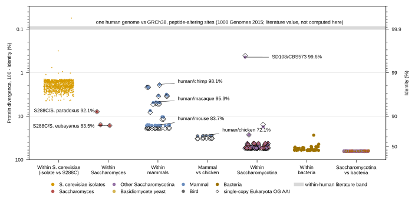
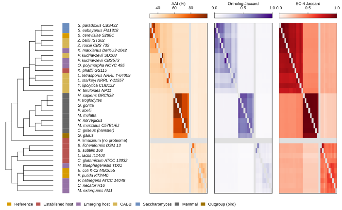
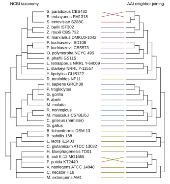
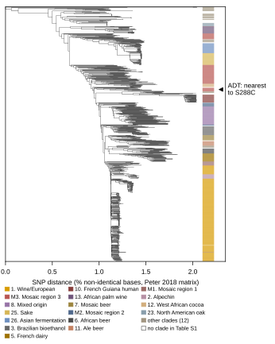
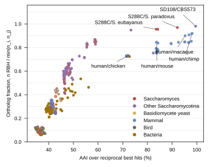

## 2026.10.19 - Is there more genetic difference within yeast than within mammals?

Plan: [[experiments.044-organism-similarity.plan]]. Reused: the per-ORF nucleotide divergence
of the 1,011 isolates from [[experiments.018-natural-isolate-genomics]]. Every number below
cites the script that produced it and the result file it sits in
(`experiments/044-organism-similarity/results/`); `headline_numbers.json` is written by
`07_figures.py` from the other result files and holds every number in the tables.

### The answer

The claim holds for the GENUS and for the SUBPHYLUM, and at the protein level it also holds
within the species, against a single human genome. Measured, rung by rung:

- **Within *S. cerevisiae*.** Against S288C, an isolate's typical ORF is 99.72% identical at
  the protein level (median over the 1,011 isolates of each isolate's per-ORF median,
  `06_isolate_protein_identity.py`); averaging over ORFs instead, which charges every
  frameshifted or indel-bearing ORF in full, gives 98.04% (median over isolates, range
  95.55 to 99.94%). One human genome differs from the GRCh38 reference at 10,000 to 12,000
  peptide-altering sites (1000 Genomes 2015, a literature value, not computed here), 99.90
  to 99.91% identity over our 11.7 million-residue human proteome. The isolate per-ORF
  median divergence (0.28%) is about three times that human value (about 0.09%); the human
  count includes heterozygous sites at full weight and ours half-weights them, so the
  comparison is conservative toward human diversity. The two are still different
  measurements (one isolate genome vs a reference strain; one human genome vs a reference
  genome assembled from several donors), so the factor of three is a measured contrast
  between two differently built numbers, not a population diversity ratio.
- **Within *Saccharomyces*.** S288C/*S. paradoxus* AAI 92.1%, S288C/*S. eubayanus* 83.5%,
  *S. paradoxus*/*S. eubayanus* 84.2% (`03_mmseqs_rbh.py`). Human/mouse is 83.7% and
  human/macaque 95.3%, so the genus spans macaque-to-mouse distances: the sister species is
  farther from S288C than macaque is from human, and *S. eubayanus* sits at the human/mouse
  distance. This reproduces Peris et al. 2023's statement with our own data.
- **Within mammals.** 28 pairs, AAI 83.5 to 98.1% (median 84.3%, dominated by the 15
  primate-rodent pairs). Human/chimp 98.1% (median over RBHs 99.2%), human/chicken 72.1%.
- **Beyond the genus.** The 75 Saccharomycotina pairs have a median AAI of 47.4%, below every
  amniote pair we measured (human/chicken 72.1%). Above 60% are only SD108/CBS573 (99.6%),
  the *Lipomyces* pair (82.4%) and the *Zygosaccharomyces* pair (73.3%); the
  *Saccharomyces*-*Zygosaccharomyces*-*Kluyveromyces* pairs sit at 55 to 59%. Hypothesis (untested
  here; Aranguiz 2025, after Shen 2018): this places the subphylum at animal-kingdom
  breadth. We did not measure any non-amniote animal, so the comparison to the whole
  kingdom is not made from our data.

Plan hypothesis check: "the isolates will sit near human/chimp" holds on the mean-over-ORFs
statistic (98.04% vs 98.14%); on medians the isolates are closer to S288C (99.72%) than chimp
is to human (99.2%). "The genus will straddle human/mouse and beyond" holds (83.5 to 92.1%
around 83.7%). "The industrial yeasts will spread past human/chicken" holds (median 47.4%).

### Headline numbers

| Quantity | Value | Script | Result file |
|---|---|---|---|
| Isolate vs S288C protein identity, median over isolates of per-ORF median | 99.72% (n = 1,011 isolates, 6,005 ORFs each) | `06_isolate_protein_identity.py` | `isolate_protein_identity.parquet` |
| Same, median over isolates of mean over ORFs | 98.04% (range 95.55 to 99.94%) | `06_isolate_protein_identity.py` | `isolate_protein_identity.parquet` |
| Same, mean over equal-length (no indel) ORFs only, median over isolates | 99.58% | `06_isolate_protein_identity.py` | `isolate_protein_identity.parquet` |
| Isolate vs S288C nucleotide divergence (reused, not recomputed) | 0.42% SNP, 0.69% with indels | 018 `build_divergence_matrix.py` | 018 `per_strain_divergence_summary.parquet` |
| One human genome vs GRCh38, peptide-altering sites (literature) | 10,000 to 12,000, i.e. 99.90 to 99.91% identity | `00_literature_values.py` | `literature_values.json` |
| One human genome vs GRCh38, all sites (literature) | 4.1 to 5.0 million, i.e. 0.14 to 0.17% of 2.95 Gb | `00_literature_values.py` | `literature_values.json` |
| Human/chimp AAI (mean / median over RBHs) | 98.14 / 99.20% (n_rbh 18,461) | `03_mmseqs_rbh.py` | `pairwise_similarity.csv` |
| Human/macaque AAI | 95.29 / 96.90% (n_rbh 18,064) | `03_mmseqs_rbh.py` | `pairwise_similarity.csv` |
| Human/mouse AAI | 83.70 / 86.50% (n_rbh 16,925) | `03_mmseqs_rbh.py` | `pairwise_similarity.csv` |
| Human/chicken AAI | 72.12 / 73.60% (n_rbh 13,170) | `03_mmseqs_rbh.py` | `pairwise_similarity.csv` |
| S288C/*S. paradoxus* AAI | 92.15 / 93.20% (n_rbh 5,367) | `03_mmseqs_rbh.py` | `pairwise_similarity.csv` |
| S288C/*S. eubayanus* AAI | 83.55 / 84.70% (n_rbh 5,136) | `03_mmseqs_rbh.py` | `pairwise_similarity.csv` |
| SD108/CBS573 AAI | 99.56 / 99.80% (n_rbh 5,037, ortholog fraction 0.980) | `03_mmseqs_rbh.py` | `pairwise_similarity.csv` |
| S288C/*E. coli* AAI | 36.84%, ortholog fraction 0.091 (n_rbh 391) | `03_mmseqs_rbh.py` | `pairwise_similarity.csv` |
| Within *Saccharomyces* (3 pairs) | AAI median 84.19%, range 83.55 to 92.15% | `07_figures.py` | `headline_numbers.json` |
| Within mammals (28 pairs) | AAI median 84.26%, range 83.52 to 98.14% | `07_figures.py` | `headline_numbers.json` |
| Mammal vs chicken (8 pairs) | AAI median 72.13%, range 71.47 to 72.25% | `07_figures.py` | `headline_numbers.json` |
| Within Saccharomycotina (75 pairs, *Saccharomyces* pairs included) | AAI median 47.45%, range 45.98 to 99.56% | `07_figures.py` | `headline_numbers.json` |
| Within bacteria (45 pairs) | AAI median 40.52%, range 38.84 to 72.73% | `07_figures.py` | `headline_numbers.json` |
| Saccharomycotina vs bacteria (130 pairs) | AAI median 36.53%, range 35.09 to 38.17% | `07_figures.py` | `headline_numbers.json` |
| Single-copy OG AAI vs RBH AAI, 253 eukaryote pairs | Pearson r 0.998, median difference -1.66 points | `06_isolate_protein_identity.py` (scog), `07_figures.py` | `busco_aai.csv`, `headline_numbers.json` |
| EC coverage (proteins with any EC) | 17.6% (chimp) to 31.3% (*E. coli*) | `04_emapper.py` | `ec_coverage.csv` |

Note on the Saccharomycotina row: its range starts below the genus row only because the
genus row's three pairs are counted in the genus column of Fig 1, not here; the 75 pairs
above are every pair of Saccharomycotina species that are not both *Saccharomyces*.

### Sanity checks (03, printed by the script, job 5894)

| Pair | AAI mean (median) | Expected (brief) | Outcome |
|---|---|---|---|
| human/chimp | 98.14 (99.20) | about 99% | median matches; the mean is pulled down by RBH pairs whose longest isoforms differ |
| human/mouse | 83.70 (86.50) | about 85% | matches |
| S288C/*S. paradoxus* | 92.15 (93.20) | about 90% | matches |
| S288C/*E. coli* | 36.84, ortholog fraction 0.091 | well below 50%, small fraction | matches |

The human/chimp mean below 99% is a hypothesis-level explanation (untested): longest-isoform
choice differs between the two annotations for some genes, so an RBH pair compares
different isoforms and scores low identity over the aligned part. The single-copy OG AAI
gives the same 98.07%, so the RBH set is not the cause.

### Peris's BUSCO AAI: the single-copy OG proxy

compleasm could not be installed (its sepp dependency conflicts with the python 3.12 pin)
and the only resolvable busco was 4.0.beta1, so Peris et al. 2023's BUSCO-restricted AAI is
replaced by its PROXY: Eukaryota-level eggNOG OGs (`@2759` in the `eggNOG_OGs` column) that
hold exactly one protein in each member of the pair, identity from the same mmseqs2 hits.
For the labeled pairs (`busco_aai.csv`): human/chimp 98.07% (6,063 OGs), human/macaque
94.85%, human/mouse 80.92%, human/chicken 68.16%, S288C/*S. paradoxus* 92.09% (3,152 OGs),
S288C/*S. eubayanus* 83.64%, SD108/CBS573 99.59%. Over all 253 eukaryote pairs the two
definitions correlate at r = 0.998 and the proxy is 1.66 points lower at the median; among
the labeled pairs the gap ranges from under 0.1 point (the *Saccharomyces* pairs) to 4
points (human/chicken). The two definitions agree on every ordering the claim rests on.

### Organism manifest

`results/organisms.json` (`01_organisms.py` + `02_proteome_prep.py`, pydantic records in
`orgsim_manifest.py`): 34 organisms, 33 proteomes, one absent. Every protein FASTA and GFF is
sha256-pinned; NCBI assemblies came through `datasets` 18.39.0 (`datasets download genome
accession <acc> --include protein,gff3`), tier sets through `registry.resolve`. Per-gene
reduction keeps the longest protein per GFF gene, keyed by NCBI GeneID, which matters for
GRCh38.p14: 1,239 human protein-coding GeneIDs are annotated twice (primary plus alt loci),
so keying by gene feature gave 21,287 human genes and keying by GeneID gives 20,076, the
NCBI protein-coding count.

| Row | Organism | Source | Accession / set | Strain | Proteins raw | Per gene |
|---|---|---|---|---|---|---|
| 1 | S. cerevisiae S288C | tier | sgd_S288C_R64-4-1_20230830 | S288C | 6,716 | 6,716 |
| 3 | P. kudriavzevii SD108 | SD108 clone | commit 8ca6a106 | SD108 | 5,159 | 5,159 |
| 4 | P. kudriavzevii CBS573 | NCBI | GCF_003054445.1 | CBS573 | 5,139 | 5,139 |
| 5 | E. coli K-12 MG1655 | tier | GCA_000005845.2 | K-12 MG1655 | 4,300 | 4,290 |
| 6 | P. putida KT2440 | tier | GCA_000007565.2 | KT2440 | 5,564 | 5,564 |
| 7 | C. glutamicum ATCC 13032 | NCBI | GCF_000011325.1 | ATCC 13032 | 2,941 | 2,941 |
| 8 | B. subtilis 168 | NCBI | GCF_000009045.1 | 168 | 4,237 | 4,237 |
| 9 | B. licheniformis DSM 13 | NCBI | GCF_034478925.1 | ATCC 14580 | 4,169 | 4,169 |
| 10 | K. phaffii GS115 | NCBI | GCF_000027005.1 | GS115 | 5,040 | 5,040 |
| 11 | C. griseus (hamster) | NCBI | GCF_003668045.3 | 17A/GY | 46,638 | 21,776 |
| 12 | H. sapiens GRCh38 | NCBI | GCF_000001405.40 | reference | 136,807 | 20,076 |
| 13 | L. lactis IL1403 | NCBI | GCF_000006865.1 | IL1403 | 2,230 | 2,230 |
| 14 | A. limacinum | absent | GCA_036850685.1 (no annotation) | none | none | none |
| 15 | Y. lipolytica CLIB122 | NCBI | GCF_000002525.2 | CLIB122 | 6,472 | 6,471 |
| 16 | R. toruloides NP11 | NCBI | GCF_000320785.1 | NP11 | 8,140 | 8,140 |
| 17 | C. necator H16 | NCBI | GCF_000009285.1 | H16 | 6,618 | 6,618 |
| 18 | K. marxianus DMKU3-1042 | NCBI | GCF_001417885.1 | DMKU3-1042 | 4,952 | 4,941 |
| 19 | H. bluephagenesis TD01 | NCBI | GCF_054790765.1 | TD01 | 3,635 | 3,635 |
| 20 | O. polymorpha NCYC 495 | NCBI | GCF_001664045.1 | NCYC 495 leu1.1 | 5,155 | 5,153 |
| 21 | V. natriegens ATCC 14048 | NCBI | GCF_001456255.1 | ATCC 14048 | 4,504 | 4,504 |
| 22 | M. extorquens AM1 | NCBI | GCF_000022685.1 | AM1 | 6,151 | 6,151 |
| 23 | L. starkeyi NRRL Y-11557 | NCBI | GCA_001661325.1 | NRRL Y-11557 | 8,183 | 8,182 |
| 24 | Z. bailii IST302 | NCBI | GCA_900162805.1 | IST302 | 5,141 | 5,141 |
| 25 | Z. rouxii CBS 732 | NCBI | GCF_000026365.1 | CBS 732 | 4,991 | 4,991 |
| 26 | L. tetrasporus NRRL Y-64009 | NCBI | GCF_029532465.1 | NRRL Y-64009 | 8,004 | 8,004 |
| 27 | S. paradoxus CBS432 | NCBI | GCF_002079055.1 | CBS432 | 5,542 | 5,538 |
| 28 | S. eubayanus FM1318 | NCBI | GCF_001298625.1 | FM1318 | 5,379 | 5,379 |
| 29 | P. troglodytes | NCBI | GCF_028858775.2 | AG18354 | 109,159 | 22,543 |
| 30 | G. gorilla | NCBI | GCF_029281585.2 | KB3781 | 81,002 | 22,640 |
| 31 | P. abelii | NCBI | GCF_028885655.2 | AG06213 | 81,635 | 22,203 |
| 32 | M. mulatta | NCBI | GCF_049350105.2 | MMU2019108-1 | 109,385 | 21,513 |
| 33 | M. musculus C57BL/6J | NCBI | GCF_000001635.27 | C57BL/6J | 97,339 | 22,198 |
| 34 | R. norvegicus | NCBI | GCF_036323735.1 | BN/NHsdMcwi | 97,483 | 23,209 |
| 35 | G. gallus | NCBI | GCF_016699485.2 | bGalGal1 | 68,683 | 18,023 |

Choices that depart from the NCBI reference assembly (each recorded with its reason in
`conf/organisms.yaml` and the manifest): the named strain was used where it has an annotated
assembly and the reference is another strain (*L. lactis* IL1403 over 14B4, *Y. lipolytica*
CLIB122 over CLIB89(W29), *C. necator* H16 over N-1, *M. extorquens* AM1 over DM4,
*L. starkeyi* NRRL Y-11557 over an unannotated reference). Two need the owner's eye:

- ***Z. bailii*: IST302 stands in for the named CLIB 213.** CLIB 213's GenBank annotation
  (GCA_000442885.1) lists 864 protein-coding genes, a partial annotation of a roughly
  5,000-gene yeast, which would read as a missing proteome on every ortholog axis. IST302
  is the same species with a complete 5,141-gene annotation. This is a strain, not species,
  substitution; the figure labels say IST302.
- ***A. limacinum*: absent.** No annotated assembly at NCBI for *Aurantiochytrium
  limacinum* or *Schizochytrium* (2026-10-19); it stays on the cladogram (Fig 2) and is
  excluded from every proteome axis.

The hamster is the Chinese hamster reference animal (CriGri-PICRH-1.0), not a CHO cell-line
assembly. The S288C proteome is SGD's `orf_trans_all`, which includes the dubious ORFs, so
S288C's per-gene count (6,716) and its ortholog fractions are on a different footing from
NCBI proteomes that omit dubious ORFs.

### Isolate tree and clades

`05_trees.py`: rapidnj on Peter's `1011DistanceMatrixBasedOnSNPs.tab.gz` (sha256 `140da4e5...`;
values are percent non-identical bases, heterozygous differences half-weighted). Clades come
from Supplementary Table 1 (`41586_2018_30_MOESM3_ESM.xls`, the tier copy, byte-identical to
the mirror's `si/si3.xls`; the OCR'd `si/si1.md` does not carry the table): 1,010 of the
1,011 matrix isolates match a Table S1 row and 962 carry a clade (29 clades after merging
the Wine/European subclades and whitespace variants). The one unmatched code is ATK, which
sits at the matrix position where Table S1 lists ARC (CBS1257); hypothesis (untested): a
renaming between the released matrix and the table. It is left unmatched rather than
remapped. ADT is the isolate closest to S288C (018's mean per-ORF divergence 0.0005%).

### Figures

Fig. 1 | Protein divergence within *S. cerevisiae*, within *Saccharomyces* and within
mammals on one axis. Each point is a pair; the y axis is 100 minus protein identity (log
scale, inverted; identity on the right). Within *S. cerevisiae* (n = 1,011 isolates): the
mean over S288C reference ORFs of each isolate's protein identity to S288C, from Peter
2018's reference-inferred alleles, with every gap column of a frameshifted or indel-bearing
ORF charged (`06_isolate_protein_identity.py`); the per-isolate median over ORFs, which
frameshifted ORFs do not pull down, gives a median divergence of 0.28%. Every other column:
AAI, the mean percent identity over reciprocal best mmseqs2 hits of one-protein-per-gene
proteomes (`03_mmseqs_rbh.py`); n pairs per column: within *Saccharomyces* 3, within
mammals 28, mammal vs chicken 8, within Saccharomycotina 75, within bacteria 45,
Saccharomycotina vs bacteria 130. Open diamonds: AAI restricted to Eukaryota-level eggNOG
OGs that are single copy in both members, the proxy for Peris et al. 2023's BUSCO AAI.
Point face and edge colors are the taxonomic groups of the two members. Gray band: one
human genome differs from GRCh38 at 10,000 to 12,000 peptide-altering sites (1000 Genomes
Project 2015, doi:10.1038/nature15393; literature value, not computed here), divided by this
study's 11.7 million-residue human per-gene proteome.

Fig. 2 | The organisms torchcell serves or targets on three similarity axes, ordered by the
NCBI taxonomy. Left: NCBI taxonomy cladogram (topology only; ete3 NCBITaxa, `05_trees.py`)
of the 34 reference organisms; the strip is the plan's first group per organism. Heatmaps,
rows and columns in cladogram order: AAI (mean percent identity over reciprocal best hits,
`03_mmseqs_rbh.py`), ortholog Jaccard (RBH count over the union of the two per-gene
proteomes) and EC-4 Jaccard (complete EC numbers from one eggNOG-mapper 2 run, eggNOG 5.0.2,
`04_emapper.py`). Gray: no proteome (*A. limacinum* has no annotated assembly at NCBI) or
the diagonal.

Fig. 3 | NCBI taxonomy and AAI agree on the large groups. Left: NCBI taxonomy cladogram
(topology only) over the 33 organisms with a proteome. Right: neighbor-joining tree
(Biopython) on d = -ln(AAI/100), rooted with the bacteria as outgroup, drawn as topology
with children rotated to follow the left tree. Lines join the same organism and are colored
by its taxonomic group (`05_trees.py`).

Fig. 4 | The 1,011 *S. cerevisiae* isolates. rapidnj neighbor-joining tree on Peter et al.
2018's SNP distance matrix (percent non-identical bases, heterozygous differences
half-weighted), midpoint rooted (`05_trees.py`). Strip: clade from Peter's Supplementary
Table 1 (962 of 1,011 isolates carry one; the 17 largest clades in color, the remaining 12
in one color; Wine/European subclades merged). Arrow: ADT, the isolate with the lowest mean
per-ORF nucleotide divergence from S288C in 018 (0.0005%); S288C itself is not in Peter's
matrix.

Fig. 5 | Shared orthologs fall with AAI. Each point is one of the 528 pairs of the 33
proteomes: AAI (mean RBH percent identity) against the ortholog fraction, reciprocal best
hits over the smaller per-gene proteome (`03_mmseqs_rbh.py`). Face and edge colors are the
taxonomic groups of the two members.

### Runs

| Step | Slurm job | Wall time | Log |
|---|---|---|---|
| mmseqs2 all-vs-all + RBH | 5894 | 25 min 33 s | `slurm/output/044-mmseqs-rbh_5894.out` |
| Isolate protein identity (first attempt failed on YDR098C's span; fixed by excluding span-mismatched ORFs) | 5899 failed, 5900 | 6 min 16 s | `slurm/output/044-isolate-protid_5900.out` |
| eggNOG-mapper | 5901 | 42 min 25 s | `slurm/output/044-emapper_5901.out` |
| Single-copy OG AAI | 5903 | 39 s | `slurm/output/044-isolate-protid_5903.out` |

### What was not done

- **BUSCO itself.** The BUSCO-restricted AAI is the single-copy eggNOG OG proxy (above);
  compleasm and a current busco were not installable in the orgsim env.
- **An AAI-matched isolate statistic.** The isolate identity uses a global alignment that
  charges every gap column, while species AAI uses local alignments of RBHs with at least
  50% coverage. The two summaries reported (mean and median over ORFs) bracket the
  comparison; isolate proteomes were not run through the same mmseqs2 RBH pipeline.
- **Intron-containing ORFs whose Peter span differs from R64-4-1** (6 ORFs, 6,066
  ORF-isolate rows) are excluded, not rescored.
- **A within-human protein identity computed by us.** The human line is the 1000 Genomes
  count over our proteome length, labeled as a literature value.
- **Animals beyond amniotes.** The "Saccharomycotina is as diverse as Animalia" statement
  is not tested; no fish, insect or nematode proteome is in the set.
- **CLEAN for EC annotation** (the owner's later idea) is not run; eggNOG-mapper is the
  annotator.
- **SD108 through the tier.** SD108 is read from the clone; switching to
  `resolve(PKUDRIAVZEVII_SD108, "proteins.faa")` waits for the sibling branch to land.
- **Figures are timestamped** and not yet approved; the superseded renders from the layout
  iteration were moved to `$DATA_ROOT/data/organism_similarity/superseded_renders/`.
