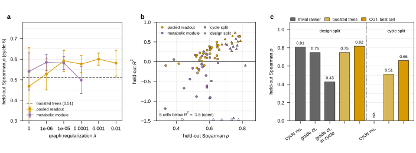

## 2026.11.24 - The goal: how good a Spearman does 375 records support?

The MVP goal ([[experiments.048-pputida-isoprenol-cgt.p-putida-cgt-mvp-goal]])
asked whether a P. putida CGT with a metabolic module can be built at all, and
it can: three arm groups ran and the design-split CGT reached Pearson 0.773 on
44 held-out designs. This is the next question, and it is narrower on purpose.

**The goal.** Get the best held-out **Spearman** this campaign supports, on one
GPU, and record enough of the rest of the metric surface to know what kind of
model produced it.

**Why Spearman is the objective.** The decision the model is for is which
CRISPRi design to build next, and that decision reads the ordering of the
candidates, not their absolute titers. A model that ranks correctly and is
miscalibrated by a constant factor is useful; one that predicts the mean titer
of every strain to within 20 mg/L and gets the ordering wrong is not.

**Why the other metrics are recorded anyway.** Spearman and Pearson are both
invariant to an increasing affine transform of the predictions, so neither can
report that the model has the scale wrong. Every run therefore logs, on train,
validation and test, at every epoch: Spearman, Pearson, standardized MSE, raw
MSE, RMSE, MAE, NMSE and R-squared. NMSE and R-squared are normalized by the
variance of the split being scored, so 1.0 and 0.0 respectively are the scores
of predicting that split's own mean. Standardized MSE uses the train split's
mean and sd instead, which is what the loss minimizes, so the two disagree on a
split whose spread differs from the train split's; they are kept separate rather
than reconciled.

**The thing to beat is not the constant.** Gradient-boosted trees on the
multi-hot guide-target vector score Spearman 0.773 on the design-split test set.
The trees see exactly what the transformer sees about the genotype, minus the
graph and the sequence, so the gap between them is the whole accounting of what
the structure buys. Ridge on the same features scores 0.731. A 17.6M-parameter
model that does not pass the trees has not earned its parameters, and that has
happened before on this stack.

### This is a feasibility trial, and it is labeled as one

465 records over 402 designs is two orders of magnitude less data than any other
arm of this program trains on. The run series is therefore named for what it is
rather than for what we hope it shows: the wandb project is
`torchcell_048-pputida-isoprenol-low-data-trial` and the reports land under
`results/low_data_trial/`. The experiment directory keeps its `048` number and
slug, because that identifier is load-bearing in the dendron note names, the
branch, the open PR and every committed artifact path; renaming the series where
the runs are read is the part that carries the meaning.

### What the trial varies

Four axes, measured against the objective, on the design split:

| axis | values | what it asks |
|---|---|---|
| graph regularization lambda | 0, 1e-6, 1e-5, 1e-4 | does a STRING prior on attention help at this data size |
| metabolic module | off, `--flux` | does the GEM enter the prediction usefully |
| capacity control | dropout 0.1 / decay 1e-4, dropout 0.3 / decay 1e-2 | is the fit limited by data or by parameters |
| seed | 42 to 44 on the promoted cells | is any gap larger than the split's own noise |

**The lambda ladder was measured before it was chosen, not guessed.** At lambda
1e-3 the KL term contributes 33.3 to the loss while the MSE sits near 1, so
1e-3 is not a weak prior, it is the entire objective. The ladder brackets the
range where the term is a correction.

**Graph regularization is on block 1, and the run fails if it was not.** The KL
term pulls attention head *k* toward the row-normalized adjacency of STRING
channel *k*, one channel per head, six of each. It can only shape attention that
a later block still reads, so block 0 is refused. The run also raises if
`graph_reg_loss` was 0.0 at every epoch, which is how the 031 campaign recorded
378 cells as graph-regularized when the config named a block the stack did not
have ([[graph-reg-and-mask-index-second-block]] in memory).

### The splits, and why there is no cycle-5 arm

| arm | train | select | test |
|---|---|---|---|
| design | 375 records, 0.8 of designs | 0.1 | 44 records |
| cycle | cycles 0 to 4 | cycle 5 | cycle 6, 59 records |

A `cycle5` arm (test on 5, select on 4) was specified and is now deleted. It
leaves cycle 6's 59 records in no split, so the partition check in
`cycle_splits` refuses it, correctly. Cycle 6 is the campaign's last cycle and
belongs in test, which is what the `cycle` arm already does. The only ways to
make a cycle-5 arm valid are to discard 59 released records or to train on a
cycle later than the one being predicted, and neither is worth a card. Job 7612
is the 23-second failure this replaces.

### Cycles 2 and 3 are the same designs on a repaired vector

Cycle 2 and cycle 3 share 50 designs; no other cycle pair shares more than 7.
This is not two plasmids in the biological sense. Carruthers et al. report 40%
DBTL2 failure from low dCas9 expression, a vector repair that removed a
redundant linker, a 25% fidelity improvement, and that DBTL3 repeated DBTL2's
sgRNA arrays. On the 50 shared designs the two cycles agree at Spearman 0.668
while within-cycle split-half reliability is 0.946 and 0.980, so the lost
agreement is a per-construct fidelity defect, not a context effect.

**The authors' own QC flags are in the released file and not in our store.**
`Carruthers_etal_2025.csv` carries `above_dcas9_thresh` (1,210 True / 296
False), `to_keep` (669 / 444) and `to_keep_improved` (717 / 789), plus per-target
proteomics columns `target_N_value` and `target_N_norm`. The loader does not
store any of them, so the `--fidelity-tier` flag approximates the tier by cycle
number (cycles 3 and up) instead of by the authors' filter. Using the released
flags, or the per-target knockdown levels as features, needs either a loader
revision or a read of the raw CSV in the experiment, and is not part of this
trial.

### The compute, and the deadline

One dedicated card, from 2026-11-24 20:00 CST until 2026-11-25 14:00 CST. The
other three GilaHyper cards are held by the 031 program.

Measured on this card: 9.4 s/epoch with the regularizer and the flux layer on,
4.6 s/epoch with both off, about 170 s to build the dataset, embeddings and GEM,
and 17.6M trainable parameters.

`sweep_low_data_trial.py` runs three stages and obeys the deadline rather than
being killed by it, launching nothing whose projected finish passes it:

1. all 16 configurations at seed 42, which ranks them,
2. the top 3 configurations at seeds 43 and 44,
3. the best configuration on the cycle split at 5 seeds.

## 2026.11.25 - The design-split half, and why its objective was the wrong one

The design pass ran 20:01 to 00:32 CST, 27 cells on one RTX 6000 at about 10
minutes each. Every number below is from the per-cell reports under
`results/low_data_trial/` and the committed scripts that wrote them.

### The finding that reframed the trial

**On the 44-record design-split test set, ranking the strains by DBTL cycle
number alone scores Spearman 0.807.** That beats the boosted trees at 0.773 and
every CGT cell trained all night. Titer rose across the campaign, as a
successful optimization campaign's titer should, and the design split is random
over designs rather than over cycles, so train and test both span all seven
cycles and "a later cycle means a higher titer" is most of the available rank
information.

The model is never handed the cycle. It does not need to be: each cycle used its
own sgRNA sets, so the cycle is recoverable from the guide identity the model
does get.

`cycle_confound_audit.py` reports the corrections:

| ranker | overall test rho | within-cycle rho | cycle-partialed rho |
|---|---|---|---|
| cycle number | +0.807 | undefined by construction | +0.008 |
| guide count | +0.748 | +0.426 | +0.153 |
| control titer | -0.659 | undefined by construction | -0.080 |

Guide count loses most of its apparent skill once the cycle is removed. The test
split's cycle composition is also lopsided: 20 of the 44 records are cycle 0,
the single-sgRNA lowest-titer cycle, so the split is largely a cycle-0 versus
later contrast. Only 24 records across 6 groups support a within-cycle number at
all.

**So the design split cannot carry a clean rank objective at this campaign
size.** The cycle split needs no correction, because every one of its test
records is cycle 6 and the chronology therefore has zero variance inside the
test set. The cycle arm scores much lower, and that is why it is the stronger
evidence of the two, not the weaker.

### What the grid measured

Sixteen configurations at seed 42, then three at two further seeds. Ranked by
VALIDATION Spearman, because ordering the table by the held-out score is how a
test-set selection decision gets made without anyone intending it.

| tag | best ep | val rho | test rho | test r | RMSE | offset |
|---|---|---|---|---|---|---|
| light_flux_reg1e-04 | 123 | 0.816 | 0.818 | 0.866 | 144.9 | 124.9 |
| heavy_pooled_reg1e-05 | 45 | 0.804 | 0.756 | 0.861 | 71.5 | 11.2 |
| heavy_pooled_reg1e-04 | 4 | 0.778 | 0.699 | 0.683 | 102.9 | 13.0 |
| light_pooled_reg0 | 45 | 0.767 | 0.741 | 0.831 | 82.0 | 9.6 |
| heavy_flux_reg0 | 77 | 0.764 | 0.776 | 0.767 | 241.8 | 223.9 |
| heavy_flux_reg1e-05 | 77 | 0.728 | 0.675 | 0.670 | 273.1 | 252.3 |
| light_pooled_reg1e-04 | 3 | 0.717 | 0.788 | 0.766 | 95.0 | 26.3 |
| heavy_flux_reg1e-04 | 60 | 0.717 | 0.707 | 0.668 | 104.6 | 4.1 |
| heavy_flux_reg1e-06 | 41 | 0.686 | 0.735 | 0.363 | 269.4 | 235.4 |

RMSE and the offset are in ug/mL. The eight omitted rows are pooled cells with
offsets between 1.7 and 44.6.

The three-seed replication, and the nulls it is measured against:

| tag | n | test rho | test r | RMSE | offset |
|---|---|---|---|---|---|
| light_flux_reg1e-04 | 3 | +0.775 ± 0.038 | +0.757 ± 0.120 | 159 ± 68 | 108 ± 88 |
| light_pooled_reg1e-04 | 3 | +0.753 ± 0.050 | +0.791 ± 0.022 | 94.7 ± 3.2 | 15.3 ± 9.5 |
| heavy_flux_reg0 | 3 | +0.709 ± 0.077 | +0.692 ± 0.066 | 260 ± 145 | 223 ± 172 |
| boosted trees | | +0.773 | +0.782 | 87.7 | |
| ridge | | +0.731 | +0.751 | 98.0 | |

**No configuration beats the trees.** The best is 0.775 ± 0.038 against 0.773, a
gap of 0.002 on a seed standard deviation of 0.038, and the trees win Pearson
and RMSE outright against all three.

### The error is an offset, and the offset is unstable

MSE decomposes exactly as `bias^2 + (sd_o^2 + sd_p^2 - 2 r sd_o sd_p)`, so the
offset is recoverable from the reported Pearson and the two standard deviations
without saving a single prediction. The share of test MSE that is a constant
offset is 0 to 14 percent for all eight pooled cells and 12 to 86 percent for
all six flux cells, reaching 252 ug/mL on a target whose own spread is 139.

Strip the offset and the best flux cell's scatter is 73.6 ug/mL against the best
pooled cell's 70.6, with a higher Pearson. **The metabolic module is not
predicting worse than the pooled head, it is predicting off-center.** That
matters for the MVP note's `design_flux` arm, whose Pearson 0.745 against
`design` at 0.773 was reading a centering defect rather than the value of
metabolism.

**The first explanation offered for the offset was wrong and is withdrawn.**
Weight decay applied to bias parameters looked like the cause: the two
heavy-decay flux cells were offset by 224 and 235 ug/mL against 37 to 125 for
the four light-decay ones. Then three seeds of ONE light-decay configuration came
back offset by 13, 125 and 186. The within-configuration seed spread is as large
as the between-decay contrast the story rested on, and every stage-1 cell was a
single seed. The flux head's calibration is better described as unstable across
seeds than as a decay effect: its RMSE seed standard deviations are 68 and 145
ug/mL against 3.2 for the pooled cell.

### Two defects in the trial's own method, both found and one fixed mid-flight

**Checkpoint selection on validation Spearman is noisy.** Best epoch across the
grid came out 1, 2, 3, 3, 3, 4, 12, 16, 37, 37, 39, 41, 45, 45, 60, 77, 77 and
123 with no relation to the regularization lambda, and validation Spearman is
computed on 46 records where its standard error is near 0.1. An unregularized
cell selected at epoch 2 and a regularized one at 45, so an early account of
this as a property of the KL term was wrong and is withdrawn. A paired arm tests
the rule directly.

**Stage 2 promoted on the test score.** The driver ranked configurations by
`test_spearman` to choose which to replicate, which is a selection decision made
on the held-out set. Each cell's own test score remains an honest held-out
measurement, but the three promoted tags are test-selected, and they are recorded
that way rather than as "the best three". Concretely it skipped
`heavy_pooled_reg1e-05`, the cell with the best RMSE of all sixteen and the
second-best validation Spearman. Fixed to promote on validation Spearman before
the cycle pass used the same code.

### The first cycle-split evidence

Four seeds of the test-selected winner, on the split the chronology cannot
inflate:

| seed | best ep | val rho | test rho | test r | RMSE | offset | NMSE |
|---|---|---|---|---|---|---|---|
| 42 | 76 | 0.733 | 0.585 | 0.592 | 252.0 | 189.0 | 1.614 |
| 43 | 75 | 0.809 | 0.385 | 0.425 | 192.9 | 66.4 | 0.946 |
| 44 | 94 | 0.798 | 0.523 | 0.492 | 272.4 | 209.6 | 1.885 |
| 45 | 61 | 0.762 | 0.514 | 0.532 | 180.7 | 63.5 | 0.829 |
| mean | | | +0.502 ± 0.084 | +0.510 ± 0.070 | 224.5 | 132.1 | |
| boosted trees | | | +0.510 | | | | |
| ridge | | | +0.415 | | | | |

**A prediction was recorded before these ran and it failed.** If lambda 1e-04's
design-split lead had been a real graph-prior benefit it would have survived
here; instead the configuration that led the design split at 0.818 scores
0.502 ± 0.084 against the trees' 0.510, a tie. The design-split advantage was the
confound.

Validation and test diverge sharply here, 0.73 to 0.81 against 0.39 to 0.59,
where on the design split they tracked each other. Cycle 5 does not tell you
about cycle 6, which is extrapolation failure rather than ordinary overfitting.
Three of the four seeds have NMSE at or above 1, meaning predictions worse than
the test cycle's own mean titer.

## 2026.11.25 - The cycle split, the bootstrap, and what the trial answers

The full run was 72 cells and 11.1 GPU hours on one RTX 6000, from 20:01 on
2026-11-24 to 12:40 the next day, in four chained passes: the design grid, the
cycle grid, a paired selection-rule arm and a paired bias-decay arm. Every table
below is written by `summarize_low_data_trial.py` and every figure panel by
`plot_low_data_trial.py`, both reading the per-cell reports.

**Figure 1. The low-data trial.** **a**, Held-out Spearman on cycle 6 against
the graph-regularization lambda, one line per readout head, error bars the
standard deviation over seeds where a configuration has more than one. The
dashed line is gradient-boosted trees on the multi-hot guide-target vector,
which sees exactly what the transformer sees about the genotype minus the graph
and the sequence. **b**, Rank against scale for all 72 cells. Circles are the
cycle split, triangles the design split, orange the pooled head, purple the flux
head. R-squared below zero means the predictions are worse than predicting the
scored split's own mean titer; five cells fall below the axis and are drawn open
on the floor. **c**, What the design split's rank score measures. Ranking the
44-record design test set by DBTL cycle number alone scores 0.81, above every
model, because titer rose across the campaign and that split mixes cycles across
train and test. Within cycle the same ranker scores 0.43. The cycle split has no
such escape, every one of its test records being cycle 6.

### The result

| configuration | n runs | test rho | R-squared | RMSE | offset | gap over trees |
|---|---|---|---|---|---|---|
| light_pooled_reg1e-05 | 3 | 0.615 ± 0.062 | +0.378 | 155.8 | 29.1 | +0.104 |
| heavy_pooled_reg1e-04 | 1 | 0.606 | +0.355 | 159.3 | 24.5 | +0.096 |
| selrule_val_mse | 3 | 0.598 ± 0.021 | +0.225 | 174.3 | 59.5 | +0.088 |
| heavy_pooled_reg1e-05 | 8 | 0.596 ± 0.056 | +0.179 | 178.8 | 77.7 | +0.086 |
| light_flux_reg1e-04 | 5 | 0.498 ± 0.073 | -0.343 | 227.2 | 138.0 | -0.012 |
| biasdecay_decay | 6 | 0.518 ± 0.107 | -0.554 | 244.1 | 160.4 | +0.008 |
| biasdecay_exempt | 5 | 0.545 ± 0.066 | -0.561 | 242.5 | 154.9 | +0.035 |

R-squared is `1 - NMSE` exactly, since NMSE normalizes by the scored split's own
variance. The two are one measurement reported twice for readers who expect one
or the other.

**Every flux configuration has negative R-squared while ranking at 0.50 to
0.65.** The metabolic module as currently built orders strains usefully and
predicts titers worse than a constant. The best pooled configuration explains 38
percent of the held-out cycle's titer variance.

### The headline claim, and the bootstrap that qualifies it

`bootstrap_headline_gap.py` resamples the 59 cycle-6 records 10,000 times,
scoring the model and each null on the same resampled records in every draw, with
predictions pooled over the three seeds:

| comparison | CGT rho | null rho | gap | 95 percent interval | reversal rate |
|---|---|---|---|---|---|
| vs boosted trees | 0.625 | 0.510 | +0.115 | [-0.038, +0.279] | 7.6 percent |
| vs ridge | 0.625 | 0.415 | +0.210 | [+0.055, +0.363] | 0.2 percent |

**Against ridge the lead is solid. Against boosted trees it is suggestive and
not established:** the interval includes zero and the trees win in 7.6 percent
of resamples.

**A seed standard deviation was the wrong uncertainty and saying so is the
point.** The cycle split is deterministic, so every seed scores the same 59
records and the seed spread, 0.024 on the headline cell, measures initialization
variance alone. The record-level uncertainty is six times wider. An earlier
version of this note's analysis called the gap decisive on the strength of that
0.024, which it never supported.

**The limit is the test set, not the model.** Cycle 6 has 59 records and no
further tuning changes that. Resolving the gap needs more cycle-6 measurements,
or a repeated-holdout scheme over several held-out cycles that accumulates test
records at some cost in extrapolation purity.

### The two paired arms, both predictions wrong

**Bias decay, refuted.** Five paired seeds, exempting one-dimensional parameters
from weight decay: paired mean Spearman difference -0.010 ± 0.010, RMSE
+8.3 ± 33.5 ug/mL, offset 148.4 against 154.9. Weight decay on the intercept is
not why the flux head is mis-centered. The defect is in the head, whose dense
term reads the raw flux vector over 2,958 unnormalized reactions, and fixing it
is a model change for the owner rather than a trainer flag.

**Selection rule, underpowered.** Selecting on validation MSE rather than
validation Spearman gives paired mean Spearman +0.018 ± 0.091 and RMSE
-17.7 ± 38.0 ug/mL. Every aggregate favors MSE selection (rho 0.598 against
0.580, RMSE 174 against 192, offset 60 against 91) but the per-seed differences
flip sign and three pairs cannot resolve it. MSE selection does not stabilize the
chosen epoch either, 23, 74 and 83 against 34, 60 and 81, so the earlier account
of noisy Spearman selection pinning near-initial checkpoints is not supported.

### Runs are not reproducible at a fixed seed

`heavy_pooled_reg1e-05` and `selrule_val_spearman` are the same settings at the
same three seeds, launched at different times, and their mean test Spearman
differs by 0.040, which is larger than either group's own standard deviation.
The trainer seeds python, numpy and torch and sets cudnn deterministic, but does
not set `torch.use_deterministic_algorithms`, and the forward pass uses
`index_add_` and scatter reductions whose CUDA accumulation order is not fixed.
**Every per-tag standard deviation in this note understates run-to-run
variation**, which is why `trial_pooled.csv` groups by hyperparameters instead of
by tag. The epoch budget is part of that identity: a 2-epoch smoke cell shares
every flag with the headline configuration and pooled into it until it was
caught, moving the mean from 0.600 to 0.589.

### What this trial answers, and what it does not

Answered: a Cell Graph Transformer can be fit on 465 records. On the
extrapolation split it reaches Spearman 0.625 and R-squared 0.378 on the next
DBTL cycle, beating ridge decisively and boosted trees by a margin this test set
cannot resolve. The pooled readout is the one that works; the flux readout ranks
comparably and is not usable in absolute terms.

Not answered: whether the graph prior helps. Lambda 1e-05 leads both pooled
ladders on the cycle split, lambda 1e-04 led the design split, and the ladders
are not monotone on either, so the ranking is not stable across splits and one
seed per rung cannot separate an optimum from a draw.

### 2026.11.25, later - the lambda ladder, extended to the range this repo sweeps

The trial's ladder was 0, 1e-6, 1e-5, 1e-4. Owner pointed out that prior CGT
configs here sweep higher: `experiments/006-kuzmin-tmi` uses 1e-3, and committed
configs across the repo carry 2e-7, 2e-5, 3.4e-5, 6.5e-5, 1.6e-4, 2.2e-4, 1e-3
and 1e-2. **The ladder was truncated two orders below the top of the swept
range.** The missing rungs were run on the pooled readout, cycle split, three
seeds each:

| lambda | n | test rho | R-squared | RMSE | offset | best epoch |
|---|---|---|---|---|---|---|
| 0 | 1 | 0.601 | 0.386 | 155.5 | 35.3 | 61 |
| 1e-06 | 3 | 0.514 ± 0.088 | 0.030 | 195.3 | 85.4 | 43 |
| 1e-05 | 3 | 0.615 ± 0.062 | 0.378 | 155.8 | 29.1 | 42 |
| 1e-04 | 1 | 0.547 | 0.101 | 188.1 | 79.8 | 42 |
| 1e-03 | 3 | 0.600 ± 0.029 | 0.195 | 177.8 | 69.5 | 26 |
| 1e-02 | 3 | 0.581 ± 0.063 | -0.005 | 197.9 | 107.2 | 27 |

**The recommendation does not change: 1e-05 still leads every metric.** But the
extension shows two things the truncated ladder could not.

- **R-squared falls monotonically above 1e-05** (0.378, 0.101, 0.195, -0.005)
  while Spearman stays flat between 0.55 and 0.62. Strong regularization costs
  calibration, not ranking, which is the same rank-versus-scale dissociation the
  metabolic module shows. 1e-03 has the TIGHTEST Spearman spread on the ladder
  (± 0.029) and half the R-squared of 1e-05, so a Spearman-only read would have
  picked it.
- **The fit shortens at the top**, best epoch 61 to 42 to 26, with the offset
  growing from 29 to 107 ug/mL.

**The justification for truncating was wrong even though the conclusion
survived.** It rested on one untrained-epoch reading, the KL term contributing
33 against an MSE near 1 at lambda 1e-3, and the inference that 1e-3 was "the
whole objective". It is not: 1e-3 trains to 0.600 Spearman, within noise of the
best. A single-epoch loss magnitude does not predict where a trained model
lands, and the established sweep range should have been run rather than argued
away.

**Figure 1a asymmetry.** The pooled readout line spans 0 to 1e-2; the metabolic
module line stops at 1e-4, because the extension was run on the pooled readout
only. The purple line ending early is missing data, not a measured collapse.

### 2026.11.25 - OLS is the standard baseline, replacing ridge and boosted trees

Owner's call, and the reason is the right one: ridge carries `alpha`, a tree
ensemble carries depth and an iteration count, and both were set by whoever
wrote the script. Every model comparison then invites the question of whether
the baseline was tuned as hard as the model, and on a 465-record campaign that
question has no cheap answer. **Ordinary least squares on the multi-hot
guide-target vector has no hyperparameter**, so the comparison is identical
across experiments and nobody has to defend a baseline's configuration.

One implementation point that is a correctness matter, not a knob. The indicator
spans all 5,729 genes but only the campaign's CRISPRi targets are ever nonzero,
so the raw matrix has 5,729 columns against 347 training rows and OLS is
underdetermined; `lstsq` would return a minimum-norm solution, which is ridge by
the back door and exactly what OLS was chosen to avoid. Columns constant across
the training rows carry no information, so they are dropped, leaving 100 to 121
depending on the split.

| split | OLS rho | OLS R-squared | OLS RMSE | features / train / test |
|---|---|---|---|---|
| cycle | 0.430 | -0.139 | 211.7 | 121 / 347 / 59 |
| design, 5 seeds | 0.575 to 0.683 | 0.225 to 0.430 | ~115 | 100 to 112 / ~372 / 44 to 52 |

**Say plainly what this does to the headline.** OLS is a WEAKER baseline than the
tuned boosted trees it replaces, 0.430 against 0.510 on the cycle split, so the
model's measured advantage grows. The paired record bootstrap:

| baseline | CGT | baseline | gap | 95 percent interval | reversal rate |
|---|---|---|---|---|---|
| OLS | 0.625 | 0.430 | +0.196 | [+0.054, +0.335] | 0.4 percent |
| boosted trees | 0.625 | 0.510 | +0.115 | [-0.038, +0.279] | 7.6 percent |

Against OLS the lead is established; against the trees it was not. **The choice
of baseline changes the verdict, and standardizing on the one without
hyperparameters happens to favor us.** That is a defensible choice for the
reason given, and it has to be stated rather than quietly banked. A report that
claims the model beats its baseline should say which baseline, and the honest
companion sentence is that a tuned tree ensemble on the same features closes
most of the gap.

`ols_baseline.py` scores the splits of every run made before the change, so the
whole trial reads against one baseline without retraining a cell. New runs
compute it inline.
