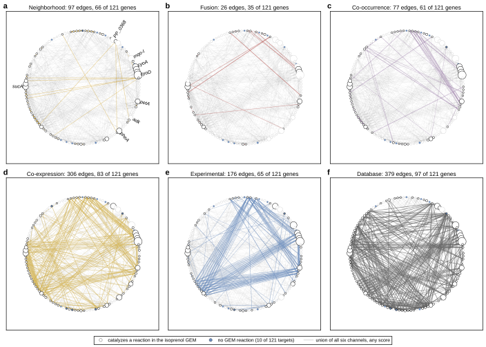
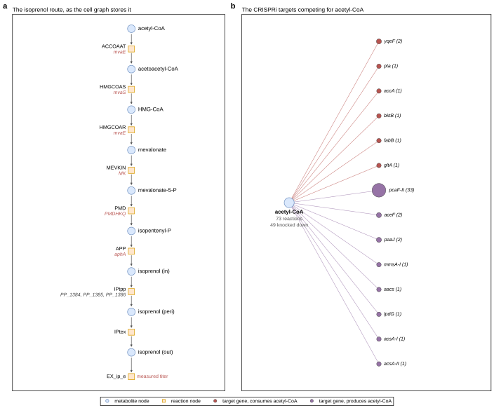

## 2026.11.17 - Scope, End Criterion, and What Is Measured So Far

This note is the standing reference for the *Pseudomonas putida* CGT + metabolic
module program. It is written to survive across sessions: the end criterion in
"MVP end criterion" is the contract, and every later session should read it
before adding work.

### Why P. putida, and what the phenotype is

The target is aviation biofuel. *P. putida* KT2440 carrying a heterologous
mevalonate route secretes isoprenol, the precursor to the sustainable aviation
fuel candidate. The phenotype we predict is isoprenol titer in mg/L at the 48 h
assay point, and the genotype is a multiplexed CRISPRi design: 1 to 4 sgRNAs
against native genes, carried on a dCas9 vector, in a strain that also carries
the pathway plasmid.

This is the bacterial counterpart of the yeast 031 program (CGT plus metabolic
module, betaxanthin as the metabolite readout). Here the metabolite readout is
isoprenol, and the metabolic model already contains the exchange reaction for
it, so the readout is a metabolite token in the same sense 046 uses one.

### Strain and genome: already in the tier, nothing to provision

The strain question is settled and the genome is already pinned. There is no
genome work in this program.

| item | value | where |
|---|---|---|
| organism, strain | *Pseudomonas putida* KT2440 | Dryad metadata `Organism`; `kt2440.py` |
| base engineered chassis | `IY1449b` (+ pIY670 = `IY1452b`) | Dryad `Strain_ID`; loader |
| assembly set id | `pputida_KT2440_ASM756v2` | `torchcell/sequence/genome/registry.py:108` |
| GenBank / RefSeq assembly | `GCA_000007565.2` / `GCF_000007565.2` | `KT2440_ASSEMBLY` in `kt2440.py` |
| replicon | `AE015451.2` (= NC_002947.4), 6,181,873 bp | `kt2440.py` |
| locus tags | `PP_####`, 5,786 loci (5,621 numbered) | `KT2440_LOCUS_TAG_PATTERN` |
| pinned bytes | 10 files + `manifest.json` + `SHA256SUMS`, `provenance_complete: true` | `$DATA_ROOT/torchcell-genomes/pputida_KT2440_ASM756v2/` |
| GO | `109.P_putida_KT2440.goa` (GAF 2.2, taxon 160488) | same |

`PPutidaKT2440Genome(BacterialGenome[PPutidaKT2440Gene])` is the exact analogue
of `SCerevisiaeGenome`, sitting on a 1,245-line shared bacterial layer
(`torchcell/sequence/genome/bacterial.py`) with GenBank-first ingest, a RefSeq
`old_locus_tag` crosswalk and a six-layer `resolve_gene_name`. Siblings already
exist for E. coli K-12, REL606, W3110 and *P. kudriavzevii* SD108.

Key files:

- `/home/michaelvolk/Documents/projects/torchcell/torchcell/sequence/genome/pputida/kt2440.py`
- `/home/michaelvolk/Documents/projects/torchcell/torchcell/sequence/genome/bacterial.py`
- `/home/michaelvolk/Documents/projects/torchcell/torchcell/sequence/genome/registry.py`
- `/home/michaelvolk/Documents/projects/torchcell/scripts/provision_bacterial_genomes.py`

### What already exists, and what the gaps actually are

This was the biggest correction of the first session. The P. putida side of
torchcell is not a blank slate: there are **16 loaders in
`torchcell/datasets/pputida/` (44,212 lines) and 32 served P. putida datasets in
KG 4.0.**

The Carruthers campaign itself is **already loaded and already served**:
`torchcell/datasets/pputida/carruthers2025.py`, 6,593 lines, the largest loader
in the package, with four dataset classes.

| class | experiment type | served records |
|---|---|---|
| `IsoprenolTiterCarruthers2025Dataset` | `ProductTiterExperiment` | 502 (465 campaign + 37 panel) |
| `CampaignProteomeCarruthers2025Dataset` | `ProteinAbundanceExperiment` | 465 |
| `ProteomeCarruthers2025Dataset` | `ProteinAbundanceExperiment` | 21 |
| `ProteomeFoldChangeCarruthers2025Dataset` | `ProteinFoldChangeExperiment` | 16 |

Record identity is (CRISPRi construct, DBTL cycle). The loader already models
everything I had assumed was owed: the `IY1449b` chassis on a `ReferenceGenome`
pinned to `pputida_KT2440_ASM756v2`, the five pIY670 pathway genes as
`HeterologousPathwayPerturbation`, each guide as a
`CrisprInterferencePerturbation` on its `PP_` tag, the 86 kb host deletion as a
`BackgroundAllele` / `AlleleEdit` / `GenomicSpan` of 86,812 bp at
4,538,575..4,625,386 (resolving `zwf`, `glZ`, `liuC`, `ldhA`), and
`M9_NREL_CARRUTHERS2025` as the environment. The served 465 reconciles with the
paper's 472 strains because 7 strains carry six replicates, which matches the
472 design-cycle cells measured above.

So the real gaps are these, and they are the work:

1. **The DBTL cycle label is not materialized in the served graph.** It is the
   loader's record identity and it sits in the raw mirror's `DBTL_Cycle`
   column, but a permissive regex over the full serialization of every record in
   all four Carruthers stores finds no DBTL token, and `screen_id` is empty
   throughout. That test is from
   [[experiments.database.pputida-cell-state]] (worktree
   `docs/pputida-cell-state`), not mine. Corroborating it from the loader side:
   `cycle` appears there only as a build-time dict key
   (`by_strain[(construct, cycle)]`) and inside verification diagnostic labels
   (`label=f"{construct} DBTL{cycle}"`, `carruthers2025.py:5019,6217`), never as
   a field on a stored record. **This blocks MVP criterion 2 outright**, since
   cycle extrapolation needs the cycle. It is also what blocks the vector
   token, because the vector is a function of the cycle. Fixing this is the
   first task of the next session.
2. **No STRING for any bacterium.** `torchcell/graph/graph.py` is yeast-only and
   hard-codes the `4932.` prefix. Taxon 160488 is already known to the codebase
   from the GOA spec but never used for STRING.
3. **No bacterial regulatory graph.** No RegulonDB, Abasy, CollecTF or
   RegPrecise ingestion exists. The only bacterial TRN in the repo is an
   unopened RegulonDB file inside the Lamoureux 2023 release, classified in
   `notes/plan.bacteria-si-phenotype-audit-ecoli.md` as annotation, not a
   measurement.
4. **iJN1463 is not in the repo or any data tier.** Every metabolic-module code
   path hard-codes `YeastGEM` / yeast-GEM 9.0.2.
5. **ESM2 and ProtT5 are typed to `SCerevisiaeGenome`.** Only GenSLM, codon
   frequency, one-hot and random are genome-agnostic today, and
   `NodeEmbeddingBuilder.EMBEDDING_CONFIGS` has no `data/pputida/...` roots.
6. **No HiGenLM, HiSan, Evo or Evo 2 code anywhere.** One aspirational mention
   in `notes/paper.north-star.md:74`.

### The campaign: 7 DBTL cycles, and cycle 3 is cycle 2 on a new vector

Every number in this section and the two that follow is regenerated by
`experiments/048-pputida-isoprenol-cgt/scripts/carruthers_campaign_audit.py`,
which writes `results/carruthers_campaign_audit.json`,
`results/design_reuse_across_cycles.csv`, `results/vector_per_cycle.csv` and
`results/titer_by_cycle.csv`. Measured from `Carruthers_etal_2025.csv`:

| quantity | value |
|---|---|
| rows (line x replicate) | 1,506 |
| DBTL cycles | 0 through 6 |
| distinct designs (target sets) | 402 |
| distinct gene targets | 121 |
| replicates per design | 3 for 458 of 472 design-cycle cells |
| no-gRNA controls | 12 per cycle, 18 in cycle 0 |
| sgRNAs per design | 1 in cycle 0, then 2 to 4 |

Design reuse across cycles is negligible everywhere except one pair. Cycle 2
and cycle 3 share **50 designs**; no other cycle pair shares more than 7. That
is the plasmid-swap experiment, and the released plasmid table names the swap:

| cycles | vector | description (SI Table 3) |
|---|---|---|
| 1, 2 | `pIY989` (JBx_249165) | `pRSF1010-Gm-NagR-pNagAa-dCas9-thrLABC-sfGFP` |
| 3, 4, 5, 6 | `pDBTL3-6_Vector` (JBx_273384) | `pRSF1010-Gm-L7-NagR-pNagAa-dCas9-thrLABC-sfGFP` |

The two descriptions differ by the `L7` linker ahead of `NagR`. On the 50 shared
designs, measured on mean titer per design:

| statistic | value |
|---|---|
| cycle 2 vs cycle 3, Pearson | 0.670 (n = 50) |
| cycle 2 vs cycle 3, Spearman | 0.668 |
| same, on fold-over-control | 0.670 |
| mean paired difference | -2.5 mg/L (312.9 vs 310.3) |
| within-cycle split-half reliability, cycle 2 | 0.946 [0.926, 0.973] |
| within-cycle split-half reliability, cycle 3 | 0.980 [0.974, 0.985] |
| mean dCas9 signal, cycle 2 vs cycle 3 | 2.63e6 vs 4.31e6 (1.6x) |

The reliability numbers are Spearman-Brown corrected split-half over 400 random
replicate splits. The replicate ceiling is 0.95 to 0.98 and the same designs on
the new vector agree at only 0.67, so something beyond replicate noise changed
between cycles 2 and 3. That part is measured and stands.

#### Correction, same day: the mechanism is dCas9 fidelity, not plasmid context

My first reading of the above was that the vector is a biological context
variable and belongs in the model as a token. **That was wrong, and the paper
says so directly.** Quoting Carruthers et al. 2025 Results verbatim from the
mirrored `paper.md`:

> Notably, we suffered $40 \%$ failure in DBTL2 strains owing to low dCas9
> expression (Supplementary Fig. 6). Following DBTL2, we repaired the dCas9
> vector to eliminate a redundant linker and reduce spurious recombination
> during adaptation, thereby increasing dCas9 fidelity. DBTL3 was then repeated
> with the same sgRNA arrays from DBTL2, with a noted $2 5 \%$ improvement in
> dCas9 fidelity.

and, on what they did about it:

> Although the repair only reduced the incidence of recombination, models after
> DBTL3 were trained only on data from the improved dCas9 plasmid, consolidating
> our design space to the 18 unique sgRNA that passed proteomics filters in
> DBTL3.

So the cycle 2 to 3 change is a **construct-fidelity repair on the same
pRSF1010-Gm backbone** (a redundant linker removed, hence the `Linker7` oligos
in SI Table 2), not a backbone swap and not a change of biological context. The
40% DBTL2 failure rate from low dCas9 is the cause of the lost correlation: a
strain whose sgRNA array recombined carries that defect across its own
replicates, which is exactly why within-cycle reliability stays at 0.946 while
the independent rebuild in cycle 3 re-rolls it. **High within-cycle reliability
does not distinguish a context effect from a per-construct fidelity defect, and
I treated it as though it did.**

The right reading: the pre-repair cycles are a lower-fidelity measurement tier,
and the authors themselves trained only on the post-repair cycles. What follows
for us:

- **Not** a vector token standing for biological context.
- The primary arm is the tier question: train on cycles 3 through 6 (improved
  plasmid) and ask whether adding cycles 0 through 2 helps or hurts. That
  mirrors the authors' own choice and is falsifiable.
- Use the authors' released QC columns rather than inventing a filter:
  `above_dcas9_thresh`, `to_keep`, and `to_keep_improved` (717 True / 789 False
  over the 1,506 rows).
- A two-level token is still a reasonable *encoding* of the tier, but it is
  encoding measurement quality, and the note must not call it context.

The 0.670 figure keeps its value as a ceiling statement: it bounds what any
model can score when trained on pre-repair data and tested on post-repair data.
It is not evidence of a plasmid effect on the biology.

### Provenance audit of the shared folder

Juan's folder is `/tmp/screenshots/04_Data`. Its phenotype content is fully
reproducible from the already-mirrored published record. Verified: all 1,506
titer rows in `Carruthers_etal_2025.csv` match the published SI
(`si9.xlsx`, sheets `Figure 1D` and `Figure 4b`) with **maximum absolute
difference 0** on 3,012 matched comparisons, 0 unmatched. So the CSV is
a derived analysis-ready join, not a new measurement, and the loader must source
from the mirror, not from the CSV.

Mirror key: `carruthersAutomationMachineLearning2025`, already present in both
`$DATA_ROOT/torchcell-library/` (paper, OCR, si1 through si9) and
`$DATA_ROOT/torchcell-raw/` (SI xlsx plus the Dryad deposit). The raw-mirror
provenance is already complete for the published part: the Dryad deposit carries
DOI `10.5061/dryad.gtht76hzh`, version `v20250820`, retrieved by hand on
2026-10-09 under `RetrievalMethod.manual_browser` because Dryad serves an Anubis
JS proof-of-work to scripts. Per-cycle raw DIA sits in PRIDE
(`PXD063733`, `PXD063737`, `PXD063738`, `PXD063740`, `PXD063743`, `PXD063744`,
`PXD063746`), recorded in the loader as `PRIDE_ACCESSIONS` and read by nothing.

Already in the mirror, and the existing loader already reads it:

| content | mirror path |
|---|---|
| per-line titers, cycle, control flag, QC filter | `torchcell-library/.../si/si9.xlsx` |
| 121 gene targets, source, RbTnSeq presence, dCas9/POI ratios, cycle usage | `.../si/si4.xlsx` (SI Table 1) |
| all plasmids with JBEI accessions and descriptions | `.../si/si6.xlsx` (SI Table 3) |
| the 361 CRISPRi arrays by cycle, construct, sgRNA count, vector | `.../si/si7.xlsx` (SI Table 4) |
| oligonucleotides | `.../si/si5.xlsx` (SI Table 2) |
| proteome, per line per replicate, ~1,700 UniProt columns, with titer | `torchcell-raw/.../data/dryad/CRISPRi_automation_Pputida_proteomic_Top3_peptide_quantification_method_data.csv` (1,496 rows) |
| full environment record | `torchcell-raw/.../data/dryad/CRISPRi_automation_Pputida_proteomic_metadata.csv` (1,497 rows) |

The environment record is complete enough to fill `Environment.media` without a
gap: M9-NREL, glucose 20 g/L, 24 C, 1000 rpm, 48-well BioLector flower plate,
L-arabinose 2 g/L induced at 8 h, assayed at 48 h.

**Not in the mirror, and therefore owed to the data lake.** These are the files
Juan shared that the publication does not release as sequence, so each needs a
raw-mirror entry with `source_url` (or a manual recipe naming Juan and the date
received), `retrieval_method`, `sha256` and `retrieved_at`:

| file | what it is | note |
|---|---|---|
| `dbtl2-1.gb` | 11,046 bp dCas9 + sgRNA array plasmid, cycle 2 example | RSF1010 oriV, `aacC1` Gm, `pnagAa`-dCas9, J23119 array, BASIC scars |
| `dbtl3-1.gb` | 11,046 bp, cycle 3 example | differs from `dbtl2-1.gb` at only 29 nt, all in the spacer region from 1,347 |
| `dbtl0-2_plasmid.fasta` | 9,959 bp "non-sgRNA plasmid used in DBTL0-2" | |
| `dbtl3-6_plasmid.fasta` | 14,066 bp, header says DBTL0-2 but the filename says DBTL3-6 | header is inconsistent, resolve with Juan before pinning |
| `86kb_deletion.csv` | 58 genes in the host's 86 kb deletion | corroborates the `GenomicSpan` the loader already carries (86,812 bp, 4,538,575..4,625,386), so this is a cross-check, not a new source |
| `pputida_isoprenol.json` | iJN1463 plus the isoprenol route | diff below; check whether the paper's GitHub releases it before treating it as unpublished |

Two things to resolve with Juan rather than guess. First, the
`dbtl3-6_plasmid.fasta` header names DBTL0-2 while its length (14,066) differs
from the DBTL0-2 file (9,959) by 4,107 bp, so one of the two labels is wrong.
Second, SI Table 3 gives a JBEI accession for every plasmid, so part of this may
be retrievable from the JBEI registry, which would be a better provenance route
than a hand-received file.

### The metabolic model, and why the readout is native to it

`pputida_isoprenol.json` is iJN1463 with the isoprenol route added. Measured
diff, from the same audit script:

| | iJN1463 | isoprenol model |
|---|---|---|
| reactions | 2,927 | 2,958 |
| metabolites | 2,153 | 2,178 |
| genes | 1,462 | 1,474 |
| objective | `BIOMASS_KT2440_WT3` | `BIOMASS_KT2440_WT3` |

The added genes are `mvaE`, `mvaS`, `MK`, `PMDHKQ`, `aphA` (heterologous, no
`PP_` id) plus 8 native `PP_` genes. The added reactions carry the mevalonate
route to isoprenol (`HMGCOAS`, `HMGCOAR`, `MEVKIN`, `PMD`) and, importantly,
`EX_ip_e` with `ip_c`, `ip_p`, `ip_e`. So the phenotype we predict is a native
exchange reaction of the model, which is the condition 031 wanted and did not
get for betaxanthin: the metabolite readout is a node in the metabolic module,
not an external regression target bolted on.

The heterologous genes are also the pathway plasmid's content, which closes the
loop with the sequence-level genotype principle: pathway plasmid, dCas9 vector,
and host 86 kb deletion are all edits to the total genomic content in the cell,
and all three are things we hold sequence for.

### Dataset size, and why this is a transfer problem

The supervised target is small: 465 served titer records over 402 designs and
121 targets. On its own that will not train a CGT, and a transformer losing to a
boosted tree on 402 designs is the expected outcome, not a surprise, which 030
already measured in yeast.

What makes the program viable is that the P. putida side of the store is not
small. The two largest served P. putida datasets are
`RbTnseqBorchert2024Dataset` at **1,466,920 records** and
`FitnessBrowserPutidaDataset` at **1,118,052**, plus the 321-sample transcriptome
compendium `PutidaPrecise321Lim2022Dataset`. So this follows the 040 pattern,
general model then fine-tune: pretrain the gene representation on the millions of
P. putida fitness records, then fit the isoprenol head on 465 records. The
metabolic model, the STRING graph and the sequence embeddings carry the rest of
the inductive bias.

Stated plainly as a hypothesis, because none of it is measured yet: **I expect
the isoprenol head to need the fitness pretraining to beat the lower-order null,
and I have not tested this.** The MVP is designed to find out, which is why the
null is on the same table as the model.

### Sequence windows for a bacterium: the ORF, not a 1 kb promoter window

The recollection of "1,000 upstream, 300 downstream" is the yeast setting
(`nt_window_five_prime_1003`, `nt_window_three_prime_300` in
`torchcell/datasets/nucleotide_transformer.py`). Measured on the pinned KT2440
GFF by `scripts/kt2440_sequence_window_budget.py`, it does not transfer:

| statistic over 5,729 KT2440 genes | value |
|---|---|
| median clear upstream gap to the neighboring gene | 88 bp |
| mean clear upstream gap | 130 bp |
| genes overlapping or abutting the upstream neighbor | 17.4% |
| genes with 100 bp clear upstream | 46.9% |
| genes with 300 bp clear upstream | 9.8% |
| genes with 1,000 bp clear upstream | **0.7%** |
| gene length, median / q99 / max | 834 / 3,431 / 26,049 bp |

For 99.3% of KT2440 genes a 1 kb upstream window is mostly the neighboring
gene's coding sequence, which is what an operonic genome implies. So a fixed
promoter window is the wrong sequence unit here, and the right one is the ORF
itself, with at most a short (100 to 200 bp) upstream flank that is understood
to reach into the neighbor.

That is also why FUDT genuinely does not apply, as the owner noted, and why the
protein-level and codon-level encoders carry more weight for this organism than
a DNA promoter-window model. GenSLM already does the right thing without
modification: its window is `("cds", GENSLM_SEQ_LENGTH * 3)` = 6,144 nt
(2,048 codons), which covers well past the 99th percentile gene, and its
`__main__` already runs P. putida KT2440.

### How to capture the promoter: at the transcription unit, not the gene

The constructive half of the window question. In a bacterium the promoter
belongs to the transcription unit, so the capture is: chain adjacent same-strand
genes into TUs, take a promoter window upstream of the TU **leader** only, and
let every gene in the TU inherit its leader's promoter.

The operon threshold is measured, not assumed, by
`scripts/kt2440_transcription_unit_promoters.py`. The negative class is
**divergent** gene pairs, which cannot share a TU and must hold promoters in
their gap; convergent pairs are reported as the terminator-containing control.

| median intergenic gap, by orientation | value |
|---|---|
| tandem (same strand, n = 4,014) | 42 bp |
| convergent (n = 857) | 72 bp |
| divergent (n = 857) | **178 bp** |

A gap that has to hold two promoters is 4.2x a tandem gap. The threshold scan
shows how sharply that separates:

| tandem gap at or below | tandem | divergent | enrichment |
|---|---|---|---|
| 0 bp | 0.240 | 0.018 | 13.7x |
| 20 bp | 0.423 | 0.028 | **15.1x** |
| 40 bp | 0.496 | 0.041 | 12.1x |
| 100 bp | 0.689 | 0.173 | 4.0x |
| 150 bp | 0.793 | 0.400 | 2.0x |
| 300 bp | 0.937 | 0.823 | 1.1x |

So a tandem gap under about 40 bp essentially never holds a promoter, and past
roughly 150 bp the distinction is gone. Taking 40 bp as the chaining threshold:

| result | value |
|---|---|
| transcription units from 5,729 genes | 3,740 |
| multigene units | 1,107 (largest 14 genes) |
| promoter window upstream of a TU leader, median available | **151 bp** |
| units with no promoter window at all | 3 |
| units hitting the 300 bp cap | 581 |

That is the payoff: per gene, the median clear upstream is 88 bp and about a
thousand genes have none at all. Per TU leader it is 151 bp and **three** units
have none. Moving to the TU nearly doubles the promoter sequence available and
removes the zero-window problem almost entirely.

Rules that follow, and they are implementation requirements, not preferences:

- The window is **clipped, variable-length, and never padded with coding
  sequence**. The available length is itself a feature, so the model can tell a
  200 bp promoter from a leader that abuts its neighbor instead of being handed
  a silently contaminated window.
- Cap at 300 bp, near the divergent median, since that is roughly how much
  sequence a gap that genuinely holds a promoter offers.
- Genes in one TU **share** a promoter representation. This also matters
  mechanistically for CRISPRi: a guide against an internal gene of a 14-gene
  operon is not the same perturbation as one against the leader, and the TU
  assignment is what lets the model express that.
- The threshold is a parameter with a measured basis, not a constant to be
  tuned quietly. 20 bp maximizes separation, 40 bp trades a little separation
  for longer units; report which was used.

A caveat on all of the above: this is **predicted** operon structure from gene
adjacency, not measured transcription units. The honest upgrade is a TSS or
operon measurement. The already-served
`PutidaPrecise321Lim2022Dataset` (321-sample transcriptome compendium) can test
the TU calls directly by within-TU versus across-TU co-expression, which is a
real validation available without new data. Do that before leaning on the
predicted TUs for anything load-bearing.

### Promoters in this dataset vary on the plasmid, not the chromosome

A distinction that matters for how promoter sequence is used here. CRISPRi does
not edit promoters, so **native promoter sequence is constant across every
strain in 048**. It is a per-gene node feature, useful through pretraining and
transfer across the millions of P. putida fitness records, and it cannot by
itself explain any variation in isoprenol titer.

What varies per record is the engineered expression context: the sgRNA array
promoter (`J23119`, constant), the dCas9 promoter (`pnagAa`, salicylate
inducible, constant), the pathway plasmid promoters (`PBAD`, `Ptrc1-O` on
pIY670), and the one that actually changes, the **vector**, where SI Table 2
lists `Linker7_Insert_F/R` as a 70 nt insert, corroborating that the
`pIY989` to `pDBTL3-6_Vector` difference is the L7 linker ahead of `NagR`.

**A gap to raise with Juan:** the sgRNA spacer sequences are not in the released
tables. SI Table 2 holds check primers, SI Table 4 names the arrays by target
set, and the only spacers we hold are in the two example genbanks, where
`dbtl2-1.gb` and `dbtl3-1.gb` differ at 29 nt in the spacer region. Without the
spacer table we cannot compute guide position relative to the TU leader or the
TSS, which is likely the strongest promoter-adjacent feature available for a
CRISPRi dataset, since repression strength depends on where dCas9 binds. Ask
for the spacer table or the full plasmid set.

Planned encoder set, grouped by what it reads and in the order the sanity
checks come first:

| encoder | reads | status in repo |
|---|---|---|
| one-hot | ORF | genome-agnostic, works today |
| random (several seeds) | nothing, control | genome-agnostic, works today |
| codon frequency | CDS | genome-agnostic, works today |
| **GenSLM 25M / 250M PATRIC** | CDS, 6,144 nt | genome-agnostic, bacterial-trained, already runs on KT2440, weights on disk: **the MVP encoder** |
| HiGenLM / HiSan | nucleotide, long context | **deferred past the MVP**; needs repo access, weights and terms from the Ramanathan lab |
| ESM2 | protein | typed to `SCerevisiaeGenome`, needs the type relaxed |
| ProtT5 | protein | typed to `SCerevisiaeGenome`, needs the type relaxed |
| CaLM | CDS codons | `CalmDataset` exists, CDS-based |
| Nucleotide Transformer | ORF rather than flanks | class exists, windows are yeast-tuned |
| Evo or Evo 2 | nucleotide, long context | no code, new dataset class |

One-hot plus the randoms are the floor the whole table is read against, and they
run first, before any new model is added, so the pipeline is proven end to end
on encoders that cannot be blamed.

### External resources, and the decisions the numbers force

Researched 2026-11-17. Items marked unverified were not read at source.

**The locus-tag trap, which is the cheapest thing to get wrong.** The two NCBI
annotations disagree on the primary tag:

| annotation | primary `locus_tag` | `old_locus_tag` |
|---|---|---|
| GenBank `AE015451.2` (TIGR) | `PP_0001` ... | none |
| RefSeq `NC_002947.4` (PGAP) | `PP_RS00005` ... | `PP_0001` |

Carruthers, iJN1463, STRING, RegPrecise, CollecTF and iModulonDB all speak
`PP_####`, so key on the GenBank assembly or join through RefSeq's
`old_locus_tag`. We are already correct here: `KT2440_ASSEMBLY` makes
`GCA_000007565.2` primary and `bacterial.py` carries the RefSeq crosswalk. Keep
it that way. A related naming hazard: NCBI records the synonym *Pseudomonas
alloputida* KT2440 with 90.66% ANI to the *P. putida* type assembly and
`taxonomy_check_status: Inconclusive`, so any cross-resource join keyed on a
species string will silently miss records. Join on taxid 160488.

**STRING: mirror the slice, not the database.** This settles the open question
directly, and against the instinct.

| scope | compressed size |
|---|---|
| taxon 160488, all 18 per-organism files | **36.1 MB** |
| all organisms, everything | **~682 GB** |
| all organisms, `.full` tier only | ~285 GB |

A 19,000x difference for one organism. Take the 160488 slice, plus
`species.v12.5.txt` and the four global COG link files (~82 MB) since COG is
not published per organism. `COG.mappings` (755 MB) only if orthologous-group
mapping is wanted. If we later serve many organisms the calculus changes, but
then the right unit is a per-taxon slice each, not the monolith.

Other STRING facts that change our code:

- **Current release is v12.5, live 2026-09-29.** `graph.py` hard-codes v12.0,
  which is still served. Add v12.5 rather than silently moving.
- v12.5 adds a **third, directed network, `protein.regulatory.links`**, with
  3,972 directed edges for KT2440. That is larger than every curated regulatory
  resource below combined, but its evidence is predominantly transferred rather
  than measured, so it is a separate tier, not a peer of CollecTF.
- KT2440 has 5,564 STRING proteins, matching the GenBank proteome exactly, ids
  of the form `160488.PP_0001`.
- Scores are integers 0 to 1000, pre-filtered at `>= 150`. `combined_score` is a
  naive-Bayes combination with a random-expectation correction, **not a sum or
  max**, and can fall below a channel score. `.full` splits each channel into
  direct and `_transferred`; for KT2440 much of the network is transferred, so
  keep that split as an edge feature instead of collapsing it.
- **STRING publishes no checksums or manifest for any file.** Hash on first
  retrieval, which is what our provenance model does anyway.
- License CC BY 4.0, and it asks that the version appear in metadata. Record
  `v12.5`.

**Regulatory graph: there is no TFLink for P. putida. Three of the obvious
candidates have literally zero KT2440 content.**

| resource | KT2440 | TFs | edges | license |
|---|---|---|---|---|
| **SBRG `modulome_ppu` TRN** | yes | **94** | **1,993** | **MIT** |
| STRING v12.5 regulatory | yes | n/a | 3,972 directed | CC BY 4.0 |
| RegPrecise v3.2 (`genome_id=267`) | yes | 49 | 301 unique | none stated |
| CollecTF / reCollecTF | yes | 16 | 264 (95 verified) | MIT (app) |
| RegulonDB v13 | no, E. coli only | 0 | 0 | unverified |
| Abasy Atlas v2.9 | **no** | 0 | 0 | CC BY-NC 4.0 |
| PRODORIC | **no** | 0 | 0 | n/a |

The pick is the **SBRG TRN**, and it is a pleasing fit: it ships with Lim et al.
2022, *Metab Eng* 72:297-310, doi `10.1016/j.ymben.2022.04.004`, the very paper
whose 321 expression profiles we **already serve** as
`PutidaPrecise321Lim2022Dataset`. So the regulatory prior and the transcriptome
compendium come from one pinned source. 1,993 edges, 94 regulators, 1,532 target
genes (27.5% of the proteome), largest regulons FleQ 299, TurA 227, GacA 180.
File: `TRN_update_210616.csv` on branch `master` of `SBRG/modulome_ppu` (the
`main` branch 404s).

Two things to carry as features rather than filters, per "the data is the data":
`effect` is `unknown` on all 1,993 edges, so the prior is **unsigned**, unlike
TFLink; and 611 of the edges are *P. aeruginosa* ChIP-exo transferred by
orthology, flagged by a `Pputida` column that splits 1,352 true / 641 false.
Dropping the transferred edges costs a third of the graph, and hiding the flag
makes 30% of the prior silently cross-species. Keep the flag.

Add RegPrecise and CollecTF as separately tagged tiers. Marginal gains are
lopsided: RegPrecise adds only 27 edges beyond the TRN (which already ingested
335 RegPrecise edges), while CollecTF adds 241, and CollecTF is the only tier
with per-site experimental verification. **RegPrecise gotcha:** it mixes
`PP4489` and `PP_1021` styles in one file, so without a
`PP_?(\d{4}) -> PP_\1` normalization the genome join drops nearly all of it.
**CollecTF gotcha:** the whole database is at `collectf.org/CollecTF.db.gz`,
73 MB, which despite the name is an uncompressed SQLite file, so `gunzip` fails
and it should just be renamed.

Pooled union after normalization: 2,261 edges, 98 regulators, 1,628 genes, 29.3%
coverage, unsigned. That is the honest ceiling of what a curated bacterial
regulatory prior buys here, and it is a fraction of what yeast gets from
TFLink and YeastRACT.

**Metabolic model.** iJN1463 confirmed current in BiGG (2,927 reactions, 2,153
metabolites, 1,462 genes, `genome_ref_string: ncbi_accession:NC_002947.4`), with
a naming wrinkle worth recording: BiGG serves it as `iJN1463` while the paper's
own file is `iJN1462`, and secondary sources split between the names. Citation
Nogales et al. 2020, *Environ Microbiol* 22(1):255-269, doi
`10.1111/1462-2920.14843`.

Two newer models exist. The one that matters is Mueller et al. 2026, *mSystems*,
doi `10.1128/msystems.01594-25`, a pan-putida reconstruction over 164 strains
that also **updates the KT2440 model itself** (+158 core, +308 accessory, +33
rare reactions over iJN1463), with everything on Zenodo
`10.5281/zenodo.17382094`. Pin iJN1463 first because Carruthers used it, then
evaluate the 2026 update as a second pinned artifact. There is also an ME model,
`iPpu1676-ME` (Tibocha-Bonilla et al. 2025), whose download location and license
I could not verify.

Also worth knowing: Carruthers picked its CRISPRi targets with **FluxRETAP**
(Czajka et al. 2025, *Bioinformatics* 41:btaf471, code at
`github.com/JBEI/FluxRETAP`) running on iJN1463, which is what SI Table 1's
"Source (Flux-RETAP or Heuristic)" column records. The chassis itself comes from
Banerjee et al. 2024, *Metab Eng* 82:157-170, doi
`10.1016/j.ymben.2024.02.004`, which is also the source of the 86 kb deletion.
Intersecting that deletion against the GenBank annotation removes **57 genes,
PP_4029 through PP_4085**, consistent with the `GenomicSpan` the loader carries.

**Encoders: licensing disqualifies the obvious choice, and ours is already on
disk.**

| model | license | verdict |
|---|---|---|
| GenSLM 25M / 250M PATRIC | weights carry **no stated license** | **start here, and for the MVP this is the only one: weights already on GilaHyper** |
| Nucleotide Transformer, all variants | CC BY-NC-SA 4.0 (verified on the HF API) | fine to use, see the licensing note below |
| Evo 1 (`evo-1-131k-base`) | Apache-2.0 | prokaryote-only, the clean control arm |
| Evo 2 (`evo2_7b`) | Apache-2.0 | adds eukaryotes, so prokaryotes no longer dominate |
| `tattabio/gLM2_650M` | Apache-2.0 | models a contig as proteins plus intergenic DNA |
| `DOEJGI/GenomeOcean-4B` | BSD 3-clause (LBNL) | commercial use fine |
| ESM-2 `esm2_t33_650M_UR50D` | MIT | dim 1280, the recommended checkpoint |
| ProtT5 `prot_t5_xl_half_uniref50-enc` | **repos declare no license** | code is MIT, weights are a gap |
| CaLM | BSD-3 code, **weights unlicensed** | loaded via bare `pickle.load` from a hardcoded URL |

**Licensing note, and a correction to my own framing.** I first wrote that the
Nucleotide Transformer was "disqualified by license". That was wrong. The
license is real (`cc-by-nc-sa-4.0`, verified on the HF API for the v2 50M, v2
500M, 2.5B and segment-NT repos), but CC BY-NC-SA restricts **commercial** use,
and academic research in an open-source academic project is the paradigm
non-commercial use. ShareAlike binds adapted material that is distributed; we
download weights at runtime and ship code that calls them, which is not
adaptation. It was also inconsistent with existing practice, since the yeast
line already uses `NucleotideTransformerDataset`. Owner's position, 2026-11-17:
this is an open-source academic project, so there is no reason not to use it.

The only narrow cases to keep in mind are redistributing weights or publishing
an embedding dataset as a release artifact, and any future commercial licensing
of a resulting model. Neither is in scope.

Worth recording the opposite finding, because it inverts which model is the
awkward one: **ProtT5 and GenSLM state no license at all.**
`Rostlab/prot_t5_xl_half_uniref50-enc` has no `license` field and no LICENSE
file among its seven repo files, and our local GenSLM weight directory contains
only a `manifest.json` and the two checkpoints. "No stated license" grants no
explicit permission, which is murkier than a clear non-commercial grant, and
ProtT5 is already pinned in `torchcell/models/protT5.py` and appears in thesis
Fig 3.2. In practice academic use of published weights is universally accepted
for all three; the point is only that NT is the one that actually tells you the
terms, so it should not be singled out.

Two findings that do change the plan:

1. **GenSLM is unblocked locally, and for the MVP it is the only encoder.**
   Owner's call 2026-11-17: use GenSLM for now instead of HiGenLM. Its upstream
   weight download has reportedly been broken since 2025-10-03, but we already
   hold `patric_25m_epoch01-val_loss_0.57_bias_removed.pt` and
   `patric_250m_epoch00_val_loss_0.48_attention_removed.pt` (1.1 GB) under
   `$DATA_ROOT/models/genslm`, with a `manifest.json` beside them. The 2.5B is
   not there. So this needs no download and no new code. HiGenLM/HiSan is
   **deferred, not dropped**: the repo URL 404s anonymously and the
   `ramanathanlab` org lists no `higenlm`, so it is an access question for the
   Ramanathan lab (repo, weights, terms) to be picked up after the MVP. Public
   Argonne siblings are `ramanathanlab/genslm` (MIT) and
   `ramanathanlab/genslm-embeddings` (MIT).
2. **`gLM2` is the most interesting new option** for us specifically, because it
   models a contig as a sequence of proteins plus intergenic DNA, which lines up
   with the transcription-unit framing above: the intergenic token span *is* the
   promoter region. Gotcha to respect: its vocabulary uses lowercase `a t c g`
   for nucleotides and uppercase `A T C G` for alanine, threonine, cysteine and
   glycine, so uppercasing DNA makes it silently read intergenic sequence as
   protein.

Proteome cost is a non-issue: 5,564 proteins, mean 327.9 aa, and only 83 genes
(1.49%) exceed the 1,022-residue ESM-2 and CaLM window, so handle those
explicitly rather than redesigning around context length. Reported benchmark on
one RTX 6000 Ada: ESM-2 650M embedded the proteome in 41.6 s at 2.38 GiB,
ProtT5-XL encoder in 142.9 s at 9.53 GiB (unverified by me). Note our
`torchcell/models/protT5.py` pins `prot_t5_xl_uniref50` and already discards
the decoder via `T5EncoderModel`, so repinning to the encoder-only half-precision
checkpoint cuts the download from 22 GB to about 2.8 GB for identical output.

**Expression-system data for P. putida: thinner than hoped, and the specific
thing asked for does not exist.**

| dataset | what it measures | access |
|---|---|---|
| **Elmore 2017**, doi `10.1016/j.meteno.2017.04.001` | the only true KT2440 synthetic promoter library: 36 core promoters (6x6 -35 x -10), UP and RBS variants, single-copy Bxb1 integration, 72-fold range | CC BY 4.0, SI zips at `ars.els-cdn.com` |
| **Liebal 2021 / Köbbing 2020**, doi `10.3389/fbinf.2021.747428` | largest sequence-to-expression table: 550 rows, 102 KT2440 strains, 40 bp sequences, mini-Tn7 single copy | repo `iAMB-RWTH-Aachen/Exp2Ipynb`, GPL-3.0 |
| **openCIDAR**, doi `10.1021/acssynbio.3c00104` | 18 expression units (3 promoters x 6 RBS) on pBBR1 across 4 hosts incl. KT2440, MEFL-calibrated, plus ddPCR copy number | repo has **no license file**, clear with authors |
| **Cook 2018**, doi `10.1007/s10295-017-2001-5` | KT2440 copies per chromosome: BBR1 30+-7, RK2 30+-10, RSF1010 130+-40 | Table 1 only, not downloadable |
| **Jahn 2016**, doi `10.1186/s12934-016-0610-8` | 7 pSEVA plasmids differing only in replicon, ddPCR + EGFP + growth rate | CC BY 4.0, CC0 data, but **host is E. coli** |

Two honest negatives, which are findings rather than search failures:

- **No Sort-seq or MPRA exists in P. putida, and no pooled barcoded RBS library
  exists in any Pseudomonas.** In-vivo KT2440 promoter and RBS libraries top out
  around 10^2. The large libraries are in *P. aeruginosa* PAO1 or in KT2440
  **cell-free lysate**, not in the cell.
- **There is no head-to-head antibiotic versus auxotrophic marker burden study
  in P. putida**, and no study measures copy number and reporter expression and
  growth rate across four or more replicons with deposited per-construct
  numbers. So the "aux markers under different promoters" data the owner hoped
  for is not available to learn a plasmid representation from. The openCIDAR
  result is also cautionary: expression did not track copy number across hosts.

A trap to avoid: **SAGE-RTP** (1,435 promoter variants, 5 hosts, Elmore et al.
2023) looks like the ideal dataset and is not KT2440 at all; its *P. putida*
strain is **GPo1**. Likewise Hanko 2020 is *C. necator* H16 and Gilman and Love
is *Geobacillus*, despite all three being cited in this context.

**The pretraining corpus, with a provenance catch.** The RB-TnSeq Fitness
Browser database (`feba.db`, 10.4 GB, `orgId = Putida`) carries **no license on
the website**; the license is CC BY 4.0 only on the figshare archive deposits.
So take the bytes from figshare and pin the DOI
(`10.6084/m9.figshare.32865896.v1`, or the per-organism split
`10.6084/m9.figshare.25236931.v1` at 56 MB), not from the live site. Carries an
erratum: disregard the sucrose and D-mannitol data, bad stock solutions. Derived
on top of it, Borchert et al. 2024, *mSystems* 9:e00942-23, CC BY 4.0, gives 84
fModules over 4,732 genes x 332 samples, repo `fModules/putida-code`.

### Core reusable objects versus experiment-local assembly

The division the owner asked for: reusable objects in core, the dataset that
combines them in the experiment. Following the 031 precedent, where
`torchcell/models/cell_graph_transformer_metabolism.py` subclasses the CGT
unchanged and the whole study lives in `experiments/031-betaxanthin-module/`.

**Goes in core (`torchcell/`), because a second organism will need it:**

| new object | where | why core |
|---|---|---|
| a host-parameterized STRING builder | `torchcell/graph/` | `graph.py` hard-codes `4932.`; the taxon, the id-to-locus-tag mapping and the channel set are the only organism-specific parts |
| `PPutidaGraph` (or a generalized `<Host>Graph`) | `torchcell/graph/` | `torchcell/graph/` currently has no bacterial builder at all |
| `BiggGEM` beside `YeastGEM` | `torchcell/metabolism/` | must expose the same `model` / `gene_set` / `reaction_map` / `bipartite_graph` surface so `neo4j_cell.py` takes it unchanged |
| genome-agnostic `Esm2Dataset` / `ProtT5Dataset` | `torchcell/datasets/` | both are typed to `SCerevisiaeGenome` today; the fix is a type relaxation, not a new class |
| new embedding datasets (HiGenLM, Evo, NT) | `torchcell/datasets/` | each implements `MODEL_TO_WINDOW`, `initialize_model`, `process` per `BaseEmbeddingDataset` |
| `data/pputida/kt2440/...` embedding roots | `node_embedding_builder.py` | `EMBEDDING_CONFIGS` is all `data/scerevisiae/...` |

**Stays in `experiments/048-pputida-isoprenol-cgt/`:** the query, the dataset
assembly that joins titer + proteome + graphs + embeddings, the split
construction (design-level random and cycle extrapolation), the vector-token
arm, the baselines, the train script, the conf yamls, the readers and the
figures.

### MVP end criterion

The overnight goal, and the contract this note exists to hold stable:

1. A trained model on the 048 dataset under **random split 0.8 / 0.1 / 0.1 over
   designs** (split by design, never by replicate row, so replicates of one
   design never straddle the split).
2. The same model under **cycle extrapolation: train on cycles 0 through 5,
   predict cycle 6**. Only the last cycle is predicted from the previous ones.
   Earlier-cycle-ahead variants are out of scope for the MVP.
3. Both readouts reported as validation and test Pearson and MSE on isoprenol
   titer, train and validation curves on one axis, logged to W&B, with the
   lower-order null (per-target mean, additive, boosted trees) on the same
   table.
4. The **fidelity-tier arm**, reported both ways: trained on cycles 3 through 6
   only (the repaired dCas9 plasmid, which is what the authors used) versus
   trained on all cycles. Per the correction above this is a measurement-quality
   question, not a plasmid-context one, and it is still the most informative
   single comparison in the MVP because the 0.670 against a 0.95 ceiling bounds
   what the pre-repair cycles can contribute.

Criterion 2 carries a caveat that must travel with any result: **cycle 6 is the
anomalous cycle.** The paper ends the campaign because of it ("DBTL6 exhibited
an increase in strains that failed to pass the filter and exhibited poor
titer"), and it has by far the widest spread in our own audit (sd 197.7 against
79 to 153 elsewhere, median 245.4 against mean 319.6). Predicting cycle 6 is
therefore predicting the cycle where the assay degraded, so a poor score there
is ambiguous between a model failure and an assay failure. Report cycle 5 as the
held-out cycle alongside it, since that is the last well-behaved cycle, and let
the pair separate the two explanations.

Done means those four, with every artifact produced by a committed script in
`experiments/048-pputida-isoprenol-cgt/scripts/`.

Not in the MVP: the proteome co-head (it follows, as 046 does for yeast), the
kinetic layer, inverse design, and any new wet-lab proposal.

**Criterion 2 is blocked until the DBTL cycle reaches the served graph.** That
is gap 1 above and it is the first task, not a parallel one: without the cycle
there is no cycle split and no vector token, so criteria 2 and 4 cannot be
evaluated at all. Criteria 1 and 3 can proceed on the served titer records
meanwhile.

### The proteome pairing is better here than in yeast

Worth recording because it shapes what comes after the MVP.
`CampaignProteomeCarruthers2025Dataset` serves 465 records and
`IsoprenolTiterCarruthers2025Dataset` serves 465 campaign records, measured on
the same cultures: the Dryad quantification table carries `Isoprenol_titer` in
the same row as the ~1,700 protein columns. So proteome and phenotype are
paired one-to-one, which is stronger than the yeast situation where the omics
co-targets (Kemmeren, Messner) are gene-keyed and only partially overlap the
phenotype pool.

That makes the proteome co-head the natural first extension after the MVP, and
it can be a true co-head on the same record rather than a separately keyed
auxiliary target. It stays out of the MVP so that criterion 1 is not confounded,
but it is the obvious next arm.

### Logging and reporting conventions

Carried over so later sessions do not relitigate them:

- Train and validation loss on one axis, always.
- Per-label loss and performance logged, not just the aggregate.
- W&B views over reports, with a Charts view each round; group links per arm.
- Every number that reaches this note or a figure comes from a committed script
  in `experiments/048-pputida-isoprenol-cgt/scripts/`, reading real result
  files.
- Figures follow the repo standard (`PLOT_PALETTE`, Arial 6 pt, boxed axes,
  panel widths from `PANEL_WIDTHS_MM`, true-size SVG embedded in the note).

### Ordered plan across sessions

1. Materialize the DBTL cycle (and therefore the vector) on the Carruthers
   records. Decide with the owner whether this is a loader change plus a
   superset admission, or an experiment-local join on construct name against the
   raw mirror's `DBTL_Cycle`. The loader route is the correct one by the
   constitution; the join is the fast one. **Needs the owner's call, since a
   loader change to a served dataset triggers the admission check.**
2. Land `BiggGEM` with iJN1463 into the data tier, pinned by sha256 like the
   genomes tier, and decide whether the isoprenol-augmented model is a second
   pinned artifact or a documented derivation from it.
3. Bacterial STRING: taxon 160488, the channel set, and the STRING-protein to
   `PP_` mapping.
4. Embeddings. Owner's call 2026-11-17: **GenSLM for now, HiSan deferred.**
   GenSLM needs no new code and no download (its `__main__` already runs KT2440
   and the PATRIC weights are on disk), so the MVP runs on GenSLM 25M and 250M
   alongside one-hot and the randoms as the floor. No new encoder class is
   written until the pipeline is proven end to end on those.
   Also in this step: the TU promoter windows from
   `kt2440_transcription_unit_promoters.py` as a per-gene feature, and the TU
   co-expression validation against `PutidaPrecise321Lim2022Dataset`.
5. The dataset assembly, the splits, the baselines, then the model.

Each step ends with its numbers in this note under a new dated H2, not in a
conversation.

## 2026.11.17 - The CGT is constructed, the metabolism is load-bearing, and it trains

The gap list of the first session said six things were missing. Four of them are
now closed with real data rather than placeholders, and the two that remain are
named below with the decision each one needs. Everything in this section was run;
the two training numbers at the end are labeled as smoke runs because that is
what they are.

### What was built, and where it lives

The owner's split was honored: the reusable objects are in `torchcell/`, the
campaign-specific assembly is in the experiment.

| new file | what it is |
|---|---|
| `torchcell/graph/string_db.py` | STRING for any taxon, sha256-pinned, with the per-channel graph builder |
| `torchcell/metabolism/bipartite.py` | `cobra_bipartite_graph`, the reaction-metabolite builder with the organism removed |
| `torchcell/metabolism/bigg_gem.py` | `BiggGEM`, a pinned BiGG model exposing `.model`, `.bipartite_graph`, `.gene_set` |
| `torchcell/data/genotype_aggregate.py` | `ReferenceKeyedGenotypeAggregator`, added |
| `experiments/048-.../queries/isoprenol_titer_048.cql` | the 502-record campaign query |
| `experiments/048-.../scripts/pputida_cgt_data.py` | genome, graphs, metabolism, embeddings, dataset, cycle join, splits |
| `experiments/048-.../scripts/train_isoprenol_cgt.py` | the model, the loss, the arms, the result table |
| `experiments/048-.../scripts/provision_string_kt2440.py` | the STRING mirror |
| `experiments/048-.../scripts/provision_pputida_gems.py` | the two metabolic models, pinned |
| `experiments/048-.../scripts/run_mvp_arms.sh` | the arms of the end criterion |

### STRING is real, not a placeholder

The plan was a placeholder for the gene connections. It is not needed: the v12.5
per-organism slice downloads, so the edges are real as of tonight.

Mirrored to `/bulk/torchcell-string/v12.5/160488/`, **19 files, 36,056,470
bytes, every one verified against its own sha256 after write**. /bulk because
/scratch is at 98% with 150 GB free while /bulk has 20 TB, and this mirror grows
one directory per organism. STRING publishes no checksums of its own, so each
sha256 is first-observation and is what a re-fetch is compared against.

**The namespace question is settled and it needed no alias table.** STRING
protein ids for taxon 160488 are the `PP_` locus tags themselves
(`160488.PP_0001` is `parB`), so stripping the taxon prefix lands directly on the
genome's gene set. Measured: of 1,324,300 links, **100% have both ends in the
5,729-gene set, and zero STRING proteins fall outside it**. The yeast path's
silent failure mode, where a namespace mismatch yields an empty graph with no
error, cannot bite here.

The six channel graphs, built in 8.3 s:

| channel | nodes | edges |
|---|---|---|
| neighborhood | 5,522 | 282,020 |
| coexpression | 5,239 | 288,542 |
| cooccurence | 4,476 | 291,140 |
| experimental | 3,758 | 121,575 |
| database | 2,210 | 45,713 |
| fusion | 2,402 | 5,512 |

On the whole-database question the owner raised: **do not take it.** The three
v12.5 SQL dumps are 342.83 GB compressed (items 42,578,695,524 + network
243,027,445,520 + evidence 57,225,579,743 bytes) and restore to an estimated 1.0
to 1.7 TB inside a PostgreSQL instance, loaded by a single-threaded,
non-resumable `psql` pipe. Mirroring every taxon's `links.detailed` instead is
201.04 GB over 12,535 organisms, with no database to run. The slice is 36 MB per
organism. Three organisms is 110 MB for the complete file set. The evidence
layer and cross-species SQL joins are the only things the dumps buy, and neither
is on the CGT's path.

### Both metabolic models are pinned

`$DATA_ROOT/torchcell-gems/`, each with `manifest.json` and `SHA256SUMS` in the
genome tier's shape.

| model | reactions | metabolites | genes | sha256 (first 12) | provenance |
|---|---|---|---|---|---|
| `iJN1463` | 2,927 | 2,153 | 1,462 | `8232a1ea39af` | BiGG, `direct_url` |
| `pputida_isoprenol` | 2,958 | 2,178 | 1,474 | `e310145bd1f9` | `manual_deposit`, from the authors |

The augmented model adds 33 reactions, removes 2, adds 25 metabolites and adds
12 genes (`MK`, `PMDHKQ`, `aphA`, `mvaE`, `mvaS`, and seven `PP_` loci). BiGG
serves the base model as iJN1463 while Nogales et al. publish it as iJN1462, and
a request for iJN1462 at BiGG returns 404, so the manifest records
`published_filename: iJN1462.json` or that link is lost. The isoprenol model is
published nowhere, so our deposit is the only copy and its hash is its only
identity; that is recorded in its manifest.

### The DBTL cycle is recovered, and no loader change was needed

This was the blocking gap. It is closed, and the route makes the earlier
owner's-call question moot: **the cycle does not have to be put on the served
record to be used tonight.**

Each campaign record's own `ExperimentReference` carries the per-cycle no-gRNA
control titer, because every cycle was normalized to its own controls. Over the
465 campaign records that reference takes exactly seven distinct values, one per
cycle:

| control titer, ug/mL | cycle | records |
|---|---|---|
| 169.7658 | 0 | 121 |
| 154.4024 | 1 | 57 |
| 156.7333 | 2 | 59 |
| 168.8314 | 3 | 54 |
| 152.8553 | 4 | 57 |
| 163.0200 | 5 | 58 |
| 155.1945 | 6 | 59 |

**Two independent routes agree on those counts.** The join above, read from the
served graph, and `preprocess/pass_filter.csv` in the loader's own build
directory, which carries a `cycle` column in LMDB index order. `campaign_table`
asserts the counts and raises if the join ever stops holding, so this is gated
rather than trusted.

Campaign and panel records separate cleanly: a record is a campaign record when
its genotype carries no deletion and no native-copy addition. That gives
**465 campaign and 37 panel, which is the published split**, with zero campaign
records failing to match a cycle.

### A real defect found in the aggregation, and the fix

The yeast builds pass a genotype-keyed aggregator. Using one here would have
silently destroyed the result the campaign exists to produce. 502 served records
carry only 432 distinct genotypes, because cycle 3 re-measured 50 cycle-2 designs
on the repaired dCas9 plasmid. A genotype-keyed aggregator averages each such
pair into one sample, which is exactly the fidelity-tier contrast being averaged
away.

`ReferenceKeyedGenotypeAggregator` keys on the perturbation set together with the
record's own reference value, so the cycles stay apart. It is additive and
changes nothing for yeast.

Keying it revealed a second, pre-existing problem, which the existing
`GenotypeAggregator` carries as a written TODO: it keys on gene NAMES, so a
CRISPRi knockdown of a gene and a deletion of the same gene hash together. In
this dataset that is not hypothetical. The Source Data panel both knocks `PP_0815`
down with a guide and knocks it out by deletion, and those two strains were being
merged into one sample despite titers of **521.0 and 186.1 ug/mL**. The new
aggregator keys on `(perturbation_type, gene)` pairs, which is the axis-aware key
the TODO asks for, and the merge disappears: 496 samples became 497.

Final shape: **502 served records become 497 samples**. The 465 campaign records
are 465 samples, every one distinct. The 37 panel records become 32 samples,
because two strains were measured three times and one twice within the same panel
context, and those are replicates of one quantity.

### The cell graph, measured

```
gene            5,729 nodes, x = [5729, 5729] one-hot
metabolite      2,178 nodes
reaction        3,717 nodes, w_growth sums to 1.0
6 STRING gene-gene relations, 51,442 to 296,869 edges each
(reaction, rmr, metabolite)   hyperedge_index [2, 19367], signed stoichiometry -47 to +47
(gene, gpr, reaction)         hyperedge_index [2, 4578] over 3,611 reactions
```

`w_growth` summing to 1.0 is worth stating, because it was a trap.
`to_cell_data` marks growth reactions by the literal test
`subsystem == "Growth"`, which is a yeast-GEM convention; iJN1463 calls that
subsystem "Biomass and maintenance functions", so the growth tensor would have
come back all zeros with no error. `BiggGEM` reads the objective coefficient
instead, which is how a GEM declares its own biomass reaction, and labels those
reactions, keeping the model's own string under `subsystem_source`. It found
`BIOMASS_KT2440_WT3`.

The isoprenol route is present in the graph as reaction nodes `APP_comb0_fwd`,
`IPtpp_comb0_fwd`, `IPtex_noGene_fwd`, `EX_ip_e_noGene_fwd`, with metabolites
`ip_c`, `ip_p`, `ip_e`. `induced_gene_set` is deliberately NOT used: restricting
the model to the genome's gene set would drop every OR term whose genes all lie
outside it, and that is precisely the heterologous route, since `APP` is gated by
`aphA`, which is not a KT2440 locus. Dropping it would have removed the product's
own reaction from the graph.

A record and a batch, which is what the model is handed:

```
dataset[0]  gene: perturbed_genes=[7], perturbation_indices=[2],
            pert_mask=[5729], phenotype_values=[1]
batch(16)   gene: perturbation_indices=[39], perturbation_indices_batch=[39],
            phenotype_values=[16], phenotype_values_batch=[16]
```

`perturbed_genes` is 7 while `perturbation_indices` is 2 for that record, and
that is correct, not a bug: the five constant pIY670 pathway genes are named on
the genotype but are not KT2440 loci, so `Perturbation` does not index them. They
are background, the two CRISPRi guides are the perturbation, and no filtering
code was needed to arrange it.

### The metabolism is load-bearing, via the flux layer

Worth being precise, because the experiment's name claims it. On this branch the
model's forward pass does not read the `rmr` and `gpr` stores on its own; the
blocks that would are not on this branch. Carrying metabolism in the cell graph
is therefore not the same as using it. What makes it participate is a
`FluxLayer`, and that path is live on this branch and now wired as `--flux`:

```
n_reactions 2958, n_metabolites 2178, biomass BIOMASS_KT2440_WT3,
385 exchanges, 3,051 catalytic units (455 multigene), 2,122 reactions with GPR,
1,474 GEM genes, EX_ip_e at index 2957, thermo off
```

With it the chain is gene representation to per-gene availability, through the
GPR to per-reaction capacity, to a feasible flux vector, which a `flux_scalar`
head reads on nine named route metabolites (`accoa_c`, `aacoa_c`, `hmgcoa_c`,
`mva_c`, `5pmva_c`, `3mbut3e1yp_c`, `ip_c`, `ip_p`, `ip_e`). Naming the
precursors is what makes the head a hypothesis instead of another projection.

`with_thermo=False`, stated rather than hidden: the thermodynamic tables are
yeast-GEM CSVs, and P. putida deltaG values are a sourcing job, not a default to
invent. The compartments are also bacterial, `c`, `p`, `e`, with no
mitochondrion, so the inherited pH and membrane-potential table from iMM904 does
not apply and is another sourcing job before the thermodynamic term goes on.

### Splits

Both regimes of the end criterion are implemented and verified disjoint.

| regime | train | val | test |
|---|---|---|---|
| random by design, 0.8/0.1/0.1 over 401 designs | 375 | 46 | 44 |
| cycle extrapolation, 0 to 4 / 5 / 6 | 348 | 58 | 59 |

The split is over **designs**, never records, because a design measured in two
cycles is two records and a record-level split would put the same guide array in
train and test. The 37 panel records are excluded from the campaign splits by
`index_subset`, which the data module confirms: "restricts the pool to 465 of 497
records".

### Two smoke runs, which are not results

Both ran for 2 and 3 epochs respectively, to prove the loop closes. They are
reported here only so the next session knows what has and has not been seen, and
the result files were deliberately not kept so they cannot later be mistaken for
measurements.

Pooled head, one-hot, 2 epochs, design split: val Pearson +0.630, test +0.692.
Flux head, one-hot, 3 epochs, design split: val Pearson +0.314, test +0.538.

**The lower-order nulls on the same split, which are the thing to beat:** ridge
on the guide indicator reached val +0.708 / test +0.751, and gradient-boosted
trees val +0.779 / test +0.782. Three epochs of a transformer losing to boosted
trees is not a finding, but it is the right table to keep reporting, and on this
stack the trees have won before.

The flux arm's first epoch had `train_mse` at 127, which is a scale problem, not
a learning problem: this branch's `FluxScalarHead` has no input normalization, so
the raw flux magnitudes enter a head whose target is standardized. That needs
either normalization or a much longer budget, and it is the first thing to look
at in the real runs.

### What is still owed

1. **An encoder policy for the 165 non-coding genes.** 165 of the 5,729 KT2440
   loci carry no CDS and no protein: 75 tRNA (`PP_t##`), 67 misc RNA
   (`PP_mr##`), 21 rRNA (`PP_16S*`/`PP_23S*`/`PP_5S*`) and 2 others.
   `CodonFrequencyDataset` raises `AttributeError: 'NoneType' object has no
   attribute 'seq'` on the first of them, and **every** CDS- or protein-based
   encoder will do the same, GenSLM included. So the encoder ladder stops at
   one-hot and random until it is decided what those genes contribute: a zero
   vector, a reserved out-of-vocabulary token, or exclusion from the gene set.
   This is the single thing most worth deciding next, because the MVP encoder
   choice depends on it.
2. **The real runs.** `run_mvp_arms.sh` holds the arms. The one-hot input is
   5,729 wide, which is why the smoke model carried 17.4 M parameters against
   375 training samples; a real encoder matters for more than fidelity here.
3. **No bacterial regulatory graph yet.** The SBRG `modulome_ppu` TRN decision
   from the first session is unchanged and uningested.
4. The thermodynamic layer, needing P. putida deltaG values and a bacterial
   compartment table.

### Correction, same session: three reviews, and what they changed

Three independent reviews ran against the code above. They confirmed the parts
most likely to be silently wrong and found four things that were wrong, two of
them mine to own.

**Confirmed correct, by measurement rather than by reading:**

* **Index alignment**, over all 497 samples, not a sample of them: for every
  ``i``, ``dataset[i]``'s perturbation indices mapped back through the cell
  graph's node ids equal row ``i`` of the record table, with the group's mean
  titer matching to float32. Zero mismatches. This was the most dangerous
  possible bug and it is not there.
* **The bipartite extraction is byte-exact.** On the real yeast-GEM 9.0.2,
  ``cobra_bipartite_graph`` and ``YeastGEM.bipartite_graph`` agree on 9,928
  nodes and 26,325 edges with zero attribute differences, and everything
  ``to_cell_data`` derives from them (``hyperedge_index``, ``stoichiometry``,
  ``w_growth`` summing to 9.0 on both, the gpr index, both node id lists)
  compares equal. So the yeast path can migrate onto the shared builder without
  changing what the model sees.
* **The STRING channel graphs** match the yeast builder exactly on the real
  1,324,300-row slice, all six channels, node sets, edge sets and every edge
  attribute. All rows are both-direction pairs covering 662,150 undirected
  pairs, and zero pairs disagree on any channel score, so the last-write-wins of
  the vectorized build cannot pick a different weight.
* **Both aggregator key paths agree** on all 502 real records, which is the base
  class's stated requirement.
* **The target is wired right**, row for row, in both orders.
* **The split arithmetic** and the train-split-only standardization are correct;
  the normalization is in fact better than the yeast path's, which fits the
  normalizer over the whole dataset.

**Wrong, and fixed:**

1. **The metabolism was decorative, and the result table said otherwise.** This
   is the one that matters. Without a flux layer, nothing in the forward pass on
   this branch reads the ``rmr`` or ``gpr`` stores: the blocks that would
   (``MetabolicMessages``, ``GeneReactionMetaboliteBlock``) are not in this
   worktree, and the only parent-side consumer is a ``per_metabolite`` head this
   experiment does not build. Proven rather than argued: deleting every reaction
   and metabolite store from the cell graph moves the head output by
   **5.2e-08**, which is exactly the same-input nondeterminism floor. The table
   nonetheless printed ``CGT + met``. It now prints what the model is,
   ``CGT, pooled head`` or ``CGT + flux met``, the run record carries a
   ``metabolism_role`` field saying which, and ``--flux`` is now an arm instead
   of an unused flag. Two of the four old ablations were also no-ops: a
   ``--no-metabolism`` arm that changes only a graph the forward ignores, and a
   ``--embeddings one_hot`` arm identical to the default. Both are replaced, by
   the flux arm and by a random-feature floor.
2. **The cycle split leaked designs into the held-out cycle.** The cycle
   boundary is not a design boundary, and the campaign re-measured designs
   across cycles, so three cycle-6 designs had already been measured in cycle 4
   or 5. That is 3 of 59 test records, 5.1%, and a test Pearson over them is
   partly a memory score. ``cycle_splits`` now drops the earlier measurements
   from train and val rather than the later ones from test, so the held-out
   cycle stays the cycle as released: **347 / 56 / 59** instead of 348 / 58 / 59.
3. **``StringTaxonMirror.fetch`` destroyed the pin it exists to create.** It
   hashed whatever was on disk and wrote that back as canonical, so a drifted
   file was re-pinned and ``verify()`` then passed on it. Demonstrated on a copy
   of the real mirror. It now compares a present file against the record it
   already has and raises ``MirrorDriftError``, which is the stance
   ``BiggGEM.deposit`` already took; a narrower fetch no longer deletes other
   files' records; and every read path goes through ``ensure_verified`` so
   mirrored bytes are never consumed on trust.
4. **``alias_map`` resolved ambiguity by file order.** In the v12.5 slice for
   this taxon every one of the 5,564 proteins carries two ``RefSeq`` aliases, a
   GenBank protein accession and the locus tag, so asking ``RefSeq`` for locus
   tags silently returned accessions; and an unknown source name returned an
   empty mapping with no error. Both now raise, and ``alias_sources()``
   publishes the real names. Unused on the P. putida path, since the ids are
   already locus tags, but it was a loaded gun.

Smaller corrections made in the same pass: the target is averaged per sample
rather than assigned, which mattered for the three samples that aggregate more
than one record; the reference value in the aggregator key is canonicalized
through ``float`` so an integral JSON value cannot key differently from the
validated float; ``min_score`` became ``above_score`` because the threshold is
strict and the old name denied it; ``protein_to_gene`` refuses an incomplete map
instead of dropping the unmapped edges; ``MemberlessReactionError`` is one class
again rather than two unrelated ones of the same name; ``GemManifest`` forbids
unknown keys, since the fields a caller passes are exactly the ones worth
misspelling; and the record table's ``n_samples`` is summed over the group so it
describes the same thing the averaged titer does.

**Still owed, and now explicit:**

* **Criterion 2 as written is not what runs.** The criterion says train on
  cycles 0 through 5 and predict 6; the implementation trains on 0 through 4 and
  uses cycle 5 for selection, because a model selected on the cycle it is
  scored against is not extrapolating. The criterion should be renegotiated in
  this note rather than silently reinterpreted in a docstring. A separate
  ``cycle5`` arm, testing on cycle 5 while selecting on cycle 4, now supplies
  the clean cycle-5 number the criterion asks to see beside cycle 6, which the
  validation score cannot: **val is the selection set and its score is
  optimistically biased**, now labeled as such in the printed table and in the
  run record.
* The fidelity-tier arm under the cycle split leaves only cycles 3 and 4, which
  is 111 training records, so the design split is where that arm carries its
  weight. Worth knowing before reading the two side by side.
* There is no aggregation or figure script yet, so the arms produce one JSON
  each and nothing that compares them.
* The nulls are conservative in the model's favor and the model still lost at
  two epochs: 15 of the test split's guide-targeted genes appear in no training
  row, so ridge and the trees can only predict the intercept for them while the
  CGT can in principle reach them through the graph and the gene features.

## 2026.11.18 - Three arm groups ran, the inputs have figures, and the suite costs 3.5 hours

### What ran overnight

Three of the four queued slurm jobs finished and one failed. All three ran
serially behind the 031 program, one GPU each.

| job | arm | runs | wall | state |
|---|---|---|---|---|
| 7609 | design | 5 | 24:58 | COMPLETED |
| 7610 | cycle | 5 | 25:55 | COMPLETED |
| 7611 | design_flux | 5 | 40:37 | COMPLETED |
| 7612 | cycle5 | 0 | 00:23 | FAILED |

`experiments/048-pputida-isoprenol-cgt/scripts/summarize_arms.py` reads the
fifteen run records into `results/arm_runs.csv` and `results/arm_summary.csv`.
The statistic is Pearson r between predicted and measured titer at the
lowest-validation-MSE checkpoint, and the arm value is the mean over five seeds
with the sample standard deviation.

| arm | n | CGT test r | trees test r | ridge test r |
|---|---|---|---|---|
| design | 5 | 0.773 +/- 0.054 | 0.738 +/- 0.035 | 0.711 |
| design_flux | 5 | 0.745 +/- 0.048 | 0.738 +/- 0.035 | 0.711 |
| cycle | 5 | 0.560 +/- 0.112 | 0.505 | 0.435 |

Read these as a first measurement and not as a result. Three points stand out
and each is a reason to withhold judgment:

* **The CGT is ahead of the boosted trees on both splits, and by less than its
  own seed spread.** On the design split the gap is 0.035 against a seed SD of
  0.054. Five seeds is not enough to separate them, and the honest statement is
  that the model and the lower-order null are tied so far.
* **The flux arm is not better than the pooled head.** 0.745 against 0.773,
  again inside the seed spread, and it costs 1.69 times the wall time. The
  metabolic module is doing no measurable work on this campaign yet. It is also
  the only arm in which metabolism enters the prediction at all.
* **Cycle extrapolation is much harder than the design split**, 0.560 against
  0.773, with double the seed spread. That is the expected ordering and it is
  the number the program actually cares about.

### The cycle5 arm is invalid as written

Job 7612 failed in 23 seconds, and the failure is correct behavior rather than a
bug. `cycle_splits(holdout_cycle=5, val_cycle=4)` trains on cycles 0 to 3,
selects on 4 and tests on 5, which leaves cycle 6's 59 records in no split at
all, and the partition check refuses rather than silently dropping them.

The arm was added to supply the clean cycle-5 number that criterion 2 asks to
see beside cycle 6. It needs a decision, and it is the owner's:

* **Exclude cycle 6 explicitly.** Honest and simple, and it answers the
  criterion's question. Needs a flag that says so at the call site, since
  silently dropping a cycle is what the check exists to prevent.
* **Train on cycle 6 too.** Cheapest to implement and wrong: the model would see
  a later cycle than the one it is scored on, so the number would not be an
  extrapolation.

Until that is settled the cycle5 arm cannot run. The other seven arms are
unaffected.

### The inputs now have figures

Both are generated by committed scripts and read the deposited artifacts.

`experiments/048-pputida-isoprenol-cgt/scripts/plot_string_networks.py`



**Figure 1. The six STRING v12.5 evidence channels over the 121 CRISPRi target
genes of P. putida KT2440 (taxon 160488).** One panel per channel on a single
shared layout: the 121 genes sit on a circle in genome order, so a gene holds
its position in all six panels and a short chord is a pair of genes that are
close on the chromosome. Edges are drawn above a STRING score of 400, which is
STRING's medium-confidence cut; the channel graphs the model consumes use every
nonzero score, and the per-channel totals at both thresholds are in
`results/string_channel_edge_counts.csv`. Node area is the number of campaign
designs naming the gene, so cyoD (125 designs) and mqo-I (88) read as the hubs
they are. A node is filled when the gene catalyzes no reaction in the isoprenol
GEM, which is 10 of the 121 targets and is exactly the set the metabolic module
cannot see. The faint grey backdrop in every panel is the union of all six
channels at any score. The channels are not redundant: database contributes the
most edges at this threshold (379, reaching 97 of the 121 genes) and fusion the
fewest (26 edges, 35 genes), and the neighborhood channel's edges are visibly
short, which is what a channel scoring conserved genomic adjacency should
produce and is a check that the layout and the data agree.

A force-directed layout was tried first and rejected. 121 genes carrying 1,998
union edges collapse to a blob occupying a fifth of the panel while a few
pendant genes stretch the frame, and the picture changes with the seed and with
the threshold. Genome order costs nothing, is a pure function of the locus tag,
and reproduces exactly.

Both figures are drawn to the repo figure standard: 179 mm wide, under the
170 mm height cap, Arial, every piece of text inside Nature's 5 to 7 pt band
with 8 pt bold lowercase panel letters, and exported as a true-size SVG beside
the PNG. Figure 2 needed one further change to get there. Its nodes were
originally data-space patches under `aspect="equal"`, which letterboxed the
drawing into a quarter of its canvas and, in panel a, spaced the route's 18
nodes closer together than their own radii, so the arrows between them had
negative length and the chain read as a stack of disconnected shapes. The nodes
are now scatter markers sized in points and the arrows shrink by the drawn
marker radius, so the edges are visible at any data limits and the panel fills
its box.

`experiments/048-pputida-isoprenol-cgt/scripts/plot_metabolic_network.py`



**Figure 2. The isoprenol metabolic module, drawn the way the cell graph stores
it.** The module is iJN1463 plus the pIY670 route: 2,958 reactions, 2,178
metabolites and 1,474 genes, pinned by sha256 as `pputida_isoprenol`. Both
panels are bipartite, metabolite nodes and reaction nodes, never a
metabolite-to-metabolite cartoon. **a**, the nine reactions carrying acetyl-CoA
to extracellular isoprenol, each annotated with the genes its GPR names. The
five genes in red (mvaE, mvaS, MK, PMDHKQ, aphA) are the pIY670 plasmid's: they
are present in every strain in the campaign, no guide targets them, and they are
not KT2440 loci, so the model never sees them as gene tokens. Only the two
transport steps are native, IPtpp through the ttgABC efflux pump (PP_1384 to
PP_1386). EX_ip_e is what a measured titer is. **b**, the competition for the
route's entry metabolite. Acetyl-CoA carries 73 reactions in the GEM, and 14 of
the campaign's CRISPRi target genes catalyze 49 of them, so a guide aimed at
native metabolism reaches the route through this one metabolite. Node area is
proportional to the number of acetyl-CoA reactions the gene carries and color
says which way those reactions run. pcaF-II (PP_2137) alone carries 33 of the
49, all beta-ketothiolase reactions of fatty acid metabolism that produce
acetyl-CoA. The per-gene accounting, with reaction ids and subsystems, is in
`results/accoa_competition.csv`.

### What the model costs to train, on one GPU

Measured on one RTX 6000 Ada, from the fifteen finished runs. A run is one arm
at one seed, with a 300-epoch budget and patience 40.

| quantity | measured |
|---|---|
| seconds per epoch, pooled head | 2.91 to 3.06 |
| seconds per epoch, with the flux layer | 3.20 |
| epochs actually run, mean | 88 (design), 97 (cycle), 142 (design_flux) |
| one run, training only | 268 s (design), 282 s (cycle), 454 s (design_flux) |
| process overhead before training | 29 to 34 s |
| **one run, end to end** | **5.0 min pooled, 8.1 min with flux** |

Nothing came close to the 300-epoch cap; patience 40 stopped every run, the
longest at 217 epochs. The 12-hour slurm limit is not a constraint.

The full MVP suite is eight arms at five seeds, forty runs:

| arm | wall, 5 seeds | basis |
|---|---|---|
| design | 22.3 min | measured |
| cycle | 23.5 min | measured |
| design_flux | 37.8 min | measured |
| cycle_flux | 39.7 min | projected, cycle x the measured flux multiplier 1.69 |
| cycle5 | 23.5 min | projected, and currently blocked |
| design_fidelity | 10.8 min | projected, scaled by the 182 of 375 training records |
| cycle_fidelity | 7.5 min | projected, scaled by the 111 of 347 training records |
| design_random | 22.3 min | projected, same shape as design |

**Three and a half hours of wall time for the whole suite on one dedicated
GPU**, 3.1 hours of training plus 21 minutes of per-process startup. The
projections scale the measured per-epoch cost by training-set size and assume
the epoch count does not change, which is the weak part: a smaller training set
can stop earlier or run longer, and only the measured rows are evidence.

The runs are not compute-bound. At batch 16 over 375 training records an epoch
is 23 optimizer steps, and 3.06 s per epoch is 130 ms per step for a
17.4M-parameter model. **Hypothesis, unmeasured:** that is dominated by Python
and graph-assembly overhead rather than by the GPU, so several arms could share
one card with little slowdown and the suite would finish in well under three
hours. Worth measuring before relying on it, since the fix if true is to run the
arms concurrently rather than serially as `run_mvp_arms.sh` does today.
