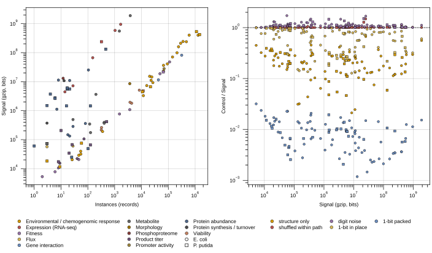

## 2026.10.14 - Bacteria Instances vs Signal table, with the Signal controls (temporary pre-build version)

Owner asked (2026-10-13) for the bacteria counterpart of the yeast table, and for the
Signal-column controls of #1099, as temporary versions now rather than at the next table
build. Both are measured in one script and rendered as views:

- `experiments/database/scripts/build_bacteria_datasets_table.py` scans every bacterial
  LMDB the adapter map serves (`build_adapter_map(organisms={ecoli, pputida})`, 100
  datasets, all built in the dev tree, 32.6 GB) and writes
  `experiments/database/results/pre-build/2026-10-14/ecoli-pputida_datasets.json`.
  Per-dataset rows are cached by LMDB fingerprint in
  `experiments/database/scripts/bacteria_signals_cache.json` (committed, like the yeast
  cache), so a rerun recomputes only rebuilt stores. Two streaming passes, 24 workers,
  about 8 minutes wall clock (Fuhrer 2017's wide metabolome was the straggler at 489 s).
- `render_bacteria_datasets_table.py` writes the generated note
  [[experiments.database.bacteria-datasets-table]], the `.tex` fragment beside the JSON and
  the preview PDF `notes/assets/pdf-output/experiments.database.bacteria-datasets-table.pdf`.
- `plot_bacteria_datasets_signal.py` draws the figure below (`ASSET_IMAGES_DIR/database/`).

Nothing in the row list is hand-curated: membership comes from the adapter map, the LMDB
path from each loader's default root, and Genotypes / Env are distinct stored genotype and
environment payloads counted in the pass, not curated text as in the yeast table.

Panel a: Instances vs Signal (gzip bits of the stored instance, the yeast table's
definition), colored by section, host as marker. Panel b: each control divided by Signal,
against Signal, one series per control (definitions in the generated note).

### Totals (measured, 100 datasets, 7,257,468 instances, 115,325,823 numeric leaves)

| Quantity | bits | ratio to Signal | median per-dataset ratio |
| :-- | --: | --: | --: |
| Signal (gzip of stored instances) | 7.73e9 | 1.000 | 1.000 |
| Structure only (leaves replaced by type tokens) | 2.26e9 | 0.292 | 0.199 |
| Shuffled within key path | 7.90e9 | 1.022 | 1.005 |
| Digit noise at stored precision | 8.25e9 | 1.066 | 1.087 |
| 1-bit z-score, in place | 4.08e9 | 0.528 | 0.678 |
| 1-bit z-score, packed | 6.98e7 | 0.009 | 0.009 |

E. coli holds 4,561,865 instances over 58 datasets and P. putida 2,695,603 over 42. The
Environmental / chemogenomic response section carries 6.56 M of the 7.26 M instances.

### Findings (measured in this run)

1. **Shuffling the numeric values within their key path does not change the gzip size**
   (ratio 1.022 overall; per dataset median 1.005, range 0.992 to 1.48). gzip finds no
   cross-record regularity in the values: a dataset's real values and a permutation of them
   compress to the same length.
2. **Pure digit noise at the stored precision is only 7% larger than the real data**
   (1.066 overall; median 1.087). The value bytes of a stored record compress like noise.
3. **Structure is 20 to 30% of Signal.** The schema copies (keys, nesting, list lengths,
   type tokens) cost 2.26e9 bits; the remaining 70 to 80% is value bytes that behave as in
   finding 2.
4. **The one-bit floor is about 1% of Signal**: 6.98e7 bits packed, 0.60 bits per numeric
   leaf (below 1 because constant paths such as `n_samples` and skewed sign distributions
   compress). Written in place, the same bits cost 0.528 of Signal, which is the structure
   plus the `1`/`0` tokens.

Reading: as defined, Signal measures (number of numeric leaves) times (stored digits) plus
the schema copies. It ranks datasets by volume and precision, not by regularity gzip can
exploit, which is consistent with the paper's framing of `L_C(D)` as a codelength under
gzip's model and an upper bound, not an information content. For the yeast snapshot of
2026-07-17 the same decomposition is not yet measured; a run with `--organisms scerevisiae`
was started on 2026-10-14 (377 GB, Hoepfner 2014 alone 30.3 M records) and is in flight, so
no yeast number is reported here.

Hypothesis (untested): the yeast table decomposes the same way, with a larger structure
share for the natural-isolate datasets whose perturbation lists are long and repetitive.

Hypothesis (untested): a compressor that models numbers (quantize to k bits, then gzip, or
an arithmetic coder over per-path histograms) would separate datasets that gzip cannot, and
would bring Signal closer to the information a model can learn from.

Caveats: several bacterial stores intern the environment as a `$ref` digest plus a name, so
their environment bytes are short; the yeast 2026-07-17 snapshot predates interning, so the
two tables' Signal columns are not directly comparable on that axis. The binarization sets a
constant path and a NaN leaf to 0. Noise keeps the digit count of `repr`, so a random digit
string ending in 0 can print one character shorter than the original.
