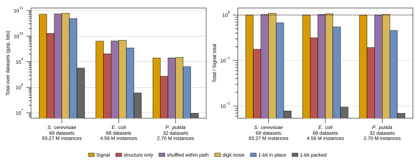

## 2026.10.15 - Signal and its controls summed per organism

Grouped bars of Signal (gzip, bits) and its five controls, each summed over every probed
dataset of one organism. Panel a gives the totals on a log axis. Panel b divides each total
by that organism's Signal total, so the dashed line at 1 is Signal itself. The script reads
only `experiments/database/scripts/dataset_probe_cache.json`, the per-dataset rows that
[[experiments.database.scripts.build_bacteria_datasets_table]] measured on 2026-10-14 under
probe variant `probes-v1`, so the three organisms share one measurement pass. Control
definitions are in [[experiments.database.bacteria-datasets-table]].

The bacteria are temporary: the dev stores will change once the ontology and schema fixes
land, and this figure is regenerated by rerunning the build script and then this one.

Table printed by the script (also written to `experiments/database/results/organism_signal_controls.csv`):

| Series | S. cerevisiae | E. coli | P. putida |
| :-- | --: | --: | --: |
| Datasets | 69 | 68 | 32 |
| Instances | 93,266,786 | 4,561,865 | 2,695,603 |
| Signal, total bits | 7.19e+10 | 6.33e+09 | 1.40e+09 |
| structure only, total bits | 1.27e+10 | 1.99e+09 | 2.69e+08 |
| shuffled within path, total bits | 7.35e+10 | 6.49e+09 | 1.41e+09 |
| digit noise, total bits | 7.92e+10 | 6.79e+09 | 1.45e+09 |
| 1-bit in place, total bits | 4.83e+10 | 3.44e+09 | 6.37e+08 |
| 1-bit packed, total bits | 5.60e+08 | 6.01e+07 | 9.71e+06 |
| structure only / Signal | 0.176 | 0.314 | 0.192 |
| shuffled within path / Signal | 1.023 | 1.024 | 1.010 |
| digit noise / Signal | 1.102 | 1.072 | 1.039 |
| 1-bit in place / Signal | 0.672 | 0.544 | 0.455 |
| 1-bit packed / Signal | 0.008 | 0.009 | 0.007 |

Readout. In all three organisms the shuffled total sits within 2.4% of Signal and the
digit-noise total within 10.2%, so the summed Signal is close to what random digits at the
stored precision would compress to. The packed one-bit floor is under 1% of Signal for each
organism. Structure alone is 18% of Signal for yeast and P. putida and 31% for E. coli.

## 2026.10.15 - What each series compresses

Every series is the gzip size (level 6) of one serialization of a dataset's stored
instances, written by `probe_lmdb` in
`experiments/database/scripts/build_bacteria_datasets_table.py`. A record is its
perturbation, environment and phenotype, serialized with sorted keys and concatenated over
the dataset. The series differ only in what replaces the numeric values before compression.

| Series | What gets gzipped |
| :-- | :-- |
| Signal | The real records with real values, in full. |
| Structure only | The real records with every value replaced by a type token, so only the format remains. |
| Shuffled within path | The real records with each field's values permuted across records, so the distribution stays but the pairing with records is lost. |
| Digit noise | The real records with every digit of every value replaced by a random digit at the stored precision, the ceiling for that format. |
| 1-bit in place | The real records with every value replaced by a 1 or 0 for above or below its field's mean, with the format kept. |
| 1-bit packed | Only those 1s and 0s, packed 8 to a byte with no format at all, the floor for what the values carry. |

"Field" is a key path, so a z-score is taken over all values that share one path across the
dataset. A constant path and a NaN value both binarize to 0.

### 1-bit in place vs 1-bit packed

Both hold the same bits, one per numeric value. In place keeps them inside the record text;
packed strips everything else. Ratios to the organism's Signal total, from the table above:

| Ratio to Signal | S. cerevisiae | E. coli | P. putida |
| :-- | --: | --: | --: |
| Structure only | 0.176 | 0.314 | 0.192 |
| 1-bit in place | 0.672 | 0.544 | 0.455 |
| 1-bit packed | 0.008 | 0.009 | 0.007 |

Measured: going from structure only to 1-bit in place adds 0.24 to 0.50 of Signal, while
the same bits packed alone cost under 0.01 of Signal.

Hypothesis (untested): the `1`/`0` characters interleaved in the record text break the
repeated record template gzip otherwise matches, so each bit costs far more than one bit in
place. A test would compare the two controls on one dataset with the bits held fixed.

### Figures

- Per organism, totals and ratios (this script):
  `notes/assets/images/database/organism_signal_controls.svg`, embedded above.
- Per dataset, bacteria: `notes/assets/images/database/bacteria_datasets_signal.svg`, in
  [[experiments.database.scripts.build_bacteria_datasets_table]] (from
  `plot_bacteria_datasets_signal.py`).
- Per dataset, yeast: `notes/assets/images/database/yeast_datasets_signal.svg`, in the same
  note (same script, run on the yeast JSON).
- Generated per-dataset tables with these controls:
  [[experiments.database.bacteria-datasets-table]] and
  [[experiments.database.yeast-datasets-table]].
