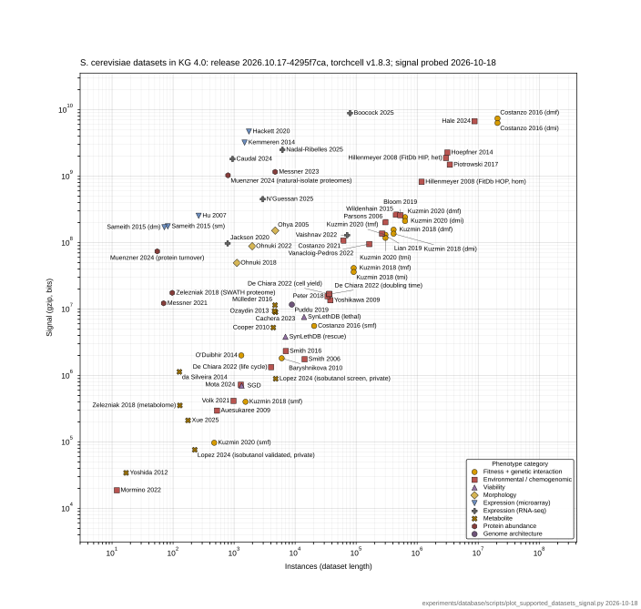

## 2026.10.18 - Seventy yeast datasets, stamped with the release

**Figure 1.** Instances against gzip signal, one point per *S. cerevisiae* dataset served in KG 4.0 (release `2026.10.17-4295f7ca`, torchcell v1.8.3), colored and shaped by phenotype category, from the 2026-10-18 snapshot of [[experiments.database.scripts.build_supported_datasets_table]]. The title carries the KG version, release id, paired tag and probe date; the footer the generating script and the date drawn. Saved as PNG, true-size SVG and PDF (`notes/assets/images/database/supported-datasets-instances-vs-signal.{png,svg,pdf}`).

Seventy labels did not fit the way 51 had: with the full registry names the slot placer found no collision-free layout at the 170 mm ceiling, even with the search radii extended to 130 pt and the repair allowed 20 ejections per label. The labels are now the registry name's "Author Year" head (`label_texts`), with the parenthetical kept only where two datasets share a head (Costanzo 2016 smf/dmf/dmi, Kuzmin, Hillenmeyer het/hom, the De Chiara 2022 stores, Muenzner, Zelezniak, Lopez, Sameith); category is already carried by color and marker. With that, 107 of 120 placement orders succeed and the cheapest costs 376 pt of leader. `PANEL_H_MM` is 170 (the ceiling), `RADII_PT` reaches 130 pt, `MAX_EJECT_AT_ONCE` 4, `MAX_EJECTIONS_PER_LABEL` 20, `PLACEMENT_ATTEMPTS` 120.
