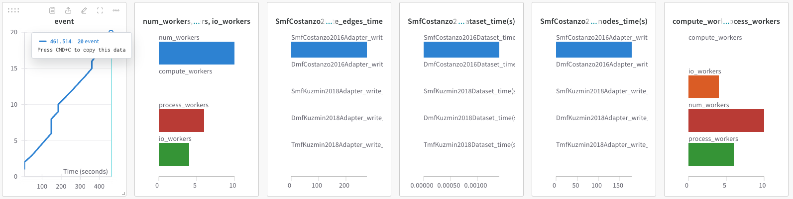
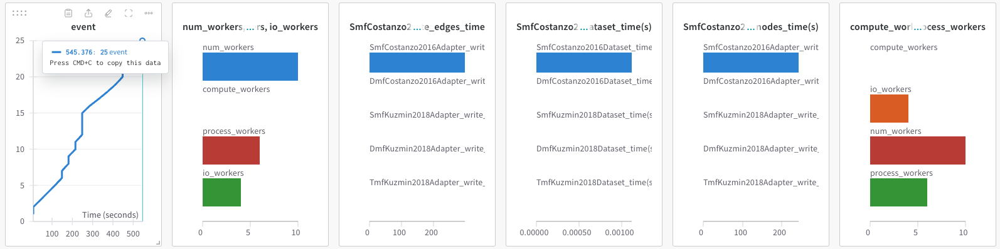

## 2024.07.18 - Config Refactor Time Test

`CellAdaptor` with `yaml` config refactor

`461 s` or `7.68 m`

`CellAdaptor` without `yaml` config refactor

`545 s` or `9 m`

The few min discrepancy is noise. They are equivalent so we will make the refactor.

## 2024.07.23

A key aspect of `CellAdapter` methods is that they should be defined in a minimal manner to forcing deduplication upon graph import. If we add metadata to say the `experiment`, or `experiment reference` nodes then duplicate measurement data will not be deduplicated on import.

Most often queries will not take place directly at the experiment level but levels above or below. Also experiments should be considered primary, where as references are primary purpose is for harmonization. In other words it is expected that almost if not all experiments will be unique, whereas we want a lot of references to be duplicated. This will allow for queries directed at references. e.g. "get all data with this same experimental reference." In the case of gene essentiality collected from primary sources we would rather them just get deduplicated on import... 😠 No good answer. I don't think we need the dataset name in the experiment object, as long as it is in graph it can be used for querying and that is really all we need it for.

## 2026.09.12 - Environment-Side Identity by Composition, Not by Quote

### The Failure

Media, temperature, environment-perturbation and environment nodes were content-addressed as `sha256(json.dumps(model.model_dump()))` of the WHOLE pydantic dump. That dump carries the STATING dataset's bookkeeping: `provenance` (each `SourcedValue` with its verbatim quote and sha256 anchor), `note`, `defers_to`, `provenance_gaps`, and the free-text `name`. Two datasets stating the same medium (YPD with 20 g/L agar, one quoting Mota 2024 and one quoting Tong and Boone) therefore differed in almost every byte that is not the medium, and got two media nodes. The aggregate the serve-50 campaign exists for (everything measured on YPD, on SC, on YPD plus 0.4 M NaCl) failed at node identity.

### The Fix

`torchcell/datamodels/identity.py` (new) projects each environment-side entity onto its COMPOSITION and hashes the canonical JSON of that projection:

- `compound_identity_key(Compound) -> str`: `inchikey`, else `chebi_id`, else `pubchem_cid`, else `name:<normalize_compound_name(name)>`. The field name is part of the key, so a name spelled like an InChIKey cannot collide with one. `smiles` / `inchi` are deliberately NOT in the precedence: a SMILES is toolkit-dependent, so two spellings of one molecule would not join anyway, and the InChIKey is the hash that does.
- `media_identity(Media)`: state, `is_synthetic`, `base_medium`, sorted components (compound key, role, definition, concentration value/unit/basis), sorted dropout keys. No `name`, no `provenance`, no component `note` / `defers_to`.
- `environment_perturbation_identity(p)`: `perturbation_type` plus the concrete leaf's typed slots. Small molecule: compound key + concentration + solvent (its compound key and percent). Physical: factor + magnitude + agent key. Biologic: agent class + normalized name + UniProt + sequence + concentration. No `description`. The DOSE is part of identity on both dosed leaves, since two doses of one compound are two different edits. An instance that is none of the three leaves raises `TypeError` rather than falling back to a dump hash.
- `temperature_identity(Temperature)`: value + typed unit. Units are NOT converted, so a Kelvin-stated temperature would not join a Celsius one; converting needs a rounding tolerance, which is a policy choice this layer should not make, and every loader states Celsius today.
- `environment_identity(Environment)`: media identity, temperature identity or `None`, sorted perturbation identities, aerobicity, `duration_hours`, `duration_generations`. No `provenance_gaps`, but what a gap MEANS survives: the gapped field is `None`, and `None` projects as `None`, so an environment that never carried a temperature is a different node from one at 30 C.
- `identity_sha256(Mapping)`: sha256 over `json.dumps(sort_keys=True, separators=(",", ":"))`.

Three properties hold. The projections are TOTAL (every field read exists on the current schema class; the `*_IDENTITY_FIELDS` tuples name them and a test checks them against `model_fields`). ABSENCE is part of identity (a `None` stays `None` rather than being dropped from the projection). ORDER is not identity (components, dropouts and perturbations are sorted by their own canonical encoding).

### Adapter Rewiring

`cell_adapter.py` gained one id function per class, and the node method AND every edge method call it, so an edge can no longer address a node the graph does not contain: `_media_node_id`, `_temperature_node_id`, `_environment_perturbation_node_id`, `_environment_node_id`. Rewired callers: `_media_node`, `_get_media_reference_nodes`, `_temperature_node_from`, `_environment_node`, `_get_environment_reference_nodes`, `_environment_perturbation_node_from`, `_media_to_environment_edge`, `_temperature_to_environment_edge`, `_environment_perturbation_to_environment_edges`, `_get_environment_perturbation_to_environment_reference_edges`, `_environment_to_experiment_edge`, `_get_environment_to_experiment_reference_edges`. Genotype, gene-perturbation, phenotype and experiment ids are untouched and still hash the full dump. The temperature-None guard is unchanged: a gapped temperature emits no node and no edge, and the environment node still carries `temperature: None`.

Node PROPERTIES did not change. A media node still carries `name`, `state` and `serialized_data` = the full dump of the first instance seen, so the dataset's own wording is still in the graph; it just no longer decides identity.

### Rebuild Consequence

This edits methods used by SERVED datasets, so the `kg_manifest` admission gate reports adapter drift on them. That is expected and there is no incremental path that could preserve the old ids: `neo4j-admin database import incremental` cannot update or delete existing nodes, so re-keying the environment side is a full-rebuild event. The planned full rebuild absorbs it.

### Two Findings Worth Acting On

1. `MEDIA_LIBRARY` has 51 media and 48 distinct composition identities. `SC`, `SC_PARTIAL_BIOTIN`, `SC_PARTIAL_CALCIUM_PANTOTHENATE` and `SC_PARTIAL_PYRIDOXINE_HYDROCHLORIDE` collapse to ONE media node, because the partial drop-out is recorded only in the medium's `name` and the component's `note`: the biotin row's `concentration` is `None` in both SC and SC_PARTIAL_BIOTIN, so no typed slot distinguishes them. Composition identity is reporting the truth here (the typed compositions ARE identical), and the fix belongs in the media library: either the reduced level as a sourced concentration, or the drop-out as `EnvironmentPhysicalPerturbation(factor=nutrient_dropout, agent=<compound>)`. Until then, the four Hillenmeyer partial drop-out conditions cannot be told apart in the graph.
2. `YPD` (the library root) and `YPD_AGAR` do NOT share an id, because the root no longer lists an agar row while the plate does. That is a composition difference, not a quote difference: every non-component slot of the two projections is equal, which is exactly what the fix was for.

## 2026.10.07 - Bacterial perturbation and the three bacterial-program phenotypes

Eleven methods ADDED, none changed (measured by `kg_manifest drift` against the served
manifest): `_bacterial_perturbation_node` (+ `_bacterial_perturbation_node_from`), and for
each of product titer, protein turnover and flux a `(chunked)` node method, a `reference`
collector and a static `_*_properties` builder. Seven table entries:
`bacterial perturbation (chunked)`, `product titer phenotype (chunked)`,
`protein turnover phenotype (chunked)`, `flux phenotype (chunked)` and the three
`reference` names. Module constant `BACTERIAL_PERTURBATION_LEAVES` (the five leaves that
declare `gene_namespace`). A bacterial conf enables `bacterial perturbation (chunked)`
instead of `perturbation (chunked)`. Classes, id rule, projection and the measurement:
[[torchcell.adapters.bacterial-graph-classes]].

## 2026.10.09 - The two environment-perturbation lanes partition the leaves (#756)

`_environment_perturbation_node` emitted every perturbation of an environment, a phage
included, and `_phage_perturbation_node` emitted the same leaf under the same content id
(both ids are `environment_perturbation_identity`) with the `phage perturbation` label.
Enabling both classes in one conf therefore wrote one id under two labels and the import
kept whichever row it read first, so the rule was "a conf enables one class or the other,
never both". Being per-conf rather than per-perturbation, it also meant a dataset whose
environment carries a phage AND a genuine non-phage perturbation could express only one
of the two, which is a graph layer selecting a data representation instead of serializing
it.

Both served methods now skip a `PhagePerturbation`:

| method | before | after |
|---|---|---|
| `_environment_perturbation_node` | every leaf | every NON-phage leaf |
| `_get_environment_perturbation_reference_nodes` | every leaf of every reference | every non-phage leaf |
| `_phage_perturbation_node` | phages only | unchanged |
| `_get_phage_perturbation_reference_nodes` | phages only | unchanged |

The lanes are now a partition of `environment.perturbations`, so a conf may enable both
and every leaf is written exactly once. The edge methods are untouched: they still emit
one `environment perturbation member of` per perturbation, and that class already
declares both `environment perturbation` and `phage perturbation` as sources. What
replaces the exclusivity rule is the dangling-edge rule that was always behind it: a conf
enabling either edge method must enable at least one node lane, pinned by
`test_an_environment_perturbation_edge_has_a_node_lane_to_address` in
`tests/torchcell/knowledge_graphs/test_adapter_schema_consistency.py`.

### Measured drift against the served store

Read from a copy of the served manifest `/scratch/projects/torchcell/database/kg_manifest.json`
(store built at `4b293d3432ca1a08ad132d73c97ac12204bbf639`) by
`python -m torchcell.knowledge_graphs.kg_manifest --manifest <copy> drift`. Both methods
matched the served store at `origin/main` and no longer match, so these 14 served
datasets are this change's own drift and nothing else's:

Bloom2019Dataset, CrisprMagicLian2019Dataset, CrispriChemgenSmith2016Dataset,
CrispriMormino2022Dataset, EnvChemgenAuesukaree2009Dataset, EnvChemgenCostanzo2021Dataset,
EnvChemgenHoepfner2014Dataset, EnvChemgenMota2024Dataset, EnvChemgenVanacloig2022Dataset,
EnvChemgenWildenhain2015Dataset, FattyAcidSmith2006Dataset, HetHillenmeyer2008Dataset,
HomHillenmeyer2008Dataset, NadalRibellesPerturbSeq2025Dataset.

That is 14 for `_environment_perturbation_node` and the same 14 for
`_get_environment_perturbation_reference_nodes`. No graph-schema class changes and no
value-surface change comes from this edit.

**No served node changes.** `_environment_perturbation_node_from`, which builds the node
and its id, is byte-identical, so every non-phage perturbation serializes exactly as
before. And none of the 51 served datasets' recorded closures names `PhagePerturbation`,
so no served loader can construct one and the filter removes nothing from any served
build. The environment-perturbation leaves those 14 closures do name are
`SmallMoleculePerturbation` (13 of them), `BiologicPerturbation` (Auesukaree 2009 only)
and, for FattyAcidSmith2006Dataset, none at all. This is a fingerprint-only change, which
is why it waits for a full rebuild rather than an increment: `neo4j-admin database import
incremental` cannot update existing nodes, so a changed served method is a full-build
event even when its output is identical.

### Verification

`tests/torchcell/adapters/test_environment_node_identity.py` drives both lanes on one
synthetic environment carrying a phage and 0.4 M NaCl: the served lane emits the NaCl
alone, the phage lane the phage alone, the two id sets are disjoint, and the two edges
the edge method emits address exactly the union. The reference-side pair splits the same
way. On the real stores (`--data`, `DATA_ROOT=/scratch/projects/torchcell-scratch`),
`assert_dev_store_graph` for Rousset 2018 and Mutalik 2020 passes with the phage conf's
left-off check now run UNEXEMPTED: before the fix that check had to skip
`environment perturbation (chunked)`, because running it re-emitted the records' phages.

## 2026.10.11 - life cycle phenotype node

`_life_cycle_phenotype_node` and `_get_life_cycle_phenotype_reference_nodes` emit `life cycle phenotype` (De Chiara 2022); the keyed time course is a JSON string and the assay, sample counts and cells per sample stay typed properties.

## 2026.10.12 - `gene essentiality phenotype` serves its evidence (#924)

`_gene_essentiality_properties` builds the node properties of a `GeneEssentialityPhenotype`, experiment or reference: `graph_level`, `label_name`, `is_essential`, and `evidence`, the whole `GeneEssentialityEvidence` as JSON (evidence class and type, the role-typed statements with their quotes and sha256, the per-record statistics). The property is named after the field, as every nested phenotype field is served, so the node class and the pydantic class stay in bijection by property set. Because the evidence and its statistics are part of the phenotype dump, the phenotype node id (the sha256 of the dump) now separates stores and records that used to share the single `is_essential=True` node.

## 2026.10.12 - `graded gene essentiality phenotype` (#909)

`_graded_gene_essentiality_properties` builds the node properties of a `GradedGeneEssentialityPhenotype`: `graph_level`, `label_name`, `essentiality_call` (the release's category verbatim: TraDIS `unclear`, an HMM state ES / GD / NE / GA / N/A) and `evidence`, the `GeneEssentialityEvidence` JSON as on `gene essentiality phenotype`. Two node methods, `graded gene essentiality phenotype (chunked)` and `graded gene essentiality phenotype reference` (deduplicated), serve the stores `graded_gene_essentiality_goodall2018` and `graded_gene_essentiality_royet2025` through `GradedGeneEssentialityGoodall2018Adapter` and `GradedGeneEssentialityRoyet2025Adapter`. The node class `graded gene essentiality phenotype` is a `phenotypic feature` and a source of `phenotype member of`; `test_cell_adapter.py` now lists 85 node methods.

## 2026.10.14 - A bacterial genotype carrying `GeneAdditionPerturbation` gets an edge and no node (open)

Found by `test_dev_store_emits_a_closed_declared_graph` for the Carruthers 2025 proteome, run against the real dev stores before the KG 4.0 rerun: one `perturbation member of` edge dangled. Carruthers 2025 stores the native `phnX` carried on a plasmid as the shared `GeneAdditionPerturbation` leaf (6 records in its proteome set, 6 in its titer set; Mohiuddin 2022 and Banerjee 2025 carry none). `_perturbation_to_genotype_edges` walks every perturbation, but the leaf carries no `gene_namespace`, so it is not in `BACTERIAL_PERTURBATION_LEAVES` (the tuple is pinned to exactly the namespace-carrying leaves by `test_the_bacterial_leaf_tuple_is_exactly_the_leaves_carrying_gene_namespace`), and a bacterial conf enables `bacterial perturbation (chunked)` and never `perturbation (chunked)`. The edge is emitted and no node is; `skip_bad_relationships: true` in the BioCypher config drops the edge at import and lists it in `import.report`, so the served graph would lose the addition silently, and the generator of job 4901 would not have noticed.

Not fixed in the adapter: putting a leaf without `gene_namespace` into the bacterial lane would serve a `bacterial perturbation` node with an empty namespace. The fix is in the data: either the Carruthers loader states the native addition on a leaf that carries the namespace (`HeterologousPathwayPerturbation` already takes `is_heterologous=False` and a `source_organism`), or a bacterial gene-addition leaf is added to the schema. Either rebuilds the two Carruthers stores (minutes). Owner's call; the dev-store test stays red until it is made.

Beside it, the `_phage_pair` helper of the bacterial adapter cases asserted that the served environment-perturbation lane is EMPTY for the two phage datasets, which Rousset 2018 has not satisfied since ea37bd21 (its S1 growth screen carries small-molecule perturbations beside the phage challenges). The assertion is now the partition itself: no phage id reaches the served lane and nothing it emits is a phage.

## 2026.10.15 - One perturbation class for every host (ontology unification G, lane H)

The adapter no longer chooses a perturbation lane by conf. `_perturbation_node` serves every member of `GenePerturbationType` and picks the label by leaf: a leaf that composes a `BacterialVariantCall` (`VARIANT_CALL_LEAVES`: the `VariantCallPerturbation` family plus `SpanDeletionCallPerturbation`, which is a `DeletionStrainPerturbation` by class and carries the call beside it) is written as `sequence variant perturbation`, every other leaf as `perturbation`. The two labels are two literal `BioCypherNode(...)` sites inside the one method, because `ontology_checks.adapter_property_mismatches` reads the label and the property keys off the AST. `BACTERIAL_PERTURBATION_LEAVES`, `BACTERIAL_VARIANT_PERTURBATION_LEAVES`, `_bacterial_perturbation_node` and `_bacterial_variant_perturbation_node` are gone, and so are the conf names `bacterial perturbation (chunked)` and `bacterial sequence variant perturbation (chunked)`; the 100 bacterial confs enable `perturbation (chunked)` like every yeast conf. The environment axis went the same way: `_environment_perturbation_node` and `_get_environment_perturbation_reference_nodes` serve every `EnvironmentPerturbationType` member through `_environment_axis_node_from`, a `PhagePerturbation` as `phage perturbation` and every other leaf as `environment perturbation`; `_phage_perturbation_node`, `_get_phage_perturbation_reference_nodes` and the conf names `phage perturbation (chunked)` / `phage perturbation reference` are gone (Mutalik 2020 and Rousset 2018 enable the environment pair).

Why by leaf and not by conf: the label was chosen by conf and the membership by class tuple, while `_perturbation_to_genotype_edges` walks every leaf, so a leaf a conf did not list got an edge and no node (Carruthers 2025's `GeneAdditionPerturbation` under the bacterial-only confs, Mutalik 2020's `SmallMoleculePerturbation` under the phage-only conf; audit C 1.3). With one method per axis the exhaustiveness invariant is the union-to-label bijection, pinned with no store by `test_the_union_to_label_map_is_a_bijection_over_every_leaf` (tests/torchcell/adapters/test_bacterial_graph_classes.py), and the three `xfail(strict=True)` marks of `test_loader_lane_exhaustiveness.py` came off with their `KNOWN_GAPS` table: all 177 cases pass. The vacuous tuple test `test_the_bacterial_leaf_tuple_is_exactly_the_leaves_carrying_gene_namespace` and `test_a_yeast_record_emits_no_bacterial_perturbation_node` are deleted; `_adapter_init_harness.Shape` lost its `bacterial`, `variant` and `phage` flags.

`host_genome`, mandatory on both labels, is the record's `gene_namespace` projected into the genomes registry's assembly-set vocabulary by `HOST_GENOME_OF_NAMESPACE` (a bijection over the eight `GeneIdNamespace` members onto `torchcell.sequence.genome.registry` ids, pinned by `test_host_genome_is_a_bijection_from_the_namespace_onto_registry_set_ids`). It is never the strain string: BY4741, BY4742 and S288C are three `genome` nodes pinning the one S288C set, so a strain-keyed value would fragment the join (review 3 finding 9). The `genome` node gains `assembly_set`, read off `AssemblyReferenceGenome.assembly_set` (`_assembly_set_of`; a yeast `ReferenceGenome` states none today and projects null, until P2 declares the field on every reference), so `perturbation.host_genome = genome.assembly_set` is a value join with no hop. The `perturbation of genome` edge (`_perturbation_to_genome_edges`, conf name `perturbation to genome (chunked)`) is the traversal form, OFF in every conf: the chunk carries `data["reference"]`, so the genome id costs no extra pass, but the edge adds one row per perturbation per record, the order of `perturbation member of` (47,251,386 rows in the 124-adapter job 4901 partial against 361.4 M edge rows in all of KG 3.0; hypothesis, untested: 10 to 15 % more edge rows and generation time). A conf opts in by listing the method, and the first build that does measures it.

Adapter drift: `cell_adapter_methods` fingerprints move for `_perturbation_node`, `_get_genome_nodes`, `_environment_perturbation_node` and `_get_environment_perturbation_reference_nodes` on every served dataset, acknowledged by the full rebuild the P1 record already requires; no schema-change record (adapter code, policy Rule 8). The yeast golden digest of `perturbation (chunked)` moved once more (the node gained `host_genome`; no id changed); the other seven digests did not. The attribution of lane A's 4,233 dangling `PerturbationMemberOf` rows is in [[experiments.database.scripts.attribute_dangling_perturbation_rows]].

## 2026.10.15 - `host_genome` is in the `AssemblySet` vocabulary or null; the pangenome namespace projects to null (lane Q)

Lane P's finding 5: `HOST_GENOME_OF_NAMESPACE["scerevisiae_peter2018_pangenome_orf"]` was the registry id `peter2018_1011_assemblies`, which `NON_ASSEMBLY_REGISTRY_SETS` excludes from `AssemblySet` by name (a panel of 1,011 assemblies and the pangenome matrices, not one reference a record pins). No `genome.assembly_set` can hold it, so the `perturbation.host_genome = genome.assembly_set` join could never resolve for the 79,016 pangenome-namespaced perturbations of the served Caudal 2024 store; it stayed latent only because Caudal's conf lists no perturbation lane.

The map is now two: `REGISTRY_SET_OF_NAMESPACE` (total over `GeneIdNamespace`, a bijection onto registry set ids, the former map under its honest name) and `HOST_GENOME_OF_NAMESPACE`, that map projected onto the `AssemblySet` vocabulary at import: a set in the vocabulary maps to itself, a set in `NON_ASSEMBLY_REGISTRY_SETS` maps to `None`, anything else is a `ValueError` at import. Null is the honest value: the record's genome node pins S288C for its other identifiers, no node pins the pangenome, and the blob's `gene_namespace` says which set the id is in. The optional `perturbation of genome` edge is absent exactly where the property is null. The vocabulary was not widened: a `ReferenceGenome` pinning the panel would need an `assembly_accession`, and the panel has 1,011.

Pinned by `tests/torchcell/adapters/test_host_genome_vocabulary.py`: every value of the map is an `AssemblySet` member or `None`, `None` exactly for the non-assembly sets, the node method writes `None` for a real `NaturalGenePresencePerturbation`, and the edge method writes no edge for it. On the code before this change the first assertion fails with `{'scerevisiae_peter2018_pangenome_orf': 'peter2018_1011_assemblies'} == {}` and the node assertion with `'peter2018_1011_assemblies' is None`. The yaml comments on `perturbation.host_genome` and `perturbation of genome` state the null case; the property stays `str`.
