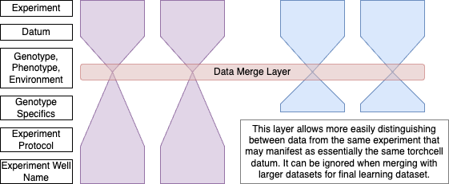
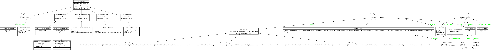
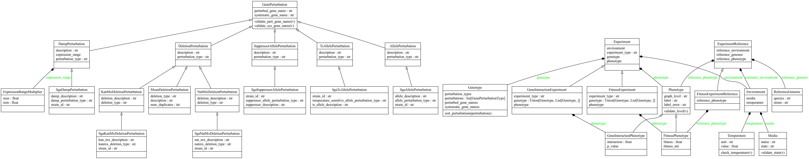
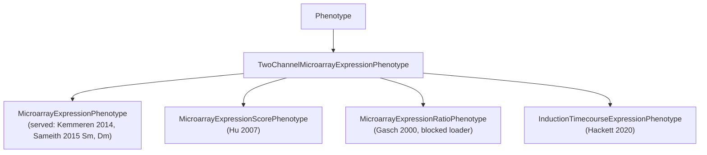

## Costanzo Smf and Dmf Whiteboard Recap

- We don't want specific info in genotype lke array position to allow for joining genotypes
  - But without it, it is difficult to make the data come together properly
- We need a way to validate the `dmf` single mutant data to make sure we are referencing the correct mutant from the correct array
- I had some ideas on pulling `strain_id` information via another method, but I avoid this and just added the data to more refined pydantic models.
  - We want these more refined pydantic models because they allow us to take advantage of the authors preprocessing of their own data. Authors like to use some conventions, and this is evident in the follow up `Kuzmin` work. It is best to add these specific details to the data so they can be used for processing, but they need to easily removed so the more general data can be more easily merged.



## Issues with the Current Data Scheme that Uses Different Named Phenotypes

If we look at the  we it looks like the different genotypes are not playing any role. since they don't carry any additional attributes. I think this layer can likely be removed simplifying our data model. Also should rename this file to something like schema.

## 2024.07.17 - How we Type

We can type the different classes and assure that data is properly serialized and deserialized by pydantic as long as we include attribute that can different classes. We simply do this with some `_type` attribute. Pydantics deserialization mechanism can then detect differences between classes.


## 2024.08.12 - Making Sublcasses More Generic For Downstream Querying

We run into an issue that only shows itself when we are trying to construct the cell dataset.

In `process_graph` from [[torchcell.data.neo4j_cell]] we have code that looks like this.

```python
def process_graph(cell_graph: HeteroData, data: dict[str, Any]) -> HeteroData:
    ...
    processed_graph["gene"].label_value = phenotype.fitness
    processed_graph["gene"].label_value_std = phenotype.fitness_std
```

If we print out the phenotype we see this.

```python
>>> phenotype
GeneInteractionPhenotype(graph_level='edge', label='dmi', label_statistic='p_value', interaction=-0.002846, p_value=0.4818)
```

In order to query the label in a generic way we need to make this more generic to something like this.

```python
>>> phenotype
GeneInteractionPhenotype(graph_level='edge', label_name='gene_interaction', label_statistic_name='p_value', gene_interaction=-0.002846, p_value=0.4818)
```

This would allow for a more generic structure of pulling out labels. For instance we would be able to run.

```python
>>> phenotype[phenotype['label_name']] == -0.002846
True
```

This also allows for consumption of more generic data instances. For example we would not need to create a second class if the gene interaction phenotype data uses a standard deviation for it's statistic instead of a p-value. Transforming between data types can still be done on the bases of the `label_name:str`.

We would then validate data for quality assurance that this pattern is observed throughout the [[torchcell.datamodels.schema]].

Here is an example.

```python
from pydantic import Field, model_validator, field_validator
from torchcell.datamodels.pydantic import ModelStrict
from typing import Any, Optional

class Phenotype(ModelStrict):
    graph_level: str = Field(
        description="most natural level of graph at which phenotype is observed"
    )
    label_name: str = Field(description="name of label")
    label_statistic_name: Optional[str] = Field(
        default=None,
        description="name of error or confidence statistic related to label"
    )
    label: Any = Field(description="value of the label")
    label_statistic: Any | None = Field(
        default=None,
        description="value of the error or confidence statistic related to label"
    )

    @model_validator(mode='after')
    def validate_fields(self):
        if self.graph_level not in {"edge", "node", "subgraph", "global", "metabolism"}:
            raise ValueError("graph_level must be one of: edge, node, subgraph, global, metabolism")

        # Check if label_name corresponds to a field in the class
        if not hasattr(self, self.label_name):
            raise ValueError(f"label_name '{self.label_name}' must correspond to a field in the class")

        # Check if label_statistic_name corresponds to a field in the class (if provided)
        if self.label_statistic_name and not hasattr(self, self.label_statistic_name):
            raise ValueError(f"label_statistic_name '{self.label_statistic_name}' must correspond to a field in the class")

        # Check if label value matches the field specified by label_name
        if getattr(self, self.label_name) != self.label:
            raise ValueError(f"label value must match the value of the field specified by label_name")

        # Check if label_statistic value matches the field specified by label_statistic_name (if provided)
        if self.label_statistic_name and getattr(self, self.label_statistic_name) != self.label_statistic:
            raise ValueError(f"label_statistic value must match the value of the field specified by label_statistic_name")

        return self

    def __getitem__(self, key):
        return getattr(self, key)


class FitnessPhenotype(Phenotype):
    label_name: str = "fitness"
    label_statistic_name: str = "std"
    fitness: float = Field(description="fitness = wt_growth_rate/ko_growth_rate")
    std: Optional[float] = Field(default=None)

    @field_validator('fitness')
    def validate_fitness(cls, v):
        if v <= 0:
            raise ValueError("Fitness must be greater than 0")
        return v

class GeneInteractionPhenotype(Phenotype):
    label_name: str = "gene_interaction"
    label_statistic_name: str = "p_value"
    gene_interaction: float = Field(
        description="epsilon, tau, or analogous interaction value. Computed from composite fitness phenotypes."
    )
    p_value: Optional[float] = Field(default=None)

    @field_validator('p_value')
    def validate_p_value(cls, v):
        if v is not None and (v < 0 or v > 1):
            raise ValueError("p-value must be between 0 and 1")
        return v
```

Straightening this out should also allow us to fix the deduplication problem[[torchcell.data.neo4j_cell]].

We already follow this pattern here [[torchcell.data.neo4j_cell]]

```python
dataset
Neo4jCellDataset(10)
dataset[0]
HeteroData(
  gene={
    node_ids=[6577],
    num_nodes=6577,
    ids_pert=[2],
    cell_graph_idx_pert=[2],
    x=[6577, 1536],
    x_pert=[2, 1536],
    graph_level='edge',
    label='dmi',
    label_statistic='p_value',
    label_value=0.016913,
    label_value_std=0.3409,
  },
  (gene, physical_interaction, gene)={
    edge_index=[2, 139038],
    num_edges=139038,
  },
  (gene, regulatory_interaction, gene)={
    edge_index=[2, 9494],
    num_edges=9494,
  }
)
```

## 2024.08.26 - Generic Subclasses Need to Consider Phenotype Label Index

We have to be careful about how we do this because we use `self.dataset.phenotype_label_index` for helping create balance spits [[torchcell.datamodules.cell]]. We compute the `phenotype_label_index` here [[torchcell.data.neo4j_cell]]. We can add the source as in the dataset name so we can create another automated way to split data. This is a good idea since datasets are split by unique phenotype to begin with. It is a bit arbitrary still. It is phenotype focused, but it would be better if it was more principled.

## 2024.09.08 - Why we Need Label_Name and Label

This is what thought we should change too and I did change `SmfKuzmin2018` and `SmfCostanzo2016` but there is an issue in that all phenotypes will start to look the same. They will have the same named attributes and could easily transformed into one another... If this was the case we should just move all data back one abstraction to phenotype. This isn't really what we want. This might also mess with decoding since the different phenotypes cannot be distinguished by named attribute. This easily happens if named attributes are the same and must be avoided.

```python
# Phenotype
class Phenotype(ModelStrict):
    graph_level: str = Field(
        description="most natural level of graph at which phenotype is observed"
    )
    label_name: str = Field(description="name of label")
    label_statistic_name: Optional[str] = Field(
        default=None,
        description="name of error or confidence statistic related to label",
    )
    label: Any = Field(description="value of the label")
    label_statistic: Optional[Any] = Field(
        default=None,
        description="value of the error or confidence statistic related to label",
    )

    @model_validator(mode="after")
    def validate_fields(self):
        valid_graph_levels = {
            "edge",
            "node",
            "subgraph",
            "global",
            "metabolism",
            "gene ontology",
        }
        if self.graph_level not in valid_graph_levels:
            raise ValueError(
                f"graph_level must be one of: {', '.join(valid_graph_levels)}"
            )
        return self

    def __getitem__(self, key):
        return getattr(self, key)


class FitnessPhenotype(Phenotype, ModelStrict):
    graph_level: str = "global"
    label_name: str = Field(
        default="fitness", description="wt_growth_rate/ko_growth_rate"
    )
    label_statistic_name: str | None = Field(
        default="std", description="fitness standard deviation"
    )

    @field_validator("label")
    def validate_fitness(cls, v):
        if v <= 0:
            raise ValueError("Fitness must be greater than 0")
        return v
```

I thought about just having `label_name:str` and then having the corresponding str as a key in the pydantic model. I previously thought that the issue with this was that we wouldn't be able to access the data, and we won't with dot notation but we can with dict notation.

I think instead what we do is have some named vocab that matches `label_name` to the key of the child class.

## 2024.09.25 - Dataset Name on Experiment Reference

#ramble it is a bit strange having `dataset_name` because then all references will be distinct in some way. Not sure if this is a concern or not because we could always check if references are same via properties.

## 2026.01.07 - Current Constraints on Schematization

The schema design is tightly coupled to downstream infrastructure with critical constraints:

**BioCypher + Neo4j**: Only fields explicitly listed in `biocypher/config/torchcell_schema_config.yaml` are exposed as queryable properties in Neo4j. Fields not in the YAML get buried in `serialized_data` blob, making them inaccessible for deduplication, aggregation, or graph queries. Pydantic `@property` methods (computed fields) don't appear in `model_fields`, so can't be automatically added to BioCypher YAML - they're Python-only, not Neo4j-accessible.

**GraphProcessor**: The `label_name` and `label_statistic_name` fields are extracted from Pydantic `model_fields` and used to batch phenotype data into training tensors. While `getattr()` works for properties, the field name must come from `model_fields.default`, meaning `label_statistic_name` must point to a real field (not just a property) that gets batched into tensors.

**Design tradeoff for MicroarrayExpressionPhenotype**: Store both `expression_log2_ratio_variance` (for meta-analysis) and `expression_log2_ratio_se` (as PRIMARY STATISTIC) as fields exposed to Neo4j. SE is chosen over SD because it measures precision of the mean estimate (relevant for ML training and deduplication), while SD (technical variability) can be computed on-demand via property when needed for QC. This balances Neo4j queryability, GraphProcessor batching, and storage efficiency.

Related: [[torchcell.adapters.cell_adapter]] [[torchcell.data.graph_processor]] [[torchcell.data.deduplicate]]

## 2026.01.29 - Philosophy around n_replicates

### Data-Driven Computation Over Reported Values

**Principle**: Always compute `n_replicates` from raw data rather than using paper-reported constants.

Even when experimental design is clearly documented in papers or supplementary information (e.g., "2 biological replicates × 2 dye-swap technical replicates = 4 measurements"), we default to counting actual replicates from the data files. This approach is more reliable because:

1. **QC filtering**: Papers report ideal experimental design, but quality control may remove failed samples (actual n_replicates < expected)
2. **Text extraction complexity**: Parsing methods sections and supplementary files to extract replicate counts is error-prone
3. **Protocol chasing**: We've encountered many back-and-forth iterations trying to understand true protocols from ambiguous text
4. **Data is ground truth**: If individual raw data files exist, direct counting is authoritative

**Implementation pattern** (see `kemmeren2014.py`, `sameith2015.py`):

```python
# Global constants document EXPECTED design from paper (for validation)
N_EXPECTED_BIOLOGICAL_REPLICATES = 2
N_EXPECTED_DYE_SWAP_TECHNICAL_REPLICATES = 2
N_EXPECTED_MAX_REPLICATES_DELETION = 4  # Documentation only

# Actual values COMPUTED from data
for gene, values in all_values_per_gene.items():
    n_replicates[gene] = len(values)  # Count actual measurements
```

Constants serve as **documentation and validation targets**, not data sources. We can compare computed values against expected ranges to detect data issues, but never substitute constants for actual counts.

### Avoiding Replicate Type Fragmentation

**Decision**: Use generic `n_replicates` instead of typed replicates (`biological_replicates`, `technical_replicates`, `pseudo_replicates`).

In reality, replicates have distinct types with different statistical properties:

- **Biological replicates**: Independent cultures/samples (captures biological variation)
- **Technical replicates**: Same sample measured multiple times (captures measurement noise)
- **Dye-swap replicates**: Technical replicates correcting for dye bias (microarray-specific)
- **Pseudo-replicates**: Subsamples from same culture (not true independent replicates)

However, we intentionally avoid this distinction for now:

1. **Simplicity**: Generic `n_replicates` is easier to work with across datasets
2. **NLP dependency**: Extracting replicate types from text requires robust natural language processing
3. **Data fragmentation**: Don't want to split data along these axes prematurely
4. **Primary label focus**: We only track replicates used to compute the mean value being reported as the primary label

**What we report**: The count of measurements that went into computing the mean expression value, regardless of whether those measurements are biological replicates, technical replicates, or dye swaps.

**Future work**: Could add typed replicate counts as optional metadata fields once we have reliable NLP extraction, but the primary `n_replicates` field should remain a simple count.

Related: [[torchcell.datasets.scerevisiae.kemmeren2014]] [[torchcell.datasets.scerevisiae.sameith2015]]

## 2026.07.20 - UI-1 env-schema foundation (assay_type / BiologicPerturbation / Compound gap)

Additive, non-breaking schema extension (UI-1 of a 3-unit env/chemogenomic audit
follow-up; plan [[plan.env-schema-assay-compound-biologic.2026.07.20]]):

- **`AssayType` enum + nullable `assay_type` on `EnvironmentResponsePhenotype`** -- records
  HOW a response was measured (experimental design), orthogonal to `MeasurementType` (WHAT
  the number is). Formalizes the method axis previously smuggled into free-text `units`.
- **`BiologicAgentClass` + `BiologicPerturbation`** added as a third `EnvironmentPerturbationType`
  union leaf (`Literal["biologic"]`) -- peptide/protein/antibody/toxin agents whose identity is
  sequence/UniProt, not an InChIKey. Required the coordinated `_ENV_FACTORY` entry in
  `test_ontology_all_trees.py`.
- **`Compound` now inherits `ProvenanceGapMixin`** (relocated above `Compound`) -- AFFORDANCE
  ONLY, no structure-or-gap validator this unit. A `Compound` with no structure and no gap
  still constructs.

Follow-ups: UI-2 = compound-identity resolver + gap ENFORCEMENT on `Compound` + reconcile
`Compound` gaps vs `Media.open_gaps`. UI-3 = `assay_type` population across loaders + the L1
uniqueness-key decision + the full DB rebuild the schema-impact gate flags as breaking.

## 2026.10.07 - ArtifactRef replaces the off-graph pointer string pairs

Phase 3 of the artifact tier ([[plan.artifact-tier.2026.10.07]], decision D4). `ArtifactRef` (tier, key, path, member, sha256, bytes, media_type; string form `tc://<tier>/<key>/<path>[#<member>]`) is now DEFINED in `schema.py`, so its contract is fingerprinted with the record classes that carry it; `torchcell.artifacts.ref` re-exports it. It could not live in `torchcell/artifacts/ref.py` and be imported here: `ref.py` imports `torchcell.datamodels.pydant`, which runs `torchcell/datamodels/__init__.py`, which imports `schema`, a cycle, and `ref.py` sat outside the fingerprinted surface (`schema.py` + `pydant.py`).

Field changes:

- `SequenceVariantPerturbation`, `NaturalGenePresencePerturbation`, `NaturalGeneAbsencePerturbation` and `CopyNumberVariantPerturbation`: `sequence_uri` + `sequence_sha256` removed, `sequence_ref: ArtifactRef | None = None` added, `sequence_source` kept. `CopyNumberVariantPerturbation` was not named in D4; it carried the same pair, and no loader fills it, so it moved with the others to keep one pointer form.
- `CrisprConstruct`: `effector_plasmid_uri` + `effector_plasmid_sha256` and the `validate_plasmid_pointer` validator removed, `effector_plasmid_ref: ArtifactRef | None = None` added (a ref cannot exist without its sha256). The `crispr construct` graph node projects it flat as `effector_plasmid_ref` (the tc:// string) and `effector_plasmid_sha256` (from the ref); `biocypher/config/torchcell_schema_config.yaml` renames the property. The perturbation node never projected `sequence_uri`, so `sequence_ref` stays inside the experiment's `serialized_data`.
- `SegregantParent` (Bloom): `assembly_member: str` + `assembly_sha256: str` removed, `assembly_ref: ArtifactRef` (required) added. A Peter parent points at `1011Assemblies.tar.gz` with its member path; BY points at the SGD R64-4-1 `S288C_reference_sequence_R64-4-1_20230830.fsa` instead of the former free-text sentinel.
- `paper/ontology_graph.py` places `ArtifactRef` in the provenance lane.

Rebuild consequence: a BREAKING schema change, so a full KG rebuild at the next build (`TORCHCELL_SCHEMA_ACK=1` at commit). `scripts/schema_impact_check.py --base HEAD` (run 2026.10.07 in the worktree) reports 5 breaking datasets: `Bloom2019Dataset` (via ArtifactRef, SegregantParent), `CaudalPanTranscriptome2024Dataset` (via ArtifactRef and the three natural-variation leaves), `CrisprMagicLian2019Dataset`, `CrispriMormino2022Dataset` and `CrispriChemgenSmith2016Dataset` (via ArtifactRef, CrisprConstruct). The three CRISPR datasets change only in the serialized key name (`effector_plasmid_uri: null` becomes `effector_plasmid_ref: null`) and the node property rename.

Loader slice (no rebuild): `experiments/036-dataset-fixes-before-kg-build/scripts/artifact_ref_loader_slice.py` writes `experiments/036-dataset-fixes-before-kg-build/results/artifact_ref_loader_slice.json`; the refs built for Caudal isolates AAA (4,557 variants) and AAB (4,913) and for the Bloom A and 375 parents all parse back from their tc:// string and resolve against the local genomes tier.

## 2026.10.09 - Two additive phenotype blocks: a two-sided interval (#776) and the gene-interaction replicate quartet (#793)

Both land with the KG 4.0 full rebuild, never an incremental admission: each moves the
schema closure of a SERVED class, and incremental import cannot update existing nodes.
`scripts/schema_impact_check.py --base origin/main` reports **34 impacted datasets, 0
breaking**, every change an added optional field. Each block is delimited in
`schema.py` so parallel branches rebase cleanly.

### `EnvironmentResponsePhenotype` (#776)

| field | why |
|---|---|
| `environment_response_lower` | the SOURCE's lower confidence limit, verbatim |
| `environment_response_upper` | the SOURCE's upper confidence limit, verbatim |
| `confidence_level` | the level the two limits are stated at, required whenever either is set |
| `replicate_id` | the source's own label for ONE replicate measurement of a (strain, condition) |

The interval is the `FluxPhenotype` shape, and for the reason `FluxPhenotype`'s docstring
already states: "a two-sided confidence bound is not a single number, and naming one of
the two bounds as 'the' statistic would misreport it." The driving case is Caglar 2017
Table S5, whose 95% interval is asymmetric in 55 of 55 rows, so `UncertaintyType.ci95`
(defined as a single half-width) cannot carry it without falsifying it.

**The limits are deliberately NOT validated to bracket the value.** A limit carried
through a nonlinear transform can land on the wrong side of the estimate: Table S5's
`Glycerol.tab` replicate 1 releases `95p = -1027.769034` against a doubling time of
80.95212424, which is the image of a slope interval straddling zero under
`DT = log_e 2 / slope`. Repairing it or dropping it would substitute our arithmetic for
released bytes, so the schema stores it and the environment-response verifier's new L2
`interval_orientation` rule counts such rows against a count the loader DECLARES.
`confidence_level` is required with either limit, and both must be finite.

`replicate_id` exists because a release can be one row per replicate CURVE, each with its
own interval and fit quality. Without it, 55 per-replicate rows collapse to 16 unique
(study, strain, condition) triples and L1 `pair_uniqueness` would demand an aggregate the
paper never released. It is a string, so `01` and `1` stay apart, and it joins the
verifier's `_study_key`.

`ABSOLUTE_MEASUREMENT_TYPES` (module level) names `growth_rate` and `colony_size`: the
measurement types whose number is a quantity on the assay's own scale rather than a
response relative to a control. A relative readout (`log2_ratio`, `z_score`,
`sensitivity_score`, `differential_fitness`, `control_regression_residual`,
`relative_growth_rate`) is 0 at its control by construction and is deliberately absent,
because the verifier's `reference_centered=False` branch REQUIRES membership here. That
is what keeps the reference relief from being a blanket relaxation.

### `GeneInteractionPhenotype` (#793)

| field | why |
|---|---|
| `n_samples` | the replicate count the score averages over |
| `sample_unit` | what one sample physically is (`colony`, `screen`, ...) |
| `gene_interaction_uncertainty` | the source-reported dispersion, verbatim |
| `gene_interaction_uncertainty_type` | what that number IS, so it converts to an SE |

The quartet `FitnessPhenotype`, `EnvironmentResponsePhenotype`, `MetabolitePhenotype` and
`ProteinAbundancePhenotype` already carry. The class had none of it, so a replicate design
that IS sourced exactly had nowhere to go: Babu 2014 Protocol S2 states eight colonies
per gene pair (two replicate screens x four biological replicate recipient colonies) and
Butland 2008 prints the colony measurements per cell. Both now store it on the record.

**No derived SE field is added.** `label_statistic_name` stays
`gene_interaction_p_value`: an interaction score's released statistic is a TEST of the
score, not a dispersion of it, and inventing a second statistic name on a served class is
a separate decision. The uncertainty pair therefore stands alone, with the same
both-or-neither invariant and the same "a dispersion that divides by n states its n" rule
the other phenotypes enforce. `SharedRecordRules._add_uncertainty` reads
`{label_name}_uncertainty`, so the naming makes the shared L2 rule work unchanged.

Consequence for a query: a gapped `gene_interaction_p_value` means "the source tested the
SET, not the pair"; a gapped `n_samples` means "the source states no replicate design".
Those read the same from a query only while the fields are absent from the class, which is
the difference this closes.

Both graph classes project the new fields (`biocypher/config/torchcell_schema_config.yaml`)
and both `cell_adapter.py` emit sites per class (the experiment node and the reference
node) carry them, so the declared/emitted bijection
(`torchcell.datamodels.ontology_checks.adapter_property_mismatches`) holds.

The supported query `solid_growth_025` drifts on `GeneInteractionPhenotype`'s contract
against KG release `2026.10.06-4b293d34` (13 yeast interaction datasets). That is the
expected full-rebuild signal and is re-validated after the KG 4.0 build.

Related: [[torchcell.datasets.ecoli.caglar2017_doubling_time]],
[[torchcell.verification.environment_response]], [[torchcell.datasets.ecoli.babu2014]],
[[torchcell.datasets.ecoli.butland2008]].

## 2026.10.10 - A p-value pair on the environment-response phenotype (#863)

`EnvironmentResponsePhenotype` gains three optional fields in their own `ADDITIVE (#863)` block, the scalar shape of the protein-fold-change family's pair (`protein_fold_change_p_value`, `protein_fold_change_p_value_adjusted`, `p_value_adjustment_method`):

- `environment_response_p_value`: the unadjusted p-value the source released for the response's test, a probability in [0, 1], verbatim. A released 0 is stored as 0.
- `environment_response_p_value_adjusted`: the multiple-testing-adjusted p-value of the same test, in [0, 1].
- `p_value_adjustment_method`: the correction, same vocabulary as the protein family (`benjamini_hochberg`). Required when the adjusted value is set and forbidden otherwise.

The validator refuses a non-finite or out-of-range p-value and an adjusted value without its method (or a method without an adjusted value). A p-value is a test of the response, not a dispersion of it, so neither field feeds `environment_response_uncertainty` or the derived SE; `label_statistic_name` stays `environment_response_se`.

Graph side: `environment response phenotype` in `biocypher/config/torchcell_schema_config.yaml` declares the three properties (float, float, str) and `CellAdapter._environment_response_properties` projects them, so experiment and reference nodes keep the declared/emitted bijection.

First consumer: Wang 2024 Table S2 ([[torchcell.datasets.ecoli.wang2024]]), 24,763 records each carrying both released values.

Schema impact (`scripts/schema_impact_check.py --base origin/main`): one changed symbol, `EnvironmentResponsePhenotype` (three added optional fields plus the `_check` validator), 36 impacted dataset groups, 0 breaking. Every dataset whose closure reaches the class is stale until rebuilt, so this lands with the KG 4.0 full rebuild, never an incremental admission.

## 2026.10.10 - A released t statistic on the environment-response phenotype

`EnvironmentResponsePhenotype` gains one optional field in its own `ADDITIVE (Wetmore 2015 own release)` block, after #863's:

- `environment_response_t_statistic`: the test statistic the source released for the response, verbatim. For RB-TnSeq it is Wetmore 2015's moderated t, `t = f / sqrt(sigma^2 + max(V_e, V_n))` with sigma 0.1 (Methods (iv)). It is a function of the response and its standard error and is stored because the release states it, not recomputed; like the p-value it is a test of the number, so it never feeds `environment_response_uncertainty` or the derived SE. The validator refuses a non-finite t and a t with no numeric response.

Graph side: `environment response phenotype` declares `environment_response_t_statistic: float`; `CellAdapter._environment_response_properties` projects it. The property is named after the field, which `test_phenotype_classes_and_node_classes_are_in_bijection` requires.

First consumer: Wetmore 2015's own release ([[torchcell.datasets.ecoli.wetmore2015]]), 304,752 records each carrying the released t.

Schema impact (`PYTHONPATH=<worktree> python scripts/schema_impact_check.py --base origin/main`): one changed symbol, `EnvironmentResponsePhenotype` (one added optional field plus the `_check` validator), 37 impacted dataset groups (against main `d88f3865c`, the Wetmore store included), 0 breaking. Every store whose closure reaches the class is stale until rebuilt, so this lands with the KG 4.0 full rebuild, never an incremental admission.

## 2026.10.11 - No schema type carries an authors' withdrawal: withdrawn data is refused, not stored

Owner decision, 2026-10-11: author-withdrawn data is bad data and must not be stored. The first draft of the section above also added `SourceWithdrawal` and `SourceWithdrawalReason` and a `source_withdrawal` field on `EnvironmentResponsePhenotype`, so that Wetmore 2015's four sucrose and D-mannitol samples could be kept and flagged. All three are removed, for the reason the decision gives: the authors state the measured response is not a response to the named compound, so the value is wrong, not merely caveated, and a flag beside a wrong value puts it in front of every consumer who does not filter on the flag.

Where the withdrawal lives instead: it is a property of the BUILD, not of a record, so it belongs with the other refusals. `wetmore2015.AUTHOR_WITHDRAWAL` (a frozen `AuthorWithdrawal` model) carries the drop-rule name, the `Condition_1` labels the note covers, and the authors' instruction and its cause as two `SourcedValue`s pinned to `data/bigfit/index.html` (sha256 `c4819e45...`). Both RB-TnSeq loaders refuse on that one object, and each ledger entry (`DropRuleCount.source`) carries the quote with its sha256 into `preprocess/dropped_records.json`.

Consequence for the record schema: nothing. A refused record is absent, so no field, no graph property and no ontology lane root is needed, and `ontology_graph.LANE_ROOTS` keeps the class count it has on main (re-derived after the rebase onto main `32bb760c1`: 197 classes on both, and 1,021 declared fields against main's 1,020, the one new t field).

## 2026.10.11 - Life-cycle phenotype family, cell yield, nitrogen dose, timed pre-culture

Additive, for De Chiara 2022 ([[torchcell.datasets.scerevisiae.dechiara2022]]):

- `LifeCyclePhenotype`: a culture's time course, `life_cycle` keyed `<measurement type>@<time><h|d>` (`life_cycle_key`, `parse_life_cycle_key`; one canonical spelling per time point) to a percentage. `LifeCycleMeasurementType` is `sporulation_efficiency`, `dyad_fraction` (a percent of the asci, not of the culture) and `stationary_phase_viability`; the first two are bounded by 100, a plate-normalized viability is not. `LifeCycleAssay` restricts each assay to the measurements it produces (`LIFE_CYCLE_ASSAY_MEASUREMENTS`). `LifeCycleExperiment` / `...Reference` declare a `CultureEnvironment`, so the induction protocol serializes.
- `MeasurementType.cell_yield`, in `ABSOLUTE_MEASUREMENT_TYPES`: cells per colony population (Scan-o-matic), kept apart from `colony_size` (an end-point size on an image scale).
- `ConcentrationUnit.mg_nitrogen_per_l` (`mg_N/L`): a nitrogen-equivalent dose, stored on the basis the source set it on.
- `ConcentrationUnit.fold_change` (`fold_change`, #691 round 2): a dimensionless ratio to the source's own reference, for a product released only as a fold change (Niu 2019's 40 pinene cells); the reference is 1.0 and no molar conversion exists.
- `PreCultureSource.timed_culture`: a pre-culture of stated duration and unstated growth phase.

Schema impact vs origin/main: 96 datasets impacted, 0 breaking.

## 2026.10.11 - Environment.media stays required (owner decision, reversing the typed medium gap)

Earlier the same day this branch made `Environment.media` `Media | None`, required but satisfiable by a `ProvenanceGap(field='media')`, so a source that states no growth medium could still produce a record. The owner reversed it, verbatim: "i don't think env / media should be optional... if there are some cell growth under some condition i think we need it ... if we are blocked by the compendia... then we shouldn't use that compendia."

The rule, in three parts:

1. `Environment.media: Media` stays required and unchanged. A growth measurement happened in some medium, so the record names it. The schema is not weakened to accommodate a source that does not state it. `environment_identity`, `environment_compound_collisions`, `CellAdapter`, the `ExperimentDataset` intern hint and L3 `media_membership` are all back to their `origin/main` form.
2. A record whose source does not state the medium is not stored, refused with a typed reason and a count, never a guess and never a placeholder.
3. A source that cannot clear part 2 is itself the problem. It becomes a settled provenance record instead of a loader, the shape MCF2Chem 2023 ([[torchcell.datasets.ecoli.cai2023]]), CeCaFDB 2015 ([[torchcell.datasets.ecoli.zhang2015]]) and D2Cell 2026 ([[torchcell.datasets.ecoli.li2024]]) already use: a module that registers no dataset, states DECISION with every clause measured on pinned bytes, and keeps the sourced statistics.

Three stores went that way, each measured at **0 storable records**: SGD essentiality ([[torchcell.datasets.scerevisiae.sgd]]) and both SynLethDB families ([[torchcell.datasets.scerevisiae.synth_leth_db]]).

Schema impact (`PYTHONPATH=<wt> python scripts/schema_impact_check.py --base origin/main`): **no schema contract changes**. The breaking `Environment` change that put 132 of 137 mapped dev stores stale is gone; 11 of 165 built stores read stale now, and 8 of those 11 are pre-existing on main (the four Costanzo subset builds, `env_chemgen_auesukaree2009`, `env_chemgen_vanacloig2022` twice, `rbtnseq_wetmore2015_ecoli`), while the other 3 are the now-unserved SGD and SynLethDB dev builds.

Still open, and an owner decision: #622 counted seven loaders emitting a stub or stand-in medium. Two of them were SynLethDB and are settled here. The other five state a medium in their own paper and are not implicated by this rule, but nothing in the schema yet refuses a `Media` whose only evidence is the loader author.

## 2026.10.12 - Schema changes now carry a record

From main `eb07bd213` on, every change to a fingerprinted symbol of this module ships a schema-change record (`database/schema_changes/<date>-<slug>.json`) with its correctness argument, the fingerprints before and after, the affected loaders, and the owner's sign-off for a removal, rename, loosened required field, changed field meaning or removed enum member. The rules and their history are in [[torchcell.datamodels.schema-change-policy]]; the dated sections above are the record of earlier changes and are not backfilled.

## 2026.10.12 - Media carries a typed gap; Environment.media stays required (owner decision, #901, #902, #903)

The owner reversed the removal of the 2026.10.11 section above, verbatim: "we are fine with irreversible updates to schema, as long as you are convinced it is correct ... why would you get rid of old classes?" The three classes stay (SGD essentiality and both SynLethDB families), and the missing medium is a typed gap on `Media` itself, the first of the two routes #902 and #903 named, not an optional `Environment.media`.

- `Environment.media: Media` is unchanged: required, never `None`.
- `Media` gains `ProvenanceGapMixin`. `name`, `state` and `is_synthetic` are each required, and each is stated or `None` beside a `ProvenanceGap` naming that field (`_stated_or_gapped`, through `_require_value_or_gap`); the mixin refuses a gap beside a value, and a stated `state` is still solid, liquid or gas. A source that names no medium stores a `Media` whose three labels are gaps; a source that names a medium but not its physical state (SGD's "YPD with 2% glucose") gaps only `state`.
- The gap is the existing typed record: a `ProvenanceGapReason` (`not_carried_by_curation` for both sources), `looked_in` (the pinned artifact, with its sha256) and a `note` carrying the source's silence verbatim. `ProvenanceGap` has no separate `quote` field; the quote lives in the note, and for SynLethDB the same sentence is an audited `SourcedValue` in `SYNLETHDB_SOURCED_QUOTES`.
- `media_identity` projects a medium's gaps only when it carries one (`MEDIA_OPTIONAL_IDENTITY_FIELDS`): `field`, `reason` and `looked_in` (`source_uri`, `citation_key`, `sha256`), never the note. A stated medium's id is unchanged (the Ohya `MEDIA_ID` and `ENVIRONMENT_ID` pins hold), one source's unstated medium joins neither a stated medium nor another source's absence, and a reworded note does not split a node.
- `Media.stated_name` returns the name or refuses a gapped one by name. The eight loaders and the FBA medium code that key on their own library medium's name use it (`hackett2020`, `hale2024`, `borchert2023`, `borchert2024`, `carruthers2025`, `wang2018`, `fang2025`, `gupta2024`, `torchcell/metabolism/media.py`); the `ExperimentDataset` intern hint reads "media gapped" for an unnamed medium.
- L3 `media_membership` counts an unnamed medium with a `name` gap by reason and passes; an unnamed medium with no `name` gap stays free text and fails ([[torchcell.verification.common]]).

Schema impact (`PYTHONPATH=<wt> python scripts/schema_impact_check.py --base origin/main`): one changed symbol, `Media` (base `ModelStrict` to `ProvenanceGapMixin`, `name` and `state` `str` to `str | None`, `is_synthetic` `bool` to `bool | None`, the `_stated_or_gapped` validator), **106 dataset groups, all BREAKING**, because `Media` is in every closure: every record now dumps the medium's empty `provenance_gaps`, so every experiment id moves. Accepted by the owner for the KG 4.0 full rebuild; the PR carries the `schema-breaking` label. Golden pins re-derived where a record dump inlines a medium: the two yeast experiment-edge digests in `test_bacterial_graph_classes.py`, the toy environment payload (733 to 756 bytes) in `test_cell_adapter.py`, the Ohya interned-environment id and length (5,200 to 5,223 bytes), the three reference-index ids in `test_experiment_dataset.py`, and the `neo4j_query_raw` expected record.

Tests: `test_a_medium_label_is_stated_or_gapped_never_silently_none` and `test_a_gapped_medium_has_no_stated_name_and_environment_media_stays_required` in `tests/torchcell/datamodels/test_schema.py`, `test_a_stated_medium_projects_no_gap_key_and_keeps_its_id` and `test_a_gapped_medium_is_keyed_by_its_gaps_never_by_a_stated_medium` in `tests/torchcell/datamodels/test_identity.py`, `test_media_membership_passes_a_typed_medium_gap_and_counts_it` in `tests/torchcell/verification/test_common.py`.

The schema-change policy landed on main the same day ([[torchcell.datamodels.schema-change-policy]], PR #1044), and this is the first schema change after it. Its record is `database/schema_changes/2026-10-12-sgd-synlethdb-typed-media-gap.json`: one symbol, `Media`, kind `typed_gap`, fingerprint `db903b1e...` to `928f43b9...` (base `8bee8bb04`, Python 3.13.0), 51 served datasets of the `2026.10.06-4b293d34` release, rebuild scope `full_kg_rebuild`, and the owner's 2026-10-12 words as the sign-off. `name` and `state` are declared bare (`name: str | None`, a comment in place of the `Field(description=...)`), because the impact tool reads a documentation-only `Field` wrapper added to a required field as "default changed", which only a sign-off kind would cover; the declared contract is the same either way. `scripts/check_schema_change_records.py` passes, `python -m torchcell.provenance.schema_change check` reads "1 record(s) carry every change since eb07bd213ca1", and `tests/torchcell/datamodels/test_schema_change_records.py` passes against the grandfathered baseline as committed, so `BASELINE_COMMIT` stays `eb07bd213`.

## 2026.10.12 - The promoter belongs to the genotype: two leaves, a pooled readout, a biosensor readout (#991, #990)

A promoter is an edit to the total genomic content of the cell, so it goes on the
genotype. Two releases blocked on that, and on where their readout belongs. Record:
`database/schema_changes/2026-10-12-promoter-genotypes-pooled-sortseq-biosensor.json`
(PR #1055); 16 symbols, 108 datasets stale, 0 breaking.

**Genotype, two new leaves under `GeneAdditionPerturbation`** (`state="present"`,
SO:0000667 `insertion`, the parent's relaxed name validator, which a heterologous
reporter needs):

- `PromoterDrivenGeneIntegrationPerturbation`: a gene integrated at a REQUIRED
  `integration_locus`, driven by `promoter_name`, with `promoter_sequence` optional for a
  named part whose sequence the release does not deposit. Zhang 2020 varies which of six
  promoters drives each of five re-integrated genes, and without the leaf 275 distinct
  designs would collapse onto one genotype.
- `VariablePromoterReporterPerturbation`: a reporter whose promoter carries a variable
  released sequence. `promoter_sequence` is REQUIRED (it IS the independent variable) and
  `variable_region_start` / `..._end` are the 1-based inclusive span of the insert inside
  it, so the constant scaffold is not duplicated per record and the insert stays
  recoverable. `scaffold_name` is part of the identity: the same 80-mer in another
  scaffold is another construct.

Two leaves rather than one because the promoter means a different thing in each: a named
characterized part whose sequence is optional and whose locus is required, against a
sequence that must be present on a construct with no locus. The bacterial
`PromoterReplacementPerturbation` is the sibling they sit beside: it asserts a native
promoter was REMOVED and a part put in its place (SO:1000032 `delins`), and its required
`gene_namespace` plus locus-tag validator refuse `YKR097W`. A promoter field on
`GeneAdditionPerturbation` was rejected: it is in the closure of the served metabolite,
morphology and product-titer loaders, so it would change a served class's field meaning
(policy rule 3), and `None` there would mean both "not released" and "native context".

**`ReporterReadout.sort_seq_fluorescence`.** The four existing members each return a
reading per well or per cell; a sort-seq number is a read-weighted average of bin indices
for one sequence out of millions, so storing one under an existing member would claim a
sample unit it does not have. An enum member re-stales every store importing the enum,
which is accepted and is in the record.

**`PooledSortSeqExpressionPhenotype` + its experiment pair**, a SIBLING of the served
`PromoterActivityPhenotype` under `Phenotype`. The served class's `well_id` stays
required, because it is that class's identity rule: an arrayed reporter library holds one
promoter in several wells, so without the well two readings of one promoter in one
condition collapse into a single L1 identity. A pooled library has no well at all, and its
key is the source's `sequence_id`. `library_id` and `read_count` are the two released
per-record values a pooled assay carries instead; the uncertainty quartet is there for a
source that labels its dispersion, and Vaishnav 2022 does not (gapped, with the
measurement in [[torchcell.datasets.scerevisiae.vaishnav2022]]).

`expression_level` is value-or-gap (`str | None` with `_require_value_or_gap`), which is
the owner rule that the release decides what is stored: a release row whose estimate cell
is empty or `NA` is still a record, with `None` beside a typed `ProvenanceGap` on that
field, never a refused row and never a filled value. A sequence the release lists no row
for is not a record at all. The first consumer's 104 such rows were refused in an earlier
revision, which silently shrank its store from the released 71,158 to 71,054.

**`BiosensorFluorescencePhenotype` + its pair.** Zhang 2020's GFP reports intracellular
tryptophan, not the varied promoters. `PromoterActivityPhenotype` would name the wrong
measured entity, `MeasurementType.biosensor_readout` lives on
`EnvironmentResponsePhenotype` whose verifier requires an environmental edit on every
record, and `MetabolitePhenotype` holds a metabolite QUANTITY, so a fluorescence synthesis
rate stored there would pose as a titer. The leaf keeps the signal in `signal_units` and
names `sensed_metabolite` as a typed `Compound`, which is the one class the environment and
phenotype lanes already share, so the record joins the compound layer without the
phenotype composing a medium. A release that publishes a calibration converts explicitly.

Graph side: `pooled sort seq expression phenotype` and `biosensor fluorescence phenotype`
under `phenotypic feature`, both as `phenotype member of` sources, each with its
`CellAdapter` node method and reference collector. The two perturbation leaves are yeast
leaves, so they project onto the served `perturbation` class and add no graph class. Counts
re-derived from the merged files: 46 node classes (42 explicit), 14 edges, 76 mermaid data
lines, 81 adapter node methods.

## 2026.10.12 - Natural isolates: loss-of-function calls, the HO deletion and the isolate descriptor (#987, #988, #1001)

Three additions, built for every natural isolate of the Peter 2018 panel by `torchcell.sequence.natural_isolate` ([[torchcell.sequence.natural_isolate]]).

- `NaturalLossOfFunctionPerturbation` (new leaf). Parent `SequencePerturbation` (AXIS 3, the allelic axis); sibling `SequenceVariantPerturbation`, deliberately not its child, so `isinstance(p, SequenceVariantPerturbation)` never counts a call as a variant. One perturbation per released call, stored as released (owner rule, 2026-10-12: the data is the data; no field is filled by a lookup in another file or in the S288C annotation): `cause` (`NaturalLossOfFunctionCause`: `nonsense_or_sift`, named as the release's README describes `1011LossOfFunction.xls.gz`, and `homozygous_frameshift`), `call_ref` (the matrix, sha256-pinned) and the row's own keys (`release_code`, `release_name`, `release_gene_name`, `release_span`). The gene key is the loss-of-function matrix's `NAME`, the code's pangenome ORF name in the frameshift matrix, or the frameshift row's `Gene` verbatim when the release gives no code, so the yeast systematic-name pattern is relaxed on this leaf, as on `NaturalGenePresencePerturbation`; `perturbed_gene_name` is the same key. Mechanism SO:0002054 `loss_of_function_variant`, verified against the Sequence Ontology's `so-simple.obo` ("A sequence variant whereby the gene product has diminished or abolished function.").
- `DeletionPerturbation` joins `GenePerturbationType`. It was an abstract parent; each child asserts a cassette, and Peter 2018's Table S1 marks an HO deletion without naming one, so the parent is the class that claims nothing unstated. Fields and fingerprint unchanged; a stored instance sets `description`, since the class default names KanMX and NatMX.
- `Genotype.natural_isolate: NaturalIsolateDescriptor | None` (new optional field, `exclude_if` None). Not a union member: nothing in it is gene-keyed. `NaturalIsolateDescriptor` (`HashableProvenanceGapMixin`) carries `isolate`, `annotation_ref`, `genetic_manipulation` (`IsolateManipulation.ho_deletion` or a typed gap), `ploidy` (or a gap), `zygosity` (`GenomeZygosity`, Table S1's genome-wide class, distinct from the background-allele `Zygosity`) and `chromosome_copy_changes` (`ChromosomeCopyChange`, `[]` for euploid, `None` with a gap). Because the field is left out of the dump when `None`, every genotype that is not a natural isolate serializes to the same bytes and keeps its content id. `Genotype` refuses a strain-carrying perturbation that names another isolate than the descriptor, and its equality now includes the descriptor.

Schema impact against `origin/main` at `007cd23b0` (`scripts/schema_impact_check.py`): 8 symbols changed (6 added, `Genotype` and `GenePerturbationType` modified), 109 loaders and 168 dataset classes stale, 51 of them served, 0 breaking. Every store whose closure holds `Genotype` is stale through the union membership; rebuilding one that is not a natural isolate rewrites identical records. Record: `database/schema_changes/` (`natural-isolate-genotype-loss-of-function-ho-deletion`).

## 2026.10.12 - GeneEssentialityPhenotype carries its evidence (#924)

`GeneEssentialityPhenotype.is_essential` meant five different observations in the five stores that write it, and every `True` phenotype of every store dumped to the same dict, so the graph served one phenotype node for all of them. The class now carries a required `evidence: GeneEssentialityEvidence`; `is_essential` keeps its type, default and meaning.

### The descriptor

- **Two-level type, the DAG.** `EssentialityEvidenceClass` is the physical observation (the parent); `EssentialityEvidenceType` is the readout and rule (the leaf). Each leaf has exactly one parent in `ESSENTIALITY_EVIDENCE_CLASS`, checked on every record.

  | class (parent) | type (leaf) | store |
  |---|---|---|
  | `mutant_recovery` | `construction_outcome` | Baba 2006 |
  | `insertion_depletion` | `genetic_footprinting` | Gerdes 2003 |
  | `insertion_depletion` | `tradis_insertion_index` | Goodall 2018 |
  | `insertion_depletion` | `rb_tnseq_coverage_and_fitness` | Price 2018 Table S1 |
  | `curated_annotation` | `curated_null_phenotype` | SGD |

- **Statements, role-typed.** `statements: list[EssentialityStatement]`, each a `role` (`EssentialityStatementRole`: `scoring_rule`, `call_definition`, `caveat`, `statistic_definition`) and a verbatim `SourcedValue` with sha256 under the one name `provenance` (the ontology-coherence rule that every `SourcedValue` field is called `provenance`). Exactly one `scoring_rule` and one `call_definition` per record; `scoring_rule` and `call_definition` read them back. Only what the source states about its own method goes here.
- **Per-record statistics, optional by construction.** Each belongs to one type (`ESSENTIALITY_EVIDENCE_FIELDS`) and is refused on any other, so `None` means "this evidence type does not release it":

  | type | fields |
  |---|---|
  | `construction_outcome` | `colonies_verified`, `colonies_tested`, `percent_verified` (consistent with each other) |
  | `genetic_footprinting` | `footprinting_call` (`FootprintingCall` E, N, N*, X, ?), `footprint_insertions_aa`, `assertion_error` + `assertion_error_is_upper_bound` (value or bound, a typed gap on an E call whose cell is `n.d.` or empty) |
  | `tradis_insertion_index` | `tradis_call` (`TradisCall`), `insertion_index`, `log_likelihood_ratio` |
  | `rb_tnseq_coverage_and_fitness` | `tnseq_reads`, `normalized_read_density`, `central_insertion_positions`, `normalized_insertion_density`, `gene_gc_fraction`, `false_discovery_rate_lower` / `_upper` |
  | `curated_null_phenotype` | `curated_experiment_type` |

- A reference phenotype (the unperturbed parent) carries its dataset's type and statements and no statistics, since no call was made on it.
- **The boolean leaf's own check.** `GeneEssentialityPhenotype._released_call_is_the_boolean` refuses a released call letter that disagrees with `is_essential` (`FOOTPRINTING_CALL_IS_ESSENTIAL`, `TRADIS_CALL_IS_ESSENTIAL`) or has no boolean (footprinting X and ?, TraDIS "unclear"). The descriptor reads no boolean.

### The sibling slot (#909)

The parent of `GeneEssentialityPhenotype` is `Phenotype`; a graded leaf (Royet 2025's HMM states, and the Gerdes X / ? and Goodall "unclear" calls the loaders ledger today) is the sibling slot under it. It can carry `GeneEssentialityEvidence` unchanged as a class: the call-to-boolean mapping and the refusal live only on the boolean leaf. What a graded leaf adds is its own rule as one more `EssentialityEvidenceType` member under `insertion_depletion`, with its entries in `ESSENTIALITY_EVIDENCE_CLASS` and `ESSENTIALITY_EVIDENCE_FIELDS` (an empty tuple if its release carries no per-record statistic beyond the grade, which is the leaf's label, not evidence). Not implemented here.

### Served graph

The adapter serves the whole descriptor as one `evidence` JSON property of `gene essentiality phenotype` (`biocypher/config/torchcell_schema_config.yaml`), under its field name as every nested phenotype field is served, so the node class still matches the pydantic class by its property set (`test_phenotype_classes_and_node_classes_are_in_bijection`). The evidence type is read from that JSON. The two evidence classes draw on the phenotype lane of the ontology figure (`torchcell/paper/ontology_graph.py`).

### Impact and record

`PYTHONPATH=<wt> python scripts/schema_impact_check.py --base origin/main` at `007cd23b0`: 12 changed symbols, 11 added (`EssentialityEvidenceClass`, `EssentialityEvidenceType`, `EssentialityStatement`, `EssentialityStatementRole`, `FootprintingCall`, `GeneEssentialityEvidence`, `TradisCall`, and the bindings `ESSENTIALITY_EVIDENCE_CLASS`, `ESSENTIALITY_EVIDENCE_FIELDS`, `FOOTPRINTING_CALL_IS_ESSENTIAL`, `TRADIS_CALL_IS_ESSENTIAL`) and `GeneEssentialityPhenotype` BREAKING (added required field `evidence`, the new validator); 5 loaders, 6 classes, all breaking: Baba 2006, Gerdes 2003, Goodall 2018, both Price 2018 classes (essentiality and RB-TnSeq share the module) and SGD. Of the `2026.10.06-4b293d34` release only `GeneEssentialitySgdDataset` is served, so the rebuild scope is the full KG rebuild. Record: `database/schema_changes/2026-10-12-gene-essentiality-evidence.json` (PR #1066; `additive_leaf` for the 11 new symbols, `contract_tightened` for the phenotype; measurement-type decision with eight verbatim source quotes; four alternatives rejected: a leaf per evidence type, an optional or free-text evidence, loosening `is_essential` to hold X / ? / unclear, and leaving the evidence in `preprocess/`).

Tests: `tests/torchcell/datamodels/test_gene_essentiality_evidence.py` (the DAG and field map, each type's round trip, every refusal, the role counts, the released-call agreement), the evidence tests of the five loaders, the SGD verifier's `evidence` row, and the adapter's projected properties.

## 2026.10.12 - The two-channel microarray parent and the ratio-only leaf (#1022, #989)

A two-channel microarray co-hybridizes a sample and a reference, labeled with two dyes, to the same spots, and every value a release carries is computed from that per-spot pair. Four releases in the schema are that one measurement and differ in what they carry, so by rule 6 of [[torchcell.datamodels.schema-change-policy]] (same technology at one level, divergent in which fields exist) they are sibling leaves of one parent:



| leaf | what the release carries | label |
|---|---|---|
| `MicroarrayExpressionPhenotype` | log2 ratio, its SE, the linear signal, per-gene n | `expression_log2_ratio` |
| `MicroarrayExpressionScorePhenotype` | an error-model X score and its p, no ratio, no signal | `expression_score` |
| `MicroarrayExpressionRatioPhenotype` | the log2 ratio alone, against a named reference | `expression_log2_ratio` |
| `InductionTimecourseExpressionPhenotype` | every processing layer of a time course, both channels | `log2_cleaned` |

- **The parent has no field.** The leaves share no released quantity (the replicate count is a per-gene dict, a strain-level int or absent), so a field there would add a required field to the served leaf. It is never a record: `Phenotype.validate_label_fields` reads the concrete class's own annotations, and the parent has none. It is not a BioCypher graph class: that would change the served node class's `is_a` and its node labels.
- **The served leaf's contract did not move.** Measured main `34e76c559` against the branch for the three reparented leaves: the pydantic core schema text (object ids and addresses removed), the JSON schema without docstring descriptions, the fields with annotations, required-ness and defaults, the validator names and `model_config` are identical. The fingerprint moves with the MRO, so the schema-impact tool reports the base change as breaking for Kemmeren 2014, Sameith 2015 Sm and Dm (served), Hu 2007 and Hackett 2020; the KG 4.0 wave rebuilds them. The record claims `equivalent_refactor`, which the policy's reason table now admits for a base change.
- **`MicroarrayExpressionRatioPhenotype`** holds `expression_log2_ratio` as log2(sample/reference), a required `reference_basis`, `measurement_type` and `array_platform`, and `n_replicates` per gene, sourced or a typed `ProvenanceGap`. Making `expression` optional on the served leaf (#989 option 2) is refused by rules 3 and 5.
- **The one conversion is inside the score leaf:** `MicroarrayExpressionScorePhenotype.p_value_of_score`, p = 2 (1 - Phi(|X|)) = erfc(|X| / sqrt 2). Re-measured on `GSE4654_family.soft.gz` (sha256 `0e8bff679733a659b29c0828812ea47ccafd5230d202e0a71813a5d9c05082b4`): 269 samples, 1,707,575 (X, p) pairs, max deviation 5.0e-7, the release's six-decimal rounding. `torchcell/verification/expression_score.py` now calls it. No conversion runs between leaves: a score back to a ratio needs each spot's error, a ratio up to the served leaf needs the signal and the counts.
- **Record:** `database/schema_changes/2026-10-12-two-channel-microarray-parent-and-ratio-leaf.json` (12 symbols). The gap-carrier index in `torchcell/verification/common.py` kept the last class seen for a field set, so the field-less parent took `Phenotype`'s; it now keeps the first, most general one.

## 2026.10.12 - The graded essentiality sibling (#909)

`GradedGeneEssentialityPhenotype` is the sibling slot the #924 section names: a second leaf under `Phenotype` for an essentiality release whose call is a category, not a boolean. Its label `essentiality_call` holds the release's own category verbatim and its `evidence` is the #924 `GeneEssentialityEvidence`. `BacterialGradedGeneEssentialityExperiment` and its reference (`experiment_type` `bacterial_graded_gene_essentiality`) join the experiment unions and maps.

- **Which categories a type may call.** `GRADED_ESSENTIALITY_CALLS` binds each graded evidence type to the descriptor field that carries its typed call and the categories its release uses: `genetic_footprinting` (`footprinting_call`; E, N, N*, X, ?), `tradis_insertion_index` (`tradis_call`; essential, non_essential, unclear) and the new `tnseq_hmm_state` (`hmm_state`; ES, GD, NE, GA, N/A). The leaf's validator refuses an evidence type outside the binding, a call outside its vocabulary, and a call that disagrees with the typed call on the descriptor.
- **Royet's rule is one new evidence type.** `EssentialityEvidenceType.tnseq_hmm_state` sits under `insertion_depletion`. `HmmEssentialityState` is the closed vocabulary (the Table 1 footnote c states plus the workbook's `N/A`).
- **The descriptor gained eight optional fields; it is not literally unchanged.** Royet's Table S4 releases per-gene statistics beyond the state, and per-record statistics live on the descriptor for every evidence type, so `hmm_state`, `ta_sites`, `hmm_sites_essential`, `hmm_sites_growth_defect`, `hmm_sites_non_essential`, `hmm_sites_growth_advantage`, `mean_insertion_rate` and `mean_read_count` are optional by construction and refused on any other type (`ESSENTIALITY_EVIDENCE_FIELDS`). Checks: the four labeled-site counts and `ta_sites` are set together, the counts sum to `ta_sites`, `N/A` exactly when `ta_sites == 0`, the rate in [0, 1], the read count non-negative. Every existing field and validator branch is unchanged, and the new fields dump as `null` on existing records.
- **The boolean leaf refuses a graded type.** `GeneEssentialityPhenotype._released_call_is_the_boolean` now refuses `tnseq_hmm_state` evidence first, since an HMM state has no boolean. Its contract is otherwise as #924 left it.

Stores (one experiment class per store, so each release's graded calls are a second store beside its boolean one):

| store | records | what it holds |
|---|---|---|
| `graded_gene_essentiality_goodall2018` | 317 | the TraDIS `unclear` calls the boolean store counts under `unclear_call_not_representable`, verbatim, on the same `BacterialReleasedTransposonPerturbation` as the boolean records (#1082, #1086): the released `Gene` symbol, and the row's own coordinate (`TL row <n>`, `LB row <n>`) as `strain_label` |
| `graded_gene_essentiality_royet2025` | 11,458 | Table S4: 5,729 KT2440 genes x 2 stages (LB agar, outgrowth in LB), every ES/GD/NE/GA/N/A state as released |

Gerdes 2003's `X` and `?` calls are admitted by the binding but have no graded store yet; they stay in the Gerdes ledger.

Served graph: node class `graded gene essentiality phenotype` (properties `graph_level`, `label_name`, `essentiality_call`, `evidence` as JSON), in bijection with the pydantic class by property set, through the adapter methods `graded gene essentiality phenotype (chunked)` and `... reference`.

Impact and record: `scripts/schema_impact_check.py --base origin/main` at `3259ed278` reports 15 changed symbols, none breaking; the essentiality loaders stale through the descriptor (Baba 2006, Gerdes 2003, Goodall 2018, both Price 2018 classes, Royet 2025, SGD) and every loader that names `ExperimentType` or the experiment maps stales through the union. Served: `GeneEssentialitySgdDataset` and `EnvChemgenHoepfner2014Dataset`, so the scope is the full KG rebuild. Record: `database/schema_changes/2026-10-12-graded-gene-essentiality-sibling.json` (four alternatives rejected: a nullable `is_essential` with a typed gap, collapsing the HMM states to a boolean, the HMM statistics on the leaf instead of the descriptor, and a second experiment class in the boolean store).

## 2026.10.15 - P1: one identifier namespace on GenePerturbation (ontology-unify, stage 3)

The host genome a record's identifiers are written against is a fact of every gene perturbation, and until this change it was expressible only by choosing a bacterial leaf class ([[scratch.2026.10.15.ontology-review-1-schema]] findings 2, 3, 4; [[database.constitution]] principles 1, 4, 5). Record: `database/schema_changes/2026-10-15-gene-id-namespace-on-gene-perturbation.json` (`full_kg_rebuild`, 51 served datasets; owner sign-off 2026-10-15: "yes rename, no major bump minor bump. go !").

- `GeneIdNamespace` (8 members) and `GENE_ID_NAMESPACE_PATTERNS` are measured, not assumed: `experiments/database/scripts/measure_gene_id_namespaces.py` over the 51 served stores plus the deposited yeast sets ([[experiments.database.scripts.measure_gene_id_namespaces]]). Members: `scerevisiae_s288c_sgd_systematic`, `scerevisiae_cenpk113_7d_locus_tag`, `scerevisiae_peter2018_pangenome_orf` and the five bacterial locus-tag spaces. No `released`, `other` or `mixed` member; "resolved or released" stays a property of the leaf class. `BacterialGeneNamespace` and `BACTERIAL_LOCUS_TAG_PATTERNS` survive as the bacterial restriction (derived) for `BacterialBackgroundAllele`, which P5 retires.
- `GenePerturbation.gene_namespace: GeneIdNamespace` is required and means the HOST; `identifier_mapping` moves to the base. `validate_sys_gene_name` on the base requires the form of some member (`_validate_host_identifier`), and `_identifier_agrees_with_namespace` requires a host-form identifier to be the declared host's (`_check_gene_namespace` generalized). Relaxed leaves keep their own validators.
- Default rule: `SGD_S288C_NAMESPACE` is the class default on exactly the leaves whose validator resolves to the base's (14 declarations: `DeletionPerturbation` and its children, `HeterozygousDeletion`, `ConditionalAllele`, `Damp`, `TsAllele`, `Allele`, `SuppressorAllele`, `NamedAllele`, `SequenceVariant`, `EngineeredCopyNumber`, `CrisprActivation`, `CrisprInterference`, `InduciblePromoterInsertion`); every relaxed or host-neutral leaf requires it, so the 30 yeast call sites on relaxed leaves and `torchcell/sequence/natural_isolate.py` now state the host, and Carruthers 2025's native copies state KT2440.
- Leaf fate: `BacterialCrisprInterferencePerturbation` and `BacterialCrisprActivationPerturbation` fold into the general leaves; `BacterialDeletionPerturbation` -> `DeletionStrainPerturbation` (`deletion_strain`), `BacterialMarkedAllelePerturbation` -> `MarkedAllelePerturbation` (`marked_allele`), `BacterialDegronPerturbation` -> `DegronPerturbation` (`degron`), `BacterialVariantPerturbation` -> `VariantCallPerturbation`, `BacterialSequenceVariantPerturbation` -> `LocusVariantCallPerturbation` (`locus_variant_call`), `BacterialSiteVariantPerturbation` -> `SiteVariantCallPerturbation` (`site_variant_call`), `BacterialSpanDeletionPerturbation` -> `SpanDeletionCallPerturbation` (`span_deletion_call`). The Keio home is a deletion STRAIN (the deletion plus the strain-level facts the source states) because 13 of its 25 loader sites state neither a collection nor a cassette. The three `BacterialReleased*` leaves keep their names for lane E (P3).
- Every served node id re-keys: a perturbation id is `sha256(model_dump())`, and the dump now carries the two base fields even at their defaults; the yeast golden digests in `tests/torchcell/adapters/test_bacterial_graph_classes.py` moved for every node and edge method except the crispr construct and the phenotype. Content ids are not comparable with KG 3.0. A dev store built under a renamed or folded tag is unreadable until rebuilt.
- Adapter and graph yaml untouched beyond the import renames; `BACTERIAL_PERTURBATION_LEAVES` now holds the general CRISPR leaves, so two lane tests are `xfail(strict=True)` for lane H.

## 2026.10.15 - P3: one released-identifier leaf (ontology-unify, stage 3)

`ReleasedIdentifierPerturbation` replaces the four leaves that asserted one fact, that the record stores the identifier its source released and the genome joins at modeling time: `BacterialReleasedStrainPerturbation` (#691), `BacterialReleasedCrisprPerturbation` and `BacterialReleasedTransposonPerturbation` (#691 round 2) and `ReleasedGeneNamePerturbation` (#1045). `ReleasedKind` (10 members) replaces `ReleasedStrainKind` (7) and `ReleasedGeneKind` (3), which shared `deletion`; `RELEASED_KIND_SO` maps every member to an SO pair the schema already pins. Spec: [[scratch.2026.10.15.ontology-review-1-schema]] findings 1, 2 and 9 and [[scratch.2026.10.15.ontology-audit-A_schema]] P3; principles 1, 2, 5, 7 and 8 of [[database.constitution]]. Record: `database/schema_changes/2026-10-15-released-identifier-leaf.json` (`full_kg_rebuild`, 51 served datasets, 16 symbols; owner sign-off 2026-10-15: "yes rename, no major bump minor bump. go !").

- **Fields.** `identifier_kind` (required: what the identifier is, as the source writes it), `strain_label` (optional by construction: the release's whole strain, row or guide identifier when it releases one beyond the gene identifier; `None` when the gene identifier is the row's whole label, which every yeast release here is), `released_kind: ReleasedKind | None` (value or typed gap, through `HashableProvenanceGapMixin`), `released_gene_id` + `released_gene_id_namespace`, `crispr` (set exactly for `crispr_interference` and `crispr_activation`), the five mapped-insertion fields of `TransposonInsertionPerturbation` (`barcode`, `insertion_position`, `insertion_strand`, `transposon`, `library_pool`; only on a `transposon_insertion` record), `cassette`, `collection`, `strain_id`. Tag `released_identifier`.
- **The host stays in `gene_namespace`** (review 1 finding 2, the hard constraint): the merged leaf inherits P1's required field with no default and the host meaning; there is no `released` member. Nichols 2011 rows are BW25113 records with ECK identifiers; the 16 yeast loaders state S288C. The class is what says the identifier is unresolved.
- **Field-name drift resolved.** `marker` folds into `cassette` (identical descriptions: the selectable marker the source names for the strain). `released_gene_name` retires (its validator required it to equal `systematic_gene_name`); `identifier_kind` states per loader and per column what the identifier is.
- **Direction decision** (finding 9): `ReleasedKind` gains `crispr_activation` and `expression_direction` retires. On the placed CRISPR leaves the direction is the class, the yeast leaf already encoded it as the `crispr_interference` member, and a kind plus a direction field would be two fields for one fact. Niu 2019's `KIND_OF_ARM` replaces `DIRECTION_OF_ARM`; Cui 2018 and Rousset 2018 write `crispr_interference`; Gerdes 2003 and Goodall 2018 write `transposon_insertion`, the kind their class used to imply.
- **One rule for the name**: whatever the source wrote, non-empty and verbatim. The two copies of the bacterial-locus-tag refusal are gone; P1's base check still keeps a host-form identifier on its declared host, and the host's own tag is now admitted (no stored record carried one on a released leaf).
- **Scope.** 33 constructor sites (16 yeast, 17 bacterial) and 4 reference-only modules; `BACTERIAL_PERTURBATION_LEAVES` holds the merged leaf (lane H re-keys the lane); `GenePerturbationType` loses four members and gains one, which is why the tool computes every served closure as moved and the scope as the full rebuild. Every released record's node id re-keys; a dev LMDB written under any of the four old tags is unreadable until rebuilt.
