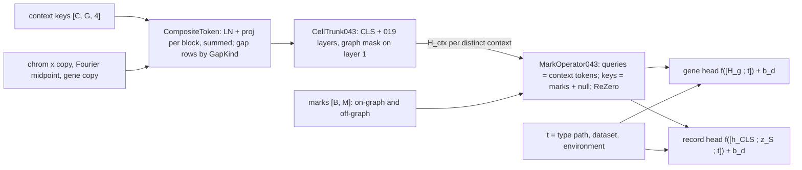

## 2026.10.21 - The 043 cell model

Source: `torchcell/models/cell_model_043.py`; tests `tests/torchcell/models/test_cell_model_043.py` (13). Design: the 043 primer, input and output sections, decisions I1 to I8 and O1 to O4 (`notes-tex/multimodal/043-datasets-primer/tables/t13-decisions-rows.tex`). Inputs come from [[torchcell.data.representation_043]] through the trainer's prepared store ([[experiments.043-expression-proteome-morphology.scripts.train_043]]); heads reuse [[torchcell.models.readout_heads_043]]; the loss is [[torchcell.losses.hl_gauss]].

**Forward.** For each DISTINCT reference context of the batch (S288C, or an isolate under route A) the composite token matrix is built from the frozen tables and encoded once by the trunk; every record of that context reads the same $H_{\mathrm{ctx}} \in \mathbb R^{(G+1) \times d}$. The operator then lets every gene of the record's context attend to the record's marks:

$$
k_m = \mathrm{MLP}\big(\mathrm{tok}_m + E_{\mathrm{change}}[c_m] + E_{\mathrm{parent}}[p_m]\big) + \mathbb 1[\text{on graph}]\, H_{\mathrm{ctx}}[g_m],
\qquad H' = H + \beta_a\,\mathrm{Attn}(H, [k_\varnothing; k]),\quad H'' = H' + \beta_f\,\mathrm{FFN}(H'),
$$

with $k_\varnothing$ a learned null key whose value is zero and $\beta_a = \beta_f = 0$ at initialization (exact identity). $z_S$ is the mean of the mark keys. The gene head reads $[H''_g ; t]$ with $t = [t_{\mathrm{type}} ; t_{\mathrm{dataset}} ; t_{\mathrm{env}}]$ and adds the per-dataset bias $b_d \in \mathbb R^{P}$ ($P = K$ logits under HL-Gauss, 19 quantiles under pinball, 1 under MSE). The dataset id never enters the trunk or the operator (tested: changing it moves only the head output).

**Gaps and position.** A key slot without a vector carries a learned embedding of its `GapKind` for that block, never another sequence's vector. Position: chromosome embedding times the chromosome copy number (relative to basal ploidy), Fourier features of the relative midpoint (8 frequencies), $\log_2(c+1) - 1$ of the gene copy $c$, and a `PositionGap` embedding; an unknown copy drops its term. Off-graph tokens (accessory ORFs, the Vaishnav reporter) use `Replicon` rows 17 and 18 in place of a chromosome and have no midpoint features.

**Route A context caching and memory.** The frozen inputs are cached on the device for the whole run as compact per-encoder tables holding exactly the keys the arm's records use; a context is a `[G, 4]` row index into them. For `joint_9` (prepared store `prep_v1_routeA`): 1,015,748 FUDT upstream, 364,360 FUDT downstream, 637,446 ProtT5 and 972,879 CaLM rows, about 4.9 GB fp16 on the card (computed from the row counts, $\sum_e n_e d_e \times 2$ bytes; the run logs the measured `setup/table_gb`). Trunk outputs are not cached across batches because the trunk trains.

**The smoke-only mark cap.** `select_marks(change_types, cap, seed)`: when a record has more than `cap` marks, keep the `absent`, `deletion` and `loss_of_function` marks in precedence order, then a fixed random subset of the rest drawn with the record's raw index as seed (the same subset every epoch). The design has no cap; the smoke uses 1,024, which binds on the segregants only (Boocock pooled median 3,112 marks, N'Guessan 2,909, in the prepared store).

**Objective.** `ReadoutLoss043` selects HL-Gauss, pinball (19 quantiles, median as point) or MSE, each masked to the measured entries.
