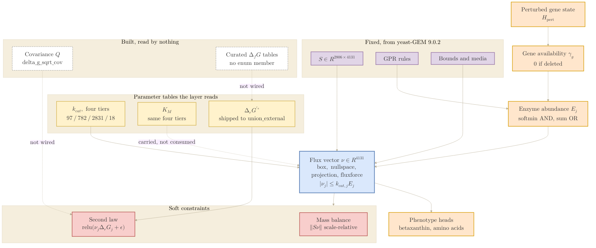

## 2026.09.04 - Simplified view: the main components

A five-box reading of the metabolic flux module, for orientation. The full diagram with the
equations is [[torchcell.models.equivariant_cell_graph_transformer.mermaid.metabolic-module]];
the instrument taxonomy it extends is
[[torchcell.models.equivariant_cell_graph_transformer.mermaid.type-i-ii]].

**Read the edge styles.** A solid edge is implemented and carries data in every run reported
so far. A dashed edge is built but NOT wired: the table exists, is hash-pinned, and is read
by nothing. That distinction is the single most important thing about the current state, and
the detailed diagram draws several of these edges solid when the code does not have them.

*(The 2026.09.04 diagram is superseded by the revision below; its code fence has been removed so only one diagram renders from this note.)*

## 2026.09.11 - Revision: the tables are wired, the covariance is not

The 2026.09.04 drawing below has been replaced. It marked the predicted $k_{cat}$ table, the
$K_M$ table and the recomputed $\Delta_f G$ table as built and read by nothing, and all
three are now read: `build_flux_layer` in `experiments/026-metabolism-flux/scripts/train_flux.py`
resolves $k_{cat}$ and $K_M$ through the four-tier resolver at the verified predictor
version with the homolog tier on by default, and `thermo_source` selects among `shipped`,
`equilibrator`, `union` and `union_external`.

**What is genuinely not wired is the reaction square-root covariance $Q$.** `FluxLayer`
takes `delta_g_sqrt_cov` and builds the correlated error term from it; `build_flux_layer`
never constructs one and `train_bx.py` never passes one, so every arm run so far has a
formation covariance on disk and a reaction potential with no covariance in it. The second
unwired thing is narrower: `ThermoSource` has no member for
`verified/metabolite_dgf_prime_with_curation.parquet`, so the curated records, the withdrawn
mispricings and the composition guard reach no run, and `union_external` still reads the
table those corrections supersede.

**Read the edge styles.** A solid edge is implemented and carries data. A dashed edge is
built and read by nothing.



**Where the complex-versus-isozyme split comes from.** It is not inferred from EC numbers
or from any kinetic table. Each yeast-GEM reaction carries a gene-protein-reaction (GPR)
rule as a boolean string in the SBML, for example `(YKL060C and YLR044C) or YGR254W`. An
`and` is a complex whose subunits are all required, so availability folds by a softmin
(the scarcest subunit limits); an `or` is a set of isozymes that substitute for one
another, so availability folds by a sum (capacities add). `parse_catalytic_units` in
`torchcell/metabolism/constraints.py` reads cobra's `gene_reaction_rule` string for every
reaction, splits on top-level `or` into units and each unit on `and` into subunits, and
stores the result as index arrays (`CatalyticUnits`); `reaction_availability` in
`flux_layer.py` applies the softmin and the sum over those arrays. A reaction with no GPR
keeps availability 1, since an unannotated reaction is one nobody has assigned a gene to,
not one that no gene catalyzes. The softmin temperature is `softmin_beta` in
`FluxLayerConfig`.

### What the five components do

| Component | Role |
|---|---|
| **Learned** | The only part with weights. A gene's embedding becomes an availability in [0,1], folded up the gene-protein-reaction rule to an enzyme abundance. A deletion pins availability to zero; everything else is free, which is what leaves room for dosage and alleles. |
| **Fixed** | Stoichiometry and bounds, straight from yeast-GEM 9.0.2 and never learned. The bounds encode direction and on/off only: 4,129 of 4,131 reactions carry no capacity at all, which is why the enzyme constraint is the load-bearing addition. |
| **Tables** | The physical constants. Solid = consumed today, dashed = built and read by nothing. Everything measured so far ran on the OED's 4.0% kcat plus a default and on the GEM's shipped formation energies. |
| **Flux vector** | The output, and the reason the module is neither Type I nor Type II: a latent physical state rather than a phenotype. Bounds and capacity hold exactly by the sigmoid parameterization and cannot be violated. |
| **Soft constraints** | Mass balance, the second law and dissipation, each a smooth penalty rather than a hard constraint. The second law is the one that matters: because delta_r G is a difference of potentials it sums to zero around any cycle, so requiring v * delta_r G <= 0 forbids internal loops with no integer variable. |

Regenerate the figure asset (name matches this note):

```bash
bash notes/assets/publish/scripts/mermaid_pdf.sh notes/torchcell.models.equivariant_cell_graph_transformer.mermaid.metabolic-module-simple.md
```
