## 2026.09.03 - CGT with the enzyme-constrained thermodynamic flux module

Updates [[torchcell.models.equivariant_cell_graph_transformer.mermaid.type-i-ii]] by adding
the metabolic module as a third instrument class. The flux layer is neither Type I nor
Type II as those were defined: it maps a perturbed representation to a **flux vector**,
which is a latent physical state rather than a measured phenotype, and the phenotypes are
read off that flux. So it sits between them.

Three inputs to the module are parameter tables rather than learned weights, and all three
are now built and hash-pinned: the kcat table from the sequence predictors, the Km table
from the same, and the formation energies recomputed from eQuilibrator with a covariance
factor. (**Stale, corrected 2026.09.12:** the kcat table is four-tiered rather than a
predictor blend, and the covariance factor is read by nothing, so it does not make the
thermodynamic term a measurement.) The
heterologous pathway enters as a typed perturbation on the GEM, which is what puts the
betaxanthin cassette inside the same object as a gene deletion.

Colors follow the same base-primary mapping as the Type I / Type II diagram. The metabolic
module takes the blue slot, which was unused there, so the new content is separable at a
glance from what it extends.

*(Superseded by the 2026.09.12 revision below. The code fence of this
diagram has been removed so only one diagram renders from this note.)*

## 2026.09.12 - Revision: the tables are wired, the covariance is not

The 2026.09.03 diagram above is superseded and its code fence removed, so only the diagram
below renders from this note. Two of its claims went stale.

**The kcat box named five sequence predictors, and the shipped table is not a predictor
table.** `resolve_kcat_table` runs four tiers in order and
`build_flux_layer` in `experiments/026-metabolism-flux/scripts/train_flux.py` calls it with
the homolog mirror on by default at the verified predictor version: **97 measured** (this
organism's own accession, substrate-matched), **782 homolog** (same EC and substrate, any
organism), **2,831 predicted** (the median over EZKinetics, EITLEM and UniKP, the three the
within-class study admits) and **18 organism default**. Those counts are what
`kcat_tier: predicted` resolves; the default `measured` drops the predicted tier.

**The paragraph said all three tables are built and hash-pinned "with the covariance factor
that makes the thermodynamic term a measurement rather than a regularizer". That is not
true.** `FluxLayer` accepts the reaction square-root covariance as `delta_g_sqrt_cov` and
builds the correlated error term from it, `build_flux_layer` constructs none and
`train_bx.py` passes none, so every arm run so far has a formation covariance on disk and a
reaction potential with no covariance in it. The thermodynamic term is a regularizer today.

**What is wired.** kcat on the four tiers above; $\Delta_r G'^{\circ}$ through
`ThermoSource`, whose members are now `shipped`, `equilibrator`, `union`, `union_external`
and **`verified`**. `verified` resolves the curated tables under
`thermo_equilibrator/verified/` through their manifest's sha256, reads the reaction values
out of the verified reaction table rather than re-summing them, since cancellation, the
conserved moiety and the shipped reaction column are reaction-level facts a stoichiometric
sum cannot reproduce, and raises rather than falling back when the manifest or a hash is
missing. It is the only route in which the accession composition guard has run, so the
glycogen and dolichol mispricings are absent from it and present in every other route.

**What is carried but not consumed.** $K_M$ is resolved on the same four tiers and handed to
the layer as `km_mm`; no term reads it. The saturation factor it would enter through is
argued against in the 026 document's limits section.

**What is built and read by nothing.** The reaction covariance $Q$, and that is now the only
entry on this list: the curated tables have an enum member as of `ThermoSource.VERIFIED`.

```mermaid
%%{init: {'theme':'base','themeVariables':{'background':'#F5EEDD','clusterBkg':'#F5EEDD','clusterBorder':'#E0D6BE','lineColor':'#B7AC93'}}}%%
graph TD
  subgraph InputLayer["$$\text{Input Layer}$$"]
    direction TB
    CellGraph["$$\begin{gathered}\text{Cell Graph}\\\ |G| = 6607\ \text{genes}\\\ \text{9 graph types}\end{gathered}$$"]
    PerturbationData["$$\begin{gathered}\text{Perturbation Data}\\\ S \subseteq G,\ \tau \in \{\mathrm{del}, \mathrm{OE}, \mathrm{KD}, \mathrm{cassette}\}\end{gathered}$$"]
  end

  subgraph TransformerBlock["$$\text{Graph-Regularized Transformer}$$"]
    direction TB
    GeneEmbed["$$\begin{gathered}\text{Gene Embeddings}\\\ H^{(0)} \in \mathbb{R}^{(N+1)\times d}\end{gathered}$$"]
    TLayers["$$\begin{gathered}L\ \text{Transformer Layers}\\\ H^{(L)} = T^{(L)}(H^{(L-1)})\end{gathered}$$"]
    GraphReg["$$\begin{gathered}\text{Graph Regularization}\\\ \mathrm{KL}(A_g \,\|\, \alpha^{(\ell,k)})\end{gathered}$$"]
  end

  subgraph TypeI["$$\begin{gathered}\text{Type I Virtual Instruments}\\\ (\text{Representation} \to \text{Representation})\end{gathered}$$"]
    direction TB
    PertOps["$$\begin{gathered}T_\psi^{\mathrm{del}},\ T_\psi^{\mathrm{OE}},\ T_\psi^{\mathrm{KD}}\\\ \text{Perturbation Operators}\end{gathered}$$"]
    PerturbedState["$$\begin{gathered}H_{\mathrm{pert}} \in \mathbb{R}^{B \times N \times d}\\\ \text{EQUIVARIANT}\end{gathered}$$"]
  end

  subgraph MetabolicModule["$$\begin{gathered}\text{Metabolic Flux Module}\\\ (\text{Representation} \to \text{Flux})\end{gathered}$$"]
    direction TB

    subgraph Params["$$\text{Hash-Pinned Parameter Tables the Layer Reads}$$"]
      direction TB
      KcatTable["$$\begin{gathered}k_{cat},\ \text{four tiers}\\\ 97\ \text{measured},\ 782\ \text{homolog},\\\ 2831\ \text{predicted},\ 18\ \text{default}\end{gathered}$$"]
      KmTable["$$\begin{gathered}K_M,\ \text{same four tiers}\\\ \text{passed as}\ \texttt{km\_mm}\end{gathered}$$"]
      ThermoTable["$$\begin{gathered}\Delta_r G'^{\circ},\ \texttt{thermo\_source}\\\ \texttt{shipped},\ \texttt{equilibrator},\ \texttt{union},\\\ \texttt{union\_external},\ \texttt{verified}\end{gathered}$$"]
    end

    Qcov["$$\begin{gathered}\text{Reaction covariance}\ Q\\\ \texttt{delta\_g\_sqrt\_cov}\\\ \text{built, read by nothing}\end{gathered}$$"]

    subgraph GEMSide["$$\text{Genome-Scale Model}$$"]
      direction TB
      Stoich["$$\begin{gathered}S \in \mathbb{R}^{2806 \times 4131}\\\ \text{yeast-GEM 9.0.2}\end{gathered}$$"]
      Media["$$\begin{gathered}\text{Media Bounds}\\\ lb_j,\ ub_j\ \text{on exchange}\end{gathered}$$"]
      Pathway["$$\begin{gathered}\text{Heterologous Cassette}\\\ \text{betaxanthin, as a}\\\ \text{typed perturbation}\end{gathered}$$"]
    end

    GeneAvail["$$\begin{gathered}\text{Gene Availability}\\\ a_g = 0\ \text{if deleted, else}\ \sigma(w^\top h_g)\\\ \text{unit} = \mathrm{softmin}_g\ a_g\end{gathered}$$"]
    Enzyme["$$\begin{gathered}\text{Enzyme Abundance}\ E_j\\\ \sum_g MW_g E_g \le P_{\mathrm{avail}}\end{gathered}$$"]
    Box["$$\begin{gathered}\text{Box Parameterization}\\\ \nu_j = lb_j + (ub_j - lb_j)\,\sigma(z_j)\\\ ub_j \le k_{cat,j} E_j\end{gathered}$$"]
    Potential["$$\begin{gathered}\text{Reaction Potential}\\\ \Delta_r G_j = \Delta_r G'^{\circ}_j + RT \sum_i S_{ij} \ln c_i\end{gathered}$$"]

    subgraph Penalties["$$\text{Soft Constraints}$$"]
      direction TB
      MassBal["$$\begin{gathered}\text{Mass Balance}\\\ \|S\nu\|\ \text{scale-relative}\end{gathered}$$"]
      SecondLaw["$$\begin{gathered}\text{Second Law}\\\ \mathrm{relu}(\nu_j \Delta_r G_j + \epsilon)\\\ \text{no binary variable}\end{gathered}$$"]
    end

    FluxVector["$$\begin{gathered}\nu \in \mathbb{R}^{4131}\\\ \text{feasible flux}\end{gathered}$$"]
    Dissipation["$$\begin{gathered}\text{Gibbs Dissipation, readout only}\\\ g_{\mathrm{diss}} = \sum_{j \in \mathrm{exch}} \Delta_r G_j \nu_j\\\ \text{validated against}\ g_{\mathrm{lim}}\text{, never penalized}\end{gathered}$$"]
  end

  subgraph TypeII["$$\begin{gathered}\text{Type II Virtual Instruments}\\\ (\text{Representation} \to \text{Output})\end{gathered}$$"]
    direction TB
    subgraph TypeIIRowA["$$\text{Invariant}$$"]
      FitnessInst["$$R_\phi^{\mathrm{fit}}\text{: Fitness}$$"]
      GeneIntInst["$$R_\phi^{\mathrm{GI}}\text{: Gene Interaction}$$"]
    end
    subgraph TypeIIRowB["$$\text{Equivariant}$$"]
      ExprInst["$$R_\phi^{\mathrm{expr}}\text{: Expression}$$"]
      MorphInst["$$R_\phi^{\mathrm{morph}}\text{: Morphology}$$"]
    end
    TypeIIRowA ~~~ TypeIIRowB
  end

  subgraph Outputs["$$\text{Multi-Task Outputs}$$"]
    direction TB
    OutBetax["$$\begin{gathered}y_{\mathrm{betaxanthin}}\\\ \text{4735 measurements}\end{gathered}$$"]
    OutAA["$$\begin{gathered}y_{\mathrm{amino\ acid}} \in \mathbb{R}^{19}\\\ \text{4678 profiles}\end{gathered}$$"]
    OutGrowth["$$y_{\mathrm{fitness}} \in \mathbb{R}$$"]
    OutOther["$$y_{\mathrm{GI}},\ y_{\mathrm{expr}},\ y_{\mathrm{morph}}$$"]
  end

  CellGraph --> GeneEmbed
  PerturbationData --> PertOps
  GeneEmbed --> TLayers
  CellGraph --> GraphReg
  GraphReg -.->|"$$\text{regularize}$$"| TLayers
  TLayers --> PertOps
  PertOps --> PerturbedState

  PerturbedState --> GeneAvail
  PerturbedState --> FitnessInst
  PerturbedState --> GeneIntInst
  PerturbedState --> ExprInst
  PerturbedState --> MorphInst

  GeneAvail --> Enzyme
  KcatTable --> Box
  KmTable -.->|"$$\text{carried, not consumed}$$"| Box
  Enzyme --> Box
  Media --> Box
  Pathway --> Stoich
  Stoich --> Box
  ThermoTable --> Potential
  Qcov -.->|"$$\text{not wired}$$"| Potential
  Stoich --> Potential
  Box --> FluxVector
  Potential --> SecondLaw
  FluxVector --> MassBal
  FluxVector --> SecondLaw
  FluxVector -.->|"$$\text{validation}$$"| Dissipation
  Stoich --> MassBal

  FluxVector --> OutBetax
  FluxVector --> OutAA
  FluxVector --> OutGrowth
  FitnessInst --> OutGrowth
  GeneIntInst --> OutOther
  ExprInst --> OutOther
  MorphInst --> OutOther

  classDef input fill:#E1D5E7,stroke:#846592,stroke-width:2px
  classDef embedding fill:#FFE6CC,stroke:#BD8800,stroke-width:2px
  classDef transformer fill:#F8CECC,stroke:#A24A46,stroke-width:2px
  classDef graphreg fill:#FFF2CC,stroke:#BCA04C,stroke-width:2px
  classDef typeI fill:#FFE6CC,stroke:#BD8800,stroke-width:2px
  classDef metabolic fill:#DAE8FC,stroke:#6C8EBF,stroke-width:2px
  classDef params fill:#E1D5E7,stroke:#846592,stroke-width:2px
  classDef invariant fill:#FFF2CC,stroke:#BCA04C,stroke-width:2px
  classDef output fill:#F8CECC,stroke:#A24A46,stroke-width:2px

  class CellGraph,PerturbationData input
  class GeneEmbed embedding
  class TLayers transformer
  class GraphReg graphreg
  class PertOps,PerturbedState typeI
  class KcatTable,KmTable,ThermoTable params
  class Stoich,Media,Pathway,GeneAvail,Enzyme,Box,Potential,FluxVector metabolic
  class MassBal,SecondLaw graphreg
  classDef readout fill:#FFFFFF,stroke:#999999,stroke-width:1px,stroke-dasharray:4 3
  class Dissipation readout
  class Qcov readout
  class TypeIIRowA,FitnessInst,GeneIntInst invariant
  class TypeIIRowB,ExprInst,MorphInst equivariantRO
  classDef equivariantRO fill:#E1D5E7,stroke:#846592,stroke-width:2px
  class OutBetax,OutAA,OutGrowth,OutOther output
```



**This diagram is a note asset, not a notes-tex figure, and the printed label size is why.**
Measured on the render above: the mmdc page is 600 x 330 pt with 8 embedded fonts, and its
labels are 3.34 pt at true size, **2.87 pt** placed at the 182 mm text block. That is under
the 5 pt floor, so the 026 document and the module report both include the FIVE-box
simplified diagram instead, from
[[torchcell.models.equivariant_cell_graph_transformer.mermaid.metabolic-module-simple]],
whose labels measure 5.7 pt at the same width. `notes-tex/*/figures/cgt_metabolic_module.pdf`
is that simplified render; nothing in either document reads this file. Splitting this
diagram rather than scaling it is the only way it could be included, since scaling cannot
buy the factor of two.

Regenerate the figure asset (name matches this note):

```bash
bash notes/assets/publish/scripts/mermaid_pdf.sh notes/torchcell.models.equivariant_cell_graph_transformer.mermaid.metabolic-module.md
# -> notes/assets/pdf-output/torchcell.models.equivariant_cell_graph_transformer.mermaid.metabolic-module.pdf
```
